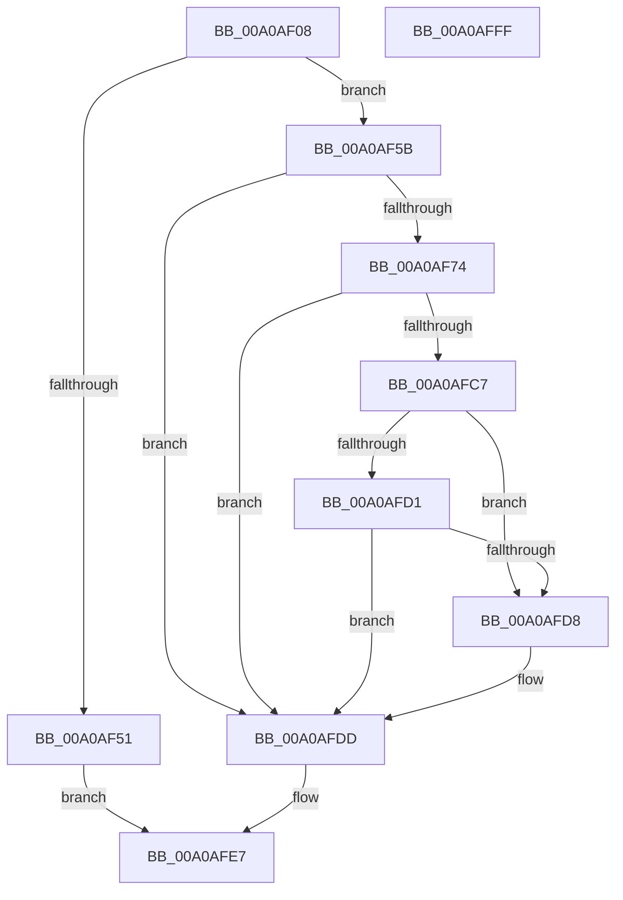

# CmGetParentDeviceContainerId

- RVA: `0x00A0AF08`–`0x00A0B000` (길이 `248` bytes)
- VA: `0x0000000140A0AF08`
- 실행 섹션: `PAGE`
- PDB 이름 있음: `예`; PDB Function 태그: `아니요`
- unwind 정보 RVA: `0x000A8970`
- 디코드: `64`개 명령, `248/248` bytes 표시
- 미해석 바이트: `0` (있으면 어셈블리에 `.byte`로 보존)

> 이 문서는 커널 이미지의 기계어와 PDB 기호를 분석해 생성했습니다. 4번과 5번은 함수 원형과 자료형을 바이너리 사용 방식에서 추정한 C 해석이며 원본 소스 복구 결과는 아닙니다.

## 1. Dependencies

- 직접 호출 지점: **4**; 고유 호출 대상: **4**
- 직접 호출자로 확인된 함수: **2**
- RIP 상대 이미지 참조: **1**

### Outgoing calls
- `0x00A0AF44` → [ExAllocatePool2](../../poolcode/B8/ExAllocatePool2_function_00B820F0.md) (function, `0x00B820F0`)
- `0x00A0AF69` → [CmGetDeviceParent](../93/CmGetDeviceParent_function_00932368.md) (function, `0x00932368`)
- `0x00A0AFBC` → [PnpGetObjectProperty](../8E/PnpGetObjectProperty_function_008E2180.md) (function, `0x008E2180`)
- `0x00A0AFE2` → [ExFreePoolWithTag](../../poolcode/B8/ExFreePoolWithTag_function_00B82870.md) (function, `0x00B82870`)

### Direct callers
- [_CmUpdateDevicePanel](_CmUpdateDevicePanel_function_00A0A16C.md) at `0x00A0A4C8`
- [_CmUpdateDevicePanel](_CmUpdateDevicePanel_function_00A0A16C.md) at `0x00A0A7B6`
- [sub_00B34C12](../B3/Unknown_function_00B34C12.md) at `0x00B34C30`

### Static image references
- `0x00A0AFA6` → RVA `0x00011568` (`.rdata`; read)

## 2. Other-region calls and transfers

- 다른 실행 섹션으로 향하는 call: **2**
  - `0x00A0AF44` → [ExAllocatePool2](../../poolcode/B8/ExAllocatePool2_function_00B820F0.md) (`PAGE` → `POOLCODE`)
  - `0x00A0AFE2` → [ExFreePoolWithTag](../../poolcode/B8/ExFreePoolWithTag_function_00B82870.md) (`PAGE` → `POOLCODE`)
- 별도 외부 분기/꼬리 이동을 확인하지 못했습니다.

## 3. Assembly (complete function range)

```asm
00A0AF08  48 8B C4                        mov rax, rsp
00A0AF0B  48 89 58 08                     mov qword ptr [rax + 8], rbx
00A0AF0F  48 89 68 10                     mov qword ptr [rax + 0x10], rbp
00A0AF13  48 89 70 18                     mov qword ptr [rax + 0x18], rsi
00A0AF17  57                              push rdi
00A0AF18  48 83 EC 70                     sub rsp, 0x70
00A0AF1C  83 60 20 00                     and dword ptr [rax + 0x20], 0
00A0AF20  49 8B E8                        mov rbp, r8
00A0AF23  83 60 E8 00                     and dword ptr [rax - 0x18], 0
00A0AF27  48 8B DA                        mov rbx, rdx
00A0AF2A  48 8B F1                        mov rsi, rcx
00A0AF2D  C7 40 EC C8 00 00 00            mov dword ptr [rax - 0x14], 0xc8
00A0AF34  BA 90 01 00 00                  mov edx, 0x190
00A0AF39  B9 00 01 00 00                  mov ecx, 0x100
00A0AF3E  41 B8 50 4E 50 52               mov r8d, 0x52504e50
00A0AF44  E8 A7 71 17 00                  call 0x140b820f0
00A0AF49  48 8B F8                        mov rdi, rax
00A0AF4C  48 85 C0                        test rax, rax
00A0AF4F  75 0A                           jne 0x140a0af5b
00A0AF51  BB 17 00 00 C0                  mov ebx, 0xc0000017
00A0AF56  E9 8C 00 00 00                  jmp 0x140a0afe7
00A0AF5B  4C 8D 4C 24 64                  lea r9, [rsp + 0x64]
00A0AF60  4C 8B C7                        mov r8, rdi
00A0AF63  48 8B D3                        mov rdx, rbx
00A0AF66  48 8B CE                        mov rcx, rsi
00A0AF69  E8 FA 73 F2 FF                  call 0x140932368
00A0AF6E  8B D8                           mov ebx, eax
00A0AF70  85 C0                           test eax, eax
00A0AF72  78 69                           js 0x140a0afdd
00A0AF74  83 64 24 50 00                  and dword ptr [rsp + 0x50], 0
00A0AF79  48 8D 44 24 60                  lea rax, [rsp + 0x60]
00A0AF7E  48 89 44 24 48                  mov qword ptr [rsp + 0x48], rax
00A0AF83  45 33 C9                        xor r9d, r9d
00A0AF86  C7 44 24 40 10 00 00 00         mov dword ptr [rsp + 0x40], 0x10
00A0AF8E  48 8D 84 24 98 00 00 00         lea rax, [rsp + 0x98]
00A0AF96  48 89 6C 24 38                  mov qword ptr [rsp + 0x38], rbp
00A0AF9B  48 8B D7                        mov rdx, rdi
00A0AF9E  48 89 44 24 30                  mov qword ptr [rsp + 0x30], rax
00A0AFA3  48 8B CE                        mov rcx, rsi
00A0AFA6  48 8D 05 BB 65 60 FF            lea rax, [rip - 0x9f9a45]
00A0AFAD  48 89 44 24 28                  mov qword ptr [rsp + 0x28], rax
00A0AFB2  45 8D 41 01                     lea r8d, [r9 + 1]
00A0AFB6  48 83 64 24 20 00               and qword ptr [rsp + 0x20], 0
00A0AFBC  E8 BF 71 ED FF                  call 0x1408e2180
00A0AFC1  8B D8                           mov ebx, eax
00A0AFC3  85 C0                           test eax, eax
00A0AFC5  78 16                           js 0x140a0afdd
00A0AFC7  83 BC 24 98 00 00 00 0D         cmp dword ptr [rsp + 0x98], 0xd
00A0AFCF  75 07                           jne 0x140a0afd8
00A0AFD1  83 7C 24 60 10                  cmp dword ptr [rsp + 0x60], 0x10
00A0AFD6  74 05                           je 0x140a0afdd
00A0AFD8  BB 01 00 00 C0                  mov ebx, 0xc0000001
00A0AFDD  33 D2                           xor edx, edx
00A0AFDF  48 8B CF                        mov rcx, rdi
00A0AFE2  E8 89 78 17 00                  call 0x140b82870
00A0AFE7  4C 8D 5C 24 70                  lea r11, [rsp + 0x70]
00A0AFEC  8B C3                           mov eax, ebx
00A0AFEE  49 8B 5B 10                     mov rbx, qword ptr [r11 + 0x10]
00A0AFF2  49 8B 6B 18                     mov rbp, qword ptr [r11 + 0x18]
00A0AFF6  49 8B 73 20                     mov rsi, qword ptr [r11 + 0x20]
00A0AFFA  49 8B E3                        mov rsp, r11
00A0AFFD  5F                              pop rdi
00A0AFFE  C3                              ret
00A0AFFF  CC                              int3
```

## 4. C-style interpretation (structured pseudocode)

```c
__int64 __fastcall CmGetParentDeviceContainerId(__int64 a1, __int64 a2, __int64 a3)
{
    __int64 result;
    __int64 v_rbx;
    __int64 v_rsp;
    unsigned __int64 v_stack_m14;
    unsigned __int64 v_stack_m18;
    unsigned int v_stack_m28;
    unsigned __int64 v_stack_m30;
    unsigned int v_stack_m38;
    unsigned __int64 v_stack_m40;
    unsigned __int64 v_stack_m48;
    unsigned __int64 v_stack_m50;
    unsigned __int64 v_stack_m58;
    unsigned __int64 v_stack_m8;
    unsigned __int64 v_stack_p20;

    *(unsigned __int64 *)(v_rsp + 8) = v_rbx;
    *(unsigned __int64 *)(v_rsp + 16) = v_rbp;
    *(unsigned __int64 *)(v_rsp + 24) = v_rsi;
    v_rsp = (v_rsp) - (112);
    *(unsigned int *)(v_rsp - 20) = 200;
    result = ExAllocatePool2(256, 400, (unsigned int)(0x52504E50ULL), a4);
    if (result != 0) goto loc_00A0AF5B;
    goto loc_00A0AFE7;
loc_00A0AF5B:
    result = CmGetDeviceParent(a1, (unsigned int)(0xC0000017ULL), result, v_stack_m14);
    if (sign_flag) goto loc_00A0AFDD;
    v_stack_m30 = v_stack_m18;
    a4 = 0;
    v_stack_m38 = 16;
    v_stack_m40 = a3;
    v_stack_m48 = v_stack_p20;
    v_stack_m50 = v_rip - 10459717;
    result = PnpGetObjectProperty(a1, result, a4 + 1, a4);
    if (sign_flag) goto loc_00A0AFDD;
    if (v_stack_p20 != 13) goto loc_00A0AFD8;
    v_rbx = (unsigned int)((unsigned int)(result));
    if (v_stack_m18 != 16) {
        v_rbx = 0xC0000001ULL;
    }
    a2 = 0;
    result = ExFreePoolWithTag(result, a2, a4 + 1, a4);
loc_00A0AFE7:
    return (unsigned int)((unsigned int)(v_rbx));
}
```

## 5. (Beta) C Style

```c
int64_t CmGetParentDeviceContainerId(int64_t Arg1, int64_t Arg2, int64_t Arg3)
{
    int64_t result;
    int64_t local_rbx;
    int64_t local_rsp;
    uint64_t v_stack_m14;
    uint64_t v_stack_m18;
    uint32_t v_stack_m28;
    uint64_t v_stack_m30;
    uint32_t v_stack_m38;
    uint64_t v_stack_m40;
    uint64_t v_stack_m48;
    uint64_t v_stack_m50;
    uint64_t v_stack_m58;
    uint64_t v_stack_m8;
    uint64_t v_stack_p20;

    *(uint64_t *)(local_rsp + 0x8) = local_rbx;
    *(uint64_t *)(local_rsp + 0x10) = local_rbp;
    *(uint64_t *)(local_rsp + 0x18) = local_rsi;
    local_rsp = (local_rsp) - (112);
    *(uint32_t *)(local_rsp - 0x14) = 200;
    result = ExAllocatePool2(256, 400, (uint32_t)(0x52504E50ULL), a4);
    if (result != 0) goto loc_00A0AF5B;
    goto loc_00A0AFE7;
loc_00A0AF5B:
    result = CmGetDeviceParent(Arg1, (uint32_t)(0xC0000017ULL), result, v_stack_m14);
    if (sign_flag) goto loc_00A0AFDD;
    v_stack_m30 = v_stack_m18;
    a4 = 0;
    v_stack_m38 = 16;
    v_stack_m40 = Arg3;
    v_stack_m48 = v_stack_p20;
    v_stack_m50 = v_rip - 10459717;
    result = PnpGetObjectProperty(Arg1, result, a4 + 1, a4);
    if (sign_flag) goto loc_00A0AFDD;
    if (v_stack_p20 != 13) goto loc_00A0AFD8;
    local_rbx = (uint32_t)((uint32_t)(result));
    if (v_stack_m18 != 16) {
        local_rbx = 0xC0000001ULL;
    }
    Arg2 = 0;
    result = ExFreePoolWithTag(result, Arg2, a4 + 1, a4);
loc_00A0AFE7:
    return (uint32_t)((uint32_t)(local_rbx));
}
```

## 6. Execution-region graph

[열기: 2D/3D 그래프와 함수 탐색 컨트롤 패널](../../../control-panel.html?section=page&rva=0x00A0AF08&view=graph)

- 2D 그래프는 위에서 아래로 흐르고, 3D 그래프는 빈 공간을 드래그해 회전합니다. Shift+드래그는 이동, 휠은 확대·축소, 함수 노드 선택은 대상 보고서 이동입니다.

### Static fallback


