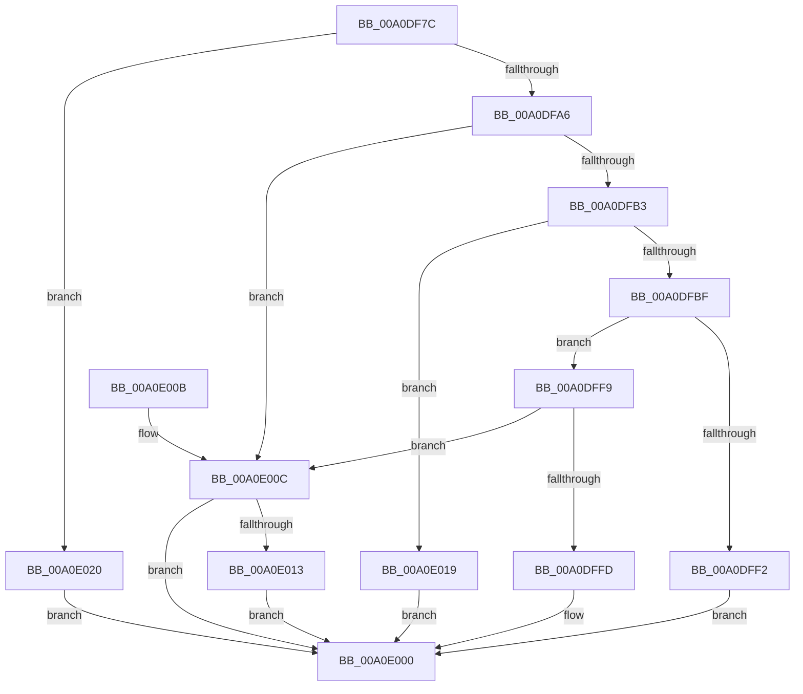

# CmIsDevicePresent

- RVA: `0x00A0DF7C`–`0x00A0E027` (길이 `171` bytes)
- VA: `0x0000000140A0DF7C`
- 실행 섹션: `PAGE`
- PDB 이름 있음: `예`; PDB Function 태그: `아니요`
- unwind 정보 RVA: `0x000A8D00`
- 디코드: `49`개 명령, `171/171` bytes 표시
- 미해석 바이트: `0` (있으면 어셈블리에 `.byte`로 보존)

> 이 문서는 커널 이미지의 기계어와 PDB 기호를 분석해 생성했습니다. 4번과 5번은 함수 원형과 자료형을 바이너리 사용 방식에서 추정한 C 해석이며 원본 소스 복구 결과는 아닙니다.

## 1. Dependencies

- 직접 호출 지점: **2**; 고유 호출 대상: **2**
- 직접 호출자로 확인된 함수: **2**
- RIP 상대 이미지 참조: **0**

### Outgoing calls
- `0x00A0DFAA` → [RtlInitUnicodeStringEx](../../text/46/RtlInitUnicodeStringEx_function_00463960.md) (function, `0x00463960`)
- `0x00A0DFE6` → [guard_dispatch_icall](../../text/6B/guard_dispatch_icall_function_006BAAD0.md) (function, `0x006BAAD0`)

### Direct callers
- [CmEnumSubkeyCallback](../82/CmEnumSubkeyCallback_function_0082CE50.md) at `0x0082D06B`
- [PiPnpRtlServiceFilterCallback](PiPnpRtlServiceFilterCallback_function_00A0DB80.md) at `0x00A0DDC8`

### Static image references
- 디코드된 RIP-relative 메모리 참조가 없습니다.

## 2. Other-region calls and transfers

- 다른 실행 섹션으로 향하는 call: **2**
  - `0x00A0DFAA` → [RtlInitUnicodeStringEx](../../text/46/RtlInitUnicodeStringEx_function_00463960.md) (`PAGE` → `.text`)
  - `0x00A0DFE6` → [guard_dispatch_icall](../../text/6B/guard_dispatch_icall_function_006BAAD0.md) (`PAGE` → `.text`)
- 별도 외부 분기/꼬리 이동을 확인하지 못했습니다.

## 3. Assembly (complete function range)

```asm
00A0DF7C  48 8B C4                        mov rax, rsp
00A0DF7F  48 89 58 08                     mov qword ptr [rax + 8], rbx
00A0DF83  57                              push rdi
00A0DF84  48 83 EC 60                     sub rsp, 0x60
00A0DF88  83 60 18 00                     and dword ptr [rax + 0x18], 0
00A0DF8C  0F 57 C0                        xorps xmm0, xmm0
00A0DF8F  83 60 D8 00                     and dword ptr [rax - 0x28], 0
00A0DF93  49 8B D8                        mov rbx, r8
00A0DF96  83 60 20 00                     and dword ptr [rax + 0x20], 0
00A0DF9A  48 8B F9                        mov rdi, rcx
00A0DF9D  0F 11 40 E0                     movups xmmword ptr [rax - 0x20], xmm0
00A0DFA1  4D 85 C0                        test r8, r8
00A0DFA4  74 7A                           je 0x140a0e020
00A0DFA6  48 8D 48 E0                     lea rcx, [rax - 0x20]
00A0DFAA  E8 B1 59 A5 FF                  call 0x140463960
00A0DFAF  85 C0                           test eax, eax
00A0DFB1  78 59                           js 0x140a0e00c
00A0DFB3  48 8B 87 08 01 00 00            mov rax, qword ptr [rdi + 0x108]
00A0DFBA  48 85 C0                        test rax, rax
00A0DFBD  74 5A                           je 0x140a0e019
00A0DFBF  83 64 24 28 00                  and dword ptr [rsp + 0x28], 0
00A0DFC4  48 8D 8C 24 80 00 00 00         lea rcx, [rsp + 0x80]
00A0DFCC  48 89 4C 24 20                  mov qword ptr [rsp + 0x20], rcx
00A0DFD1  4C 8D 8C 24 88 00 00 00         lea r9, [rsp + 0x88]
00A0DFD9  48 8B CF                        mov rcx, rdi
00A0DFDC  4C 8D 44 24 40                  lea r8, [rsp + 0x40]
00A0DFE1  48 8D 54 24 48                  lea rdx, [rsp + 0x48]
00A0DFE6  E8 E5 CA CA FF                  call 0x1406baad0
00A0DFEB  3D 05 00 00 80                  cmp eax, 0x80000005
00A0DFF0  75 07                           jne 0x140a0dff9
00A0DFF2  B8 23 00 00 C0                  mov eax, 0xc0000023
00A0DFF7  EB 07                           jmp 0x140a0e000
00A0DFF9  85 C0                           test eax, eax
00A0DFFB  78 0F                           js 0x140a0e00c
00A0DFFD  C6 03 01                        mov byte ptr [rbx], 1
00A0E000  48 8B 5C 24 70                  mov rbx, qword ptr [rsp + 0x70]
00A0E005  48 83 C4 60                     add rsp, 0x60
00A0E009  5F                              pop rdi
00A0E00A  C3                              ret
00A0E00B  CC                              int3
00A0E00C  3D 0E 00 00 C0                  cmp eax, 0xc000000e
00A0E011  75 ED                           jne 0x140a0e000
00A0E013  33 C0                           xor eax, eax
00A0E015  88 03                           mov byte ptr [rbx], al
00A0E017  EB E7                           jmp 0x140a0e000
00A0E019  B8 02 00 00 C0                  mov eax, 0xc0000002
00A0E01E  EB E0                           jmp 0x140a0e000
00A0E020  B8 0D 00 00 C0                  mov eax, 0xc000000d
00A0E025  EB D9                           jmp 0x140a0e000
```

## 4. C-style interpretation (structured pseudocode)

```c
__int64 __fastcall CmIsDevicePresent(__int64 a1, __int64 a2, __int64 a3)
{
    __int64 result;
    __int64 v_rsp;
    unsigned __int64 v_stack_m20;
    unsigned __int64 v_stack_m28;
    unsigned int v_stack_m40;
    unsigned __int64 v_stack_m48;
    unsigned __int64 v_stack_p18;
    unsigned __int64 v_stack_p20;
    unsigned __int64 v_stack_p8;

    *(unsigned __int64 *)(v_rsp + 8) = v_rbx;
    v_rsp = (v_rsp) - (96);
    *(unsigned __int64 *)(v_rsp - 32) = v_xmm0;
    if (a3 == 0) goto loc_00A0E020;
    result = RtlInitUnicodeStringEx(v_rsp - 32, a2, a3, a4);
    if (sign_flag) goto loc_00A0E00C;
    if (*(unsigned __int64 *)(a1 + 264) == 0) goto loc_00A0E019;
    v_stack_m48 = v_stack_p18;
    result = guard_dispatch_icall(a1, v_stack_m20, v_stack_m28, v_stack_p20);
    if (((unsigned int)(result)) != 0x80000005ULL) goto loc_00A0DFF9;
    goto loc_00A0E000;
loc_00A0DFF9:
    if (sign_flag) goto loc_00A0E00C;
    *(unsigned __int8 *)(a3) = 1;
loc_00A0E000:
    v_rsp = (v_rsp) + (96);
    return (unsigned int)(0xC0000023ULL);
loc_00A0E00C:
    if (((unsigned int)((unsigned int)(0xC0000023ULL))) != 0xC000000EULL) goto loc_00A0E000;
    result = 0;
    *(unsigned __int8 *)(v_stack_p8) = 0;
    goto loc_00A0E000;
loc_00A0E019:
    goto loc_00A0E000;
loc_00A0E020:
    goto loc_00A0E000;
}
```

## 5. (Beta) C Style

```c
int64_t CmIsDevicePresent(void *Arg1, int64_t Arg2, void *Arg3)
{
    uint8_t *arg1 = (uint8_t *)Arg1;
    uint8_t *arg3 = (uint8_t *)Arg3;

    int64_t result;
    int64_t local_rsp;
    uint64_t v_stack_m20;
    uint64_t v_stack_m28;
    uint32_t v_stack_m40;
    uint64_t v_stack_m48;
    uint64_t v_stack_p18;
    uint64_t v_stack_p20;
    uint64_t v_stack_p8;

    *(uint64_t *)(local_rsp + 0x8) = local_rbx;
    local_rsp = (local_rsp) - (96);
    *(uint64_t *)(local_rsp - 0x20) = v_xmm0;
    if (Arg3 == NULL) goto loc_00A0E020;
    result = RtlInitUnicodeStringEx(local_rsp - 32, Arg2, Arg3, a4);
    if (sign_flag) goto loc_00A0E00C;
    if (*(uint64_t *)(arg1 + 0x108) == 0) goto loc_00A0E019;
    v_stack_m48 = v_stack_p18;
    result = guard_dispatch_icall(Arg1, v_stack_m20, v_stack_m28, v_stack_p20);
    if (((uint32_t)(result)) != 0x80000005ULL) goto loc_00A0DFF9;
    goto loc_00A0E000;
loc_00A0DFF9:
    if (sign_flag) goto loc_00A0E00C;
    *(uint8_t *)(arg3) = 1;
loc_00A0E000:
    local_rsp = (local_rsp) + (96);
    return (uint32_t)(0xC0000023ULL);
loc_00A0E00C:
    if (((uint32_t)((uint32_t)(0xC0000023ULL))) != 0xC000000EULL) goto loc_00A0E000;
    result = 0;
    *(uint8_t *)(v_stack_p8) = 0;
    goto loc_00A0E000;
loc_00A0E019:
    goto loc_00A0E000;
loc_00A0E020:
    goto loc_00A0E000;
}
```

### 관측된 메모리 오프셋

구조체 형식이 확인되지 않은 접근은 인자 기준의 오프셋으로만 기록했습니다.

| 기준 인자 | 오프셋 표현 | 폭 (bit) | 접근 |
|---|---:|---:|---|
| `Arg1` | `+ 0x108` | `64` | `R` |
| `Arg3` | `+ 0x0` | `8` | `W` |

## 6. Execution-region graph

[열기: 2D/3D 그래프와 함수 탐색 컨트롤 패널](../../../control-panel.html?section=page&rva=0x00A0DF7C&view=graph)

- 2D 그래프는 위에서 아래로 흐르고, 3D 그래프는 빈 공간을 드래그해 회전합니다. Shift+드래그는 이동, 휠은 확대·축소, 함수 노드 선택은 대상 보고서 이동입니다.

### Static fallback


