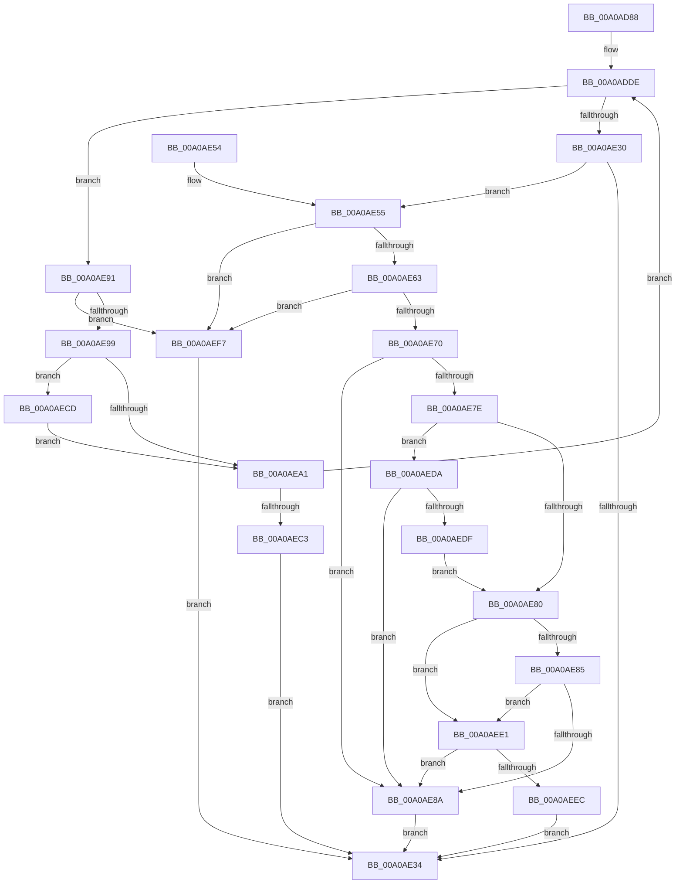

# CmQueryDevicePanelPldProperty

- RVA: `0x00A0AD88`–`0x00A0AF01` (길이 `377` bytes)
- VA: `0x0000000140A0AD88`
- 실행 섹션: `PAGE`
- PDB 이름 있음: `예`; PDB Function 태그: `아니요`
- unwind 정보 RVA: `0x000A8950`
- 디코드: `108`개 명령, `377/377` bytes 표시
- 미해석 바이트: `0` (있으면 어셈블리에 `.byte`로 보존)

> 이 문서는 커널 이미지의 기계어와 PDB 기호를 분석해 생성했습니다. 4번과 5번은 함수 원형과 자료형을 바이너리 사용 방식에서 추정한 C 해석이며 원본 소스 복구 결과는 아닙니다.

## 1. Dependencies

- 직접 호출 지점: **3**; 고유 호출 대상: **3**
- 직접 호출자로 확인된 함수: **2**
- RIP 상대 이미지 참조: **0**

### Outgoing calls
- `0x00A0AE22` → [PnpGetObjectProperty](../8E/PnpGetObjectProperty_function_008E2180.md) (function, `0x008E2180`)
- `0x00A0AEB0` → [ExAllocatePool2](../../poolcode/B8/ExAllocatePool2_function_00B820F0.md) (function, `0x00B820F0`)
- `0x00A0AECF` → [ExFreePoolWithTag](../../poolcode/B8/ExFreePoolWithTag_function_00B82870.md) (function, `0x00B82870`)

### Direct callers
- [_CmUpdateDevicePanelInterface](_CmUpdateDevicePanelInterface_function_00A09FC4.md) at `0x00A0A05C`
- [_CmUpdateDevicePanel](_CmUpdateDevicePanel_function_00A0A16C.md) at `0x00A0A270`

### Static image references
- 디코드된 RIP-relative 메모리 참조가 없습니다.

## 2. Other-region calls and transfers

- 다른 실행 섹션으로 향하는 call: **2**
  - `0x00A0AEB0` → [ExAllocatePool2](../../poolcode/B8/ExAllocatePool2_function_00B820F0.md) (`PAGE` → `POOLCODE`)
  - `0x00A0AECF` → [ExFreePoolWithTag](../../poolcode/B8/ExFreePoolWithTag_function_00B82870.md) (`PAGE` → `POOLCODE`)
- 별도 외부 분기/꼬리 이동을 확인하지 못했습니다.

## 3. Assembly (complete function range)

```asm
00A0AD88  48 8B C4                        mov rax, rsp
00A0AD8B  48 89 58 08                     mov qword ptr [rax + 8], rbx
00A0AD8F  48 89 68 10                     mov qword ptr [rax + 0x10], rbp
00A0AD93  48 89 70 18                     mov qword ptr [rax + 0x18], rsi
00A0AD97  57                              push rdi
00A0AD98  41 54                           push r12
00A0AD9A  41 55                           push r13
00A0AD9C  41 56                           push r14
00A0AD9E  41 57                           push r15
00A0ADA0  48 83 EC 70                     sub rsp, 0x70
00A0ADA4  48 8B B4 24 D8 00 00 00         mov rsi, qword ptr [rsp + 0xd8]
00A0ADAC  4C 8B E9                        mov r13, rcx
00A0ADAF  4C 8B B4 24 E0 00 00 00         mov r14, qword ptr [rsp + 0xe0]
00A0ADB7  33 C9                           xor ecx, ecx
00A0ADB9  48 8B BC 24 D0 00 00 00         mov rdi, qword ptr [rsp + 0xd0]
00A0ADC1  49 8B E9                        mov rbp, r9
00A0ADC4  48 8B 9C 24 C8 00 00 00         mov rbx, qword ptr [rsp + 0xc8]
00A0ADCC  45 8B F8                        mov r15d, r8d
00A0ADCF  48 89 0E                        mov qword ptr [rsi], rcx
00A0ADD2  4C 8B E2                        mov r12, rdx
00A0ADD5  41 89 0E                        mov dword ptr [r14], ecx
00A0ADD8  89 48 CC                        mov dword ptr [rax - 0x34], ecx
00A0ADDB  89 48 C8                        mov dword ptr [rax - 0x38], ecx
00A0ADDE  89 4C 24 50                     mov dword ptr [rsp + 0x50], ecx
00A0ADE2  48 8D 44 24 60                  lea rax, [rsp + 0x60]
00A0ADE7  48 89 44 24 48                  mov qword ptr [rsp + 0x48], rax
00A0ADEC  4C 8B CD                        mov r9, rbp
00A0ADEF  8B 07                           mov eax, dword ptr [rdi]
00A0ADF1  45 8B C7                        mov r8d, r15d
00A0ADF4  89 44 24 40                     mov dword ptr [rsp + 0x40], eax
00A0ADF8  49 8B D4                        mov rdx, r12
00A0ADFB  48 8B 03                        mov rax, qword ptr [rbx]
00A0ADFE  48 89 44 24 38                  mov qword ptr [rsp + 0x38], rax
00A0AE03  48 8D 44 24 64                  lea rax, [rsp + 0x64]
00A0AE08  48 89 44 24 30                  mov qword ptr [rsp + 0x30], rax
00A0AE0D  48 8B 84 24 C0 00 00 00         mov rax, qword ptr [rsp + 0xc0]
00A0AE15  48 89 44 24 28                  mov qword ptr [rsp + 0x28], rax
00A0AE1A  48 89 4C 24 20                  mov qword ptr [rsp + 0x20], rcx
00A0AE1F  49 8B CD                        mov rcx, r13
00A0AE22  E8 59 73 ED FF                  call 0x1408e2180
00A0AE27  8B C8                           mov ecx, eax
00A0AE29  3D 23 00 00 C0                  cmp eax, 0xc0000023
00A0AE2E  74 61                           je 0x140a0ae91
00A0AE30  85 C0                           test eax, eax
00A0AE32  79 21                           jns 0x140a0ae55
00A0AE34  4C 8D 5C 24 70                  lea r11, [rsp + 0x70]
00A0AE39  8B C1                           mov eax, ecx
00A0AE3B  49 8B 5B 30                     mov rbx, qword ptr [r11 + 0x30]
00A0AE3F  49 8B 6B 38                     mov rbp, qword ptr [r11 + 0x38]
00A0AE43  49 8B 73 40                     mov rsi, qword ptr [r11 + 0x40]
00A0AE47  49 8B E3                        mov rsp, r11
00A0AE4A  41 5F                           pop r15
00A0AE4C  41 5E                           pop r14
00A0AE4E  41 5D                           pop r13
00A0AE50  41 5C                           pop r12
00A0AE52  5F                              pop rdi
00A0AE53  C3                              ret
00A0AE54  CC                              int3
00A0AE55  81 7C 24 64 03 10 00 00         cmp dword ptr [rsp + 0x64], 0x1003
00A0AE5D  0F 85 94 00 00 00               jne 0x140a0aef7
00A0AE63  8B 54 24 60                     mov edx, dword ptr [rsp + 0x60]
00A0AE67  83 FA 01                        cmp edx, 1
00A0AE6A  0F 82 87 00 00 00               jb 0x140a0aef7
00A0AE70  4C 8B 03                        mov r8, qword ptr [rbx]
00A0AE73  41 8B 00                        mov eax, dword ptr [r8]
00A0AE76  83 E0 7F                        and eax, 0x7f
00A0AE79  83 F8 01                        cmp eax, 1
00A0AE7C  72 0C                           jb 0x140a0ae8a
00A0AE7E  74 5A                           je 0x140a0aeda
00A0AE80  83 F8 02                        cmp eax, 2
00A0AE83  72 5C                           jb 0x140a0aee1
00A0AE85  83 FA 14                        cmp edx, 0x14
00A0AE88  73 57                           jae 0x140a0aee1
00A0AE8A  B9 25 02 00 C0                  mov ecx, 0xc0000225
00A0AE8F  EB A3                           jmp 0x140a0ae34
00A0AE91  8B 44 24 60                     mov eax, dword ptr [rsp + 0x60]
00A0AE95  3B 07                           cmp eax, dword ptr [rdi]
00A0AE97  76 5E                           jbe 0x140a0aef7
00A0AE99  48 8B 0B                        mov rcx, qword ptr [rbx]
00A0AE9C  48 85 C9                        test rcx, rcx
00A0AE9F  75 2C                           jne 0x140a0aecd
00A0AEA1  8B D0                           mov edx, eax
00A0AEA3  B9 00 01 00 00                  mov ecx, 0x100
00A0AEA8  41 B8 50 4E 50 52               mov r8d, 0x52504e50
00A0AEAE  89 07                           mov dword ptr [rdi], eax
00A0AEB0  E8 3B 72 17 00                  call 0x140b820f0
00A0AEB5  33 C9                           xor ecx, ecx
00A0AEB7  48 89 03                        mov qword ptr [rbx], rax
00A0AEBA  48 85 C0                        test rax, rax
00A0AEBD  0F 85 1B FF FF FF               jne 0x140a0adde
00A0AEC3  B9 17 00 00 C0                  mov ecx, 0xc0000017
00A0AEC8  E9 67 FF FF FF                  jmp 0x140a0ae34
00A0AECD  33 D2                           xor edx, edx
00A0AECF  E8 9C 79 17 00                  call 0x140b82870
00A0AED4  8B 44 24 60                     mov eax, dword ptr [rsp + 0x60]
00A0AED8  EB C7                           jmp 0x140a0aea1
00A0AEDA  83 FA 10                        cmp edx, 0x10
00A0AEDD  72 AB                           jb 0x140a0ae8a
00A0AEDF  EB 9F                           jmp 0x140a0ae80
00A0AEE1  41 8B 40 08                     mov eax, dword ptr [r8 + 8]
00A0AEE5  83 E0 38                        and eax, 0x38
00A0AEE8  3C 30                           cmp al, 0x30
00A0AEEA  73 9E                           jae 0x140a0ae8a
00A0AEEC  4C 89 06                        mov qword ptr [rsi], r8
00A0AEEF  41 89 16                        mov dword ptr [r14], edx
00A0AEF2  E9 3D FF FF FF                  jmp 0x140a0ae34
00A0AEF7  B9 01 00 00 C0                  mov ecx, 0xc0000001
00A0AEFC  E9 33 FF FF FF                  jmp 0x140a0ae34
```

## 4. C-style interpretation (structured pseudocode)

```c
__int64 __fastcall CmQueryDevicePanelPldProperty(__int64 a1, __int64 a2, int a3, __int64 a4, __int64 a5, __int64 a6, __int64 a7, __int64 a8, __int64 a9)
{
    __int64 result;
    __int64 v_rsp;
    unsigned int v_stack_m10;
    unsigned __int64 v_stack_m28;
    unsigned __int64 v_stack_m34;
    unsigned __int64 v_stack_m38;
    unsigned int v_stack_m48;
    unsigned __int64 v_stack_m50;
    unsigned int v_stack_m58;
    unsigned __int64 v_stack_m60;
    unsigned __int64 v_stack_m68;
    unsigned __int64 v_stack_m70;
    unsigned __int64 v_stack_m78;
    unsigned int v_stack_mC;

    *(unsigned __int64 *)(v_rsp + 8) = v_rbx;
    *(unsigned __int64 *)(v_rsp + 16) = v_rbp;
    *(unsigned __int64 *)(v_rsp + 24) = v_rsi;
    v_rsp = (v_rsp) - (112);
    a1 = 0;
    *(unsigned __int64 *)(a8) = 0;
    *(unsigned int *)(a9) = 0;
    *(unsigned int *)(v_rsp - 52) = 0;
    *(unsigned int *)(v_rsp - 56) = 0;
loc_00A0ADDE:
    v_stack_m48 = 0;
    v_stack_m50 = v_stack_m38;
    v_stack_m58 = (unsigned int)((unsigned int)(*(unsigned int *)(a7)));
    v_stack_m60 = *(unsigned __int64 *)(a6);
    v_stack_m68 = v_stack_m34;
    v_stack_m70 = a5;
    v_stack_m78 = 0;
    result = PnpGetObjectProperty(0, a2, (unsigned int)((unsigned int)((unsigned int)(a3))), a4);
    if (((unsigned int)(result)) == 0xC0000023ULL) goto loc_00A0AE91;
    if (!sign_flag) goto loc_00A0AE55;
loc_00A0AE34:
    return (unsigned int)((unsigned int)((unsigned int)((unsigned int)(result))));
loc_00A0AE55:
    if (v_stack_mC != 0x1003ULL) goto loc_00A0AEF7;
    if (((unsigned int)((unsigned int)(v_stack_m10))) < 1) goto loc_00A0AEF7;
    result = (unsigned int)(((unsigned int)(*(unsigned int *)(*(unsigned __int64 *)(*(unsigned __int64 *)(v_stack_m28 + 48))))) & (127));
    if (((unsigned int)(result)) < 1) goto loc_00A0AE8A;
    if (((unsigned int)(result)) == 1) goto loc_00A0AEDA;
loc_00A0AE80:
    if (((unsigned int)(result)) < 2) goto loc_00A0AEE1;
    if (((unsigned int)((unsigned int)(v_stack_m10))) >= 20) goto loc_00A0AEE1;
loc_00A0AE8A:
    goto loc_00A0AE34;
loc_00A0AE91:
    if (((unsigned int)((unsigned int)(v_stack_m10))) <= (*(unsigned int *)(a7))) goto loc_00A0AEF7;
    if (*(unsigned __int64 *)(*(unsigned __int64 *)(v_stack_m28 + 48)) != 0) goto loc_00A0AECD;
loc_00A0AEA1:
    *(unsigned int *)(a7) = (unsigned int)((unsigned int)(v_stack_m10));
    result = ExAllocatePool2(256, (unsigned int)((unsigned int)((unsigned int)(v_stack_m10))), (unsigned int)(0x52504E50ULL), a4);
    a1 = 0;
    *(unsigned __int64 *)(*(unsigned __int64 *)(v_stack_m28 + 48)) = result;
    if (result != 0) goto loc_00A0ADDE;
    goto loc_00A0AE34;
loc_00A0AECD:
    a2 = 0;
    result = ExFreePoolWithTag((unsigned int)(0xC0000017ULL), a2, (unsigned int)(0x52504E50ULL), a4);
    goto loc_00A0AEA1;
loc_00A0AEDA:
    if (0 < 16) goto loc_00A0AE8A;
    goto loc_00A0AE80;
loc_00A0AEE1:
    result = (unsigned int)(((unsigned int)(*(unsigned int *)((unsigned int)(0x52504E50ULL) + 8))) & (56));
    if (((unsigned __int8)(result)) >= 48) goto loc_00A0AE8A;
    *(unsigned __int64 *)(*(unsigned __int64 *)(v_stack_m28 + 64)) = (unsigned int)(0x52504E50ULL);
    *(unsigned int *)(a9) = 0;
    goto loc_00A0AE34;
loc_00A0AEF7:
    goto loc_00A0AE34;
}
```

## 5. (Beta) C Style

```c
int64_t CmQueryDevicePanelPldProperty(int64_t Arg1, int64_t Arg2, int32_t Arg3, int64_t Arg4, int64_t Arg5, void *Arg6, void *Arg7, void *Arg8, void *Arg9)
{
    uint8_t *arg6 = (uint8_t *)Arg6;
    uint8_t *arg7 = (uint8_t *)Arg7;
    uint8_t *arg8 = (uint8_t *)Arg8;
    uint8_t *arg9 = (uint8_t *)Arg9;

    int64_t result;
    int64_t local_rsp;
    uint32_t v_stack_m10;
    uint64_t v_stack_m28;
    uint64_t v_stack_m34;
    uint64_t v_stack_m38;
    uint32_t v_stack_m48;
    uint64_t v_stack_m50;
    uint32_t v_stack_m58;
    uint64_t v_stack_m60;
    uint64_t v_stack_m68;
    uint64_t v_stack_m70;
    uint64_t v_stack_m78;
    uint32_t v_stack_mC;

    *(uint64_t *)(local_rsp + 0x8) = local_rbx;
    *(uint64_t *)(local_rsp + 0x10) = local_rbp;
    *(uint64_t *)(local_rsp + 0x18) = local_rsi;
    local_rsp = (local_rsp) - (112);
    Arg1 = 0;
    *(uint64_t *)(arg8) = 0;
    *(uint32_t *)(arg9) = 0;
    *(uint32_t *)(local_rsp - 0x34) = 0;
    *(uint32_t *)(local_rsp - 0x38) = 0;
loc_00A0ADDE:
    v_stack_m48 = 0;
    v_stack_m50 = v_stack_m38;
    v_stack_m58 = (uint32_t)((uint32_t)(*(uint32_t *)(arg7)));
    v_stack_m60 = *(uint64_t *)(arg6);
    v_stack_m68 = v_stack_m34;
    v_stack_m70 = Arg5;
    v_stack_m78 = 0;
    result = PnpGetObjectProperty(0, Arg2, (uint32_t)((uint32_t)((uint32_t)(Arg3))), Arg4);
    if (((uint32_t)(result)) == 0xC0000023ULL) goto loc_00A0AE91;
    if (!sign_flag) goto loc_00A0AE55;
loc_00A0AE34:
    return (uint32_t)((uint32_t)((uint32_t)((uint32_t)(result))));
loc_00A0AE55:
    if (v_stack_mC != 0x1003ULL) goto loc_00A0AEF7;
    if (((uint32_t)((uint32_t)(v_stack_m10))) < 1) goto loc_00A0AEF7;
    result = (uint32_t)(((uint32_t)(*(uint32_t *)(*(uint64_t *)(*(uint64_t *)(v_stack_m28 + 0x30))))) & (127));
    if (((uint32_t)(result)) < 1) goto loc_00A0AE8A;
    if (((uint32_t)(result)) == 1) goto loc_00A0AEDA;
loc_00A0AE80:
    if (((uint32_t)(result)) < 2) goto loc_00A0AEE1;
    if (((uint32_t)((uint32_t)(v_stack_m10))) >= 20) goto loc_00A0AEE1;
loc_00A0AE8A:
    goto loc_00A0AE34;
loc_00A0AE91:
    if (((uint32_t)((uint32_t)(v_stack_m10))) <= (*(uint32_t *)(arg7))) goto loc_00A0AEF7;
    if (*(uint64_t *)(*(uint64_t *)(v_stack_m28 + 0x30)) != 0) goto loc_00A0AECD;
loc_00A0AEA1:
    *(uint32_t *)(arg7) = (uint32_t)((uint32_t)(v_stack_m10));
    result = ExAllocatePool2(256, (uint32_t)((uint32_t)((uint32_t)(v_stack_m10))), (uint32_t)(0x52504E50ULL), Arg4);
    Arg1 = 0;
    *(uint64_t *)(*(uint64_t *)(v_stack_m28 + 0x30)) = result;
    if (result != 0) goto loc_00A0ADDE;
    goto loc_00A0AE34;
loc_00A0AECD:
    Arg2 = 0;
    result = ExFreePoolWithTag((uint32_t)(0xC0000017ULL), Arg2, (uint32_t)(0x52504E50ULL), Arg4);
    goto loc_00A0AEA1;
loc_00A0AEDA:
    if (0 < 16) goto loc_00A0AE8A;
    goto loc_00A0AE80;
loc_00A0AEE1:
    result = (uint32_t)(((uint32_t)(*(uint32_t *)((uint32_t)(0x52504E50ULL) + 0x8))) & (56));
    if (((uint8_t)(result)) >= 48) goto loc_00A0AE8A;
    *(uint64_t *)(*(uint64_t *)(v_stack_m28 + 0x40)) = (uint32_t)(0x52504E50ULL);
    *(uint32_t *)(arg9) = 0;
    goto loc_00A0AE34;
loc_00A0AEF7:
    goto loc_00A0AE34;
}
```

### 관측된 메모리 오프셋

구조체 형식이 확인되지 않은 접근은 인자 기준의 오프셋으로만 기록했습니다.

| 기준 인자 | 오프셋 표현 | 폭 (bit) | 접근 |
|---|---:|---:|---|
| `Arg6` | `+ 0x0` | `64` | `R` |
| `Arg6` | `+ 0x0` | `64` | `W` |
| `Arg7` | `+ 0x0` | `32` | `R` |
| `Arg7` | `+ 0x0` | `32` | `W` |
| `Arg8` | `+ 0x0` | `64` | `W` |
| `Arg9` | `+ 0x0` | `32` | `W` |

## 6. Execution-region graph

[열기: 2D/3D 그래프와 함수 탐색 컨트롤 패널](../../../control-panel.html?section=page&rva=0x00A0AD88&view=graph)

- 2D 그래프는 위에서 아래로 흐르고, 3D 그래프는 빈 공간을 드래그해 회전합니다. Shift+드래그는 이동, 휠은 확대·축소, 함수 노드 선택은 대상 보고서 이동입니다.

### Static fallback


