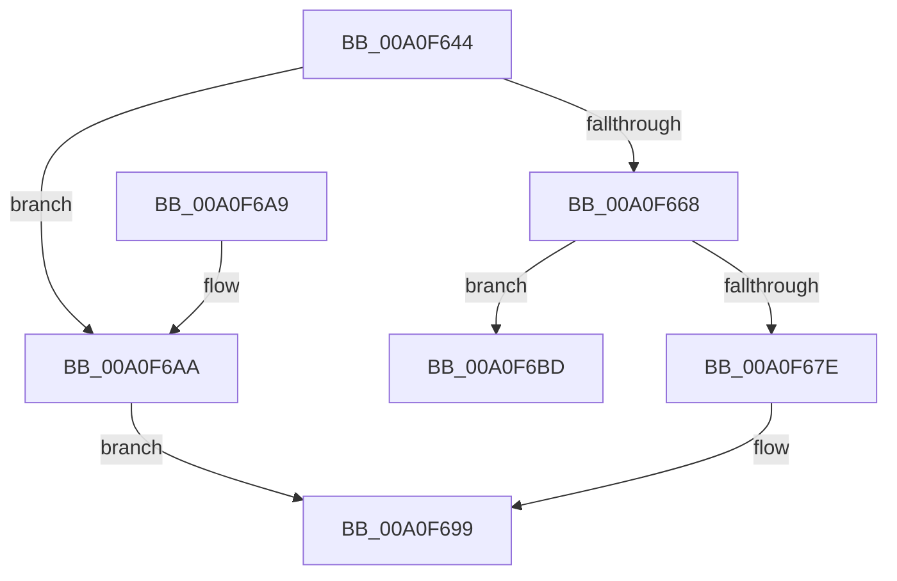

# CmpInitializeValueNameString

- RVA: `0x00A0F644`–`0x00A0F6CE` (길이 `138` bytes)
- VA: `0x0000000140A0F644`
- 실행 섹션: `PAGE`
- PDB 이름 있음: `예`; PDB Function 태그: `아니요`
- unwind 정보 RVA: `0x0008D44C`
- 디코드: `39`개 명령, `138/138` bytes 표시
- 미해석 바이트: `0` (있으면 어셈블리에 `.byte`로 보존)

> 이 문서는 커널 이미지의 기계어와 PDB 기호를 분석해 생성했습니다. 4번과 5번은 함수 원형과 자료형을 바이너리 사용 방식에서 추정한 C 해석이며 원본 소스 복구 결과는 아닙니다.

## 1. Dependencies

- 직접 호출 지점: **2**; 고유 호출 대상: **2**
- 직접 호출자로 확인된 함수: **3**
- RIP 상대 이미지 참조: **0**

### Outgoing calls
- `0x00A0F68C` → [CmpCopyCompressedName](../84/CmpCopyCompressedName_function_0084E0D0.md) (function, `0x0084E0D0`)
- `0x00A0F6C8` → [CmSiBugCheck](../../text/66/CmSiBugCheck_function_0066DF38.md) (function, `0x0066DF38`)

### Direct callers
- [CmpMergeKeyValues](../7F/CmpMergeKeyValues_function_007F2304.md) at `0x007F2424`
- [CmpLightWeightPrepareSetValueKeyUoW](CmpLightWeightPrepareSetValueKeyUoW_function_00A0EF28.md) at `0x00A0F2EA`
- [CmpLightWeightPrepareDeleteValueKeyUoW](CmpLightWeightPrepareDeleteValueKeyUoW_function_00A0F3D8.md) at `0x00A0F4AC`

### Static image references
- 디코드된 RIP-relative 메모리 참조가 없습니다.

## 2. Other-region calls and transfers

- 다른 실행 섹션으로 향하는 call: **1**
  - `0x00A0F6C8` → [CmSiBugCheck](../../text/66/CmSiBugCheck_function_0066DF38.md) (`PAGE` → `.text`)
- 별도 외부 분기/꼬리 이동을 확인하지 못했습니다.

## 3. Assembly (complete function range)

```asm
00A0F644  48 89 5C 24 08                  mov qword ptr [rsp + 8], rbx
00A0F649  48 89 74 24 10                  mov qword ptr [rsp + 0x10], rsi
00A0F64E  57                              push rdi
00A0F64F  48 83 EC 20                     sub rsp, 0x20
00A0F653  44 0F B7 49 02                  movzx r9d, word ptr [rcx + 2]
00A0F658  48 8B DA                        mov rbx, rdx
00A0F65B  BA 01 00 00 00                  mov edx, 1
00A0F660  49 8B F8                        mov rdi, r8
00A0F663  84 51 10                        test byte ptr [rcx + 0x10], dl
00A0F666  74 42                           je 0x140a0f6aa
00A0F668  66 45 03 C9                     add r9w, r9w
00A0F66C  BE FF 7F 00 00                  mov esi, 0x7fff
00A0F671  41 0F B7 C1                     movzx eax, r9w
00A0F675  66 44 89 0B                     mov word ptr [rbx], r9w
00A0F679  66 3B C6                        cmp ax, si
00A0F67C  77 3F                           ja 0x140a0f6bd
00A0F67E  44 0F B7 49 02                  movzx r9d, word ptr [rcx + 2]
00A0F683  4C 8D 41 14                     lea r8, [rcx + 0x14]
00A0F687  48 8B CF                        mov rcx, rdi
00A0F68A  8B D6                           mov edx, esi
00A0F68C  E8 3F EA E3 FF                  call 0x14084e0d0
00A0F691  48 89 7B 08                     mov qword ptr [rbx + 8], rdi
00A0F695  66 89 73 02                     mov word ptr [rbx + 2], si
00A0F699  48 8B 5C 24 30                  mov rbx, qword ptr [rsp + 0x30]
00A0F69E  48 8B 74 24 38                  mov rsi, qword ptr [rsp + 0x38]
00A0F6A3  48 83 C4 20                     add rsp, 0x20
00A0F6A7  5F                              pop rdi
00A0F6A8  C3                              ret
00A0F6A9  CC                              int3
00A0F6AA  48 8D 41 14                     lea rax, [rcx + 0x14]
00A0F6AE  66 44 89 0B                     mov word ptr [rbx], r9w
00A0F6B2  48 89 43 08                     mov qword ptr [rbx + 8], rax
00A0F6B6  66 44 89 4B 02                  mov word ptr [rbx + 2], r9w
00A0F6BB  EB DC                           jmp 0x140a0f699
00A0F6BD  4C 8B C1                        mov r8, rcx
00A0F6C0  4C 8B C8                        mov r9, rax
00A0F6C3  B9 31 00 00 00                  mov ecx, 0x31
00A0F6C8  E8 6B E8 C5 FF                  call 0x14066df38
00A0F6CD  CC                              int3
```

## 4. C-style interpretation (structured pseudocode)

```c
__int64 __fastcall CmpInitializeValueNameString(__int64 a1, __int64 a2, __int64 a3)
{
    __int64 result;
    __int64 v_rsp;
    unsigned __int64 v_stack_p10;
    unsigned __int64 v_stack_p8;

    v_stack_p8 = v_rbx;
    v_stack_p10 = v_rsi;
    v_rsp = (v_rsp) - (32);
    if (((*(unsigned __int8 *)(a1 + 16)) & (1)) == 0) goto loc_00A0F6AA;
    a4 = (unsigned __int16)((*(unsigned __int16 *)(a1 + 2)) + ((unsigned __int16)(*(unsigned __int16 *)(a1 + 2))));
    *(unsigned __int16 *)(a2) = (unsigned __int16)(a4);
    if (((unsigned __int16)((unsigned __int16)(a4))) > ((unsigned __int16)((unsigned int)(0x7FFFULL)))) goto loc_00A0F6BD;
    result = CmpCopyCompressedName(a3, (unsigned int)((unsigned int)((unsigned int)(0x7FFFULL))), a1 + 20, *(unsigned __int16 *)(a1 + 2));
    *(unsigned __int64 *)(a2 + 8) = a3;
    *(unsigned __int16 *)(a2 + 2) = (unsigned __int16)((unsigned int)(0x7FFFULL));
loc_00A0F699:
    v_rsp = (v_rsp) + (32);
    return result;
loc_00A0F6AA:
    *(unsigned __int16 *)(v_stack_p8) = (unsigned __int16)(*(unsigned __int16 *)(a1 + 2));
    *(unsigned __int64 *)(v_stack_p8 + 8) = a3 + 20;
    *(unsigned __int16 *)(v_stack_p8 + 2) = (unsigned __int16)(*(unsigned __int16 *)(a1 + 2));
    goto loc_00A0F699;
loc_00A0F6BD:
    result = CmSiBugCheck(49, (unsigned int)((unsigned int)((unsigned int)(0x7FFFULL))), a3, a3 + 20);
    return result;
}
```

## 5. (Beta) C Style

```c
int64_t CmpInitializeValueNameString(void *Arg1, void *Arg2, int64_t Arg3)
{
    uint8_t *arg1 = (uint8_t *)Arg1;
    uint8_t *arg2 = (uint8_t *)Arg2;

    int64_t result;
    int64_t local_rsp;
    uint64_t v_stack_p10;
    uint64_t v_stack_p8;

    v_stack_p8 = local_rbx;
    v_stack_p10 = local_rsi;
    local_rsp = (local_rsp) - (32);
    if (((*(uint8_t *)(arg1 + 0x10)) & (1)) == 0) goto loc_00A0F6AA;
    a4 = (uint16_t)((*(uint16_t *)(arg1 + 0x2)) + ((uint16_t)(*(uint16_t *)(arg1 + 0x2))));
    *(uint16_t *)(arg2) = (uint16_t)(a4);
    if (((uint16_t)((uint16_t)(a4))) > ((uint16_t)((uint32_t)(0x7FFFULL)))) goto loc_00A0F6BD;
    result = CmpCopyCompressedName(Arg3, (uint32_t)((uint32_t)((uint32_t)(0x7FFFULL))), Arg1 + 20, *(uint16_t *)(arg1 + 0x2));
    *(uint64_t *)(arg2 + 0x8) = Arg3;
    *(uint16_t *)(arg2 + 0x2) = (uint16_t)((uint32_t)(0x7FFFULL));
loc_00A0F699:
    local_rsp = (local_rsp) + (32);
    return result;
loc_00A0F6AA:
    *(uint16_t *)(v_stack_p8) = (uint16_t)(*(uint16_t *)(arg1 + 0x2));
    *(uint64_t *)(v_stack_p8 + 0x8) = Arg3 + 20;
    *(uint16_t *)(v_stack_p8 + 0x2) = (uint16_t)(*(uint16_t *)(arg1 + 0x2));
    goto loc_00A0F699;
loc_00A0F6BD:
    result = CmSiBugCheck(49, (uint32_t)((uint32_t)((uint32_t)(0x7FFFULL))), Arg3, Arg3 + 20);
    return result;
}
```

### 관측된 메모리 오프셋

구조체 형식이 확인되지 않은 접근은 인자 기준의 오프셋으로만 기록했습니다.

| 기준 인자 | 오프셋 표현 | 폭 (bit) | 접근 |
|---|---:|---:|---|
| `Arg1` | `+ 0x2` | `16` | `R` |
| `Arg1` | `+ 0x10` | `8` | `R` |
| `Arg1` | `+ 0x14` | `64` | `R` |
| `Arg2` | `+ 0x0` | `16` | `W` |
| `Arg2` | `+ 0x2` | `16` | `W` |
| `Arg2` | `+ 0x8` | `64` | `W` |

## 6. Execution-region graph

[열기: 2D/3D 그래프와 함수 탐색 컨트롤 패널](../../../control-panel.html?section=page&rva=0x00A0F644&view=graph)

- 2D 그래프는 위에서 아래로 흐르고, 3D 그래프는 빈 공간을 드래그해 회전합니다. Shift+드래그는 이동, 휠은 확대·축소, 함수 노드 선택은 대상 보고서 이동입니다.

### Static fallback


