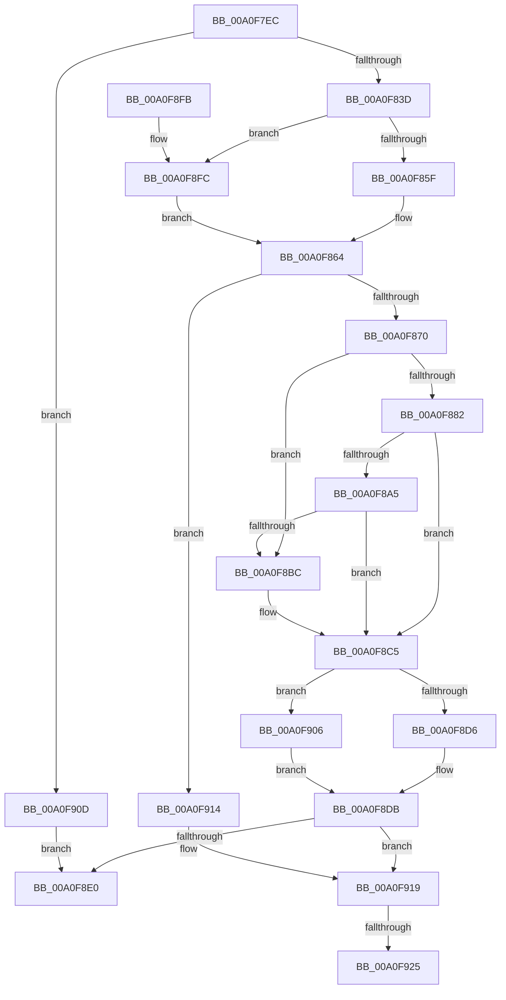

# CmpLightWeightCreateSetValueData

- RVA: `0x00A0F7EC`–`0x00A0F933` (길이 `327` bytes)
- VA: `0x0000000140A0F7EC`
- 실행 섹션: `PAGE`
- PDB 이름 있음: `예`; PDB Function 태그: `예`
- unwind 정보 RVA: `0x000A8FC8`
- 디코드: `92`개 명령, `327/327` bytes 표시
- 미해석 바이트: `0` (있으면 어셈블리에 `.byte`로 보존)

> 이 문서는 커널 이미지의 기계어와 PDB 기호를 분석해 생성했습니다. 4번과 5번은 함수 원형과 자료형을 바이너리 사용 방식에서 추정한 C 해석이며 원본 소스 복구 결과는 아닙니다.

## 1. Dependencies

- 직접 호출 지점: **8**; 고유 호출 대상: **8**
- 직접 호출자로 확인된 함수: **2**
- RIP 상대 이미지 참조: **0**

### Outgoing calls
- `0x00A0F82C` → [CmpAllocatePool](../../text/3C/CmpAllocatePool_function_003CD504.md) (function, `0x003CD504`)
- `0x00A0F85F` → [HvpGetCellFlat](../85/HvpGetCellFlat_function_00854C60.md) (function, `0x00854C60`)
- `0x00A0F89A` → [CmpCopyCell](../85/CmpCopyCell_function_0085A608.md) (function, `0x0085A608`)
- `0x00A0F8B1` → [HvpMarkCellDirty](../85/HvpMarkCellDirty_function_00858080.md) (function, `0x00858080`)
- `0x00A0F8D6` → [HvpReleaseCellPaged](../85/HvpReleaseCellPaged_function_00855F40.md) (function, `0x00855F40`)
- `0x00A0F8FC` → [HvpGetCellPaged](../85/HvpGetCellPaged_function_00854CB0.md) (function, `0x00854CB0`)
- `0x00A0F906` → [HvpReleaseCellFlat](../85/HvpReleaseCellFlat_function_0085CC20.md) (function, `0x0085CC20`)
- `0x00A0F928` → [HvFreeCell](../85/HvFreeCell_function_0085A72C.md) (function, `0x0085A72C`)

### Direct callers
- [CmpLightWeightPrepareSetValueKeyUoW](CmpLightWeightPrepareSetValueKeyUoW_function_00A0EF28.md) at `0x00A0F109`
- [CmpLightWeightPrepareDeleteValueKeyUoW](CmpLightWeightPrepareDeleteValueKeyUoW_function_00A0F3D8.md) at `0x00A0F5E6`

### Static image references
- 디코드된 RIP-relative 메모리 참조가 없습니다.

## 2. Other-region calls and transfers

- 다른 실행 섹션으로 향하는 call: **1**
  - `0x00A0F82C` → [CmpAllocatePool](../../text/3C/CmpAllocatePool_function_003CD504.md) (`PAGE` → `.text`)
- call이 아닌 외부 분기/꼬리 이동: **2**
  - `0x00A0F91F` → [sub_00B36A1E](../B3/Unknown_function_00B36A1E.md) (`tail-transfer`)
  - `0x00A0F92E` → [sub_00B36A1E](../B3/Unknown_function_00B36A1E.md) (`tail-transfer`)

## 3. Assembly (complete function range)

```asm
00A0F7EC  48 8B C4                        mov rax, rsp
00A0F7EF  48 89 58 10                     mov qword ptr [rax + 0x10], rbx
00A0F7F3  48 89 68 18                     mov qword ptr [rax + 0x18], rbp
00A0F7F7  48 89 70 20                     mov qword ptr [rax + 0x20], rsi
00A0F7FB  57                              push rdi
00A0F7FC  41 56                           push r14
00A0F7FE  41 57                           push r15
00A0F800  48 83 EC 30                     sub rsp, 0x30
00A0F804  83 48 08 FF                     or dword ptr [rax + 8], 0xffffffff
00A0F808  45 33 FF                        xor r15d, r15d
00A0F80B  44 89 78 0C                     mov dword ptr [rax + 0xc], r15d
00A0F80F  4C 8B F2                        mov r14, rdx
00A0F812  48 8B 41 30                     mov rax, qword ptr [rcx + 0x30]
00A0F816  48 8B D9                        mov rbx, rcx
00A0F819  B9 00 01 00 00                  mov ecx, 0x100
00A0F81E  41 B8 43 4D 55 77               mov r8d, 0x77554d43
00A0F824  41 8D 57 0C                     lea edx, [r15 + 0xc]
00A0F828  48 8B 70 20                     mov rsi, qword ptr [rax + 0x20]
00A0F82C  E8 D3 DC 9B FF                  call 0x1403cd504
00A0F831  48 8B F8                        mov rdi, rax
00A0F834  48 85 C0                        test rax, rax
00A0F837  0F 84 D0 00 00 00               je 0x140a0f90d
00A0F83D  C7 00 01 00 00 00               mov dword ptr [rax], 1
00A0F843  4C 8D 44 24 50                  lea r8, [rsp + 0x50]
00A0F848  F6 86 8C 00 00 00 01            test byte ptr [rsi + 0x8c], 1
00A0F84F  48 8B CE                        mov rcx, rsi
00A0F852  48 8B 43 30                     mov rax, qword ptr [rbx + 0x30]
00A0F856  8B 50 28                        mov edx, dword ptr [rax + 0x28]
00A0F859  0F 84 9D 00 00 00               je 0x140a0f8fc
00A0F85F  E8 FC 53 E4 FF                  call 0x140854c60
00A0F864  48 8B E8                        mov rbp, rax
00A0F867  48 85 C0                        test rax, rax
00A0F86A  0F 84 A4 00 00 00               je 0x140a0f914
00A0F870  48 8D 47 08                     lea rax, [rdi + 8]
00A0F874  44 89 7F 04                     mov dword ptr [rdi + 4], r15d
00A0F878  83 08 FF                        or dword ptr [rax], 0xffffffff
00A0F87B  8B 4D 24                        mov ecx, dword ptr [rbp + 0x24]
00A0F87E  85 C9                           test ecx, ecx
00A0F880  74 3A                           je 0x140a0f8bc
00A0F882  89 4F 04                        mov dword ptr [rdi + 4], ecx
00A0F885  4C 8B C6                        mov r8, rsi
00A0F888  8B 55 28                        mov edx, dword ptr [rbp + 0x28]
00A0F88B  48 8B CE                        mov rcx, rsi
00A0F88E  44 8B CA                        mov r9d, edx
00A0F891  48 89 44 24 20                  mov qword ptr [rsp + 0x20], rax
00A0F896  41 C1 E9 1F                     shr r9d, 0x1f
00A0F89A  E8 69 AD E4 FF                  call 0x14085a608
00A0F89F  8B D8                           mov ebx, eax
00A0F8A1  85 C0                           test eax, eax
00A0F8A3  78 20                           js 0x140a0f8c5
00A0F8A5  8B 55 28                        mov edx, dword ptr [rbp + 0x28]
00A0F8A8  45 33 C9                        xor r9d, r9d
00A0F8AB  45 33 C0                        xor r8d, r8d
00A0F8AE  48 8B CE                        mov rcx, rsi
00A0F8B1  E8 CA 87 E4 FF                  call 0x140858080
00A0F8B6  8B D8                           mov ebx, eax
00A0F8B8  85 C0                           test eax, eax
00A0F8BA  78 09                           js 0x140a0f8c5
00A0F8BC  49 89 3E                        mov qword ptr [r14], rdi
00A0F8BF  41 8B DF                        mov ebx, r15d
00A0F8C2  49 8B FF                        mov rdi, r15
00A0F8C5  F6 86 8C 00 00 00 01            test byte ptr [rsi + 0x8c], 1
00A0F8CC  48 8D 54 24 50                  lea rdx, [rsp + 0x50]
00A0F8D1  48 8B CE                        mov rcx, rsi
00A0F8D4  75 30                           jne 0x140a0f906
00A0F8D6  E8 65 66 E4 FF                  call 0x140855f40
00A0F8DB  48 85 FF                        test rdi, rdi
00A0F8DE  75 39                           jne 0x140a0f919
00A0F8E0  48 8B 6C 24 60                  mov rbp, qword ptr [rsp + 0x60]
00A0F8E5  8B C3                           mov eax, ebx
00A0F8E7  48 8B 5C 24 58                  mov rbx, qword ptr [rsp + 0x58]
00A0F8EC  48 8B 74 24 68                  mov rsi, qword ptr [rsp + 0x68]
00A0F8F1  48 83 C4 30                     add rsp, 0x30
00A0F8F5  41 5F                           pop r15
00A0F8F7  41 5E                           pop r14
00A0F8F9  5F                              pop rdi
00A0F8FA  C3                              ret
00A0F8FB  CC                              int3
00A0F8FC  E8 AF 53 E4 FF                  call 0x140854cb0
00A0F901  E9 5E FF FF FF                  jmp 0x140a0f864
00A0F906  E8 15 D3 E4 FF                  call 0x14085cc20
00A0F90B  EB CE                           jmp 0x140a0f8db
00A0F90D  BB 9A 00 00 C0                  mov ebx, 0xc000009a
00A0F912  EB CC                           jmp 0x140a0f8e0
00A0F914  BB 9A 00 00 C0                  mov ebx, 0xc000009a
00A0F919  8B 57 08                        mov edx, dword ptr [rdi + 8]
00A0F91C  83 FA FF                        cmp edx, -1
00A0F91F  0F 84 F9 70 12 00               je 0x140b36a1e
00A0F925  48 8B CE                        mov rcx, rsi
00A0F928  E8 FF AD E4 FF                  call 0x14085a72c
00A0F92D  90                              nop
00A0F92E  E9 EB 70 12 00                  jmp 0x140b36a1e
```

## 4. C-style interpretation (structured pseudocode)

```c
__int64 __fastcall CmpLightWeightCreateSetValueData(__int64 a1, __int64 a2)
{
    __int64 result;
    __int64 v_r15;
    __int64 v_rbx;
    __int64 v_rdi;
    __int64 v_rsp;
    unsigned __int64 v_stack_m28;
    unsigned __int64 v_stack_p10;
    unsigned __int64 v_stack_p18;
    unsigned __int64 v_stack_p20;
    unsigned __int64 v_stack_p8;

    *(unsigned __int64 *)(v_rsp + 16) = v_rbx;
    *(unsigned __int64 *)(v_rsp + 24) = v_rbp;
    *(unsigned __int64 *)(v_rsp + 32) = v_rsi;
    v_rsp = (v_rsp) - (48);
    v_r15 = 0;
    *(unsigned int *)(v_rsp + 12) = 0;
    result = CmpAllocatePool(256, v_r15 + 12, (unsigned int)(0x77554D43ULL), a4);
    if (result == 0) goto loc_00A0F90D;
    *(unsigned int *)(result) = 1;
    if (((*(unsigned __int8 *)(*(unsigned __int64 *)(*(unsigned __int64 *)(a1 + 48) + 32) + 140)) & (1)) == 0) goto loc_00A0F8FC;
    result = HvpGetCellFlat(*(unsigned __int64 *)(*(unsigned __int64 *)(a1 + 48) + 32), (unsigned int)(*(unsigned int *)(*(unsigned __int64 *)(a1 + 48) + 40)), v_stack_p8, a4);
loc_00A0F864:
    if (result == 0) goto loc_00A0F914;
    *(unsigned int *)(result + 4) = 0;
    if ((unsigned int)((unsigned int)(*(unsigned int *)(result + 36))) == 0) goto loc_00A0F8BC;
    *(unsigned int *)(result + 4) = (unsigned int)((unsigned int)(*(unsigned int *)(result + 36)));
    v_stack_m28 = result + 8;
    a4 = (unsigned int)(((unsigned int)((unsigned int)((unsigned int)(*(unsigned int *)(result + 40))))) >> (31));
    result = CmpCopyCell(*(unsigned __int64 *)(*(unsigned __int64 *)(a1 + 48) + 32), (unsigned int)(*(unsigned int *)(result + 40)), *(unsigned __int64 *)(*(unsigned __int64 *)(a1 + 48) + 32), a4);
    if (sign_flag) goto loc_00A0F8C5;
    a4 = 0;
    a3 = 0;
    result = HvpMarkCellDirty(*(unsigned __int64 *)(*(unsigned __int64 *)(a1 + 48) + 32), (unsigned int)(*(unsigned int *)(result + 40)), a3, a4);
    v_rbx = (unsigned int)((unsigned int)(result));
    v_rdi = result;
    if (!(sign_flag)) {
        *(unsigned __int64 *)(a2) = result;
        v_rbx = 0;
        v_rdi = 0;
    }
    if (((*(unsigned __int8 *)(*(unsigned __int64 *)(*(unsigned __int64 *)(a1 + 48) + 32) + 140)) & (1)) != 0) goto loc_00A0F906;
    result = HvpReleaseCellPaged(*(unsigned __int64 *)(*(unsigned __int64 *)(a1 + 48) + 32), v_stack_p8, a3, a4);
loc_00A0F8DB:
    if (v_rdi != 0) goto loc_00A0F919;
loc_00A0F8E0:
    v_rsp = (v_rsp) + (48);
    return (unsigned int)((unsigned int)(v_rbx));
loc_00A0F8FC:
    result = HvpGetCellPaged(*(unsigned __int64 *)(*(unsigned __int64 *)(a1 + 48) + 32), v_stack_p8, a3, a4);
    goto loc_00A0F864;
loc_00A0F906:
    result = HvpReleaseCellFlat(*(unsigned __int64 *)(*(unsigned __int64 *)(a1 + 48) + 32), v_stack_p8, a3, a4);
    goto loc_00A0F8DB;
loc_00A0F90D:
    goto loc_00A0F8E0;
loc_00A0F914:
loc_00A0F919:
    result = HvFreeCell(v_stack_p20, (unsigned int)(*(unsigned int *)(v_rdi + 8)), a3, a4);
}
```

## 5. (Beta) C Style

```c
int64_t CmpLightWeightCreateSetValueData(void *Arg1, void *Arg2)
{
    uint8_t *arg1 = (uint8_t *)Arg1;
    uint8_t *arg2 = (uint8_t *)Arg2;

    int64_t result;
    int64_t local_r15;
    int64_t local_rbx;
    int64_t local_rdi;
    int64_t local_rsp;
    uint64_t v_stack_m28;
    uint64_t v_stack_p10;
    uint64_t v_stack_p18;
    uint64_t v_stack_p20;
    uint64_t v_stack_p8;

    *(uint64_t *)(local_rsp + 0x10) = local_rbx;
    *(uint64_t *)(local_rsp + 0x18) = local_rbp;
    *(uint64_t *)(local_rsp + 0x20) = local_rsi;
    local_rsp = (local_rsp) - (48);
    local_r15 = 0;
    *(uint32_t *)(local_rsp + 0xC) = 0;
    result = CmpAllocatePool(256, local_r15 + 12, (uint32_t)(0x77554D43ULL), a4);
    if (result == 0) goto loc_00A0F90D;
    *(uint32_t *)(result) = 1;
    if (((*(uint8_t *)(*(uint64_t *)(*(uint64_t *)(arg1 + 0x30) + 0x20) + 0x8C)) & (1)) == 0) goto loc_00A0F8FC;
    result = HvpGetCellFlat(*(uint64_t *)(*(uint64_t *)(arg1 + 0x30) + 0x20), (uint32_t)(*(uint32_t *)(*(uint64_t *)(arg1 + 0x30) + 0x28)), v_stack_p8, a4);
loc_00A0F864:
    if (result == 0) goto loc_00A0F914;
    *(uint32_t *)(result + 0x4) = 0;
    if ((uint32_t)((uint32_t)(*(uint32_t *)(result + 0x24))) == 0) goto loc_00A0F8BC;
    *(uint32_t *)(result + 0x4) = (uint32_t)((uint32_t)(*(uint32_t *)(result + 0x24)));
    v_stack_m28 = result + 8;
    a4 = (uint32_t)(((uint32_t)((uint32_t)((uint32_t)(*(uint32_t *)(result + 0x28))))) >> (31));
    result = CmpCopyCell(*(uint64_t *)(*(uint64_t *)(arg1 + 0x30) + 0x20), (uint32_t)(*(uint32_t *)(result + 0x28)), *(uint64_t *)(*(uint64_t *)(arg1 + 0x30) + 0x20), a4);
    if (sign_flag) goto loc_00A0F8C5;
    a4 = 0;
    a3 = 0;
    result = HvpMarkCellDirty(*(uint64_t *)(*(uint64_t *)(arg1 + 0x30) + 0x20), (uint32_t)(*(uint32_t *)(result + 0x28)), a3, a4);
    local_rbx = (uint32_t)((uint32_t)(result));
    local_rdi = result;
    if (!(sign_flag)) {
        *(uint64_t *)(arg2) = result;
        local_rbx = 0;
        local_rdi = 0;
    }
    if (((*(uint8_t *)(*(uint64_t *)(*(uint64_t *)(arg1 + 0x30) + 0x20) + 0x8C)) & (1)) != 0) goto loc_00A0F906;
    result = HvpReleaseCellPaged(*(uint64_t *)(*(uint64_t *)(arg1 + 0x30) + 0x20), v_stack_p8, a3, a4);
loc_00A0F8DB:
    if (local_rdi != 0) goto loc_00A0F919;
loc_00A0F8E0:
    local_rsp = (local_rsp) + (48);
    return (uint32_t)((uint32_t)(local_rbx));
loc_00A0F8FC:
    result = HvpGetCellPaged(*(uint64_t *)(*(uint64_t *)(arg1 + 0x30) + 0x20), v_stack_p8, a3, a4);
    goto loc_00A0F864;
loc_00A0F906:
    result = HvpReleaseCellFlat(*(uint64_t *)(*(uint64_t *)(arg1 + 0x30) + 0x20), v_stack_p8, a3, a4);
    goto loc_00A0F8DB;
loc_00A0F90D:
    goto loc_00A0F8E0;
loc_00A0F914:
loc_00A0F919:
    result = HvFreeCell(v_stack_p20, (uint32_t)(*(uint32_t *)(local_rdi + 0x8)), a3, a4);
}
```

### 관측된 메모리 오프셋

구조체 형식이 확인되지 않은 접근은 인자 기준의 오프셋으로만 기록했습니다.

| 기준 인자 | 오프셋 표현 | 폭 (bit) | 접근 |
|---|---:|---:|---|
| `Arg1` | `+ 0x30` | `64` | `R` |
| `Arg2` | `+ 0x0` | `64` | `W` |

## 6. Execution-region graph

[열기: 2D/3D 그래프와 함수 탐색 컨트롤 패널](../../../control-panel.html?section=page&rva=0x00A0F7EC&view=graph)

- 2D 그래프는 위에서 아래로 흐르고, 3D 그래프는 빈 공간을 드래그해 회전합니다. Shift+드래그는 이동, 휠은 확대·축소, 함수 노드 선택은 대상 보고서 이동입니다.

### Static fallback


