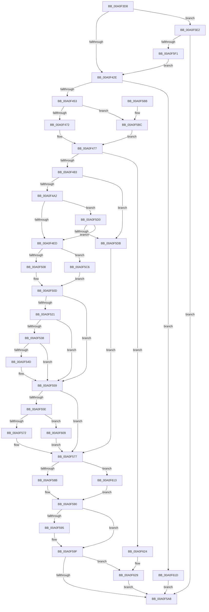

# CmpLightWeightPrepareDeleteValueKeyUoW

- RVA: `0x00A0F3D8`–`0x00A0F63B` (길이 `611` bytes)
- VA: `0x0000000140A0F3D8`
- 실행 섹션: `PAGE`
- PDB 이름 있음: `예`; PDB Function 태그: `아니요`
- unwind 정보 RVA: `0x000A8F94`
- 디코드: `166`개 명령, `611/611` bytes 표시
- 미해석 바이트: `0` (있으면 어셈블리에 `.byte`로 보존)

> 이 문서는 커널 이미지의 기계어와 PDB 기호를 분석해 생성했습니다. 4번과 5번은 함수 원형과 자료형을 바이너리 사용 방식에서 추정한 C 해석이며 원본 소스 복구 결과는 아닙니다.

## 1. Dependencies

- 직접 호출 지점: **19**; 고유 호출 대상: **15**
- 직접 호출자로 확인된 함수: **1**
- RIP 상대 이미지 참조: **0**

### Outgoing calls
- `0x00A0F442` → [CmpAllocatePool](../../text/3C/CmpAllocatePool_function_003CD504.md) (function, `0x003CD504`)
- `0x00A0F472` → [HvpGetCellFlat](../85/HvpGetCellFlat_function_00854C60.md) (function, `0x00854C60`)
- `0x00A0F491` → [ExAllocatePool2](../../poolcode/B8/ExAllocatePool2_function_00B820F0.md) (function, `0x00B820F0`)
- `0x00A0F4AC` → [CmpInitializeValueNameString](CmpInitializeValueNameString_function_00A0F644.md) (function, `0x00A0F644`)
- `0x00A0F4D8` → [CmpFindNameInListWithStatus](../84/CmpFindNameInListWithStatus_function_00846B80.md) (function, `0x00846B80`)
- `0x00A0F508` → [HvpGetCellFlat](../85/HvpGetCellFlat_function_00854C60.md) (function, `0x00854C60`)
- `0x00A0F516` → [CmpMarkValueDataDirty](../84/CmpMarkValueDataDirty_function_0084B910.md) (function, `0x0084B910`)
- `0x00A0F52D` → [HvpMarkCellDirty](../85/HvpMarkCellDirty_function_00858080.md) (function, `0x00858080`)
- `0x00A0F542` → [CmpRemoveValueFromList](CmpRemoveValueFromList_function_00A0F6D4.md) (function, `0x00A0F6D4`)
- `0x00A0F572` → [HvpReleaseCellPaged](../85/HvpReleaseCellPaged_function_00855F40.md) (function, `0x00855F40`)
- `0x00A0F58B` → [HvpReleaseCellPaged](../85/HvpReleaseCellPaged_function_00855F40.md) (function, `0x00855F40`)
- `0x00A0F59A` → [ExFreePoolWithTag](../../poolcode/B8/ExFreePoolWithTag_function_00B82870.md) (function, `0x00B82870`)
- `0x00A0F5BC` → [HvpGetCellPaged](../85/HvpGetCellPaged_function_00854CB0.md) (function, `0x00854CB0`)
- `0x00A0F5C6` → [HvpGetCellPaged](../85/HvpGetCellPaged_function_00854CB0.md) (function, `0x00854CB0`)
- `0x00A0F5E6` → [CmpLightWeightCreateSetValueData](CmpLightWeightCreateSetValueData_function_00A0F7EC.md) (function, `0x00A0F7EC`)
- `0x00A0F5FC` → [CmpLightWeightUpdateSharedSetValueData](CmpLightWeightUpdateSharedSetValueData_function_00A0F93C.md) (function, `0x00A0F93C`)
- `0x00A0F609` → [HvpReleaseCellFlat](../85/HvpReleaseCellFlat_function_0085CC20.md) (function, `0x0085CC20`)
- `0x00A0F613` → [HvpReleaseCellFlat](../85/HvpReleaseCellFlat_function_0085CC20.md) (function, `0x0085CC20`)
- `0x00A0F631` → [CmpFreePoolWithTag](../../text/44/CmpFreePoolWithTag_function_004489E0.md) (function, `0x004489E0`)

### Direct callers
- [CmpProcessLightWeightUOW](../9B/CmpProcessLightWeightUOW_function_009B0EAC.md) at `0x009B10B0`

### Static image references
- 디코드된 RIP-relative 메모리 참조가 없습니다.

## 2. Other-region calls and transfers

- 다른 실행 섹션으로 향하는 call: **4**
  - `0x00A0F442` → [CmpAllocatePool](../../text/3C/CmpAllocatePool_function_003CD504.md) (`PAGE` → `.text`)
  - `0x00A0F491` → [ExAllocatePool2](../../poolcode/B8/ExAllocatePool2_function_00B820F0.md) (`PAGE` → `POOLCODE`)
  - `0x00A0F59A` → [ExFreePoolWithTag](../../poolcode/B8/ExFreePoolWithTag_function_00B82870.md) (`PAGE` → `POOLCODE`)
  - `0x00A0F631` → [CmpFreePoolWithTag](../../text/44/CmpFreePoolWithTag_function_004489E0.md) (`PAGE` → `.text`)
- 별도 외부 분기/꼬리 이동을 확인하지 못했습니다.

## 3. Assembly (complete function range)

```asm
00A0F3D8  40 55                           push rbp
00A0F3DA  53                              push rbx
00A0F3DB  56                              push rsi
00A0F3DC  57                              push rdi
00A0F3DD  41 54                           push r12
00A0F3DF  41 55                           push r13
00A0F3E1  41 56                           push r14
00A0F3E3  41 57                           push r15
00A0F3E5  48 8B EC                        mov rbp, rsp
00A0F3E8  48 83 EC 58                     sub rsp, 0x58
00A0F3EC  48 8B 59 68                     mov rbx, qword ptr [rcx + 0x68]
00A0F3F0  45 33 E4                        xor r12d, r12d
00A0F3F3  48 8B 41 30                     mov rax, qword ptr [rcx + 0x30]
00A0F3F7  41 83 CF FF                     or r15d, 0xffffffff
00A0F3FB  44 89 7D 60                     mov dword ptr [rbp + 0x60], r15d
00A0F3FF  0F 57 C0                        xorps xmm0, xmm0
00A0F402  44 89 65 64                     mov dword ptr [rbp + 0x64], r12d
00A0F406  4C 8B F1                        mov r14, rcx
00A0F409  44 89 65 50                     mov dword ptr [rbp + 0x50], r12d
00A0F40D  48 8B 78 20                     mov rdi, qword ptr [rax + 0x20]
00A0F411  44 89 65 48                     mov dword ptr [rbp + 0x48], r12d
00A0F415  44 89 7D 58                     mov dword ptr [rbp + 0x58], r15d
00A0F419  44 89 65 5C                     mov dword ptr [rbp + 0x5c], r12d
00A0F41D  48 89 5D D8                     mov qword ptr [rbp - 0x28], rbx
00A0F421  0F 11 45 E0                     movups xmmword ptr [rbp - 0x20], xmm0
00A0F425  48 85 DB                        test rbx, rbx
00A0F428  0F 84 B4 01 00 00               je 0x140a0f5e2
00A0F42E  41 BD 00 01 00 00               mov r13d, 0x100
00A0F434  BA 10 00 00 00                  mov edx, 0x10
00A0F439  41 8B CD                        mov ecx, r13d
00A0F43C  41 B8 43 4D 55 77               mov r8d, 0x77554d43
00A0F442  E8 BD E0 9B FF                  call 0x1403cd504
00A0F447  48 8B F0                        mov rsi, rax
00A0F44A  48 85 C0                        test rax, rax
00A0F44D  0F 84 CA 01 00 00               je 0x140a0f61d
00A0F453  44 89 38                        mov dword ptr [rax], r15d
00A0F456  4C 8D 45 60                     lea r8, [rbp + 0x60]
00A0F45A  44 89 78 04                     mov dword ptr [rax + 4], r15d
00A0F45E  48 8B CF                        mov rcx, rdi
00A0F461  F6 87 8C 00 00 00 01            test byte ptr [rdi + 0x8c], 1
00A0F468  41 8B 56 58                     mov edx, dword ptr [r14 + 0x58]
00A0F46C  0F 84 4A 01 00 00               je 0x140a0f5bc
00A0F472  E8 E9 57 E4 FF                  call 0x140854c60
00A0F477  4C 8B F8                        mov r15, rax
00A0F47A  48 85 C0                        test rax, rax
00A0F47D  0F 84 A1 01 00 00               je 0x140a0f624
00A0F483  BA 00 80 00 00                  mov edx, 0x8000
00A0F488  41 B8 43 4D 53 62               mov r8d, 0x62534d43
00A0F48E  49 8B CD                        mov rcx, r13
00A0F491  E8 5A 2C 17 00                  call 0x140b820f0
00A0F496  4C 8B E8                        mov r13, rax
00A0F499  48 85 C0                        test rax, rax
00A0F49C  0F 84 39 01 00 00               je 0x140a0f5db
00A0F4A2  4C 8B C0                        mov r8, rax
00A0F4A5  48 8D 55 E0                     lea rdx, [rbp - 0x20]
00A0F4A9  49 8B CF                        mov rcx, r15
00A0F4AC  E8 93 01 00 00                  call 0x140a0f644
00A0F4B1  48 8D 43 04                     lea rax, [rbx + 4]
00A0F4B5  45 33 C9                        xor r9d, r9d
00A0F4B8  48 8D 4D 48                     lea rcx, [rbp + 0x48]
00A0F4BC  48 89 45 D8                     mov qword ptr [rbp - 0x28], rax
00A0F4C0  48 89 4C 24 28                  mov qword ptr [rsp + 0x28], rcx
00A0F4C5  4C 8D 45 E0                     lea r8, [rbp - 0x20]
00A0F4C9  48 8D 4D 50                     lea rcx, [rbp + 0x50]
00A0F4CD  48 8B D0                        mov rdx, rax
00A0F4D0  48 89 4C 24 20                  mov qword ptr [rsp + 0x20], rcx
00A0F4D5  48 8B CF                        mov rcx, rdi
00A0F4D8  E8 A3 76 E3 FF                  call 0x140846b80
00A0F4DD  BA 00 00 00 80                  mov edx, 0x80000000
00A0F4E2  8D 0C 10                        lea ecx, [rax + rdx]
00A0F4E5  85 CA                           test edx, ecx
00A0F4E7  0F 84 E3 00 00 00               je 0x140a0f5d0
00A0F4ED  F6 87 8C 00 00 00 01            test byte ptr [rdi + 0x8c], 1
00A0F4F4  4C 8D 45 58                     lea r8, [rbp + 0x58]
00A0F4F8  44 8B 7D 48                     mov r15d, dword ptr [rbp + 0x48]
00A0F4FC  48 8B CF                        mov rcx, rdi
00A0F4FF  41 8B D7                        mov edx, r15d
00A0F502  0F 84 BE 00 00 00               je 0x140a0f5c6
00A0F508  E8 53 57 E4 FF                  call 0x140854c60
00A0F50D  48 8B D0                        mov rdx, rax
00A0F510  48 8B CF                        mov rcx, rdi
00A0F513  4C 8B E0                        mov r12, rax
00A0F516  E8 F5 C3 E3 FF                  call 0x14084b910
00A0F51B  8B D8                           mov ebx, eax
00A0F51D  85 C0                           test eax, eax
00A0F51F  78 38                           js 0x140a0f559
00A0F521  45 33 C9                        xor r9d, r9d
00A0F524  45 33 C0                        xor r8d, r8d
00A0F527  41 8B D7                        mov edx, r15d
00A0F52A  48 8B CF                        mov rcx, rdi
00A0F52D  E8 4E 8B E4 FF                  call 0x140858080
00A0F532  8B D8                           mov ebx, eax
00A0F534  85 C0                           test eax, eax
00A0F536  78 21                           js 0x140a0f559
00A0F538  4C 8B 45 D8                     mov r8, qword ptr [rbp - 0x28]
00A0F53C  48 8B CF                        mov rcx, rdi
00A0F53F  8B 55 50                        mov edx, dword ptr [rbp + 0x50]
00A0F542  E8 8D 01 00 00                  call 0x140a0f6d4
00A0F547  8B D8                           mov ebx, eax
00A0F549  85 C0                           test eax, eax
00A0F54B  78 0C                           js 0x140a0f559
00A0F54D  44 89 7E 04                     mov dword ptr [rsi + 4], r15d
00A0F551  33 DB                           xor ebx, ebx
00A0F553  49 89 76 70                     mov qword ptr [r14 + 0x70], rsi
00A0F557  33 F6                           xor esi, esi
00A0F559  4D 85 E4                        test r12, r12
00A0F55C  74 19                           je 0x140a0f577
00A0F55E  F6 87 8C 00 00 00 01            test byte ptr [rdi + 0x8c], 1
00A0F565  48 8D 55 58                     lea rdx, [rbp + 0x58]
00A0F569  48 8B CF                        mov rcx, rdi
00A0F56C  0F 85 97 00 00 00               jne 0x140a0f609
00A0F572  E8 C9 69 E4 FF                  call 0x140855f40
00A0F577  F6 87 8C 00 00 00 01            test byte ptr [rdi + 0x8c], 1
00A0F57E  48 8D 55 60                     lea rdx, [rbp + 0x60]
00A0F582  48 8B CF                        mov rcx, rdi
00A0F585  0F 85 88 00 00 00               jne 0x140a0f613
00A0F58B  E8 B0 69 E4 FF                  call 0x140855f40
00A0F590  4D 85 ED                        test r13, r13
00A0F593  74 0A                           je 0x140a0f59f
00A0F595  33 D2                           xor edx, edx
00A0F597  49 8B CD                        mov rcx, r13
00A0F59A  E8 D1 32 17 00                  call 0x140b82870
00A0F59F  48 85 F6                        test rsi, rsi
00A0F5A2  0F 85 81 00 00 00               jne 0x140a0f629
00A0F5A8  8B C3                           mov eax, ebx
00A0F5AA  48 83 C4 58                     add rsp, 0x58
00A0F5AE  41 5F                           pop r15
00A0F5B0  41 5E                           pop r14
00A0F5B2  41 5D                           pop r13
00A0F5B4  41 5C                           pop r12
00A0F5B6  5F                              pop rdi
00A0F5B7  5E                              pop rsi
00A0F5B8  5B                              pop rbx
00A0F5B9  5D                              pop rbp
00A0F5BA  C3                              ret
00A0F5BB  CC                              int3
00A0F5BC  E8 EF 56 E4 FF                  call 0x140854cb0
00A0F5C1  E9 B1 FE FF FF                  jmp 0x140a0f477
00A0F5C6  E8 E5 56 E4 FF                  call 0x140854cb0
00A0F5CB  E9 3D FF FF FF                  jmp 0x140a0f50d
00A0F5D0  3D 34 00 00 C0                  cmp eax, 0xc0000034
00A0F5D5  0F 84 12 FF FF FF               je 0x140a0f4ed
00A0F5DB  BB 9A 00 00 C0                  mov ebx, 0xc000009a
00A0F5E0  EB 95                           jmp 0x140a0f577
00A0F5E2  48 8D 55 D8                     lea rdx, [rbp - 0x28]
00A0F5E6  E8 01 02 00 00                  call 0x140a0f7ec
00A0F5EB  8B D8                           mov ebx, eax
00A0F5ED  85 C0                           test eax, eax
00A0F5EF  78 B7                           js 0x140a0f5a8
00A0F5F1  48 8B 5D D8                     mov rbx, qword ptr [rbp - 0x28]
00A0F5F5  49 8B 56 30                     mov rdx, qword ptr [r14 + 0x30]
00A0F5F9  48 8B CB                        mov rcx, rbx
00A0F5FC  E8 3B 03 00 00                  call 0x140a0f93c
00A0F601  44 01 3B                        add dword ptr [rbx], r15d
00A0F604  E9 25 FE FF FF                  jmp 0x140a0f42e
00A0F609  E8 12 D6 E4 FF                  call 0x14085cc20
00A0F60E  E9 64 FF FF FF                  jmp 0x140a0f577
00A0F613  E8 08 D6 E4 FF                  call 0x14085cc20
00A0F618  E9 73 FF FF FF                  jmp 0x140a0f590
00A0F61D  BB 9A 00 00 C0                  mov ebx, 0xc000009a
00A0F622  EB 84                           jmp 0x140a0f5a8
00A0F624  BB 9A 00 00 C0                  mov ebx, 0xc000009a
00A0F629  BA 43 4D 55 77                  mov edx, 0x77554d43
00A0F62E  48 8B CE                        mov rcx, rsi
00A0F631  E8 AA 93 A3 FF                  call 0x1404489e0
00A0F636  E9 6D FF FF FF                  jmp 0x140a0f5a8
```

## 4. C-style interpretation (structured pseudocode)

```c
__int64 __fastcall CmpLightWeightPrepareDeleteValueKeyUoW(__int64 a1, __int64 a2, __int64 a3, int a4)
{
    __int64 result;
    __int64 v_r12;
    __int64 v_r15;
    __int64 v_rbx;
    __int64 v_rsi;
    __int64 v_rsp;
    unsigned __int64 v_stack_m60;
    unsigned __int64 v_stack_m68;
    unsigned __int64 v_stack_m70;
    unsigned __int64 v_stack_m78;
    unsigned int v_stack_p10;
    unsigned int v_stack_p18;
    unsigned int v_stack_p1C;
    unsigned int v_stack_p20;
    unsigned int v_stack_p24;
    unsigned int v_stack_p8;

    v_rsp = (v_rsp) - (88);
    v_r12 = 0;
    v_r15 = (unsigned int)((v_r15) | (0xFFFFFFFFULL));
    v_stack_p20 = (unsigned int)(v_r15);
    v_stack_p24 = 0;
    v_stack_p10 = 0;
    v_stack_p8 = 0;
    v_stack_p18 = (unsigned int)(v_r15);
    v_stack_p1C = 0;
    v_stack_m68 = *(unsigned __int64 *)(a1 + 104);
    v_stack_m60 = v_xmm0;
    if (*(unsigned __int64 *)(a1 + 104) == 0) goto loc_00A0F5E2;
loc_00A0F42E:
    result = CmpAllocatePool(256, 16, (unsigned int)(0x77554D43ULL), a4);
    if (result == 0) goto loc_00A0F61D;
    *(unsigned int *)(result) = (unsigned int)(v_r15);
    *(unsigned int *)(result + 4) = (unsigned int)(v_r15);
    if (((*(unsigned __int8 *)(*(unsigned __int64 *)(*(unsigned __int64 *)(a1 + 48) + 32) + 140)) & (1)) == 0) goto loc_00A0F5BC;
    result = HvpGetCellFlat(*(unsigned __int64 *)(*(unsigned __int64 *)(a1 + 48) + 32), (unsigned int)(*(unsigned int *)(a1 + 88)), v_stack_p20, a4);
loc_00A0F477:
    if (result == 0) goto loc_00A0F624;
    result = ExAllocatePool2(256, (unsigned int)(0x8000ULL), (unsigned int)(0x62534D43ULL), a4);
    if (result == 0) goto loc_00A0F5DB;
    result = CmpInitializeValueNameString(result, v_stack_m60, result, a4);
    a4 = 0;
    v_stack_m68 = *(unsigned __int64 *)(a1 + 104) + 4;
    v_stack_m70 = v_stack_p8;
    v_stack_m78 = v_stack_p10;
    result = CmpFindNameInListWithStatus(*(unsigned __int64 *)(*(unsigned __int64 *)(a1 + 48) + 32), *(unsigned __int64 *)(a1 + 104) + 4, v_stack_m60, a4);
    if ((((unsigned int)((unsigned int)(0x80000000ULL))) & ((unsigned int)(result + (unsigned int)(0x80000000ULL) * 1))) == 0) goto loc_00A0F5D0;
loc_00A0F4ED:
    if (((*(unsigned __int8 *)(*(unsigned __int64 *)(*(unsigned __int64 *)(a1 + 48) + 32) + 140)) & (1)) == 0) goto loc_00A0F5C6;
    result = HvpGetCellFlat(*(unsigned __int64 *)(*(unsigned __int64 *)(a1 + 48) + 32), (unsigned int)((unsigned int)((unsigned int)(v_stack_p8))), v_stack_p18, a4);
loc_00A0F50D:
    result = CmpMarkValueDataDirty(*(unsigned __int64 *)(*(unsigned __int64 *)(a1 + 48) + 32), result, v_stack_p18, a4);
    if (sign_flag) goto loc_00A0F559;
    a4 = 0;
    a3 = 0;
    result = HvpMarkCellDirty(*(unsigned __int64 *)(*(unsigned __int64 *)(a1 + 48) + 32), (unsigned int)((unsigned int)((unsigned int)(v_stack_p8))), a3, a4);
    if (sign_flag) goto loc_00A0F559;
    result = CmpRemoveValueFromList(*(unsigned __int64 *)(*(unsigned __int64 *)(a1 + 48) + 32), (unsigned int)(v_stack_p10), v_stack_m68, a4);
    v_rbx = (unsigned int)((unsigned int)(result));
    v_rsi = result;
    if (!(sign_flag)) {
        *(unsigned int *)(result + 4) = (unsigned int)((unsigned int)(v_stack_p8));
        v_rbx = 0;
        *(unsigned __int64 *)(a1 + 112) = result;
        v_rsi = 0;
    }
    if (result == 0) goto loc_00A0F577;
    if (((*(unsigned __int8 *)(*(unsigned __int64 *)(*(unsigned __int64 *)(a1 + 48) + 32) + 140)) & (1)) != 0) goto loc_00A0F609;
    result = HvpReleaseCellPaged(*(unsigned __int64 *)(*(unsigned __int64 *)(a1 + 48) + 32), v_stack_p18, v_stack_m68, a4);
loc_00A0F577:
    if (((*(unsigned __int8 *)(*(unsigned __int64 *)(*(unsigned __int64 *)(a1 + 48) + 32) + 140)) & (1)) != 0) goto loc_00A0F613;
    result = HvpReleaseCellPaged(*(unsigned __int64 *)(*(unsigned __int64 *)(a1 + 48) + 32), v_stack_p20, v_stack_m68, a4);
loc_00A0F590:
    if (result != 0) {
        a2 = 0;
        a1 = result;
        result = ExFreePoolWithTag(a1, a2, v_stack_m68, a4);
    }
    if (0 != 0) goto loc_00A0F629;
loc_00A0F5A8:
    v_rsp = (v_rsp) + (88);
    return 0;
loc_00A0F5BC:
    result = HvpGetCellPaged(a1, a2, v_stack_m68, a4);
    goto loc_00A0F477;
loc_00A0F5C6:
    result = HvpGetCellPaged(a1, a2, v_stack_m68, a4);
    goto loc_00A0F50D;
loc_00A0F5D0:
    if (((unsigned int)(result)) == 0xC0000034ULL) goto loc_00A0F4ED;
loc_00A0F5DB:
    goto loc_00A0F577;
loc_00A0F5E2:
    result = CmpLightWeightCreateSetValueData(a1, v_stack_m68, v_stack_m68, a4);
    if (sign_flag) goto loc_00A0F5A8;
    result = CmpLightWeightUpdateSharedSetValueData(v_stack_m68, *(unsigned __int64 *)(a1 + 48), v_stack_m68, a4);
    goto loc_00A0F42E;
loc_00A0F609:
    result = HvpReleaseCellFlat(v_stack_m68, *(unsigned __int64 *)(a1 + 48), v_stack_m68, a4);
    goto loc_00A0F577;
loc_00A0F613:
    result = HvpReleaseCellFlat(v_stack_m68, *(unsigned __int64 *)(a1 + 48), v_stack_m68, a4);
    goto loc_00A0F590;
loc_00A0F61D:
    goto loc_00A0F5A8;
loc_00A0F624:
loc_00A0F629:
    result = CmpFreePoolWithTag(0, (unsigned int)(0x77554D43ULL), v_stack_m68, a4);
    goto loc_00A0F5A8;
}
```

## 5. (Beta) C Style

```c
int64_t CmpLightWeightPrepareDeleteValueKeyUoW(void *Arg1, int64_t Arg2, int64_t Arg3, int32_t Arg4)
{
    uint8_t *arg1 = (uint8_t *)Arg1;

    int64_t result;
    int64_t local_r12;
    int64_t local_r15;
    int64_t local_rbx;
    int64_t local_rsi;
    int64_t local_rsp;
    uint64_t v_stack_m60;
    uint64_t v_stack_m68;
    uint64_t v_stack_m70;
    uint64_t v_stack_m78;
    uint32_t v_stack_p10;
    uint32_t v_stack_p18;
    uint32_t v_stack_p1C;
    uint32_t v_stack_p20;
    uint32_t v_stack_p24;
    uint32_t v_stack_p8;

    local_rsp = (local_rsp) - (88);
    local_r12 = 0;
    local_r15 = (uint32_t)((local_r15) | (0xFFFFFFFFULL));
    v_stack_p20 = (uint32_t)(local_r15);
    v_stack_p24 = 0;
    v_stack_p10 = 0;
    v_stack_p8 = 0;
    v_stack_p18 = (uint32_t)(local_r15);
    v_stack_p1C = 0;
    v_stack_m68 = *(uint64_t *)(arg1 + 0x68);
    v_stack_m60 = v_xmm0;
    if (*(uint64_t *)(arg1 + 0x68) == 0) goto loc_00A0F5E2;
loc_00A0F42E:
    result = CmpAllocatePool(256, 16, (uint32_t)(0x77554D43ULL), Arg4);
    if (result == 0) goto loc_00A0F61D;
    *(uint32_t *)(result) = (uint32_t)(local_r15);
    *(uint32_t *)(result + 0x4) = (uint32_t)(local_r15);
    if (((*(uint8_t *)(*(uint64_t *)(*(uint64_t *)(arg1 + 0x30) + 0x20) + 0x8C)) & (1)) == 0) goto loc_00A0F5BC;
    result = HvpGetCellFlat(*(uint64_t *)(*(uint64_t *)(arg1 + 0x30) + 0x20), (uint32_t)(*(uint32_t *)(arg1 + 0x58)), v_stack_p20, Arg4);
loc_00A0F477:
    if (result == 0) goto loc_00A0F624;
    result = ExAllocatePool2(256, (uint32_t)(0x8000ULL), (uint32_t)(0x62534D43ULL), Arg4);
    if (result == 0) goto loc_00A0F5DB;
    result = CmpInitializeValueNameString(result, v_stack_m60, result, Arg4);
    Arg4 = 0;
    v_stack_m68 = *(uint64_t *)(arg1 + 0x68) + 4;
    v_stack_m70 = v_stack_p8;
    v_stack_m78 = v_stack_p10;
    result = CmpFindNameInListWithStatus(*(uint64_t *)(*(uint64_t *)(arg1 + 0x30) + 0x20), *(uint64_t *)(arg1 + 0x68) + 4, v_stack_m60, Arg4);
    if ((((uint32_t)((uint32_t)(0x80000000ULL))) & ((uint32_t)(result + (uint32_t)(0x80000000ULL) * 1))) == 0) goto loc_00A0F5D0;
loc_00A0F4ED:
    if (((*(uint8_t *)(*(uint64_t *)(*(uint64_t *)(arg1 + 0x30) + 0x20) + 0x8C)) & (1)) == 0) goto loc_00A0F5C6;
    result = HvpGetCellFlat(*(uint64_t *)(*(uint64_t *)(arg1 + 0x30) + 0x20), (uint32_t)((uint32_t)((uint32_t)(v_stack_p8))), v_stack_p18, Arg4);
loc_00A0F50D:
    result = CmpMarkValueDataDirty(*(uint64_t *)(*(uint64_t *)(arg1 + 0x30) + 0x20), result, v_stack_p18, Arg4);
    if (sign_flag) goto loc_00A0F559;
    Arg4 = 0;
    Arg3 = 0;
    result = HvpMarkCellDirty(*(uint64_t *)(*(uint64_t *)(arg1 + 0x30) + 0x20), (uint32_t)((uint32_t)((uint32_t)(v_stack_p8))), Arg3, Arg4);
    if (sign_flag) goto loc_00A0F559;
    result = CmpRemoveValueFromList(*(uint64_t *)(*(uint64_t *)(arg1 + 0x30) + 0x20), (uint32_t)(v_stack_p10), v_stack_m68, Arg4);
    local_rbx = (uint32_t)((uint32_t)(result));
    local_rsi = result;
    if (!(sign_flag)) {
        *(uint32_t *)(result + 0x4) = (uint32_t)((uint32_t)(v_stack_p8));
        local_rbx = 0;
        *(uint64_t *)(arg1 + 0x70) = result;
        local_rsi = 0;
    }
    if (result == 0) goto loc_00A0F577;
    if (((*(uint8_t *)(*(uint64_t *)(*(uint64_t *)(arg1 + 0x30) + 0x20) + 0x8C)) & (1)) != 0) goto loc_00A0F609;
    result = HvpReleaseCellPaged(*(uint64_t *)(*(uint64_t *)(arg1 + 0x30) + 0x20), v_stack_p18, v_stack_m68, Arg4);
loc_00A0F577:
    if (((*(uint8_t *)(*(uint64_t *)(*(uint64_t *)(arg1 + 0x30) + 0x20) + 0x8C)) & (1)) != 0) goto loc_00A0F613;
    result = HvpReleaseCellPaged(*(uint64_t *)(*(uint64_t *)(arg1 + 0x30) + 0x20), v_stack_p20, v_stack_m68, Arg4);
loc_00A0F590:
    if (result != 0) {
        Arg2 = 0;
        Arg1 = result;
        result = ExFreePoolWithTag(Arg1, Arg2, v_stack_m68, Arg4);
    }
    if (0 != 0) goto loc_00A0F629;
loc_00A0F5A8:
    local_rsp = (local_rsp) + (88);
    return 0;
loc_00A0F5BC:
    result = HvpGetCellPaged(Arg1, Arg2, v_stack_m68, Arg4);
    goto loc_00A0F477;
loc_00A0F5C6:
    result = HvpGetCellPaged(Arg1, Arg2, v_stack_m68, Arg4);
    goto loc_00A0F50D;
loc_00A0F5D0:
    if (((uint32_t)(result)) == 0xC0000034ULL) goto loc_00A0F4ED;
loc_00A0F5DB:
    goto loc_00A0F577;
loc_00A0F5E2:
    result = CmpLightWeightCreateSetValueData(Arg1, v_stack_m68, v_stack_m68, Arg4);
    if (sign_flag) goto loc_00A0F5A8;
    result = CmpLightWeightUpdateSharedSetValueData(v_stack_m68, *(uint64_t *)(arg1 + 0x30), v_stack_m68, Arg4);
    goto loc_00A0F42E;
loc_00A0F609:
    result = HvpReleaseCellFlat(v_stack_m68, *(uint64_t *)(arg1 + 0x30), v_stack_m68, Arg4);
    goto loc_00A0F577;
loc_00A0F613:
    result = HvpReleaseCellFlat(v_stack_m68, *(uint64_t *)(arg1 + 0x30), v_stack_m68, Arg4);
    goto loc_00A0F590;
loc_00A0F61D:
    goto loc_00A0F5A8;
loc_00A0F624:
loc_00A0F629:
    result = CmpFreePoolWithTag(0, (uint32_t)(0x77554D43ULL), v_stack_m68, Arg4);
    goto loc_00A0F5A8;
}
```

### 관측된 메모리 오프셋

구조체 형식이 확인되지 않은 접근은 인자 기준의 오프셋으로만 기록했습니다.

| 기준 인자 | 오프셋 표현 | 폭 (bit) | 접근 |
|---|---:|---:|---|
| `Arg1` | `+ 0x30` | `64` | `R` |
| `Arg1` | `+ 0x58` | `32` | `R` |
| `Arg1` | `+ 0x68` | `64` | `R` |
| `Arg1` | `+ 0x70` | `64` | `W` |

## 6. Execution-region graph

[열기: 2D/3D 그래프와 함수 탐색 컨트롤 패널](../../../control-panel.html?section=page&rva=0x00A0F3D8&view=graph)

- 2D 그래프는 위에서 아래로 흐르고, 3D 그래프는 빈 공간을 드래그해 회전합니다. Shift+드래그는 이동, 휠은 확대·축소, 함수 노드 선택은 대상 보고서 이동입니다.

### Static fallback


