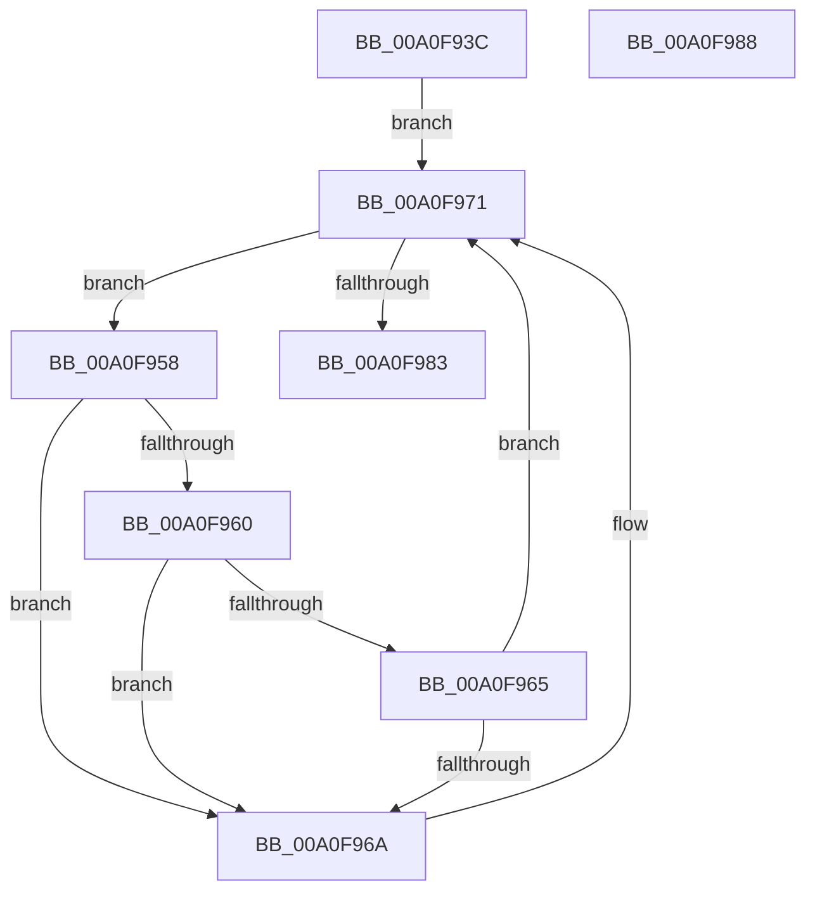

# CmpLightWeightUpdateSharedSetValueData

- RVA: `0x00A0F93C`–`0x00A0F989` (길이 `77` bytes)
- VA: `0x0000000140A0F93C`
- 실행 섹션: `PAGE`
- PDB 이름 있음: `예`; PDB Function 태그: `아니요`
- unwind 정보 RVA: `0x0005C788`
- 디코드: `23`개 명령, `77/77` bytes 표시
- 미해석 바이트: `0` (있으면 어셈블리에 `.byte`로 보존)

> 이 문서는 커널 이미지의 기계어와 PDB 기호를 분석해 생성했습니다. 4번과 5번은 함수 원형과 자료형을 바이너리 사용 방식에서 추정한 C 해석이며 원본 소스 복구 결과는 아닙니다.

## 1. Dependencies

- 직접 호출 지점: **1**; 고유 호출 대상: **1**
- 직접 호출자로 확인된 함수: **2**
- RIP 상대 이미지 참조: **0**

### Outgoing calls
- `0x00A0F979` → [CmListGetNextElement](../../pagecmrc/BC/CmListGetNextElement_function_00BC9940.md) (function, `0x00BC9940`)

### Direct callers
- [CmpLightWeightPrepareSetValueKeyUoW](CmpLightWeightPrepareSetValueKeyUoW_function_00A0EF28.md) at `0x00A0F123`
- [CmpLightWeightPrepareDeleteValueKeyUoW](CmpLightWeightPrepareDeleteValueKeyUoW_function_00A0F3D8.md) at `0x00A0F5FC`

### Static image references
- 디코드된 RIP-relative 메모리 참조가 없습니다.

## 2. Other-region calls and transfers

- 다른 실행 섹션으로 향하는 call: **1**
  - `0x00A0F979` → [CmListGetNextElement](../../pagecmrc/BC/CmListGetNextElement_function_00BC9940.md) (`PAGE` → `PAGECMRC`)
- 별도 외부 분기/꼬리 이동을 확인하지 못했습니다.

## 3. Assembly (complete function range)

```asm
00A0F93C  48 83 EC 28                     sub rsp, 0x28
00A0F940  48 83 64 24 38 00               and qword ptr [rsp + 0x38], 0
00A0F946  4C 8D 92 D0 00 00 00            lea r10, [rdx + 0xd0]
00A0F94D  4C 8B C9                        mov r9, rcx
00A0F950  41 B8 20 00 00 00               mov r8d, 0x20
00A0F956  EB 19                           jmp 0x140a0f971
00A0F958  8B 50 44                        mov edx, dword ptr [rax + 0x44]
00A0F95B  83 EA 04                        sub edx, 4
00A0F95E  74 0A                           je 0x140a0f96a
00A0F960  83 EA 01                        sub edx, 1
00A0F963  74 05                           je 0x140a0f96a
00A0F965  83 FA 01                        cmp edx, 1
00A0F968  75 07                           jne 0x140a0f971
00A0F96A  4C 89 48 68                     mov qword ptr [rax + 0x68], r9
00A0F96E  41 FF 01                        inc dword ptr [r9]
00A0F971  48 8D 54 24 38                  lea rdx, [rsp + 0x38]
00A0F976  49 8B CA                        mov rcx, r10
00A0F979  E8 C2 9F 1B 00                  call 0x140bc9940
00A0F97E  48 85 C0                        test rax, rax
00A0F981  75 D5                           jne 0x140a0f958
00A0F983  48 83 C4 28                     add rsp, 0x28
00A0F987  C3                              ret
00A0F988  CC                              int3
```

## 4. C-style interpretation (structured pseudocode)

```c
__int64 __fastcall CmpLightWeightUpdateSharedSetValueData(__int64 a1, __int64 a2)
{
    __int64 result;
    __int64 v_rsp;
    unsigned __int64 v_stack_p10;

    v_rsp = (v_rsp) - (40);
    goto loc_00A0F971;
loc_00A0F958:
    a2 = (unsigned int)(((unsigned int)(*(unsigned int *)(result + 68))) - (4));
    if (condition_is_equal) goto loc_00A0F96A;
    a2 = (unsigned int)((a2) - (1));
    if (condition_is_equal) goto loc_00A0F96A;
    if (((unsigned int)(a2)) == 1) {
        *(unsigned __int64 *)(result + 104) = a1;
    }
    result = CmListGetNextElement(a2 + 208, v_stack_p10, 32, a1);
    if (result != 0) goto loc_00A0F958;
    v_rsp = (v_rsp) + (40);
    return result;
}
```

## 5. (Beta) C Style

```c
int64_t CmpLightWeightUpdateSharedSetValueData(int64_t Arg1, void *Arg2)
{
    uint8_t *arg2 = (uint8_t *)Arg2;

    int64_t result;
    int64_t local_rsp;
    uint64_t v_stack_p10;

    local_rsp = (local_rsp) - (40);
    goto loc_00A0F971;
loc_00A0F958:
    Arg2 = (uint32_t)(((uint32_t)(*(uint32_t *)(result + 0x44))) - (4));
    if (condition_is_equal) goto loc_00A0F96A;
    Arg2 = (uint32_t)((Arg2) - (1));
    if (condition_is_equal) goto loc_00A0F96A;
    if (((uint32_t)(Arg2)) == 1) {
        *(uint64_t *)(result + 0x68) = Arg1;
    }
    result = CmListGetNextElement(Arg2 + 208, v_stack_p10, 32, Arg1);
    if (result != 0) goto loc_00A0F958;
    local_rsp = (local_rsp) + (40);
    return result;
}
```

### 관측된 메모리 오프셋

구조체 형식이 확인되지 않은 접근은 인자 기준의 오프셋으로만 기록했습니다.

| 기준 인자 | 오프셋 표현 | 폭 (bit) | 접근 |
|---|---:|---:|---|
| `Arg2` | `+ 0xD0` | `64` | `R` |

## 6. Execution-region graph

[열기: 2D/3D 그래프와 함수 탐색 컨트롤 패널](../../../control-panel.html?section=page&rva=0x00A0F93C&view=graph)

- 2D 그래프는 위에서 아래로 흐르고, 3D 그래프는 빈 공간을 드래그해 회전합니다. Shift+드래그는 이동, 휠은 확대·축소, 함수 노드 선택은 대상 보고서 이동입니다.

### Static fallback


