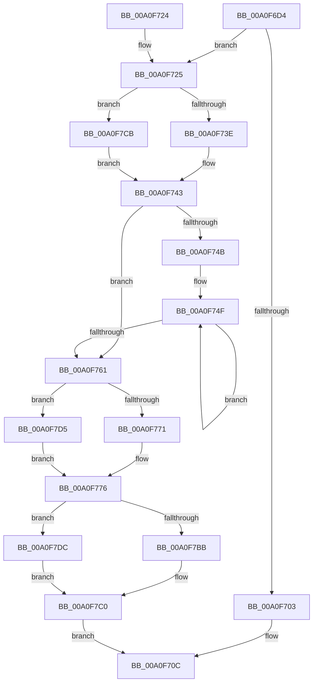

# CmpRemoveValueFromList

- RVA: `0x00A0F6D4`–`0x00A0F7E3` (길이 `271` bytes)
- VA: `0x0000000140A0F6D4`
- 실행 섹션: `PAGE`
- PDB 이름 있음: `예`; PDB Function 태그: `아니요`
- unwind 정보 RVA: `0x000A8FB0`
- 디코드: `77`개 명령, `271/271` bytes 표시
- 미해석 바이트: `0` (있으면 어셈블리에 `.byte`로 보존)

> 이 문서는 커널 이미지의 기계어와 PDB 기호를 분석해 생성했습니다. 4번과 5번은 함수 원형과 자료형을 바이너리 사용 방식에서 추정한 C 해석이며 원본 소스 복구 결과는 아닙니다.

## 1. Dependencies

- 직접 호출 지점: **8**; 고유 호출 대상: **6**
- 직접 호출자로 확인된 함수: **3**
- RIP 상대 이미지 참조: **0**

### Outgoing calls
- `0x00A0F703` → [HvFreeCell](../85/HvFreeCell_function_0085A72C.md) (function, `0x0085A72C`)
- `0x00A0F73E` → [HvpGetCellFlat](../85/HvpGetCellFlat_function_00854C60.md) (function, `0x00854C60`)
- `0x00A0F771` → [HvpReleaseCellPaged](../85/HvpReleaseCellPaged_function_00855F40.md) (function, `0x00855F40`)
- `0x00A0F7A6` → [HvReallocateCell](../85/HvReallocateCell_function_0085B5D0.md) (function, `0x0085B5D0`)
- `0x00A0F7BB` → [HvpReleaseCellPaged](../85/HvpReleaseCellPaged_function_00855F40.md) (function, `0x00855F40`)
- `0x00A0F7CB` → [HvpGetCellPaged](../85/HvpGetCellPaged_function_00854CB0.md) (function, `0x00854CB0`)
- `0x00A0F7D5` → [HvpReleaseCellFlat](../85/HvpReleaseCellFlat_function_0085CC20.md) (function, `0x0085CC20`)
- `0x00A0F7DC` → [HvpReleaseCellFlat](../85/HvpReleaseCellFlat_function_0085CC20.md) (function, `0x0085CC20`)

### Direct callers
- [CmDeleteValueKey](../84/CmDeleteValueKey_function_008476E8.md) at `0x00847B4B`
- [CmDeleteValueKey](../84/CmDeleteValueKey_function_008476E8.md) at `0x00847F84`
- [CmpLightWeightPrepareDeleteValueKeyUoW](CmpLightWeightPrepareDeleteValueKeyUoW_function_00A0F3D8.md) at `0x00A0F542`
- [sub_00B160F4](../B1/Unknown_function_00B160F4.md) at `0x00B162C2`

### Static image references
- 디코드된 RIP-relative 메모리 참조가 없습니다.

## 2. Other-region calls and transfers

- 다른 실행 섹션으로 향하는 call: **0**
- 별도 외부 분기/꼬리 이동을 확인하지 못했습니다.

## 3. Assembly (complete function range)

```asm
00A0F6D4  48 89 5C 24 08                  mov qword ptr [rsp + 8], rbx
00A0F6D9  55                              push rbp
00A0F6DA  56                              push rsi
00A0F6DB  57                              push rdi
00A0F6DC  41 56                           push r14
00A0F6DE  41 57                           push r15
00A0F6E0  48 8B EC                        mov rbp, rsp
00A0F6E3  48 83 EC 50                     sub rsp, 0x50
00A0F6E7  41 8B 30                        mov esi, dword ptr [r8]
00A0F6EA  45 33 FF                        xor r15d, r15d
00A0F6ED  44 8B F2                        mov r14d, edx
00A0F6F0  49 8B F8                        mov rdi, r8
00A0F6F3  41 8B 50 04                     mov edx, dword ptr [r8 + 4]
00A0F6F7  48 8B D9                        mov rbx, rcx
00A0F6FA  44 89 7D 40                     mov dword ptr [rbp + 0x40], r15d
00A0F6FE  83 EE 01                        sub esi, 1
00A0F701  75 22                           jne 0x140a0f725
00A0F703  E8 24 B0 E4 FF                  call 0x14085a72c
00A0F708  83 4F 04 FF                     or dword ptr [rdi + 4], 0xffffffff
00A0F70C  48 8B 9C 24 80 00 00 00         mov rbx, qword ptr [rsp + 0x80]
00A0F714  33 C0                           xor eax, eax
00A0F716  89 37                           mov dword ptr [rdi], esi
00A0F718  48 83 C4 50                     add rsp, 0x50
00A0F71C  41 5F                           pop r15
00A0F71E  41 5E                           pop r14
00A0F720  5F                              pop rdi
00A0F721  5E                              pop rsi
00A0F722  5D                              pop rbp
00A0F723  C3                              ret
00A0F724  CC                              int3
00A0F725  83 4D 48 FF                     or dword ptr [rbp + 0x48], 0xffffffff
00A0F729  4C 8D 45 48                     lea r8, [rbp + 0x48]
00A0F72D  F6 81 8C 00 00 00 01            test byte ptr [rcx + 0x8c], 1
00A0F734  44 89 7D 4C                     mov dword ptr [rbp + 0x4c], r15d
00A0F738  0F 84 8D 00 00 00               je 0x140a0f7cb
00A0F73E  E8 1D 55 E4 FF                  call 0x140854c60
00A0F743  4C 8B C0                        mov r8, rax
00A0F746  44 3B F6                        cmp r14d, esi
00A0F749  73 16                           jae 0x140a0f761
00A0F74B  4A 8D 14 B0                     lea rdx, [rax + r14*4]
00A0F74F  41 FF C6                        inc r14d
00A0F752  43 8B 0C B0                     mov ecx, dword ptr [r8 + r14*4]
00A0F756  89 0A                           mov dword ptr [rdx], ecx
00A0F758  48 8D 52 04                     lea rdx, [rdx + 4]
00A0F75C  44 3B F6                        cmp r14d, esi
00A0F75F  72 EE                           jb 0x140a0f74f
00A0F761  F6 83 8C 00 00 00 01            test byte ptr [rbx + 0x8c], 1
00A0F768  48 8D 55 48                     lea rdx, [rbp + 0x48]
00A0F76C  48 8B CB                        mov rcx, rbx
00A0F76F  75 64                           jne 0x140a0f7d5
00A0F771  E8 CA 67 E4 FF                  call 0x140855f40
00A0F776  8B 57 04                        mov edx, dword ptr [rdi + 4]
00A0F779  48 8D 45 48                     lea rax, [rbp + 0x48]
00A0F77D  48 89 44 24 30                  mov qword ptr [rsp + 0x30], rax
00A0F782  44 8D 04 B5 00 00 00 00         lea r8d, [rsi*4]
00A0F78A  48 8D 45 F0                     lea rax, [rbp - 0x10]
00A0F78E  4C 89 7D F0                     mov qword ptr [rbp - 0x10], r15
00A0F792  48 89 44 24 28                  mov qword ptr [rsp + 0x28], rax
00A0F797  41 B1 01                        mov r9b, 1
00A0F79A  48 8D 45 40                     lea rax, [rbp + 0x40]
00A0F79E  48 8B CB                        mov rcx, rbx
00A0F7A1  48 89 44 24 20                  mov qword ptr [rsp + 0x20], rax
00A0F7A6  E8 25 BE E4 FF                  call 0x14085b5d0
00A0F7AB  F6 83 8C 00 00 00 01            test byte ptr [rbx + 0x8c], 1
00A0F7B2  48 8D 55 48                     lea rdx, [rbp + 0x48]
00A0F7B6  48 8B CB                        mov rcx, rbx
00A0F7B9  75 21                           jne 0x140a0f7dc
00A0F7BB  E8 80 67 E4 FF                  call 0x140855f40
00A0F7C0  8B 45 40                        mov eax, dword ptr [rbp + 0x40]
00A0F7C3  89 47 04                        mov dword ptr [rdi + 4], eax
00A0F7C6  E9 41 FF FF FF                  jmp 0x140a0f70c
00A0F7CB  E8 E0 54 E4 FF                  call 0x140854cb0
00A0F7D0  E9 6E FF FF FF                  jmp 0x140a0f743
00A0F7D5  E8 46 D4 E4 FF                  call 0x14085cc20
00A0F7DA  EB 9A                           jmp 0x140a0f776
00A0F7DC  E8 3F D4 E4 FF                  call 0x14085cc20
00A0F7E1  EB DD                           jmp 0x140a0f7c0
```

## 4. C-style interpretation (structured pseudocode)

```c
__int64 __fastcall CmpRemoveValueFromList(__int64 a1, int a2, __int64 a3)
{
    __int64 result;
    __int64 v_r14;
    __int64 v_r15;
    __int64 v_rsi;
    __int64 v_rsp;
    unsigned __int64 v_stack_m38;
    unsigned int v_stack_p18;
    unsigned int v_stack_p20;
    unsigned int v_stack_p24;
    unsigned __int64 v_stack_p28;
    unsigned __int64 v_stack_p30;
    unsigned __int64 v_stack_p8;

    v_stack_p8 = v_rbx;
    v_rsp = (v_rsp) - (80);
    v_r15 = 0;
    v_stack_p18 = 0;
    v_rsi = (unsigned int)(((unsigned int)(*(unsigned int *)(a3))) - (1));
    if (condition_is_not_equal) goto loc_00A0F725;
    result = HvFreeCell(a1, (unsigned int)(*(unsigned int *)(a3 + 4)), a3, a4);
loc_00A0F70C:
    result = 0;
    *(unsigned int *)(a3) = (unsigned int)(v_rsi);
    v_rsp = (v_rsp) + (80);
    return result;
loc_00A0F725:
    v_stack_p24 = 0;
    if (((*(unsigned __int8 *)(a1 + 140)) & (1)) == 0) goto loc_00A0F7CB;
    result = HvpGetCellFlat(a1, (unsigned int)(*(unsigned int *)(a3 + 4)), v_stack_p20, a4);
loc_00A0F743:
    if (((unsigned int)((unsigned int)(a2))) >= ((unsigned int)(v_rsi))) goto loc_00A0F761;
loc_00A0F74F:
    v_r14 = (unsigned int)(((unsigned int)(a2)) + 1);
    *(unsigned int *)(result + (unsigned int)(a2) * 4) = (unsigned int)((unsigned int)(*(unsigned int *)(result + v_r14 * 4)));
    if (((unsigned int)(v_r14)) < ((unsigned int)(v_rsi))) goto loc_00A0F74F;
loc_00A0F761:
    if (((*(unsigned __int8 *)(v_stack_p8 + 140)) & (1)) != 0) goto loc_00A0F7D5;
    result = HvpReleaseCellPaged(v_stack_p8, v_stack_p20, result, a4);
loc_00A0F776:
    v_stack_p30 = v_stack_p20;
    v_stack_m38 = 0;
    v_stack_p28 = v_stack_m38;
    v_stack_p20 = v_stack_p18;
    result = HvReallocateCell(v_stack_p8, (unsigned int)(*(unsigned int *)(a3 + 4)), v_rsi * 4, 1);
    if (((*(unsigned __int8 *)(v_stack_p8 + 140)) & (1)) != 0) goto loc_00A0F7DC;
    result = HvpReleaseCellPaged(v_stack_p8, v_stack_p20, v_rsi * 4, 1);
loc_00A0F7C0:
    *(unsigned int *)(a3 + 4) = (unsigned int)((unsigned int)(v_stack_p18));
    goto loc_00A0F70C;
loc_00A0F7CB:
    result = HvpGetCellPaged(v_stack_p8, v_stack_p20, v_rsi * 4, 1);
    goto loc_00A0F743;
loc_00A0F7D5:
    result = HvpReleaseCellFlat(v_stack_p8, v_stack_p20, v_rsi * 4, 1);
    goto loc_00A0F776;
loc_00A0F7DC:
    result = HvpReleaseCellFlat(v_stack_p8, v_stack_p20, v_rsi * 4, 1);
    goto loc_00A0F7C0;
}
```

## 5. (Beta) C Style

```c
int64_t CmpRemoveValueFromList(void *Arg1, int32_t Arg2, void *Arg3)
{
    uint8_t *arg1 = (uint8_t *)Arg1;
    uint8_t *arg3 = (uint8_t *)Arg3;

    int64_t result;
    int64_t local_r14;
    int64_t local_r15;
    int64_t local_rsi;
    int64_t local_rsp;
    uint64_t v_stack_m38;
    uint32_t v_stack_p18;
    uint32_t v_stack_p20;
    uint32_t v_stack_p24;
    uint64_t v_stack_p28;
    uint64_t v_stack_p30;
    uint64_t v_stack_p8;

    v_stack_p8 = local_rbx;
    local_rsp = (local_rsp) - (80);
    local_r15 = 0;
    v_stack_p18 = 0;
    local_rsi = (uint32_t)(((uint32_t)(*(uint32_t *)(arg3))) - (1));
    if (condition_is_not_equal) goto loc_00A0F725;
    result = HvFreeCell(Arg1, (uint32_t)(*(uint32_t *)(arg3 + 0x4)), Arg3, a4);
loc_00A0F70C:
    result = 0;
    *(uint32_t *)(arg3) = (uint32_t)(local_rsi);
    local_rsp = (local_rsp) + (80);
    return result;
loc_00A0F725:
    v_stack_p24 = 0;
    if (((*(uint8_t *)(arg1 + 0x8C)) & (1)) == 0) goto loc_00A0F7CB;
    result = HvpGetCellFlat(Arg1, (uint32_t)(*(uint32_t *)(arg3 + 0x4)), v_stack_p20, a4);
loc_00A0F743:
    if (((uint32_t)((uint32_t)(Arg2))) >= ((uint32_t)(local_rsi))) goto loc_00A0F761;
loc_00A0F74F:
    local_r14 = (uint32_t)(((uint32_t)(Arg2)) + 1);
    *(uint32_t *)(result + (uint32_t)(Arg2) * 4) = (uint32_t)((uint32_t)(*(uint32_t *)(result + local_r14 * 4)));
    if (((uint32_t)(local_r14)) < ((uint32_t)(local_rsi))) goto loc_00A0F74F;
loc_00A0F761:
    if (((*(uint8_t *)(v_stack_p8 + 0x8C)) & (1)) != 0) goto loc_00A0F7D5;
    result = HvpReleaseCellPaged(v_stack_p8, v_stack_p20, result, a4);
loc_00A0F776:
    v_stack_p30 = v_stack_p20;
    v_stack_m38 = 0;
    v_stack_p28 = v_stack_m38;
    v_stack_p20 = v_stack_p18;
    result = HvReallocateCell(v_stack_p8, (uint32_t)(*(uint32_t *)(arg3 + 0x4)), local_rsi * 4, 1);
    if (((*(uint8_t *)(v_stack_p8 + 0x8C)) & (1)) != 0) goto loc_00A0F7DC;
    result = HvpReleaseCellPaged(v_stack_p8, v_stack_p20, local_rsi * 4, 1);
loc_00A0F7C0:
    *(uint32_t *)(arg3 + 0x4) = (uint32_t)((uint32_t)(v_stack_p18));
    goto loc_00A0F70C;
loc_00A0F7CB:
    result = HvpGetCellPaged(v_stack_p8, v_stack_p20, local_rsi * 4, 1);
    goto loc_00A0F743;
loc_00A0F7D5:
    result = HvpReleaseCellFlat(v_stack_p8, v_stack_p20, local_rsi * 4, 1);
    goto loc_00A0F776;
loc_00A0F7DC:
    result = HvpReleaseCellFlat(v_stack_p8, v_stack_p20, local_rsi * 4, 1);
    goto loc_00A0F7C0;
}
```

### 관측된 메모리 오프셋

구조체 형식이 확인되지 않은 접근은 인자 기준의 오프셋으로만 기록했습니다.

| 기준 인자 | 오프셋 표현 | 폭 (bit) | 접근 |
|---|---:|---:|---|
| `Arg1` | `+ 0x8C` | `8` | `R` |
| `Arg3` | `+ 0x0` | `32` | `R` |
| `Arg3` | `+ 0x0` | `32` | `W` |
| `Arg3` | `+ 0x4` | `32` | `R` |
| `Arg3` | `+ 0x4` | `32` | `R/W` |
| `Arg3` | `+ 0x4` | `32` | `W` |

## 6. Execution-region graph

[열기: 2D/3D 그래프와 함수 탐색 컨트롤 패널](../../../control-panel.html?section=page&rva=0x00A0F6D4&view=graph)

- 2D 그래프는 위에서 아래로 흐르고, 3D 그래프는 빈 공간을 드래그해 회전합니다. Shift+드래그는 이동, 휠은 확대·축소, 함수 노드 선택은 대상 보고서 이동입니다.

### Static fallback


