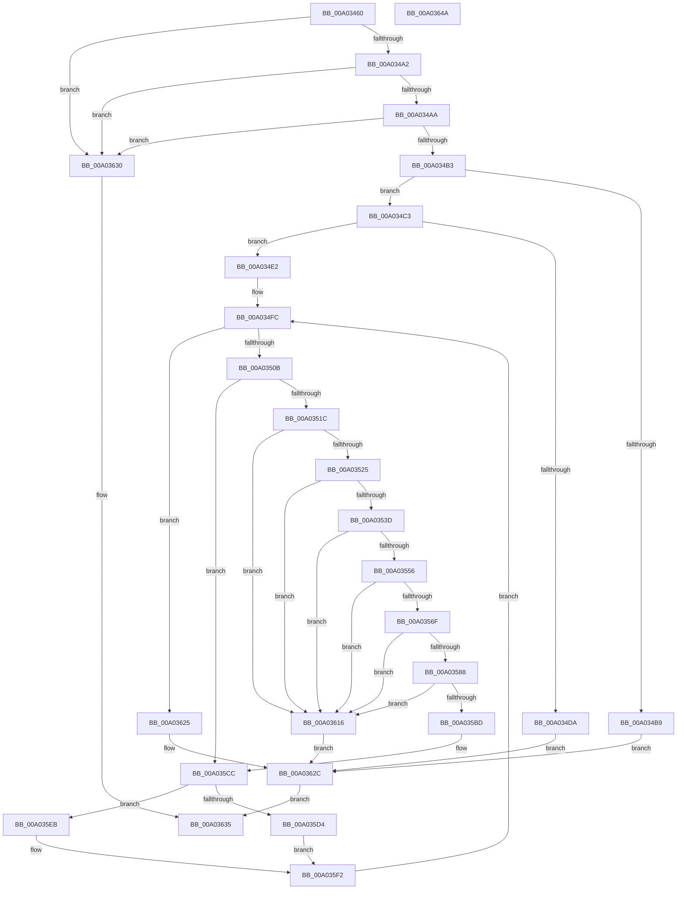

# DecodeAttributeName

- RVA: `0x00A03460`–`0x00A0364B` (길이 `491` bytes)
- VA: `0x0000000140A03460`
- 실행 섹션: `PAGE`
- PDB 이름 있음: `예`; PDB Function 태그: `아니요`
- unwind 정보 RVA: `0x000A7FC8`
- 디코드: `141`개 명령, `491/491` bytes 표시
- 미해석 바이트: `0` (있으면 어셈블리에 `.byte`로 보존)

> 이 문서는 커널 이미지의 기계어와 PDB 기호를 분석해 생성했습니다. 4번과 5번은 함수 원형과 자료형을 바이너리 사용 방식에서 추정한 C 해석이며 원본 소스 복구 결과는 아닙니다.

## 1. Dependencies

- 직접 호출 지점: **7**; 고유 호출 대상: **4**
- 직접 호출자로 확인된 함수: **2**
- RIP 상대 이미지 참조: **0**

### Outgoing calls
- `0x00A034CD` → [SddlpAlloc](../92/SddlpAlloc_function_00925F88.md) (function, `0x00925F88`)
- `0x00A03530` → [GetDigitFromChar2](../7A/GetDigitFromChar2_function_007A569C.md) (function, `0x007A569C`)
- `0x00A03549` → [GetDigitFromChar2](../7A/GetDigitFromChar2_function_007A569C.md) (function, `0x007A569C`)
- `0x00A03562` → [GetDigitFromChar2](../7A/GetDigitFromChar2_function_007A569C.md) (function, `0x007A569C`)
- `0x00A0357B` → [GetDigitFromChar2](../7A/GetDigitFromChar2_function_007A569C.md) (function, `0x007A569C`)
- `0x00A035B1` → [IsEncodedAttributeChar](../7A/IsEncodedAttributeChar_function_007A5944.md) (function, `0x007A5944`)
- `0x00A0361E` → [PdcCloseEvent](../8D/PdcCloseEvent_function_008D2404.md) (function, `0x008D2404`)

### Direct callers
- [GetAttributeName](GetAttributeName_function_00A02768.md) at `0x00A02920`
- [LocalGetRelativeAttributeForString](../AC/LocalGetRelativeAttributeForString_function_00AC74E4.md) at `0x00AC75EF`

### Static image references
- 디코드된 RIP-relative 메모리 참조가 없습니다.

## 2. Other-region calls and transfers

- 다른 실행 섹션으로 향하는 call: **0**
- 별도 외부 분기/꼬리 이동을 확인하지 못했습니다.

## 3. Assembly (complete function range)

```asm
00A03460  48 89 5C 24 10                  mov qword ptr [rsp + 0x10], rbx
00A03465  4C 89 44 24 18                  mov qword ptr [rsp + 0x18], r8
00A0346A  55                              push rbp
00A0346B  56                              push rsi
00A0346C  57                              push rdi
00A0346D  41 54                           push r12
00A0346F  41 55                           push r13
00A03471  41 56                           push r14
00A03473  41 57                           push r15
00A03475  48 8B EC                        mov rbp, rsp
00A03478  48 83 EC 30                     sub rsp, 0x30
00A0347C  33 DB                           xor ebx, ebx
00A0347E  8B FA                           mov edi, edx
00A03480  89 5D F4                        mov dword ptr [rbp - 0xc], ebx
00A03483  49 8B C0                        mov rax, r8
00A03486  66 89 5D F2                     mov word ptr [rbp - 0xe], bx
00A0348A  4C 8B F1                        mov r14, rcx
00A0348D  88 5D 40                        mov byte ptr [rbp + 0x40], bl
00A03490  88 5D 58                        mov byte ptr [rbp + 0x58], bl
00A03493  88 5D F0                        mov byte ptr [rbp - 0x10], bl
00A03496  88 5D F1                        mov byte ptr [rbp - 0xf], bl
00A03499  48 85 C9                        test rcx, rcx
00A0349C  0F 84 8E 01 00 00               je 0x140a03630
00A034A2  85 D2                           test edx, edx
00A034A4  0F 84 86 01 00 00               je 0x140a03630
00A034AA  48 85 C0                        test rax, rax
00A034AD  0F 84 7D 01 00 00               je 0x140a03630
00A034B3  40 F6 C7 01                     test dil, 1
00A034B7  74 0A                           je 0x140a034c3
00A034B9  BB 38 05 00 00                  mov ebx, 0x538
00A034BE  E9 69 01 00 00                  jmp 0x140a0362c
00A034C3  41 BF 02 00 00 00               mov r15d, 2
00A034C9  49 8D 0C 3F                     lea rcx, [r15 + rdi]
00A034CD  E8 B6 2A F2 FF                  call 0x140925f88
00A034D2  4C 8B E8                        mov r13, rax
00A034D5  48 85 C0                        test rax, rax
00A034D8  75 08                           jne 0x140a034e2
00A034DA  8D 58 08                        lea ebx, [rax + 8]
00A034DD  E9 4A 01 00 00                  jmp 0x140a0362c
00A034E2  41 BC 04 00 00 00               mov r12d, 4
00A034E8  D1 EF                           shr edi, 1
00A034EA  8B F3                           mov esi, ebx
00A034EC  0F B7 CB                        movzx ecx, bx
00A034EF  44 8B D3                        mov r10d, ebx
00A034F2  45 8D 44 24 FF                  lea r8d, [r12 - 1]
00A034F7  41 8D 54 24 FD                  lea edx, [r12 - 3]
00A034FC  89 55 F8                        mov dword ptr [rbp - 8], edx
00A034FF  44 89 45 FC                     mov dword ptr [rbp - 4], r8d
00A03503  3B F7                           cmp esi, edi
00A03505  0F 83 1A 01 00 00               jae 0x140a03625
00A0350B  8B C6                           mov eax, esi
00A0350D  44 8A CB                        mov r9b, bl
00A03510  66 41 83 3C 46 25               cmp word ptr [r14 + rax*2], 0x25
00A03516  0F 85 B0 00 00 00               jne 0x140a035cc
00A0351C  44 3B E7                        cmp r12d, edi
00A0351F  0F 83 F1 00 00 00               jae 0x140a03616
00A03525  8B CA                           mov ecx, edx
00A03527  48 8D 55 40                     lea rdx, [rbp + 0x40]
00A0352B  41 0F B7 0C 4E                  movzx ecx, word ptr [r14 + rcx*2]
00A03530  E8 67 21 DA FF                  call 0x1407a569c
00A03535  84 C0                           test al, al
00A03537  0F 84 D9 00 00 00               je 0x140a03616
00A0353D  41 8B CF                        mov ecx, r15d
00A03540  48 8D 55 58                     lea rdx, [rbp + 0x58]
00A03544  41 0F B7 0C 4E                  movzx ecx, word ptr [r14 + rcx*2]
00A03549  E8 4E 21 DA FF                  call 0x1407a569c
00A0354E  84 C0                           test al, al
00A03550  0F 84 C0 00 00 00               je 0x140a03616
00A03556  41 8B C8                        mov ecx, r8d
00A03559  48 8D 55 F0                     lea rdx, [rbp - 0x10]
00A0355D  41 0F B7 0C 4E                  movzx ecx, word ptr [r14 + rcx*2]
00A03562  E8 35 21 DA FF                  call 0x1407a569c
00A03567  84 C0                           test al, al
00A03569  0F 84 A7 00 00 00               je 0x140a03616
00A0356F  41 8B CC                        mov ecx, r12d
00A03572  48 8D 55 F1                     lea rdx, [rbp - 0xf]
00A03576  41 0F B7 0C 4E                  movzx ecx, word ptr [r14 + rcx*2]
00A0357B  E8 1C 21 DA FF                  call 0x1407a569c
00A03580  84 C0                           test al, al
00A03582  0F 84 8E 00 00 00               je 0x140a03616
00A03588  0F B6 45 58                     movzx eax, byte ptr [rbp + 0x58]
00A0358C  0F B6 4D 40                     movzx ecx, byte ptr [rbp + 0x40]
00A03590  66 C1 E1 04                     shl cx, 4
00A03594  66 0B C8                        or cx, ax
00A03597  0F B6 45 F0                     movzx eax, byte ptr [rbp - 0x10]
00A0359B  66 C1 E1 04                     shl cx, 4
00A0359F  66 0B C8                        or cx, ax
00A035A2  0F B6 45 F1                     movzx eax, byte ptr [rbp - 0xf]
00A035A6  66 C1 E1 04                     shl cx, 4
00A035AA  66 0B C8                        or cx, ax
00A035AD  66 89 4D F2                     mov word ptr [rbp - 0xe], cx
00A035B1  E8 8E 23 DA FF                  call 0x1407a5944
00A035B6  44 8A C8                        mov r9b, al
00A035B9  84 C0                           test al, al
00A035BB  74 59                           je 0x140a03616
00A035BD  0F B7 4D F2                     movzx ecx, word ptr [rbp - 0xe]
00A035C1  44 8B 45 FC                     mov r8d, dword ptr [rbp - 4]
00A035C5  8B 55 F8                        mov edx, dword ptr [rbp - 8]
00A035C8  44 8B 55 F4                     mov r10d, dword ptr [rbp - 0xc]
00A035CC  45 8B DA                        mov r11d, r10d
00A035CF  45 84 C9                        test r9b, r9b
00A035D2  74 17                           je 0x140a035eb
00A035D4  83 C6 04                        add esi, 4
00A035D7  83 C2 04                        add edx, 4
00A035DA  41 83 C7 04                     add r15d, 4
00A035DE  41 83 C0 04                     add r8d, 4
00A035E2  41 83 C4 04                     add r12d, 4
00A035E6  0F B7 C1                        movzx eax, cx
00A035E9  EB 07                           jmp 0x140a035f2
00A035EB  8B C6                           mov eax, esi
00A035ED  41 0F B7 04 46                  movzx eax, word ptr [r14 + rax*2]
00A035F2  66 43 89 44 5D 00               mov word ptr [r13 + r11*2], ax
00A035F8  B8 01 00 00 00                  mov eax, 1
00A035FD  03 F0                           add esi, eax
00A035FF  03 D0                           add edx, eax
00A03601  44 03 F8                        add r15d, eax
00A03604  44 03 C0                        add r8d, eax
00A03607  44 03 E0                        add r12d, eax
00A0360A  44 03 D0                        add r10d, eax
00A0360D  44 89 55 F4                     mov dword ptr [rbp - 0xc], r10d
00A03611  E9 E6 FE FF FF                  jmp 0x140a034fc
00A03616  49 8B CD                        mov rcx, r13
00A03619  BB 38 05 00 00                  mov ebx, 0x538
00A0361E  E8 E1 ED EC FF                  call 0x1408d2404
00A03623  EB 07                           jmp 0x140a0362c
00A03625  48 8B 45 50                     mov rax, qword ptr [rbp + 0x50]
00A03629  4C 89 28                        mov qword ptr [rax], r13
00A0362C  8B C3                           mov eax, ebx
00A0362E  EB 05                           jmp 0x140a03635
00A03630  B8 57 00 00 00                  mov eax, 0x57
00A03635  48 8B 5C 24 78                  mov rbx, qword ptr [rsp + 0x78]
00A0363A  48 83 C4 30                     add rsp, 0x30
00A0363E  41 5F                           pop r15
00A03640  41 5E                           pop r14
00A03642  41 5D                           pop r13
00A03644  41 5C                           pop r12
00A03646  5F                              pop rdi
00A03647  5E                              pop rsi
00A03648  5D                              pop rbp
00A03649  C3                              ret
00A0364A  CC                              int3
```

## 4. C-style interpretation (structured pseudocode)

```c
__int64 __fastcall DecodeAttributeName(__int64 a1, int a2, __int64 a3)
{
    __int64 result;
    __int64 v_r10;
    __int64 v_r12;
    __int64 v_r15;
    __int64 v_rbx;
    __int64 v_rdi;
    __int64 v_rsi;
    __int64 v_rsp;
    unsigned int v_stack_m3C;
    unsigned int v_stack_m40;
    unsigned int v_stack_m44;
    unsigned __int16 v_stack_m46;
    unsigned __int8 v_stack_m47;
    unsigned __int8 v_stack_m48;
    unsigned __int64 v_stack_p10;
    unsigned __int64 v_stack_p18;
    unsigned __int8 v_stack_p20;
    unsigned __int8 v_stack_p8;

    v_stack_p10 = v_rbx;
    v_stack_p18 = a3;
    v_rsp = (v_rsp) - (48);
    v_rbx = 0;
    v_stack_m44 = 0;
    v_stack_m46 = 0;
    v_stack_p8 = 0;
    v_stack_p20 = 0;
    v_stack_m48 = 0;
    v_stack_m47 = 0;
    if (a1 == 0) goto loc_00A03630;
    if (a2 == 0) goto loc_00A03630;
    if (a3 == 0) goto loc_00A03630;
    if ((((unsigned __int8)((unsigned int)(a2))) & (1)) == 0) goto loc_00A034C3;
    goto loc_00A0362C;
loc_00A034C3:
    result = SddlpAlloc(2 + (unsigned int)(a2) * 1, a2, a3, a4);
    if (result != 0) goto loc_00A034E2;
    goto loc_00A0362C;
loc_00A034E2:
    v_rdi = (unsigned int)(((unsigned int)(a2)) >> (1));
loc_00A034FC:
    v_stack_m40 = (unsigned int)(4 - 3);
    v_stack_m3C = (unsigned int)(4 - 1);
    if (((unsigned int)((unsigned int)((unsigned int)(result + 8)))) >= ((unsigned int)(v_rdi))) goto loc_00A03625;
    if ((*(unsigned __int16 *)(a1 + (unsigned int)((unsigned int)((unsigned int)((unsigned int)(result + 8)))) * 2)) != 37) goto loc_00A035CC;
    if (4 >= ((unsigned int)(v_rdi))) goto loc_00A03616;
    result = GetDigitFromChar2(*(unsigned __int16 *)(a1 + (unsigned int)((unsigned int)(4 - 3)) * 2), v_stack_p8, 4 - 1, (unsigned __int8)(result + 8));
    if ((unsigned __int8)(result) == 0) goto loc_00A03616;
    result = GetDigitFromChar2(*(unsigned __int16 *)(a1 + 2 * 2), v_stack_p20, 4 - 1, (unsigned __int8)(result + 8));
    if ((unsigned __int8)(result) == 0) goto loc_00A03616;
    result = GetDigitFromChar2(*(unsigned __int16 *)(a1 + (unsigned int)((unsigned int)(4 - 1)) * 2), v_stack_m48, 4 - 1, (unsigned __int8)(result + 8));
    if ((unsigned __int8)(result) == 0) goto loc_00A03616;
    result = GetDigitFromChar2(*(unsigned __int16 *)(a1 + 4 * 2), v_stack_m47, 4 - 1, (unsigned __int8)(result + 8));
    if ((unsigned __int8)(result) == 0) goto loc_00A03616;
    a1 = (unsigned __int16)((v_stack_p8) << (4));
    a1 = (unsigned __int16)((a1) | ((unsigned __int16)(v_stack_p20)));
    a1 = (unsigned __int16)((a1) << (4));
    a1 = (unsigned __int16)((a1) | ((unsigned __int16)(v_stack_m48)));
    a1 = (unsigned __int16)((a1) << (4));
    a1 = (unsigned __int16)((a1) | ((unsigned __int16)(v_stack_m47)));
    v_stack_m46 = (unsigned __int16)(a1);
    result = IsEncodedAttributeChar(a1, v_stack_m47, 4 - 1, (unsigned __int8)(result + 8));
    if ((unsigned __int8)(result) == 0) goto loc_00A03616;
loc_00A035CC:
    if ((unsigned __int8)((unsigned __int8)(result)) == 0) goto loc_00A035EB;
    v_rsi = (unsigned int)(((unsigned int)((unsigned int)(result + 8))) + (4));
    a2 = (unsigned int)(((unsigned int)(v_stack_m40)) + (4));
    v_r15 = (unsigned int)((2) + (4));
    a3 = (unsigned int)(((unsigned int)(v_stack_m3C)) + (4));
    v_r12 = (unsigned int)((4) + (4));
    goto loc_00A035F2;
loc_00A035EB:
loc_00A035F2:
    *(unsigned __int16 *)(result + (unsigned int)((unsigned int)((unsigned int)(v_stack_m44))) * 2) = (unsigned __int16)(*(unsigned __int16 *)(a1 + (unsigned int)((unsigned int)(v_rsi)) * 2));
    v_rsi = (unsigned int)((v_rsi) + (1));
    a2 = (unsigned int)((a2) + (1));
    v_r15 = (unsigned int)((v_r15) + (1));
    a3 = (unsigned int)((a3) + (1));
    v_r12 = (unsigned int)((v_r12) + (1));
    v_r10 = (unsigned int)(((unsigned int)(v_stack_m44)) + (1));
    v_stack_m44 = (unsigned int)(v_r10);
    goto loc_00A034FC;
loc_00A03616:
    result = PdcCloseEvent(result, a2, a3, (unsigned __int8)(result));
    goto loc_00A0362C;
loc_00A03625:
    *(unsigned __int64 *)(v_stack_p18) = result;
loc_00A0362C:
    goto loc_00A03635;
loc_00A03630:
loc_00A03635:
    v_rsp = (v_rsp) + (48);
    return 87;
}
```

## 5. (Beta) C Style

```c
int64_t DecodeAttributeName(void *Arg1, int32_t Arg2, int64_t Arg3)
{
    uint8_t *arg1 = (uint8_t *)Arg1;

    int64_t result;
    int64_t local_r10;
    int64_t local_r12;
    int64_t local_r15;
    int64_t local_rbx;
    int64_t local_rdi;
    int64_t local_rsi;
    int64_t local_rsp;
    uint32_t v_stack_m3C;
    uint32_t v_stack_m40;
    uint32_t v_stack_m44;
    uint16_t v_stack_m46;
    uint8_t v_stack_m47;
    uint8_t v_stack_m48;
    uint64_t v_stack_p10;
    uint64_t v_stack_p18;
    uint8_t v_stack_p20;
    uint8_t v_stack_p8;

    v_stack_p10 = local_rbx;
    v_stack_p18 = Arg3;
    local_rsp = (local_rsp) - (48);
    local_rbx = 0;
    v_stack_m44 = 0;
    v_stack_m46 = 0;
    v_stack_p8 = 0;
    v_stack_p20 = 0;
    v_stack_m48 = 0;
    v_stack_m47 = 0;
    if (Arg1 == NULL) goto loc_00A03630;
    if (Arg2 == 0) goto loc_00A03630;
    if (Arg3 == 0) goto loc_00A03630;
    if ((((uint8_t)((uint32_t)(Arg2))) & (1)) == 0) goto loc_00A034C3;
    goto loc_00A0362C;
loc_00A034C3:
    result = SddlpAlloc(2 + (uint32_t)(Arg2) * 1, Arg2, Arg3, a4);
    if (result != 0) goto loc_00A034E2;
    goto loc_00A0362C;
loc_00A034E2:
    local_rdi = (uint32_t)(((uint32_t)(Arg2)) >> (1));
loc_00A034FC:
    v_stack_m40 = (uint32_t)(4 - 3);
    v_stack_m3C = (uint32_t)(4 - 1);
    if (((uint32_t)((uint32_t)((uint32_t)(result + 8)))) >= ((uint32_t)(local_rdi))) goto loc_00A03625;
    if ((*(uint16_t *)(arg1 + (uint32_t)((uint32_t)((uint32_t)((uint32_t)(result + 0x8)))) * 2)) != 37) goto loc_00A035CC;
    if (4 >= ((uint32_t)(local_rdi))) goto loc_00A03616;
    result = GetDigitFromChar2(*(uint16_t *)(arg1 + (uint32_t)((uint32_t)(4 - 0x3)) * 2), v_stack_p8, 4 - 1, (uint8_t)(result + 8));
    if ((uint8_t)(result) == 0) goto loc_00A03616;
    result = GetDigitFromChar2(*(uint16_t *)(arg1 + 0x2 * 2), v_stack_p20, 4 - 1, (uint8_t)(result + 8));
    if ((uint8_t)(result) == 0) goto loc_00A03616;
    result = GetDigitFromChar2(*(uint16_t *)(arg1 + (uint32_t)((uint32_t)(4 - 0x1)) * 2), v_stack_m48, 4 - 1, (uint8_t)(result + 8));
    if ((uint8_t)(result) == 0) goto loc_00A03616;
    result = GetDigitFromChar2(*(uint16_t *)(arg1 + 0x4 * 2), v_stack_m47, 4 - 1, (uint8_t)(result + 8));
    if ((uint8_t)(result) == 0) goto loc_00A03616;
    Arg1 = (uint16_t)((v_stack_p8) << (4));
    Arg1 = (uint16_t)((Arg1) | ((uint16_t)(v_stack_p20)));
    Arg1 = (uint16_t)((Arg1) << (4));
    Arg1 = (uint16_t)((Arg1) | ((uint16_t)(v_stack_m48)));
    Arg1 = (uint16_t)((Arg1) << (4));
    Arg1 = (uint16_t)((Arg1) | ((uint16_t)(v_stack_m47)));
    v_stack_m46 = (uint16_t)(Arg1);
    result = IsEncodedAttributeChar(Arg1, v_stack_m47, 4 - 1, (uint8_t)(result + 8));
    if ((uint8_t)(result) == 0) goto loc_00A03616;
loc_00A035CC:
    if ((uint8_t)((uint8_t)(result)) == 0) goto loc_00A035EB;
    local_rsi = (uint32_t)(((uint32_t)((uint32_t)(result + 8))) + (4));
    Arg2 = (uint32_t)(((uint32_t)(v_stack_m40)) + (4));
    local_r15 = (uint32_t)((2) + (4));
    Arg3 = (uint32_t)(((uint32_t)(v_stack_m3C)) + (4));
    local_r12 = (uint32_t)((4) + (4));
    goto loc_00A035F2;
loc_00A035EB:
loc_00A035F2:
    *(uint16_t *)(result + (uint32_t)((uint32_t)((uint32_t)(v_stack_m44))) * 2) = (uint16_t)(*(uint16_t *)(arg1 + (uint32_t)((uint32_t)(local_rsi)) * 2));
    local_rsi = (uint32_t)((local_rsi) + (1));
    Arg2 = (uint32_t)((Arg2) + (1));
    local_r15 = (uint32_t)((local_r15) + (1));
    Arg3 = (uint32_t)((Arg3) + (1));
    local_r12 = (uint32_t)((local_r12) + (1));
    local_r10 = (uint32_t)(((uint32_t)(v_stack_m44)) + (1));
    v_stack_m44 = (uint32_t)(local_r10);
    goto loc_00A034FC;
loc_00A03616:
    result = PdcCloseEvent(result, Arg2, Arg3, (uint8_t)(result));
    goto loc_00A0362C;
loc_00A03625:
    *(uint64_t *)(v_stack_p18) = result;
loc_00A0362C:
    goto loc_00A03635;
loc_00A03630:
loc_00A03635:
    local_rsp = (local_rsp) + (48);
    return 87;
}
```

### 관측된 메모리 오프셋

구조체 형식이 확인되지 않은 접근은 인자 기준의 오프셋으로만 기록했습니다.

| 기준 인자 | 오프셋 표현 | 폭 (bit) | 접근 |
|---|---:|---:|---|
| `Arg1` | `+ 0x0 + rax*2` | `16` | `R` |
| `Arg1` | `+ 0x0 + rcx*2` | `16` | `R` |

## 6. Execution-region graph

[열기: 2D/3D 그래프와 함수 탐색 컨트롤 패널](../../../control-panel.html?section=page&rva=0x00A03460&view=graph)

- 2D 그래프는 위에서 아래로 흐르고, 3D 그래프는 빈 공간을 드래그해 회전합니다. Shift+드래그는 이동, 휠은 확대·축소, 함수 노드 선택은 대상 보고서 이동입니다.

### Static fallback


