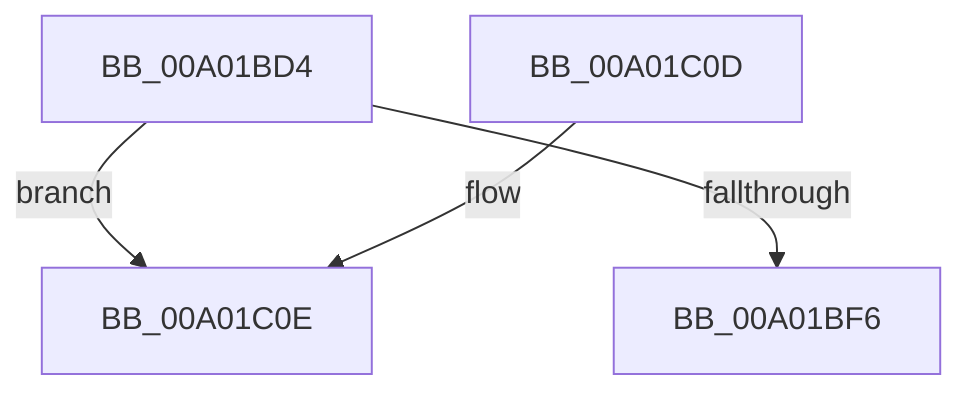

# EncloseSubCondition

- RVA: `0x00A01BD4`–`0x00A01C17` (길이 `67` bytes)
- VA: `0x0000000140A01BD4`
- 실행 섹션: `PAGE`
- PDB 이름 있음: `예`; PDB Function 태그: `예`
- unwind 정보 RVA: `0x00078298`
- 디코드: `20`개 명령, `67/67` bytes 표시
- 미해석 바이트: `0` (있으면 어셈블리에 `.byte`로 보존)

> 이 문서는 커널 이미지의 기계어와 PDB 기호를 분석해 생성했습니다. 4번과 5번은 함수 원형과 자료형을 바이너리 사용 방식에서 추정한 C 해석이며 원본 소스 복구 결과는 아닙니다.

## 1. Dependencies

- 직접 호출 지점: **0**; 고유 호출 대상: **0**
- 직접 호출자로 확인된 함수: **2**
- RIP 상대 이미지 참조: **0**

### Outgoing calls
- 직접 디코드된 call 명령이 없습니다.

### Direct callers
- [LocalpGetStringForCondition](LocalpGetStringForCondition_function_00A0122C.md) at `0x00A0155D`
- [LocalpGetStringForCondition](LocalpGetStringForCondition_function_00A0122C.md) at `0x00A01707`
- [sub_00B32900](../B3/Unknown_function_00B32900.md) at `0x00B3293E`

### Static image references
- 디코드된 RIP-relative 메모리 참조가 없습니다.

## 2. Other-region calls and transfers

- 다른 실행 섹션으로 향하는 call: **0**
- call이 아닌 외부 분기/꼬리 이동: **1**
  - `0x00A01C12` → [sub_00B32F2A](../B3/Unknown_function_00B32F2A.md) (`tail-transfer`)

## 3. Assembly (complete function range)

```asm
00A01BD4  48 89 5C 24 08                  mov qword ptr [rsp + 8], rbx
00A01BD9  48 89 6C 24 10                  mov qword ptr [rsp + 0x10], rbp
00A01BDE  48 89 74 24 18                  mov qword ptr [rsp + 0x18], rsi
00A01BE3  57                              push rdi
00A01BE4  48 83 EC 20                     sub rsp, 0x20
00A01BE8  48 8B F9                        mov rdi, rcx
00A01BEB  33 DB                           xor ebx, ebx
00A01BED  48 8B 09                        mov rcx, qword ptr [rcx]
00A01BF0  66 83 39 28                     cmp word ptr [rcx], 0x28
00A01BF4  75 18                           jne 0x140a01c0e
00A01BF6  48 8B 6C 24 38                  mov rbp, qword ptr [rsp + 0x38]
00A01BFB  8B C3                           mov eax, ebx
00A01BFD  48 8B 5C 24 30                  mov rbx, qword ptr [rsp + 0x30]
00A01C02  48 8B 74 24 40                  mov rsi, qword ptr [rsp + 0x40]
00A01C07  48 83 C4 20                     add rsp, 0x20
00A01C0B  5F                              pop rdi
00A01C0C  C3                              ret
00A01C0D  CC                              int3
00A01C0E  48 83 C8 FF                     or rax, 0xffffffffffffffff
00A01C12  E9 13 13 13 00                  jmp 0x140b32f2a
```

## 4. C-style interpretation (structured pseudocode)

```c
__int64 __fastcall EncloseSubCondition(__int64 a1)
{
    __int64 result;
    __int64 v_rbx;
    __int64 v_rsp;
    unsigned __int64 v_stack_p10;
    unsigned __int64 v_stack_p18;
    unsigned __int64 v_stack_p8;

    v_stack_p8 = v_rbx;
    v_stack_p10 = v_rbp;
    v_stack_p18 = v_rsi;
    v_rsp = (v_rsp) - (32);
    v_rbx = 0;
    if ((*(unsigned __int16 *)(*(unsigned __int64 *)(a1))) != 40) goto loc_00A01C0E;
    v_rsp = (v_rsp) + (32);
    return 0;
loc_00A01C0E:
    result = (0) | (-1);
}
```

## 5. (Beta) C Style

```c
int64_t EncloseSubCondition(void *Arg1)
{
    uint8_t *arg1 = (uint8_t *)Arg1;

    int64_t result;
    int64_t local_rbx;
    int64_t local_rsp;
    uint64_t v_stack_p10;
    uint64_t v_stack_p18;
    uint64_t v_stack_p8;

    v_stack_p8 = local_rbx;
    v_stack_p10 = local_rbp;
    v_stack_p18 = local_rsi;
    local_rsp = (local_rsp) - (32);
    local_rbx = 0;
    if ((*(uint16_t *)(*(uint64_t *)(arg1))) != 40) goto loc_00A01C0E;
    local_rsp = (local_rsp) + (32);
    return 0;
loc_00A01C0E:
    result = (0) | (-1);
}
```

### 관측된 메모리 오프셋

구조체 형식이 확인되지 않은 접근은 인자 기준의 오프셋으로만 기록했습니다.

| 기준 인자 | 오프셋 표현 | 폭 (bit) | 접근 |
|---|---:|---:|---|
| `Arg1` | `+ 0x0` | `64` | `R` |

## 6. Execution-region graph

[열기: 2D/3D 그래프와 함수 탐색 컨트롤 패널](../../../control-panel.html?section=page&rva=0x00A01BD4&view=graph)

- 2D 그래프는 위에서 아래로 흐르고, 3D 그래프는 빈 공간을 드래그해 회전합니다. Shift+드래그는 이동, 휠은 확대·축소, 함수 노드 선택은 대상 보고서 이동입니다.

### Static fallback


