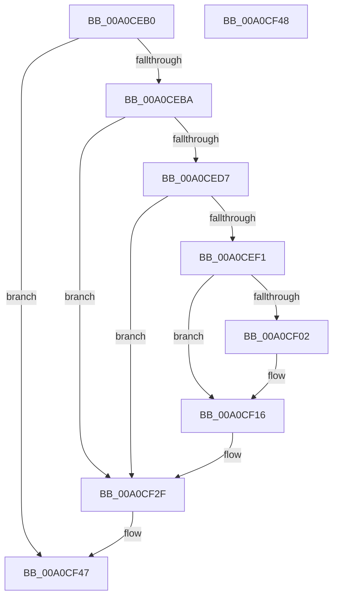

# EtwpCloseRegistrationObject

- RVA: `0x00A0CEB0`–`0x00A0CF49` (길이 `153` bytes)
- VA: `0x0000000140A0CEB0`
- 실행 섹션: `PAGE`
- PDB 이름 있음: `예`; PDB Function 태그: `아니요`
- unwind 정보 RVA: `0x000A8BC4`
- 디코드: `36`개 명령, `153/153` bytes 표시
- 미해석 바이트: `0` (있으면 어셈블리에 `.byte`로 보존)

> 이 문서는 커널 이미지의 기계어와 PDB 기호를 분석해 생성했습니다. 4번과 5번은 함수 원형과 자료형을 바이너리 사용 방식에서 추정한 C 해석이며 원본 소스 복구 결과는 아닙니다.

## 1. Dependencies

- 직접 호출 지점: **3**; 고유 호출 대상: **3**
- 직접 호출자로 확인된 함수: **0**
- RIP 상대 이미지 참조: **3**

### Outgoing calls
- `0x00A0CEE5` → [EtwEventEnabled](../../text/39/EtwEventEnabled_function_00392450.md) (function, `0x00392450`)
- `0x00A0CF2A` → [EtwWrite](../../text/41/EtwWrite_function_0041C720.md) (function, `0x0041C720`)
- `0x00A0CF3D` → [_security_check_cookie](../../text/6A/_security_check_cookie_function_006AC640.md) (function, `0x006AC640`)

### Direct callers
- 이 함수 시작 RVA로 연결되는 직접 call은 확인되지 않았습니다. 간접 호출은 완전히 역산할 수 없습니다.

### Static image references
- `0x00A0CEBF` → RVA `0x00E0A740` (`.data`; read)
- `0x00A0CED7` → RVA `0x00EFF840` (`.data`; read)
- `0x00A0CEDE` → RVA `0x00010888` (`.rdata`; read)

## 2. Other-region calls and transfers

- 다른 실행 섹션으로 향하는 call: **3**
  - `0x00A0CEE5` → [EtwEventEnabled](../../text/39/EtwEventEnabled_function_00392450.md) (`PAGE` → `.text`)
  - `0x00A0CF2A` → [EtwWrite](../../text/41/EtwWrite_function_0041C720.md) (`PAGE` → `.text`)
  - `0x00A0CF3D` → [_security_check_cookie](../../text/6A/_security_check_cookie_function_006AC640.md) (`PAGE` → `.text`)
- 별도 외부 분기/꼬리 이동을 확인하지 못했습니다.

## 3. Assembly (complete function range)

```asm
00A0CEB0  49 83 F9 01                     cmp r9, 1
00A0CEB4  0F 85 8D 00 00 00               jne 0x140a0cf47
00A0CEBA  53                              push rbx
00A0CEBB  48 83 EC 70                     sub rsp, 0x70
00A0CEBF  48 8B 05 7A D8 3F 00            mov rax, qword ptr [rip + 0x3fd87a]
00A0CEC6  48 33 C4                        xor rax, rsp
00A0CEC9  48 89 44 24 60                  mov qword ptr [rsp + 0x60], rax
00A0CECE  F6 42 62 02                     test byte ptr [rdx + 0x62], 2
00A0CED2  48 8B DA                        mov rbx, rdx
00A0CED5  74 58                           je 0x140a0cf2f
00A0CED7  48 8B 0D 62 29 4F 00            mov rcx, qword ptr [rip + 0x4f2962]
00A0CEDE  48 8D 15 A3 39 60 FF            lea rdx, [rip - 0x9fc65d]
00A0CEE5  E8 66 55 98 FF                  call 0x140392450
00A0CEEA  45 33 C9                        xor r9d, r9d
00A0CEED  84 C0                           test al, al
00A0CEEF  74 3E                           je 0x140a0cf2f
00A0CEF1  48 8B 43 20                     mov rax, qword ptr [rbx + 0x20]
00A0CEF5  48 8B 0D 44 29 4F 00            mov rcx, qword ptr [rip + 0x4f2944]
00A0CEFC  48 83 C0 28                     add rax, 0x28
00A0CF00  74 14                           je 0x140a0cf16
00A0CF02  48 89 44 24 30                  mov qword ptr [rsp + 0x30], rax
00A0CF07  41 B9 01 00 00 00               mov r9d, 1
00A0CF0D  48 C7 44 24 38 10 00 00 00      mov qword ptr [rsp + 0x38], 0x10
00A0CF16  48 8D 44 24 30                  lea rax, [rsp + 0x30]
00A0CF1B  45 33 C0                        xor r8d, r8d
00A0CF1E  48 8D 15 63 39 60 FF            lea rdx, [rip - 0x9fc69d]
00A0CF25  48 89 44 24 20                  mov qword ptr [rsp + 0x20], rax
00A0CF2A  E8 F1 F7 A0 FF                  call 0x14041c720
00A0CF2F  66 F0 83 4B 62 20               lock or word ptr [rbx + 0x62], 0x20
00A0CF35  48 8B 4C 24 60                  mov rcx, qword ptr [rsp + 0x60]
00A0CF3A  48 33 CC                        xor rcx, rsp
00A0CF3D  E8 FE F6 C9 FF                  call 0x1406ac640
00A0CF42  48 83 C4 70                     add rsp, 0x70
00A0CF46  5B                              pop rbx
00A0CF47  C3                              ret
00A0CF48  CC                              int3
```

## 4. C-style interpretation (structured pseudocode)

```c
__int64 __fastcall EtwpCloseRegistrationObject(__int64 a1, __int64 a2, int a3, __int64 a4)
{
    __int64 result;
    __int64 v_rsp;
    unsigned __int64 v_stack_m18;
    unsigned __int64 v_stack_m40;
    unsigned __int64 v_stack_m48;
    unsigned __int64 v_stack_m58;

    if (a4 != 1) goto loc_00A0CF47;
    v_rsp = (v_rsp) - (112);
    result = (*(unsigned __int64 *)(v_rip + 4184186)) ^ (v_rsp);
    v_stack_m18 = result;
    if (((*(unsigned __int8 *)(a2 + 98)) & (2)) == 0) goto loc_00A0CF2F;
    result = EtwEventEnabled(*(unsigned __int64 *)(v_rip + 5187938), v_rip - 10471005, a3, a4);
    a4 = 0;
    if ((unsigned __int8)(result) == 0) goto loc_00A0CF2F;
    result = (*(unsigned __int64 *)(a2 + 32)) + (40);
    if (!(condition_is_equal)) {
        v_stack_m48 = result;
        a4 = 1;
        v_stack_m40 = 16;
    }
    a3 = 0;
    v_stack_m58 = v_stack_m48;
    result = EtwWrite(*(unsigned __int64 *)(v_rip + 5187908), v_rip - 10471069, a3, a4);
loc_00A0CF2F:
    a1 = (v_stack_m18) ^ (v_rsp);
    result = _security_check_cookie(a1, v_rip - 10471069, a3, a4);
    v_rsp = (v_rsp) + (112);
loc_00A0CF47:
    return result;
}
```

## 5. (Beta) C Style

```c
int64_t EtwpCloseRegistrationObject(int64_t Arg1, void *Arg2, int32_t Arg3, int64_t Arg4)
{
    uint8_t *arg2 = (uint8_t *)Arg2;

    int64_t result;
    int64_t local_rsp;
    uint64_t v_stack_m18;
    uint64_t v_stack_m40;
    uint64_t v_stack_m48;
    uint64_t v_stack_m58;

    if (Arg4 != 1) goto loc_00A0CF47;
    local_rsp = (local_rsp) - (112);
    result = (*(uint64_t *)(v_rip + 0x3FD87A)) ^ (local_rsp);
    v_stack_m18 = result;
    if (((*(uint8_t *)(arg2 + 0x62)) & (2)) == 0) goto loc_00A0CF2F;
    result = EtwEventEnabled(*(uint64_t *)(v_rip + 0x4F2962), v_rip - 10471005, Arg3, Arg4);
    Arg4 = 0;
    if ((uint8_t)(result) == 0) goto loc_00A0CF2F;
    result = (*(uint64_t *)(arg2 + 0x20)) + (40);
    if (!(condition_is_equal)) {
        v_stack_m48 = result;
        Arg4 = 1;
        v_stack_m40 = 16;
    }
    Arg3 = 0;
    v_stack_m58 = v_stack_m48;
    result = EtwWrite(*(uint64_t *)(v_rip + 0x4F2944), v_rip - 10471069, Arg3, Arg4);
loc_00A0CF2F:
    Arg1 = (v_stack_m18) ^ (local_rsp);
    result = _security_check_cookie(Arg1, v_rip - 10471069, Arg3, Arg4);
    local_rsp = (local_rsp) + (112);
loc_00A0CF47:
    return result;
}
```

### 관측된 메모리 오프셋

구조체 형식이 확인되지 않은 접근은 인자 기준의 오프셋으로만 기록했습니다.

| 기준 인자 | 오프셋 표현 | 폭 (bit) | 접근 |
|---|---:|---:|---|
| `Arg2` | `+ 0x20` | `64` | `R` |
| `Arg2` | `+ 0x62` | `8` | `R` |
| `Arg2` | `+ 0x62` | `16` | `R/W` |

## 6. Execution-region graph

[열기: 2D/3D 그래프와 함수 탐색 컨트롤 패널](../../../control-panel.html?section=page&rva=0x00A0CEB0&view=graph)

- 2D 그래프는 위에서 아래로 흐르고, 3D 그래프는 빈 공간을 드래그해 회전합니다. Shift+드래그는 이동, 휠은 확대·축소, 함수 노드 선택은 대상 보고서 이동입니다.

### Static fallback


