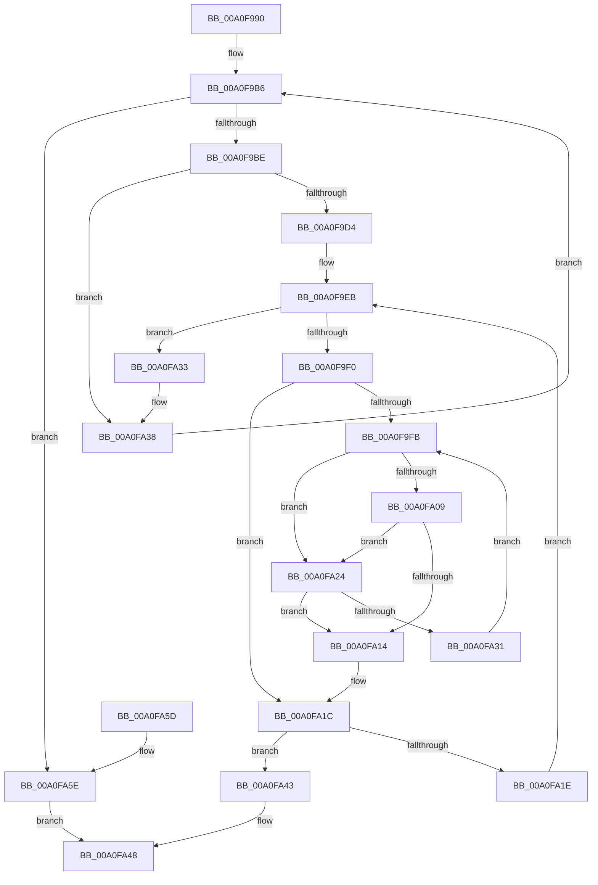

# EtwpCovSampCheckForSegments

- RVA: `0x00A0F990`–`0x00A0FA62` (길이 `210` bytes)
- VA: `0x0000000140A0F990`
- 실행 섹션: `PAGE`
- PDB 이름 있음: `예`; PDB Function 태그: `아니요`
- unwind 정보 RVA: `0x000A9170`
- 디코드: `70`개 명령, `210/210` bytes 표시
- 미해석 바이트: `0` (있으면 어셈블리에 `.byte`로 보존)

> 이 문서는 커널 이미지의 기계어와 PDB 기호를 분석해 생성했습니다. 4번과 5번은 함수 원형과 자료형을 바이너리 사용 방식에서 추정한 C 해석이며 원본 소스 복구 결과는 아닙니다.

## 1. Dependencies

- 직접 호출 지점: **1**; 고유 호출 대상: **1**
- 직접 호출자로 확인된 함수: **1**
- RIP 상대 이미지 참조: **0**

### Outgoing calls
- `0x00A0FA09` → [towlower](../../text/50/towlower_function_005018E0.md) (function, `0x005018E0`)

### Direct callers
- [EtwpCovSampContextGetModule](../8D/EtwpCovSampContextGetModule_function_008D7FEC.md) at `0x008D8392`
- [EtwpCovSampContextGetModule](../8D/EtwpCovSampContextGetModule_function_008D7FEC.md) at `0x008D83BE`

### Static image references
- 디코드된 RIP-relative 메모리 참조가 없습니다.

## 2. Other-region calls and transfers

- 다른 실행 섹션으로 향하는 call: **1**
  - `0x00A0FA09` → [towlower](../../text/50/towlower_function_005018E0.md) (`PAGE` → `.text`)
- 별도 외부 분기/꼬리 이동을 확인하지 못했습니다.

## 3. Assembly (complete function range)

```asm
00A0F990  48 89 5C 24 08                  mov qword ptr [rsp + 8], rbx
00A0F995  44 89 44 24 18                  mov dword ptr [rsp + 0x18], r8d
00A0F99A  48 89 54 24 10                  mov qword ptr [rsp + 0x10], rdx
00A0F99F  55                              push rbp
00A0F9A0  56                              push rsi
00A0F9A1  57                              push rdi
00A0F9A2  41 54                           push r12
00A0F9A4  41 55                           push r13
00A0F9A6  41 56                           push r14
00A0F9A8  41 57                           push r15
00A0F9AA  48 83 EC 20                     sub rsp, 0x20
00A0F9AE  41 8B C0                        mov eax, r8d
00A0F9B1  4C 8B E9                        mov r13, rcx
00A0F9B4  33 F6                           xor esi, esi
00A0F9B6  3B F0                           cmp esi, eax
00A0F9B8  0F 83 A0 00 00 00               jae 0x140a0fa5e
00A0F9BE  49 8B 45 08                     mov rax, qword ptr [r13 + 8]
00A0F9C2  8B DE                           mov ebx, esi
00A0F9C4  48 C1 E3 04                     shl rbx, 4
00A0F9C8  48 03 DA                        add rbx, rdx
00A0F9CB  48 8B 4B 08                     mov rcx, qword ptr [rbx + 8]
00A0F9CF  48 3B C1                        cmp rax, rcx
00A0F9D2  72 64                           jb 0x140a0fa38
00A0F9D4  4D 8B 75 00                     mov r14, qword ptr [r13]
00A0F9D8  48 2B C1                        sub rax, rcx
00A0F9DB  49 8D 14 46                     lea rdx, [r14 + rax*2]
00A0F9DF  48 8B 03                        mov rax, qword ptr [rbx]
00A0F9E2  48 89 54 24 78                  mov qword ptr [rsp + 0x78], rdx
00A0F9E7  48 8D 2C 48                     lea rbp, [rax + rcx*2]
00A0F9EB  4C 3B F2                        cmp r14, rdx
00A0F9EE  77 43                           ja 0x140a0fa33
00A0F9F0  48 8B 3B                        mov rdi, qword ptr [rbx]
00A0F9F3  4D 8B FE                        mov r15, r14
00A0F9F6  48 3B FD                        cmp rdi, rbp
00A0F9F9  73 21                           jae 0x140a0fa1c
00A0F9FB  41 0F B7 0F                     movzx ecx, word ptr [r15]
00A0F9FF  44 0F B7 27                     movzx r12d, word ptr [rdi]
00A0FA03  66 41 3B CC                     cmp cx, r12w
00A0FA07  74 1B                           je 0x140a0fa24
00A0FA09  E8 D2 1E AF FF                  call 0x1405018e0
00A0FA0E  66 41 3B C4                     cmp ax, r12w
00A0FA12  74 10                           je 0x140a0fa24
00A0FA14  48 8B 54 24 78                  mov rdx, qword ptr [rsp + 0x78]
00A0FA19  48 3B FD                        cmp rdi, rbp
00A0FA1C  74 25                           je 0x140a0fa43
00A0FA1E  49 83 C6 02                     add r14, 2
00A0FA22  EB C7                           jmp 0x140a0f9eb
00A0FA24  48 83 C7 02                     add rdi, 2
00A0FA28  49 83 C7 02                     add r15, 2
00A0FA2C  48 3B FD                        cmp rdi, rbp
00A0FA2F  73 E3                           jae 0x140a0fa14
00A0FA31  EB C8                           jmp 0x140a0f9fb
00A0FA33  48 8B 54 24 68                  mov rdx, qword ptr [rsp + 0x68]
00A0FA38  8B 44 24 70                     mov eax, dword ptr [rsp + 0x70]
00A0FA3C  FF C6                           inc esi
00A0FA3E  E9 73 FF FF FF                  jmp 0x140a0f9b6
00A0FA43  B8 01 00 00 00                  mov eax, 1
00A0FA48  48 8B 5C 24 60                  mov rbx, qword ptr [rsp + 0x60]
00A0FA4D  48 83 C4 20                     add rsp, 0x20
00A0FA51  41 5F                           pop r15
00A0FA53  41 5E                           pop r14
00A0FA55  41 5D                           pop r13
00A0FA57  41 5C                           pop r12
00A0FA59  5F                              pop rdi
00A0FA5A  5E                              pop rsi
00A0FA5B  5D                              pop rbp
00A0FA5C  C3                              ret
00A0FA5D  CC                              int3
00A0FA5E  33 C0                           xor eax, eax
00A0FA60  EB E6                           jmp 0x140a0fa48
```

## 4. C-style interpretation (structured pseudocode)

```c
__int64 __fastcall EtwpCovSampCheckForSegments(__int64 a1, __int64 a2, int a3)
{
    __int64 result;
    __int64 v_r14;
    __int64 v_r15;
    __int64 v_rbx;
    __int64 v_rdi;
    __int64 v_rsi;
    __int64 v_rsp;
    unsigned __int64 v_stack_p10;
    unsigned int v_stack_p18;
    unsigned __int64 v_stack_p20;
    unsigned __int64 v_stack_p8;

    v_stack_p8 = v_rbx;
    v_stack_p18 = a3;
    v_stack_p10 = a2;
    v_rsp = (v_rsp) - (32);
    v_rsi = 0;
loc_00A0F9B6:
    if (0 >= ((unsigned int)((unsigned int)(a3)))) goto loc_00A0FA5E;
    v_rbx = (0) << (4);
    v_rbx = (v_rbx) + (a2);
    if ((*(unsigned __int64 *)(a1 + 8)) < (*(unsigned __int64 *)(v_rbx + 8))) goto loc_00A0FA38;
    result = (*(unsigned __int64 *)(a1 + 8)) - (*(unsigned __int64 *)(v_rbx + 8));
    v_stack_p20 = *(unsigned __int64 *)(a1) + result * 2;
loc_00A0F9EB:
    if ((*(unsigned __int64 *)(a1)) > (*(unsigned __int64 *)(a1) + result * 2)) goto loc_00A0FA33;
    if ((*(unsigned __int64 *)(v_rbx)) >= (*(unsigned __int64 *)(v_rbx) + *(unsigned __int64 *)(v_rbx + 8) * 2)) goto loc_00A0FA1C;
loc_00A0F9FB:
    if (((unsigned __int16)(*(unsigned __int16 *)(*(unsigned __int64 *)(a1)))) == ((unsigned __int16)(*(unsigned __int16 *)(*(unsigned __int64 *)(v_rbx))))) goto loc_00A0FA24;
    result = towlower(*(unsigned __int16 *)(*(unsigned __int64 *)(a1)), *(unsigned __int64 *)(a1) + result * 2, a3, a4);
    if (((unsigned __int16)(result)) == ((unsigned __int16)(*(unsigned __int16 *)(*(unsigned __int64 *)(v_rbx))))) goto loc_00A0FA24;
loc_00A0FA14:
loc_00A0FA1C:
    if ((*(unsigned __int64 *)(v_rbx)) == (*(unsigned __int64 *)(v_rbx) + *(unsigned __int64 *)(v_rbx + 8) * 2)) goto loc_00A0FA43;
    v_r14 = (*(unsigned __int64 *)(a1)) + (2);
    goto loc_00A0F9EB;
loc_00A0FA24:
    v_rdi = (*(unsigned __int64 *)(v_rbx)) + (2);
    v_r15 = (*(unsigned __int64 *)(a1)) + (2);
    if (v_rdi >= (*(unsigned __int64 *)(v_rbx) + *(unsigned __int64 *)(v_rbx + 8) * 2)) goto loc_00A0FA14;
    goto loc_00A0F9FB;
loc_00A0FA33:
loc_00A0FA38:
    v_rsi = (unsigned int)((v_rsi) + 1);
    goto loc_00A0F9B6;
loc_00A0FA43:
loc_00A0FA48:
    v_rsp = (v_rsp) + (32);
    return 1;
loc_00A0FA5E:
    result = 0;
    goto loc_00A0FA48;
}
```

## 5. (Beta) C Style

```c
int64_t EtwpCovSampCheckForSegments(void *Arg1, int64_t Arg2, int32_t Arg3)
{
    uint8_t *arg1 = (uint8_t *)Arg1;

    int64_t result;
    int64_t local_r14;
    int64_t local_r15;
    int64_t local_rbx;
    int64_t local_rdi;
    int64_t local_rsi;
    int64_t local_rsp;
    uint64_t v_stack_p10;
    uint32_t v_stack_p18;
    uint64_t v_stack_p20;
    uint64_t v_stack_p8;

    v_stack_p8 = local_rbx;
    v_stack_p18 = Arg3;
    v_stack_p10 = Arg2;
    local_rsp = (local_rsp) - (32);
    local_rsi = 0;
loc_00A0F9B6:
    if (0 >= ((uint32_t)((uint32_t)(Arg3)))) goto loc_00A0FA5E;
    local_rbx = (0) << (4);
    local_rbx = (local_rbx) + (Arg2);
    if ((*(uint64_t *)(arg1 + 0x8)) < (*(uint64_t *)(local_rbx + 0x8))) goto loc_00A0FA38;
    result = (*(uint64_t *)(arg1 + 0x8)) - (*(uint64_t *)(local_rbx + 0x8));
    v_stack_p20 = *(uint64_t *)(arg1) + result * 2;
loc_00A0F9EB:
    if ((*(uint64_t *)(arg1)) > (*(uint64_t *)(arg1) + result * 2)) goto loc_00A0FA33;
    if ((*(uint64_t *)(local_rbx)) >= (*(uint64_t *)(local_rbx) + *(uint64_t *)(local_rbx + 0x8) * 2)) goto loc_00A0FA1C;
loc_00A0F9FB:
    if (((uint16_t)(*(uint16_t *)(*(uint64_t *)(arg1)))) == ((uint16_t)(*(uint16_t *)(*(uint64_t *)(local_rbx))))) goto loc_00A0FA24;
    result = towlower(*(uint16_t *)(*(uint64_t *)(arg1)), *(uint64_t *)(arg1) + result * 2, Arg3, a4);
    if (((uint16_t)(result)) == ((uint16_t)(*(uint16_t *)(*(uint64_t *)(local_rbx))))) goto loc_00A0FA24;
loc_00A0FA14:
loc_00A0FA1C:
    if ((*(uint64_t *)(local_rbx)) == (*(uint64_t *)(local_rbx) + *(uint64_t *)(local_rbx + 0x8) * 2)) goto loc_00A0FA43;
    local_r14 = (*(uint64_t *)(arg1)) + (2);
    goto loc_00A0F9EB;
loc_00A0FA24:
    local_rdi = (*(uint64_t *)(local_rbx)) + (2);
    local_r15 = (*(uint64_t *)(arg1)) + (2);
    if (local_rdi >= (*(uint64_t *)(local_rbx) + *(uint64_t *)(local_rbx + 0x8) * 2)) goto loc_00A0FA14;
    goto loc_00A0F9FB;
loc_00A0FA33:
loc_00A0FA38:
    local_rsi = (uint32_t)((local_rsi) + 1);
    goto loc_00A0F9B6;
loc_00A0FA43:
loc_00A0FA48:
    local_rsp = (local_rsp) + (32);
    return 1;
loc_00A0FA5E:
    result = 0;
    goto loc_00A0FA48;
}
```

### 관측된 메모리 오프셋

구조체 형식이 확인되지 않은 접근은 인자 기준의 오프셋으로만 기록했습니다.

| 기준 인자 | 오프셋 표현 | 폭 (bit) | 접근 |
|---|---:|---:|---|
| `Arg1` | `+ 0x0` | `64` | `R` |
| `Arg1` | `+ 0x8` | `64` | `R` |

## 6. Execution-region graph

[열기: 2D/3D 그래프와 함수 탐색 컨트롤 패널](../../../control-panel.html?section=page&rva=0x00A0F990&view=graph)

- 2D 그래프는 위에서 아래로 흐르고, 3D 그래프는 빈 공간을 드래그해 회전합니다. Shift+드래그는 이동, 휠은 확대·축소, 함수 노드 선택은 대상 보고서 이동입니다.

### Static fallback


