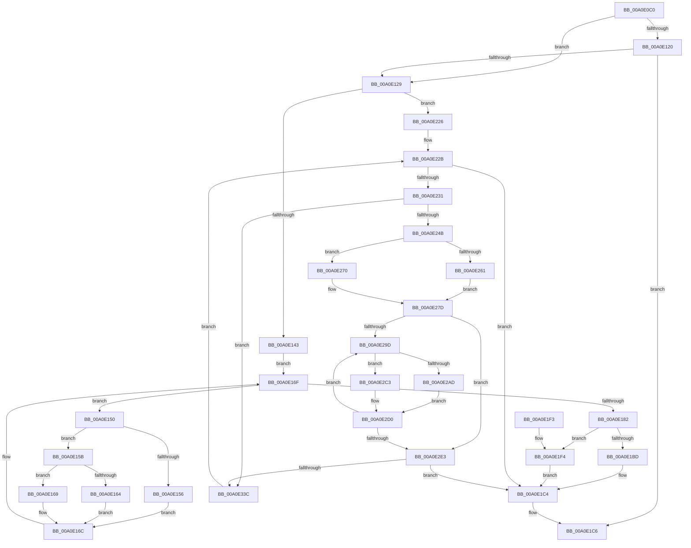

# EtwpEventTracingCounterSetCallback

- RVA: `0x00A0E0C0`–`0x00A0E344` (길이 `644` bytes)
- VA: `0x0000000140A0E0C0`
- 실행 섹션: `PAGE`
- PDB 이름 있음: `예`; PDB Function 태그: `아니요`
- unwind 정보 RVA: `0x000A8D40`
- 디코드: `167`개 명령, `644/644` bytes 표시
- 미해석 바이트: `0` (있으면 어셈블리에 `.byte`로 보존)

> 이 문서는 커널 이미지의 기계어와 PDB 기호를 분석해 생성했습니다. 4번과 5번은 함수 원형과 자료형을 바이너리 사용 방식에서 추정한 C 해석이며 원본 소스 복구 결과는 아닙니다.

## 1. Dependencies

- 직접 호출 지점: **11**; 고유 호출 대상: **11**
- 직접 호출자로 확인된 함수: **0**
- RIP 상대 이미지 참조: **5**

### Outgoing calls
- `0x00A0E12D` → [PsGetCurrentServerSiloGlobals](../../text/2F/PsGetCurrentServerSiloGlobals_function_002FE1F0.md) (function, `0x002FE1F0`)
- `0x00A0E175` → [EtwpGetNextGuidEntry](../8C/EtwpGetNextGuidEntry_function_008C3170.md) (function, `0x008C3170`)
- `0x00A0E1B3` → [ExGetExtensionTable](../../text/42/ExGetExtensionTable_function_00428814.md) (function, `0x00428814`)
- `0x00A0E1BD` → [ExpPcwDisabledStatus](../A6/ExpPcwDisabledStatus_function_00A611E0.md) (function, `0x00A611E0`)
- `0x00A0E1CD` → [_security_check_cookie](../../text/6A/_security_check_cookie_function_006AC640.md) (function, `0x006AC640`)
- `0x00A0E211` → [guard_dispatch_icall](../../text/6B/guard_dispatch_icall_function_006BAAD0.md) (function, `0x006BAAD0`)
- `0x00A0E21F` → [ExReleaseExtensionTable](../../text/45/ExReleaseExtensionTable_function_00456DC0.md) (function, `0x00456DC0`)
- `0x00A0E23A` → [EtwpAcquireLoggerContextByLoggerId](../93/EtwpAcquireLoggerContextByLoggerId_function_00932920.md) (function, `0x00932920`)
- `0x00A0E2AF` → [KeGetPrcb](../../text/2D/KeGetPrcb_function_002D85D0.md) (function, `0x002D85D0`)
- `0x00A0E30E` → [PcwAddInstance](PcwAddInstance_function_00A0E530.md) (function, `0x00A0E530`)
- `0x00A0E32F` → [ExReleaseRundownProtectionCacheAwareEx](../../text/25/ExReleaseRundownProtectionCacheAwareEx_function_0025F050.md) (function, `0x0025F050`)

### Direct callers
- 이 함수 시작 RVA로 연결되는 직접 call은 확인되지 않았습니다. 간접 호출은 완전히 역산할 수 없습니다.

### Static image references
- `0x00A0E0E3` → RVA `0x00E0A740` (`.data`; read)
- `0x00A0E102` → RVA `0x00B0E4F0` (` ?? ::NNGAKEGL::`string'`; read)
- `0x00A0E188` → RVA `0x00FD8080` (`PAGEDATA`; read)
- `0x00A0E285` → RVA `0x00FC6A80` (`ALMOSTRO`; read)
- `0x00A0E2A4` → RVA `0x00FC6AA8` (`ALMOSTRO`; read)

## 2. Other-region calls and transfers

- 다른 실행 섹션으로 향하는 call: **7**
  - `0x00A0E12D` → [PsGetCurrentServerSiloGlobals](../../text/2F/PsGetCurrentServerSiloGlobals_function_002FE1F0.md) (`PAGE` → `.text`)
  - `0x00A0E1B3` → [ExGetExtensionTable](../../text/42/ExGetExtensionTable_function_00428814.md) (`PAGE` → `.text`)
  - `0x00A0E1CD` → [_security_check_cookie](../../text/6A/_security_check_cookie_function_006AC640.md) (`PAGE` → `.text`)
  - `0x00A0E211` → [guard_dispatch_icall](../../text/6B/guard_dispatch_icall_function_006BAAD0.md) (`PAGE` → `.text`)
  - `0x00A0E21F` → [ExReleaseExtensionTable](../../text/45/ExReleaseExtensionTable_function_00456DC0.md) (`PAGE` → `.text`)
  - `0x00A0E2AF` → [KeGetPrcb](../../text/2D/KeGetPrcb_function_002D85D0.md) (`PAGE` → `.text`)
  - `0x00A0E32F` → [ExReleaseRundownProtectionCacheAwareEx](../../text/25/ExReleaseRundownProtectionCacheAwareEx_function_0025F050.md) (`PAGE` → `.text`)
- 별도 외부 분기/꼬리 이동을 확인하지 못했습니다.

## 3. Assembly (complete function range)

```asm
00A0E0C0  48 8B C4                        mov rax, rsp
00A0E0C3  48 89 58 08                     mov qword ptr [rax + 8], rbx
00A0E0C7  48 89 70 18                     mov qword ptr [rax + 0x18], rsi
00A0E0CB  48 89 78 20                     mov qword ptr [rax + 0x20], rdi
00A0E0CF  55                              push rbp
00A0E0D0  41 54                           push r12
00A0E0D2  41 55                           push r13
00A0E0D4  41 56                           push r14
00A0E0D6  41 57                           push r15
00A0E0D8  48 8D 68 A1                     lea rbp, [rax - 0x5f]
00A0E0DC  48 81 EC 90 00 00 00            sub rsp, 0x90
00A0E0E3  48 8B 05 56 C6 3F 00            mov rax, qword ptr [rip + 0x3fc656]
00A0E0EA  48 33 C4                        xor rax, rsp
00A0E0ED  48 89 45 27                     mov qword ptr [rbp + 0x27], rax
00A0E0F1  33 C0                           xor eax, eax
00A0E0F3  48 C7 45 E7 2C 00 2E 00         mov qword ptr [rbp - 0x19], 0x2e002c
00A0E0FB  48 89 45 07                     mov qword ptr [rbp + 7], rax
00A0E0FF  0F 57 C0                        xorps xmm0, xmm0
00A0E102  48 8D 05 E7 03 10 00            lea rax, [rip + 0x1003e7]
00A0E109  48 89 45 EF                     mov qword ptr [rbp - 0x11], rax
00A0E10D  33 C0                           xor eax, eax
00A0E10F  48 89 45 1F                     mov qword ptr [rbp + 0x1f], rax
00A0E113  0F 11 45 F7                     movups xmmword ptr [rbp - 9], xmm0
00A0E117  0F 11 45 0F                     movups xmmword ptr [rbp + 0xf], xmm0
00A0E11B  83 E9 02                        sub ecx, 2
00A0E11E  74 09                           je 0x140a0e129
00A0E120  83 F9 01                        cmp ecx, 1
00A0E123  0F 85 9D 00 00 00               jne 0x140a0e1c6
00A0E129  4C 8B 6A 18                     mov r13, qword ptr [rdx + 0x18]
00A0E12D  E8 BE 00 8F FF                  call 0x1402fe1f0
00A0E132  48 8B B0 40 03 00 00            mov rsi, qword ptr [rax + 0x340]
00A0E139  49 83 F8 01                     cmp r8, 1
00A0E13D  0F 85 E3 00 00 00               jne 0x140a0e226
00A0E143  48 83 65 03 00                  and qword ptr [rbp + 3], 0
00A0E148  83 65 0B 00                     and dword ptr [rbp + 0xb], 0
00A0E14C  33 D2                           xor edx, edx
00A0E14E  EB 1F                           jmp 0x140a0e16f
00A0E150  83 79 60 00                     cmp dword ptr [rcx + 0x60], 0
00A0E154  75 05                           jne 0x140a0e15b
00A0E156  FF 45 07                        inc dword ptr [rbp + 7]
00A0E159  EB 11                           jmp 0x140a0e16c
00A0E15B  48 8D 41 38                     lea rax, [rcx + 0x38]
00A0E15F  48 39 00                        cmp qword ptr [rax], rax
00A0E162  75 05                           jne 0x140a0e169
00A0E164  FF 45 0B                        inc dword ptr [rbp + 0xb]
00A0E167  EB 03                           jmp 0x140a0e16c
00A0E169  FF 45 03                        inc dword ptr [rbp + 3]
00A0E16C  48 8B D1                        mov rdx, rcx
00A0E16F  45 33 C0                        xor r8d, r8d
00A0E172  48 8B CE                        mov rcx, rsi
00A0E175  E8 F6 4F EB FF                  call 0x1408c3170
00A0E17A  48 8B C8                        mov rcx, rax
00A0E17D  48 85 C0                        test rax, rax
00A0E180  75 CE                           jne 0x140a0e150
00A0E182  8B 86 34 11 00 00               mov eax, dword ptr [rsi + 0x1134]
00A0E188  48 8B 0D F1 9E 5C 00            mov rcx, qword ptr [rip + 0x5c9ef1]
00A0E18F  89 45 F7                        mov dword ptr [rbp - 9], eax
00A0E192  8B 86 30 11 00 00               mov eax, dword ptr [rsi + 0x1130]
00A0E198  89 45 FF                        mov dword ptr [rbp - 1], eax
00A0E19B  8B 86 2C 11 00 00               mov eax, dword ptr [rsi + 0x112c]
00A0E1A1  89 45 FB                        mov dword ptr [rbp - 5], eax
00A0E1A4  48 8D 45 F7                     lea rax, [rbp - 9]
00A0E1A8  48 89 45 D7                     mov qword ptr [rbp - 0x29], rax
00A0E1AC  C7 45 DF 18 00 00 00            mov dword ptr [rbp - 0x21], 0x18
00A0E1B3  E8 5C A6 A1 FF                  call 0x140428814
00A0E1B8  48 85 C0                        test rax, rax
00A0E1BB  75 37                           jne 0x140a0e1f4
00A0E1BD  E8 1E 30 05 00                  call 0x140a611e0
00A0E1C2  8B F8                           mov edi, eax
00A0E1C4  8B C7                           mov eax, edi
00A0E1C6  48 8B 4D 27                     mov rcx, qword ptr [rbp + 0x27]
00A0E1CA  48 33 CC                        xor rcx, rsp
00A0E1CD  E8 6E E4 C9 FF                  call 0x1406ac640
00A0E1D2  4C 8D 9C 24 90 00 00 00         lea r11, [rsp + 0x90]
00A0E1DA  49 8B 5B 30                     mov rbx, qword ptr [r11 + 0x30]
00A0E1DE  49 8B 73 40                     mov rsi, qword ptr [r11 + 0x40]
00A0E1E2  49 8B 7B 48                     mov rdi, qword ptr [r11 + 0x48]
00A0E1E6  49 8B E3                        mov rsp, r11
00A0E1E9  41 5F                           pop r15
00A0E1EB  41 5E                           pop r14
00A0E1ED  41 5D                           pop r13
00A0E1EF  41 5C                           pop r12
00A0E1F1  5D                              pop rbp
00A0E1F2  C3                              ret
00A0E1F3  CC                              int3
00A0E1F4  48 8B 40 20                     mov rax, qword ptr [rax + 0x20]
00A0E1F8  48 8D 4D D7                     lea rcx, [rbp - 0x29]
00A0E1FC  48 89 4C 24 20                  mov qword ptr [rsp + 0x20], rcx
00A0E201  48 8D 55 E7                     lea rdx, [rbp - 0x19]
00A0E205  49 8B CD                        mov rcx, r13
00A0E208  41 B9 01 00 00 00               mov r9d, 1
00A0E20E  45 33 C0                        xor r8d, r8d
00A0E211  E8 BA C8 CA FF                  call 0x1406baad0
00A0E216  48 8B 0D 63 9E 5C 00            mov rcx, qword ptr [rip + 0x5c9e63]
00A0E21D  8B F8                           mov edi, eax
00A0E21F  E8 9C 8B A4 FF                  call 0x140456dc0
00A0E224  EB 9E                           jmp 0x140a0e1c4
00A0E226  33 FF                           xor edi, edi
00A0E228  45 33 F6                        xor r14d, r14d
00A0E22B  44 3B 76 10                     cmp r14d, dword ptr [rsi + 0x10]
00A0E22F  73 93                           jae 0x140a0e1c4
00A0E231  45 33 C0                        xor r8d, r8d
00A0E234  41 8B D6                        mov edx, r14d
00A0E237  48 8B CE                        mov rcx, rsi
00A0E23A  E8 E1 46 F2 FF                  call 0x140932920
00A0E23F  48 8B D8                        mov rbx, rax
00A0E242  48 85 C0                        test rax, rax
00A0E245  0F 84 F1 00 00 00               je 0x140a0e33c
00A0E24B  33 C0                           xor eax, eax
00A0E24D  0F 57 C0                        xorps xmm0, xmm0
00A0E250  0F 11 45 0F                     movups xmmword ptr [rbp + 0xf], xmm0
00A0E254  48 89 45 1F                     mov qword ptr [rbp + 0x1f], rax
00A0E258  83 BB 2C 01 00 00 01            cmp dword ptr [rbx + 0x12c], 1
00A0E25F  75 0F                           jne 0x140a0e270
00A0E261  8B 8B E8 00 00 00               mov ecx, dword ptr [rbx + 0xe8]
00A0E267  0F AF 4B 04                     imul ecx, dword ptr [rbx + 4]
00A0E26B  89 4D 0F                        mov dword ptr [rbp + 0xf], ecx
00A0E26E  EB 0D                           jmp 0x140a0e27d
00A0E270  8B 83 E8 00 00 00               mov eax, dword ptr [rbx + 0xe8]
00A0E276  0F AF 43 04                     imul eax, dword ptr [rbx + 4]
00A0E27A  89 45 13                        mov dword ptr [rbp + 0x13], eax
00A0E27D  8B 83 F0 00 00 00               mov eax, dword ptr [rbx + 0xf0]
00A0E283  33 FF                           xor edi, edi
00A0E285  44 8B 3D F4 87 5B 00            mov r15d, dword ptr [rip + 0x5b87f4]
00A0E28C  89 45 1F                        mov dword ptr [rbp + 0x1f], eax
00A0E28F  8B 83 58 01 00 00               mov eax, dword ptr [rbx + 0x158]
00A0E295  89 45 23                        mov dword ptr [rbp + 0x23], eax
00A0E298  45 85 FF                        test r15d, r15d
00A0E29B  74 46                           je 0x140a0e2e3
00A0E29D  48 8B 8B 50 05 00 00            mov rcx, qword ptr [rbx + 0x550]
00A0E2A4  48 3B 0D FD 87 5B 00            cmp rcx, qword ptr [rip + 0x5b87fd]
00A0E2AB  75 16                           jne 0x140a0e2c3
00A0E2AD  8B CF                           mov ecx, edi
00A0E2AF  E8 1C A3 8C FF                  call 0x1402d85d0
00A0E2B4  48 8B 80 A8 8B 00 00            mov rax, qword ptr [rax + 0x8ba8]
00A0E2BB  48 05 40 01 00 00               add rax, 0x140
00A0E2C1  EB 0D                           jmp 0x140a0e2d0
00A0E2C3  8B C7                           mov eax, edi
00A0E2C5  48 C1 E0 06                     shl rax, 6
00A0E2C9  48 03 81 40 11 00 00            add rax, qword ptr [rcx + 0x1140]
00A0E2D0  48 8B 40 08                     mov rax, qword ptr [rax + 8]
00A0E2D4  FF C7                           inc edi
00A0E2D6  4A 8B 0C F0                     mov rcx, qword ptr [rax + r14*8]
00A0E2DA  48 01 4D 17                     add qword ptr [rbp + 0x17], rcx
00A0E2DE  41 3B FF                        cmp edi, r15d
00A0E2E1  75 BA                           jne 0x140a0e29d
00A0E2E3  48 8D 45 0F                     lea rax, [rbp + 0xf]
00A0E2E7  C7 45 DF 18 00 00 00            mov dword ptr [rbp - 0x21], 0x18
00A0E2EE  48 89 45 D7                     mov qword ptr [rbp - 0x29], rax
00A0E2F2  48 8D 93 88 00 00 00            lea rdx, [rbx + 0x88]
00A0E2F9  48 8D 45 D7                     lea rax, [rbp - 0x29]
00A0E2FD  41 B9 01 00 00 00               mov r9d, 1
00A0E303  45 8B C6                        mov r8d, r14d
00A0E306  48 89 44 24 20                  mov qword ptr [rsp + 0x20], rax
00A0E30B  49 8B CD                        mov rcx, r13
00A0E30E  E8 1D 02 00 00                  call 0x140a0e530
00A0E313  48 8B 93 50 05 00 00            mov rdx, qword ptr [rbx + 0x550]
00A0E31A  8B F8                           mov edi, eax
00A0E31C  44 8B 03                        mov r8d, dword ptr [rbx]
00A0E31F  48 8B 8A C0 02 00 00            mov rcx, qword ptr [rdx + 0x2c0]
00A0E326  BA 01 00 00 00                  mov edx, 1
00A0E32B  4A 8B 0C C1                     mov rcx, qword ptr [rcx + r8*8]
00A0E32F  E8 1C 0D 85 FF                  call 0x14025f050
00A0E334  85 FF                           test edi, edi
00A0E336  0F 88 88 FE FF FF               js 0x140a0e1c4
00A0E33C  41 FF C6                        inc r14d
00A0E33F  E9 E7 FE FF FF                  jmp 0x140a0e22b
```

## 4. C-style interpretation (structured pseudocode)

```c
__int64 __fastcall EtwpEventTracingCounterSetCallback(int a1, __int64 a2, __int64 a3)
{
    __int64 result;
    __int64 v_r14;
    __int64 v_rdi;
    __int64 v_rsp;
    unsigned __int64 v_stack_m28;
    unsigned __int64 v_stack_m70;

    *(unsigned __int64 *)(v_rsp + 8) = v_rbx;
    *(unsigned __int64 *)(v_rsp + 24) = v_rsi;
    *(unsigned __int64 *)(v_rsp + 32) = v_rdi;
    v_rsp = (v_rsp) - (144);
    result = (*(unsigned __int64 *)(v_rip + 4179542)) ^ (v_rsp);
    *(unsigned __int64 *)(v_rsp - 95 + 39) = result;
    result = 0;
    *(unsigned __int64 *)(v_rsp - 95 - 25) = 0x2E002CULL;
    *(unsigned __int64 *)(v_rsp - 95 + 7) = 0;
    *(unsigned __int64 *)(v_rsp - 95 - 17) = v_rip + 1049575;
    result = 0;
    *(unsigned __int64 *)(v_rsp - 95 + 31) = 0;
    *(unsigned __int64 *)(v_rsp - 95 - 9) = v_xmm0;
    *(unsigned __int64 *)(v_rsp - 95 + 15) = v_xmm0;
    a1 = (unsigned int)((a1) - (2));
    if (condition_is_equal) goto loc_00A0E129;
    if (a1 != 1) goto loc_00A0E1C6;
loc_00A0E129:
    result = PsGetCurrentServerSiloGlobals(a1, a2, a3, a4);
    if (a3 != 1) goto loc_00A0E226;
    a2 = 0;
    goto loc_00A0E16F;
loc_00A0E150:
    if ((*(unsigned int *)(a1 + 96)) != 0) goto loc_00A0E15B;
    goto loc_00A0E16C;
loc_00A0E15B:
    if ((*(unsigned __int64 *)(a1 + 56)) != (a1 + 56)) goto loc_00A0E169;
    goto loc_00A0E16C;
loc_00A0E169:
loc_00A0E16C:
loc_00A0E16F:
    a3 = 0;
    result = EtwpGetNextGuidEntry(*(unsigned __int64 *)(result + 832), a1, a3, a4);
    if (result != 0) goto loc_00A0E150;
    *(unsigned int *)(v_rsp - 95 - 9) = (unsigned int)((unsigned int)(*(unsigned int *)(*(unsigned __int64 *)(result + 832) + 4404)));
    *(unsigned int *)(v_rsp - 95 - 1) = (unsigned int)((unsigned int)(*(unsigned int *)(*(unsigned __int64 *)(result + 832) + 4400)));
    *(unsigned int *)(v_rsp - 95 - 5) = (unsigned int)((unsigned int)(*(unsigned int *)(*(unsigned __int64 *)(result + 832) + 4396)));
    *(unsigned __int64 *)(v_rsp - 95 - 41) = v_rsp - 95 - 9;
    *(unsigned int *)(v_rsp - 95 - 33) = 24;
    result = ExGetExtensionTable(*(unsigned __int64 *)(v_rip + 6070001), a1, a3, a4);
    if (result != 0) goto loc_00A0E1F4;
    result = ExpPcwDisabledStatus(*(unsigned __int64 *)(v_rip + 6070001), a1, a3, a4);
loc_00A0E1C4:
loc_00A0E1C6:
    a1 = (*(unsigned __int64 *)(v_rsp - 95 + 39)) ^ (v_rsp);
    result = _security_check_cookie(a1, a1, a3, a4);
    return result;
loc_00A0E1F4:
    v_stack_m70 = v_rsp - 95 - 41;
    a3 = 0;
    result = guard_dispatch_icall(*(unsigned __int64 *)(a2 + 24), v_rsp - 95 - 25, a3, 1);
    result = ExReleaseExtensionTable(*(unsigned __int64 *)(v_rip + 6069859), v_rsp - 95 - 25, a3, 1);
    goto loc_00A0E1C4;
loc_00A0E226:
    v_rdi = 0;
    v_r14 = 0;
loc_00A0E22B:
    if (0 >= (*(unsigned int *)(*(unsigned __int64 *)(v_stack_m28 + 64) + 16))) goto loc_00A0E1C4;
    a3 = 0;
    result = EtwpAcquireLoggerContextByLoggerId(*(unsigned __int64 *)(v_stack_m28 + 64), 0, a3, 1);
    if (result == 0) goto loc_00A0E33C;
    result = 0;
    *(unsigned __int64 *)(v_rsp - 95 + 15) = v_xmm0;
    *(unsigned __int64 *)(v_rsp - 95 + 31) = 0;
    if ((*(unsigned int *)(result + 300)) != 1) goto loc_00A0E270;
    a1 = (unsigned int)(((unsigned int)(*(unsigned int *)(result + 232))) * (*(unsigned int *)(result + 4)));
    *(unsigned int *)(v_rsp - 95 + 15) = a1;
    goto loc_00A0E27D;
loc_00A0E270:
    result = (unsigned int)(((unsigned int)(*(unsigned int *)(result + 232))) * (*(unsigned int *)(result + 4)));
    *(unsigned int *)(v_rsp - 95 + 19) = (unsigned int)(result);
loc_00A0E27D:
    v_rdi = 0;
    *(unsigned int *)(v_rsp - 95 + 31) = (unsigned int)((unsigned int)(*(unsigned int *)(result + 240)));
    *(unsigned int *)(v_rsp - 95 + 35) = (unsigned int)((unsigned int)(*(unsigned int *)(result + 344)));
    if ((unsigned int)((unsigned int)(*(unsigned int *)(v_rip + 5998580))) == 0) goto loc_00A0E2E3;
loc_00A0E29D:
    if ((*(unsigned __int64 *)(result + 1360)) != (*(unsigned __int64 *)(v_rip + 5998589))) goto loc_00A0E2C3;
    result = KeGetPrcb(0, 0, a3, 1);
    result = (*(unsigned __int64 *)(result + 35752)) + (320);
    goto loc_00A0E2D0;
loc_00A0E2C3:
    result = (0) << (6);
    result = (result) + (*(unsigned __int64 *)(0 + 4416));
loc_00A0E2D0:
    v_rdi = (unsigned int)((v_rdi) + 1);
    if (((unsigned int)(v_rdi)) != ((unsigned int)((unsigned int)(*(unsigned int *)(v_rip + 5998580))))) goto loc_00A0E29D;
loc_00A0E2E3:
    *(unsigned int *)(v_rsp - 95 - 33) = 24;
    *(unsigned __int64 *)(v_rsp - 95 - 41) = v_rsp - 95 + 15;
    v_stack_m70 = v_rsp - 95 - 41;
    result = PcwAddInstance(*(unsigned __int64 *)(a2 + 24), result + 136, 0, 1);
    result = ExReleaseRundownProtectionCacheAwareEx(*(unsigned __int64 *)(*(unsigned __int64 *)(*(unsigned __int64 *)(result + 1360) + 704) + (unsigned int)(*(unsigned int *)(result)) * 8), 1, (unsigned int)(*(unsigned int *)(result)), 1);
    if (sign_flag) goto loc_00A0E1C4;
loc_00A0E33C:
    v_r14 = (unsigned int)((v_r14) + 1);
    goto loc_00A0E22B;
}
```

## 5. (Beta) C Style

```c
int64_t EtwpEventTracingCounterSetCallback(int32_t Arg1, void *Arg2, int64_t Arg3)
{
    uint8_t *arg2 = (uint8_t *)Arg2;

    int64_t result;
    int64_t local_r14;
    int64_t local_rdi;
    int64_t local_rsp;
    uint64_t v_stack_m28;
    uint64_t v_stack_m70;

    *(uint64_t *)(local_rsp + 0x8) = local_rbx;
    *(uint64_t *)(local_rsp + 0x18) = local_rsi;
    *(uint64_t *)(local_rsp + 0x20) = local_rdi;
    local_rsp = (local_rsp) - (144);
    result = (*(uint64_t *)(v_rip + 0x3FC656)) ^ (local_rsp);
    *(uint64_t *)(local_rsp - 0x5F + 0x27) = result;
    result = 0;
    *(uint64_t *)(local_rsp - 0x5F - 0x19) = 0x2E002CULL;
    *(uint64_t *)(local_rsp - 0x5F + 0x7) = 0;
    *(uint64_t *)(local_rsp - 0x5F - 0x11) = v_rip + 1049575;
    result = 0;
    *(uint64_t *)(local_rsp - 0x5F + 0x1F) = 0;
    *(uint64_t *)(local_rsp - 0x5F - 0x9) = v_xmm0;
    *(uint64_t *)(local_rsp - 0x5F + 0xF) = v_xmm0;
    Arg1 = (uint32_t)((Arg1) - (2));
    if (condition_is_equal) goto loc_00A0E129;
    if (Arg1 != 1) goto loc_00A0E1C6;
loc_00A0E129:
    result = PsGetCurrentServerSiloGlobals(Arg1, Arg2, Arg3, a4);
    if (Arg3 != 1) goto loc_00A0E226;
    Arg2 = 0;
    goto loc_00A0E16F;
loc_00A0E150:
    if ((*(uint32_t *)(Arg1 + 0x60)) != 0) goto loc_00A0E15B;
    goto loc_00A0E16C;
loc_00A0E15B:
    if ((*(uint64_t *)(Arg1 + 0x38)) != (Arg1 + 56)) goto loc_00A0E169;
    goto loc_00A0E16C;
loc_00A0E169:
loc_00A0E16C:
loc_00A0E16F:
    Arg3 = 0;
    result = EtwpGetNextGuidEntry(*(uint64_t *)(result + 0x340), Arg1, Arg3, a4);
    if (result != 0) goto loc_00A0E150;
    *(uint32_t *)(local_rsp - 0x5F - 0x9) = (uint32_t)((uint32_t)(*(uint32_t *)(*(uint64_t *)(result + 0x340) + 0x1134)));
    *(uint32_t *)(local_rsp - 0x5F - 0x1) = (uint32_t)((uint32_t)(*(uint32_t *)(*(uint64_t *)(result + 0x340) + 0x1130)));
    *(uint32_t *)(local_rsp - 0x5F - 0x5) = (uint32_t)((uint32_t)(*(uint32_t *)(*(uint64_t *)(result + 0x340) + 0x112C)));
    *(uint64_t *)(local_rsp - 0x5F - 0x29) = local_rsp - 95 - 9;
    *(uint32_t *)(local_rsp - 0x5F - 0x21) = 24;
    result = ExGetExtensionTable(*(uint64_t *)(v_rip + 0x5C9EF1), Arg1, Arg3, a4);
    if (result != 0) goto loc_00A0E1F4;
    result = ExpPcwDisabledStatus(*(uint64_t *)(v_rip + 0x5C9EF1), Arg1, Arg3, a4);
loc_00A0E1C4:
loc_00A0E1C6:
    Arg1 = (*(uint64_t *)(local_rsp - 0x5F + 0x27)) ^ (local_rsp);
    result = _security_check_cookie(Arg1, Arg1, Arg3, a4);
    return result;
loc_00A0E1F4:
    v_stack_m70 = local_rsp - 95 - 41;
    Arg3 = 0;
    result = guard_dispatch_icall(*(uint64_t *)(arg2 + 0x18), local_rsp - 95 - 25, Arg3, 1);
    result = ExReleaseExtensionTable(*(uint64_t *)(v_rip + 0x5C9E63), local_rsp - 95 - 25, Arg3, 1);
    goto loc_00A0E1C4;
loc_00A0E226:
    local_rdi = 0;
    local_r14 = 0;
loc_00A0E22B:
    if (0 >= (*(uint32_t *)(*(uint64_t *)(v_stack_m28 + 0x40) + 0x10))) goto loc_00A0E1C4;
    Arg3 = 0;
    result = EtwpAcquireLoggerContextByLoggerId(*(uint64_t *)(v_stack_m28 + 0x40), 0, Arg3, 1);
    if (result == 0) goto loc_00A0E33C;
    result = 0;
    *(uint64_t *)(local_rsp - 0x5F + 0xF) = v_xmm0;
    *(uint64_t *)(local_rsp - 0x5F + 0x1F) = 0;
    if ((*(uint32_t *)(result + 0x12C)) != 1) goto loc_00A0E270;
    Arg1 = (uint32_t)(((uint32_t)(*(uint32_t *)(result + 0xE8))) * (*(uint32_t *)(result + 0x4)));
    *(uint32_t *)(local_rsp - 0x5F + 0xF) = Arg1;
    goto loc_00A0E27D;
loc_00A0E270:
    result = (uint32_t)(((uint32_t)(*(uint32_t *)(result + 0xE8))) * (*(uint32_t *)(result + 0x4)));
    *(uint32_t *)(local_rsp - 0x5F + 0x13) = (uint32_t)(result);
loc_00A0E27D:
    local_rdi = 0;
    *(uint32_t *)(local_rsp - 0x5F + 0x1F) = (uint32_t)((uint32_t)(*(uint32_t *)(result + 0xF0)));
    *(uint32_t *)(local_rsp - 0x5F + 0x23) = (uint32_t)((uint32_t)(*(uint32_t *)(result + 0x158)));
    if ((uint32_t)((uint32_t)(*(uint32_t *)(v_rip + 0x5B87F4))) == 0) goto loc_00A0E2E3;
loc_00A0E29D:
    if ((*(uint64_t *)(result + 0x550)) != (*(uint64_t *)(v_rip + 0x5B87FD))) goto loc_00A0E2C3;
    result = KeGetPrcb(0, 0, Arg3, 1);
    result = (*(uint64_t *)(result + 0x8BA8)) + (320);
    goto loc_00A0E2D0;
loc_00A0E2C3:
    result = (0) << (6);
    result = (result) + (*(uint64_t *)(0 + 0x1140));
loc_00A0E2D0:
    local_rdi = (uint32_t)((local_rdi) + 1);
    if (((uint32_t)(local_rdi)) != ((uint32_t)((uint32_t)(*(uint32_t *)(v_rip + 0x5B87F4))))) goto loc_00A0E29D;
loc_00A0E2E3:
    *(uint32_t *)(local_rsp - 0x5F - 0x21) = 24;
    *(uint64_t *)(local_rsp - 0x5F - 0x29) = local_rsp - 95 + 15;
    v_stack_m70 = local_rsp - 95 - 41;
    result = PcwAddInstance(*(uint64_t *)(arg2 + 0x18), result + 136, 0, 1);
    result = ExReleaseRundownProtectionCacheAwareEx(*(uint64_t *)(*(uint64_t *)(*(uint64_t *)(result + 0x550) + 0x2C0) + (uint32_t)(*(uint32_t *)(result)) * 8), 1, (uint32_t)(*(uint32_t *)(result)), 1);
    if (sign_flag) goto loc_00A0E1C4;
loc_00A0E33C:
    local_r14 = (uint32_t)((local_r14) + 1);
    goto loc_00A0E22B;
}
```

### 관측된 메모리 오프셋

구조체 형식이 확인되지 않은 접근은 인자 기준의 오프셋으로만 기록했습니다.

| 기준 인자 | 오프셋 표현 | 폭 (bit) | 접근 |
|---|---:|---:|---|
| `Arg2` | `+ 0x18` | `64` | `R` |

## 6. Execution-region graph

[열기: 2D/3D 그래프와 함수 탐색 컨트롤 패널](../../../control-panel.html?section=page&rva=0x00A0E0C0&view=graph)

- 2D 그래프는 위에서 아래로 흐르고, 3D 그래프는 빈 공간을 드래그해 회전합니다. Shift+드래그는 이동, 휠은 확대·축소, 함수 노드 선택은 대상 보고서 이동입니다.

### Static fallback


