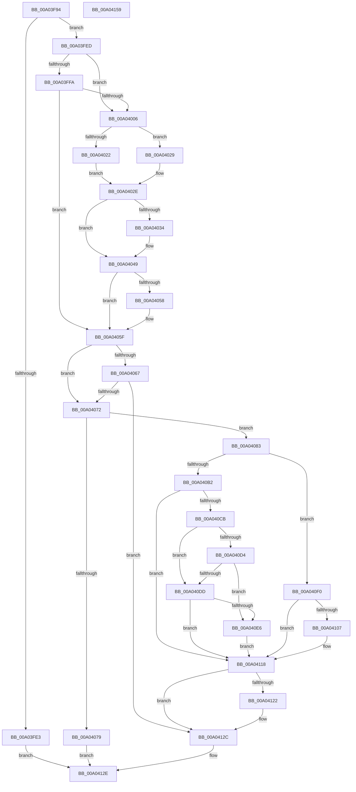

# EtwpProviderArrivalCallback

- RVA: `0x00A03F94`–`0x00A0415A` (길이 `454` bytes)
- VA: `0x0000000140A03F94`
- 실행 섹션: `PAGE`
- PDB 이름 있음: `예`; PDB Function 태그: `아니요`
- unwind 정보 RVA: `0x000A814C`
- 디코드: `118`개 명령, `454/454` bytes 표시
- 미해석 바이트: `0` (있으면 어셈블리에 `.byte`로 보존)

> 이 문서는 커널 이미지의 기계어와 PDB 기호를 분석해 생성했습니다. 4번과 5번은 함수 원형과 자료형을 바이너리 사용 방식에서 추정한 C 해석이며 원본 소스 복구 결과는 아닙니다.

## 1. Dependencies

- 직접 호출 지점: **11**; 고유 호출 대상: **10**
- 직접 호출자로 확인된 함수: **5**
- RIP 상대 이미지 참조: **6**

### Outgoing calls
- `0x00A04022` → [RtlPcToFilePath](../A2/RtlPcToFilePath_function_00A2B9A0.md) (function, `0x00A2B9A0`)
- `0x00A04029` → [MmGetFileNameForAddress](../A2/MmGetFileNameForAddress_function_00A2B878.md) (function, `0x00A2B878`)
- `0x00A04044` → [EtwpTrackBinaryForSession](../A1/EtwpTrackBinaryForSession_function_00A11708.md) (function, `0x00A11708`)
- `0x00A0405A` → [ExFreePoolWithTag](../../poolcode/B8/ExFreePoolWithTag_function_00B82870.md) (function, `0x00B82870`)
- `0x00A040A2` → [EtwpLocateDbgIdForRegEntry](../8D/EtwpLocateDbgIdForRegEntry_function_008D99A4.md) (function, `0x008D99A4`)
- `0x00A040BD` → [EtwpTrackDebugIdForSession](EtwpTrackDebugIdForSession_function_00A0EDD4.md) (function, `0x00A0EDD4`)
- `0x00A040E9` → [EtwpSendDbgId](../7B/EtwpSendDbgId_function_007BC1C0.md) (function, `0x007BC1C0`)
- `0x00A040FE` → [EtwEventEnabled](../../text/39/EtwEventEnabled_function_00392450.md) (function, `0x00392450`)
- `0x00A04113` → [EtwpEventWriteDebugLookupFailed](../7B/EtwpEventWriteDebugLookupFailed_function_007B5AA8.md) (function, `0x007B5AA8`)
- `0x00A04127` → [ExFreePoolWithTag](../../poolcode/B8/ExFreePoolWithTag_function_00B82870.md) (function, `0x00B82870`)
- `0x00A04138` → [_security_check_cookie](../../text/6A/_security_check_cookie_function_006AC640.md) (function, `0x006AC640`)

### Direct callers
- [EtwpTrackProviderBinaryKm](../6F/EtwpTrackProviderBinaryKm_function_006FD8E8.md) at `0x006FDA44`
- [EtwpTrackProviderBinaryKm](../6F/EtwpTrackProviderBinaryKm_function_006FD8E8.md) at `0x006FDA94`
- [EtwpTrackProviderRegistration](../8C/EtwpTrackProviderRegistration_function_008C368C.md) at `0x008C36F6`
- [EtwpTrackProviderRegistration](../8C/EtwpTrackProviderRegistration_function_008C368C.md) at `0x008C3765`
- [EtwpTrackProviderRegistration](../8C/EtwpTrackProviderRegistration_function_008C368C.md) at `0x008C37C8`
- [EtwpAddRegEntryToGroup](../9F/EtwpAddRegEntryToGroup_function_009F39D4.md) at `0x009F3EB1`
- [EtwpAddRegEntryToGroup](../9F/EtwpAddRegEntryToGroup_function_009F39D4.md) at `0x009F3EF3`
- [EtwpAddRegEntryToGroup](../9F/EtwpAddRegEntryToGroup_function_009F39D4.md) at `0x009F3FAB`
- [EtwpAddRegEntryToGroup](../9F/EtwpAddRegEntryToGroup_function_009F39D4.md) at `0x009F3FED`
- [EtwpTrackGuidEntryRegistrations](EtwpTrackGuidEntryRegistrations_function_00A03CC0.md) at `0x00A03E65`
- [EtwpTrackGuidEntryRegistrations](EtwpTrackGuidEntryRegistrations_function_00A03CC0.md) at `0x00A03F81`
- [EtwpEnableGuid](../A5/EtwpEnableGuid_function_00A5CD28.md) at `0x00A5D561`
- [EtwpEnableGuid](../A5/EtwpEnableGuid_function_00A5CD28.md) at `0x00A5D74B`

### Static image references
- `0x00A03FB5` → RVA `0x00E0A740` (`.data`; read)
- `0x00A040CB` → RVA `0x00F475DC` (`.data`; read)
- `0x00A040D4` → RVA `0x00E0AA1C` (`.data`; read)
- `0x00A040DD` → RVA `0x00F55CB3` (`.data`; read)
- `0x00A040F0` → RVA `0x00EFF840` (`.data`; read)
- `0x00A040F7` → RVA `0x00021EE0` (`.rdata`; read)

## 2. Other-region calls and transfers

- 다른 실행 섹션으로 향하는 call: **4**
  - `0x00A0405A` → [ExFreePoolWithTag](../../poolcode/B8/ExFreePoolWithTag_function_00B82870.md) (`PAGE` → `POOLCODE`)
  - `0x00A040FE` → [EtwEventEnabled](../../text/39/EtwEventEnabled_function_00392450.md) (`PAGE` → `.text`)
  - `0x00A04127` → [ExFreePoolWithTag](../../poolcode/B8/ExFreePoolWithTag_function_00B82870.md) (`PAGE` → `POOLCODE`)
  - `0x00A04138` → [_security_check_cookie](../../text/6A/_security_check_cookie_function_006AC640.md) (`PAGE` → `.text`)
- 별도 외부 분기/꼬리 이동을 확인하지 못했습니다.

## 3. Assembly (complete function range)

```asm
00A03F94  48 89 5C 24 10                  mov qword ptr [rsp + 0x10], rbx
00A03F99  48 89 74 24 20                  mov qword ptr [rsp + 0x20], rsi
00A03F9E  55                              push rbp
00A03F9F  57                              push rdi
00A03FA0  41 54                           push r12
00A03FA2  41 56                           push r14
00A03FA4  41 57                           push r15
00A03FA6  48 8D AC 24 A0 FE FF FF         lea rbp, [rsp - 0x160]
00A03FAE  48 81 EC 60 02 00 00            sub rsp, 0x260
00A03FB5  48 8B 05 84 67 40 00            mov rax, qword ptr [rip + 0x406784]
00A03FBC  48 33 C4                        xor rax, rsp
00A03FBF  48 89 85 50 01 00 00            mov qword ptr [rbp + 0x150], rax
00A03FC6  45 33 FF                        xor r15d, r15d
00A03FC9  48 8B D9                        mov rbx, rcx
00A03FCC  49 8B 48 58                     mov rcx, qword ptr [r8 + 0x58]
00A03FD0  49 8B F0                        mov rsi, r8
00A03FD3  44 89 7C 24 3C                  mov dword ptr [rsp + 0x3c], r15d
00A03FD8  44 8A F2                        mov r14b, dl
00A03FDB  41 8B FF                        mov edi, r15d
00A03FDE  48 85 C9                        test rcx, rcx
00A03FE1  75 0A                           jne 0x140a03fed
00A03FE3  B8 41 01 00 C0                  mov eax, 0xc0000141
00A03FE8  E9 41 01 00 00                  jmp 0x140a0412e
00A03FED  41 F6 40 62 10                  test byte ptr [r8 + 0x62], 0x10
00A03FF2  41 BC 00 02 00 00               mov r12d, 0x200
00A03FF8  75 0C                           jne 0x140a04006
00A03FFA  F7 83 30 03 00 00 00 00 00 02   test dword ptr [rbx + 0x330], 0x2000000
00A04004  74 59                           je 0x140a0405f
00A04006  C7 44 24 38 00 00 00 02         mov dword ptr [rsp + 0x38], 0x2000000
00A0400E  48 8D 44 24 50                  lea rax, [rsp + 0x50]
00A04013  48 89 44 24 40                  mov qword ptr [rsp + 0x40], rax
00A04018  48 8D 54 24 38                  lea rdx, [rsp + 0x38]
00A0401D  45 84 F6                        test r14b, r14b
00A04020  75 07                           jne 0x140a04029
00A04022  E8 79 79 02 00                  call 0x140a2b9a0
00A04027  EB 05                           jmp 0x140a0402e
00A04029  E8 4A 78 02 00                  call 0x140a2b878
00A0402E  8B F8                           mov edi, eax
00A04030  85 C0                           test eax, eax
00A04032  78 15                           js 0x140a04049
00A04034  4C 8B 46 20                     mov r8, qword ptr [rsi + 0x20]
00A04038  48 8D 54 24 38                  lea rdx, [rsp + 0x38]
00A0403D  49 83 C0 28                     add r8, 0x28
00A04041  48 8B CB                        mov rcx, rbx
00A04044  E8 BF D6 00 00                  call 0x140a11708
00A04049  48 8B 4C 24 40                  mov rcx, qword ptr [rsp + 0x40]
00A0404E  48 8D 44 24 50                  lea rax, [rsp + 0x50]
00A04053  48 3B C8                        cmp rcx, rax
00A04056  74 07                           je 0x140a0405f
00A04058  33 D2                           xor edx, edx
00A0405A  E8 11 E8 17 00                  call 0x140b82870
00A0405F  0F B7 46 62                     movzx eax, word ptr [rsi + 0x62]
00A04063  A8 08                           test al, 8
00A04065  75 0B                           jne 0x140a04072
00A04067  66 0F BA E0 0A                  bt ax, 0xa
00A0406C  0F 83 BA 00 00 00               jae 0x140a0412c
00A04072  8B 43 0C                        mov eax, dword ptr [rbx + 0xc]
00A04075  84 C0                           test al, al
00A04077  79 0A                           jns 0x140a04083
00A04079  B8 BB 00 00 C0                  mov eax, 0xc00000bb
00A0407E  E9 AB 00 00 00                  jmp 0x140a0412e
00A04083  48 8D 44 24 50                  lea rax, [rsp + 0x50]
00A04088  44 89 64 24 30                  mov dword ptr [rsp + 0x30], r12d
00A0408D  4C 8D 4C 24 30                  lea r9, [rsp + 0x30]
00A04092  48 89 44 24 38                  mov qword ptr [rsp + 0x38], rax
00A04097  4C 8D 44 24 38                  lea r8, [rsp + 0x38]
00A0409C  48 8B D6                        mov rdx, rsi
00A0409F  41 8A CE                        mov cl, r14b
00A040A2  E8 FD 58 ED FF                  call 0x1408d99a4
00A040A7  4C 8B 74 24 38                  mov r14, qword ptr [rsp + 0x38]
00A040AC  8B F8                           mov edi, eax
00A040AE  85 C0                           test eax, eax
00A040B0  78 3E                           js 0x140a040f0
00A040B2  44 8B 44 24 30                  mov r8d, dword ptr [rsp + 0x30]
00A040B7  49 8B D6                        mov rdx, r14
00A040BA  48 8B CB                        mov rcx, rbx
00A040BD  E8 12 AD 00 00                  call 0x140a0edd4
00A040C2  F7 43 0C 00 00 08 00            test dword ptr [rbx + 0xc], 0x80000
00A040C9  74 4D                           je 0x140a04118
00A040CB  44 38 3D 0A 35 54 00            cmp byte ptr [rip + 0x54350a], r15b
00A040D2  75 09                           jne 0x140a040dd
00A040D4  44 38 3D 41 69 40 00            cmp byte ptr [rip + 0x406941], r15b
00A040DB  74 09                           je 0x140a040e6
00A040DD  44 38 3D CF 1B 55 00            cmp byte ptr [rip + 0x551bcf], r15b
00A040E4  74 32                           je 0x140a04118
00A040E6  48 8B CB                        mov rcx, rbx
00A040E9  E8 D2 80 DB FF                  call 0x1407bc1c0
00A040EE  EB 28                           jmp 0x140a04118
00A040F0  48 8B 0D 49 B7 4F 00            mov rcx, qword ptr [rip + 0x4fb749]
00A040F7  48 8D 15 E2 DD 61 FF            lea rdx, [rip - 0x9e221e]
00A040FE  E8 4D E3 98 FF                  call 0x140392450
00A04103  84 C0                           test al, al
00A04105  74 11                           je 0x140a04118
00A04107  89 7C 24 28                     mov dword ptr [rsp + 0x28], edi
00A0410B  4C 8B CE                        mov r9, rsi
00A0410E  48 89 5C 24 20                  mov qword ptr [rsp + 0x20], rbx
00A04113  E8 90 19 DB FF                  call 0x1407b5aa8
00A04118  48 8D 44 24 50                  lea rax, [rsp + 0x50]
00A0411D  4C 3B F0                        cmp r14, rax
00A04120  74 0A                           je 0x140a0412c
00A04122  33 D2                           xor edx, edx
00A04124  49 8B CE                        mov rcx, r14
00A04127  E8 44 E7 17 00                  call 0x140b82870
00A0412C  8B C7                           mov eax, edi
00A0412E  48 8B 8D 50 01 00 00            mov rcx, qword ptr [rbp + 0x150]
00A04135  48 33 CC                        xor rcx, rsp
00A04138  E8 03 85 CA FF                  call 0x1406ac640
00A0413D  4C 8D 9C 24 60 02 00 00         lea r11, [rsp + 0x260]
00A04145  49 8B 5B 38                     mov rbx, qword ptr [r11 + 0x38]
00A04149  49 8B 73 48                     mov rsi, qword ptr [r11 + 0x48]
00A0414D  49 8B E3                        mov rsp, r11
00A04150  41 5F                           pop r15
00A04152  41 5E                           pop r14
00A04154  41 5C                           pop r12
00A04156  5F                              pop rdi
00A04157  5D                              pop rbp
00A04158  C3                              ret
00A04159  CC                              int3
```

## 4. C-style interpretation (structured pseudocode)

```c
__int64 __fastcall EtwpProviderArrivalCallback(__int64 a1, unsigned __int8 a2, __int64 a3)
{
    __int64 result;
    __int64 v_r15;
    __int64 v_rsp;
    unsigned __int64 v_stack_m188;
    unsigned __int64 v_stack_m238;
    unsigned __int64 v_stack_m248;
    unsigned int v_stack_m24C;
    unsigned int v_stack_m250;
    unsigned int v_stack_m258;
    unsigned int v_stack_m260;
    unsigned __int64 v_stack_m268;
    unsigned __int64 v_stack_m28;
    unsigned __int64 v_stack_m38;
    unsigned __int64 v_stack_p10;
    unsigned __int64 v_stack_p20;

    v_stack_p10 = v_rbx;
    v_stack_p20 = v_rsi;
    v_rsp = (v_rsp) - (608);
    result = (*(unsigned __int64 *)(v_rip + 4220804)) ^ (v_rsp);
    v_stack_m38 = result;
    v_r15 = 0;
    v_stack_m24C = 0;
    if (*(unsigned __int64 *)(a3 + 88) != 0) goto loc_00A03FED;
    goto loc_00A0412E;
loc_00A03FED:
    if (((*(unsigned __int8 *)(a3 + 98)) & (16)) != 0) goto loc_00A04006;
    if (((*(unsigned int *)(a1 + 816)) & (0x2000000ULL)) == 0) goto loc_00A0405F;
loc_00A04006:
    v_stack_m250 = 0x2000000ULL;
    v_stack_m248 = v_stack_m238;
    if (a2 != 0) goto loc_00A04029;
    result = RtlPcToFilePath(*(unsigned __int64 *)(a3 + 88), v_stack_m250, a3, a4);
    goto loc_00A0402E;
loc_00A04029:
    result = MmGetFileNameForAddress(*(unsigned __int64 *)(a3 + 88), v_stack_m250, a3, a4);
loc_00A0402E:
    if (!(sign_flag)) {
        a3 = *(unsigned __int64 *)(a3 + 32);
        a2 = v_stack_m250;
        a3 = (a3) + (40);
        a1 = a1;
        result = EtwpTrackBinaryForSession(a1, a2, a3, a4);
    }
    result = v_stack_m238;
    if (v_stack_m248 != v_stack_m238) {
        a2 = 0;
        result = ExFreePoolWithTag(v_stack_m248, a2, a3, a4);
    }
    if ((((unsigned __int8)(*(unsigned __int16 *)(a3 + 98))) & (8)) != 0) goto loc_00A04072;
    if (condition_is_above_or_equal) goto loc_00A0412C;
loc_00A04072:
    if (!sign_flag) goto loc_00A04083;
    goto loc_00A0412E;
loc_00A04083:
    v_stack_m258 = 512;
    v_stack_m250 = v_stack_m238;
    result = EtwpLocateDbgIdForRegEntry(0, a3, v_stack_m250, v_stack_m258);
    if (sign_flag) goto loc_00A040F0;
    result = EtwpTrackDebugIdForSession(a1, v_stack_m250, (unsigned int)(v_stack_m258), v_stack_m258);
    if (((*(unsigned int *)(a1 + 12)) & (0x80000ULL)) == 0) goto loc_00A04118;
    if ((*(unsigned __int8 *)(v_rip + 5518602)) != 0) goto loc_00A040DD;
    if ((*(unsigned __int8 *)(v_rip + 4221249)) == 0) goto loc_00A040E6;
loc_00A040DD:
    if ((*(unsigned __int8 *)(v_rip + 5577679)) == 0) goto loc_00A04118;
loc_00A040E6:
    result = EtwpSendDbgId(a1, v_stack_m250, (unsigned int)(v_stack_m258), v_stack_m258);
    goto loc_00A04118;
loc_00A040F0:
    result = EtwEventEnabled(*(unsigned __int64 *)(v_rip + 5224265), v_rip - 10363422, (unsigned int)(v_stack_m258), v_stack_m258);
    if ((unsigned __int8)(result) != 0) {
        v_stack_m260 = (unsigned int)((unsigned int)((unsigned int)(result)));
        a4 = a3;
        v_stack_m268 = a1;
        result = EtwpEventWriteDebugLookupFailed(*(unsigned __int64 *)(v_rip + 5224265), v_rip - 10363422, (unsigned int)(v_stack_m258), a4);
    }
    result = v_stack_m238;
    if (v_stack_m250 != v_stack_m238) {
        a2 = 0;
        a1 = v_stack_m250;
        result = ExFreePoolWithTag(a1, a2, (unsigned int)(v_stack_m258), a4);
    }
loc_00A0412E:
    a1 = (v_stack_m38) ^ (v_rsp);
    result = _security_check_cookie(a1, a2, (unsigned int)(v_stack_m258), a4);
    return result;
}
```

## 5. (Beta) C Style

```c
int64_t EtwpProviderArrivalCallback(void *Arg1, uint8_t Arg2, void *Arg3)
{
    uint8_t *arg1 = (uint8_t *)Arg1;
    uint8_t *arg3 = (uint8_t *)Arg3;

    int64_t result;
    int64_t local_r15;
    int64_t local_rsp;
    uint64_t v_stack_m188;
    uint64_t v_stack_m238;
    uint64_t v_stack_m248;
    uint32_t v_stack_m24C;
    uint32_t v_stack_m250;
    uint32_t v_stack_m258;
    uint32_t v_stack_m260;
    uint64_t v_stack_m268;
    uint64_t v_stack_m28;
    uint64_t v_stack_m38;
    uint64_t v_stack_p10;
    uint64_t v_stack_p20;

    v_stack_p10 = local_rbx;
    v_stack_p20 = local_rsi;
    local_rsp = (local_rsp) - (608);
    result = (*(uint64_t *)(v_rip + 0x406784)) ^ (local_rsp);
    v_stack_m38 = result;
    local_r15 = 0;
    v_stack_m24C = 0;
    if (*(uint64_t *)(arg3 + 0x58) != 0) goto loc_00A03FED;
    goto loc_00A0412E;
loc_00A03FED:
    if (((*(uint8_t *)(arg3 + 0x62)) & (16)) != 0) goto loc_00A04006;
    if (((*(uint32_t *)(arg1 + 0x330)) & (0x2000000ULL)) == 0) goto loc_00A0405F;
loc_00A04006:
    v_stack_m250 = 0x2000000ULL;
    v_stack_m248 = v_stack_m238;
    if (Arg2 != 0) goto loc_00A04029;
    result = RtlPcToFilePath(*(uint64_t *)(arg3 + 0x58), v_stack_m250, Arg3, a4);
    goto loc_00A0402E;
loc_00A04029:
    result = MmGetFileNameForAddress(*(uint64_t *)(arg3 + 0x58), v_stack_m250, Arg3, a4);
loc_00A0402E:
    if (!(sign_flag)) {
        Arg3 = *(uint64_t *)(arg3 + 0x20);
        Arg2 = v_stack_m250;
        Arg3 = (Arg3) + (40);
        Arg1 = Arg1;
        result = EtwpTrackBinaryForSession(Arg1, Arg2, Arg3, a4);
    }
    result = v_stack_m238;
    if (v_stack_m248 != v_stack_m238) {
        Arg2 = 0;
        result = ExFreePoolWithTag(v_stack_m248, Arg2, Arg3, a4);
    }
    if ((((uint8_t)(*(uint16_t *)(arg3 + 0x62))) & (8)) != 0) goto loc_00A04072;
    if (condition_is_above_or_equal) goto loc_00A0412C;
loc_00A04072:
    if (!sign_flag) goto loc_00A04083;
    goto loc_00A0412E;
loc_00A04083:
    v_stack_m258 = 512;
    v_stack_m250 = v_stack_m238;
    result = EtwpLocateDbgIdForRegEntry(0, Arg3, v_stack_m250, v_stack_m258);
    if (sign_flag) goto loc_00A040F0;
    result = EtwpTrackDebugIdForSession(Arg1, v_stack_m250, (uint32_t)(v_stack_m258), v_stack_m258);
    if (((*(uint32_t *)(arg1 + 0xC)) & (0x80000ULL)) == 0) goto loc_00A04118;
    if ((*(uint8_t *)(v_rip + 0x54350A)) != 0) goto loc_00A040DD;
    if ((*(uint8_t *)(v_rip + 0x406941)) == 0) goto loc_00A040E6;
loc_00A040DD:
    if ((*(uint8_t *)(v_rip + 0x551BCF)) == 0) goto loc_00A04118;
loc_00A040E6:
    result = EtwpSendDbgId(Arg1, v_stack_m250, (uint32_t)(v_stack_m258), v_stack_m258);
    goto loc_00A04118;
loc_00A040F0:
    result = EtwEventEnabled(*(uint64_t *)(v_rip + 0x4FB749), v_rip - 10363422, (uint32_t)(v_stack_m258), v_stack_m258);
    if ((uint8_t)(result) != 0) {
        v_stack_m260 = (uint32_t)((uint32_t)((uint32_t)(result)));
        a4 = Arg3;
        v_stack_m268 = Arg1;
        result = EtwpEventWriteDebugLookupFailed(*(uint64_t *)(v_rip + 0x4FB749), v_rip - 10363422, (uint32_t)(v_stack_m258), a4);
    }
    result = v_stack_m238;
    if (v_stack_m250 != v_stack_m238) {
        Arg2 = 0;
        Arg1 = v_stack_m250;
        result = ExFreePoolWithTag(Arg1, Arg2, (uint32_t)(v_stack_m258), a4);
    }
loc_00A0412E:
    Arg1 = (v_stack_m38) ^ (local_rsp);
    result = _security_check_cookie(Arg1, Arg2, (uint32_t)(v_stack_m258), a4);
    return result;
}
```

### 관측된 메모리 오프셋

구조체 형식이 확인되지 않은 접근은 인자 기준의 오프셋으로만 기록했습니다.

| 기준 인자 | 오프셋 표현 | 폭 (bit) | 접근 |
|---|---:|---:|---|
| `Arg1` | `+ 0xC` | `32` | `R` |
| `Arg1` | `+ 0x330` | `32` | `R` |
| `Arg3` | `+ 0x20` | `64` | `R` |
| `Arg3` | `+ 0x58` | `64` | `R` |
| `Arg3` | `+ 0x62` | `8` | `R` |
| `Arg3` | `+ 0x62` | `16` | `R` |

## 6. Execution-region graph

[열기: 2D/3D 그래프와 함수 탐색 컨트롤 패널](../../../control-panel.html?section=page&rva=0x00A03F94&view=graph)

- 2D 그래프는 위에서 아래로 흐르고, 3D 그래프는 빈 공간을 드래그해 회전합니다. Shift+드래그는 이동, 휠은 확대·축소, 함수 노드 선택은 대상 보고서 이동입니다.

### Static fallback


