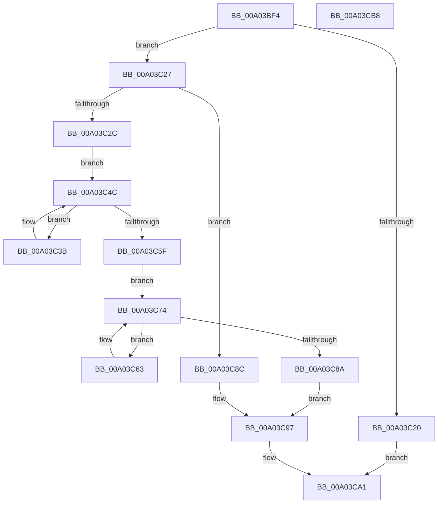

# EtwpSetProviderBinaryTracking

- RVA: `0x00A03BF4`–`0x00A03CB9` (길이 `197` bytes)
- VA: `0x0000000140A03BF4`
- 실행 섹션: `PAGE`
- PDB 이름 있음: `예`; PDB Function 태그: `아니요`
- unwind 정보 RVA: `0x0005C954`
- 디코드: `57`개 명령, `197/197` bytes 표시
- 미해석 바이트: `0` (있으면 어셈블리에 `.byte`로 보존)

> 이 문서는 커널 이미지의 기계어와 PDB 기호를 분석해 생성했습니다. 4번과 5번은 함수 원형과 자료형을 바이너리 사용 방식에서 추정한 C 해석이며 원본 소스 복구 결과는 아닙니다.

## 1. Dependencies

- 직접 호출 지점: **6**; 고유 호출 대상: **4**
- 직접 호출자로 확인된 함수: **1**
- RIP 상대 이미지 참조: **0**

### Outgoing calls
- `0x00A03C13` → [EtwpAcquireLoggerContextByLoggerId](../93/EtwpAcquireLoggerContextByLoggerId_function_00932920.md) (function, `0x00932920`)
- `0x00A03C44` → [EtwpTrackGuidEntryRegistrations](EtwpTrackGuidEntryRegistrations_function_00A03CC0.md) (function, `0x00A03CC0`)
- `0x00A03C52` → [EtwpGetNextGuidEntry](../8C/EtwpGetNextGuidEntry_function_008C3170.md) (function, `0x008C3170`)
- `0x00A03C6C` → [EtwpTrackGuidEntryRegistrations](EtwpTrackGuidEntryRegistrations_function_00A03CC0.md) (function, `0x00A03CC0`)
- `0x00A03C7D` → [EtwpGetNextGuidEntry](../8C/EtwpGetNextGuidEntry_function_008C3170.md) (function, `0x008C3170`)
- `0x00A03C9C` → [EtwpReleaseLoggerContext](EtwpReleaseLoggerContext_function_00A04160.md) (function, `0x00A04160`)

### Direct callers
- [NtTraceControl](../A9/NtTraceControl_function_00A9ED40.md) at `0x00A9F6BD`

### Static image references
- 디코드된 RIP-relative 메모리 참조가 없습니다.

## 2. Other-region calls and transfers

- 다른 실행 섹션으로 향하는 call: **0**
- 별도 외부 분기/꼬리 이동을 확인하지 못했습니다.

## 3. Assembly (complete function range)

```asm
00A03BF4  48 89 5C 24 08                  mov qword ptr [rsp + 8], rbx
00A03BF9  48 89 6C 24 10                  mov qword ptr [rsp + 0x10], rbp
00A03BFE  48 89 74 24 18                  mov qword ptr [rsp + 0x18], rsi
00A03C03  57                              push rdi
00A03C04  48 83 EC 20                     sub rsp, 0x20
00A03C08  41 8A F0                        mov sil, r8b
00A03C0B  48 8B E9                        mov rbp, rcx
00A03C0E  45 33 C0                        xor r8d, r8d
00A03C11  33 DB                           xor ebx, ebx
00A03C13  E8 08 ED F2 FF                  call 0x140932920
00A03C18  48 8B F8                        mov rdi, rax
00A03C1B  48 85 C0                        test rax, rax
00A03C1E  75 07                           jne 0x140a03c27
00A03C20  BB 0D 00 00 C0                  mov ebx, 0xc000000d
00A03C25  EB 7A                           jmp 0x140a03ca1
00A03C27  40 84 F6                        test sil, sil
00A03C2A  74 60                           je 0x140a03c8c
00A03C2C  F0 81 88 30 03 00 00 00 00 00 02  lock or dword ptr [rax + 0x330], 0x2000000
00A03C37  33 D2                           xor edx, edx
00A03C39  EB 11                           jmp 0x140a03c4c
00A03C3B  45 33 C0                        xor r8d, r8d
00A03C3E  48 8B D6                        mov rdx, rsi
00A03C41  48 8B CF                        mov rcx, rdi
00A03C44  E8 77 00 00 00                  call 0x140a03cc0
00A03C49  48 8B D6                        mov rdx, rsi
00A03C4C  45 33 C0                        xor r8d, r8d
00A03C4F  48 8B CD                        mov rcx, rbp
00A03C52  E8 19 F5 EB FF                  call 0x1408c3170
00A03C57  48 8B F0                        mov rsi, rax
00A03C5A  48 85 C0                        test rax, rax
00A03C5D  75 DC                           jne 0x140a03c3b
00A03C5F  33 D2                           xor edx, edx
00A03C61  EB 11                           jmp 0x140a03c74
00A03C63  41 B0 02                        mov r8b, 2
00A03C66  48 8B D6                        mov rdx, rsi
00A03C69  48 8B CF                        mov rcx, rdi
00A03C6C  E8 4F 00 00 00                  call 0x140a03cc0
00A03C71  48 8B D6                        mov rdx, rsi
00A03C74  41 B8 02 00 00 00               mov r8d, 2
00A03C7A  48 8B CD                        mov rcx, rbp
00A03C7D  E8 EE F4 EB FF                  call 0x1408c3170
00A03C82  48 8B F0                        mov rsi, rax
00A03C85  48 85 C0                        test rax, rax
00A03C88  75 D9                           jne 0x140a03c63
00A03C8A  EB 0B                           jmp 0x140a03c97
00A03C8C  F0 81 A0 30 03 00 00 FF FF FF FD  lock and dword ptr [rax + 0x330], 0xfdffffff
00A03C97  33 D2                           xor edx, edx
00A03C99  48 8B CF                        mov rcx, rdi
00A03C9C  E8 BF 04 00 00                  call 0x140a04160
00A03CA1  48 8B 6C 24 38                  mov rbp, qword ptr [rsp + 0x38]
00A03CA6  8B C3                           mov eax, ebx
00A03CA8  48 8B 5C 24 30                  mov rbx, qword ptr [rsp + 0x30]
00A03CAD  48 8B 74 24 40                  mov rsi, qword ptr [rsp + 0x40]
00A03CB2  48 83 C4 20                     add rsp, 0x20
00A03CB6  5F                              pop rdi
00A03CB7  C3                              ret
00A03CB8  CC                              int3
```

## 4. C-style interpretation (structured pseudocode)

```c
__int64 __fastcall EtwpSetProviderBinaryTracking(__int64 a1, int a2, int a3)
{
    __int64 result;
    __int64 v_rbx;
    __int64 v_rsp;
    unsigned __int64 v_stack_p10;
    unsigned __int64 v_stack_p18;
    unsigned __int64 v_stack_p8;

    v_stack_p8 = v_rbx;
    v_stack_p10 = v_rbp;
    v_stack_p18 = v_rsi;
    v_rsp = (v_rsp) - (32);
    a3 = 0;
    v_rbx = 0;
    result = EtwpAcquireLoggerContextByLoggerId(a1, a2, a3, a4);
    if (result != 0) goto loc_00A03C27;
    goto loc_00A03CA1;
loc_00A03C27:
    if ((unsigned __int8)((unsigned __int8)(a3)) == 0) goto loc_00A03C8C;
    a2 = 0;
    goto loc_00A03C4C;
loc_00A03C3B:
    a3 = 0;
    result = EtwpTrackGuidEntryRegistrations(result, (unsigned __int8)(a3), a3, a4);
loc_00A03C4C:
    a3 = 0;
    result = EtwpGetNextGuidEntry(a1, (unsigned __int8)(a3), a3, a4);
    if (result != 0) goto loc_00A03C3B;
    a2 = 0;
    goto loc_00A03C74;
loc_00A03C63:
    result = EtwpTrackGuidEntryRegistrations(result, result, 2, a4);
loc_00A03C74:
    result = EtwpGetNextGuidEntry(a1, result, 2, a4);
    if (result != 0) goto loc_00A03C63;
    goto loc_00A03C97;
loc_00A03C8C:
loc_00A03C97:
    a2 = 0;
    result = EtwpReleaseLoggerContext(result, a2, 2, a4);
loc_00A03CA1:
    v_rsp = (v_rsp) + (32);
    return (unsigned int)((unsigned int)((unsigned int)(0xC000000DULL)));
}
```

## 5. (Beta) C Style

```c
int64_t EtwpSetProviderBinaryTracking(int64_t Arg1, int32_t Arg2, int32_t Arg3)
{
    int64_t result;
    int64_t local_rbx;
    int64_t local_rsp;
    uint64_t v_stack_p10;
    uint64_t v_stack_p18;
    uint64_t v_stack_p8;

    v_stack_p8 = local_rbx;
    v_stack_p10 = local_rbp;
    v_stack_p18 = local_rsi;
    local_rsp = (local_rsp) - (32);
    Arg3 = 0;
    local_rbx = 0;
    result = EtwpAcquireLoggerContextByLoggerId(Arg1, Arg2, Arg3, a4);
    if (result != 0) goto loc_00A03C27;
    goto loc_00A03CA1;
loc_00A03C27:
    if ((uint8_t)((uint8_t)(Arg3)) == 0) goto loc_00A03C8C;
    Arg2 = 0;
    goto loc_00A03C4C;
loc_00A03C3B:
    Arg3 = 0;
    result = EtwpTrackGuidEntryRegistrations(result, (uint8_t)(Arg3), Arg3, a4);
loc_00A03C4C:
    Arg3 = 0;
    result = EtwpGetNextGuidEntry(Arg1, (uint8_t)(Arg3), Arg3, a4);
    if (result != 0) goto loc_00A03C3B;
    Arg2 = 0;
    goto loc_00A03C74;
loc_00A03C63:
    result = EtwpTrackGuidEntryRegistrations(result, result, 2, a4);
loc_00A03C74:
    result = EtwpGetNextGuidEntry(Arg1, result, 2, a4);
    if (result != 0) goto loc_00A03C63;
    goto loc_00A03C97;
loc_00A03C8C:
loc_00A03C97:
    Arg2 = 0;
    result = EtwpReleaseLoggerContext(result, Arg2, 2, a4);
loc_00A03CA1:
    local_rsp = (local_rsp) + (32);
    return (uint32_t)((uint32_t)((uint32_t)(0xC000000DULL)));
}
```

## 6. Execution-region graph

[열기: 2D/3D 그래프와 함수 탐색 컨트롤 패널](../../../control-panel.html?section=page&rva=0x00A03BF4&view=graph)

- 2D 그래프는 위에서 아래로 흐르고, 3D 그래프는 빈 공간을 드래그해 회전합니다. Shift+드래그는 이동, 휠은 확대·축소, 함수 노드 선택은 대상 보고서 이동입니다.

### Static fallback


