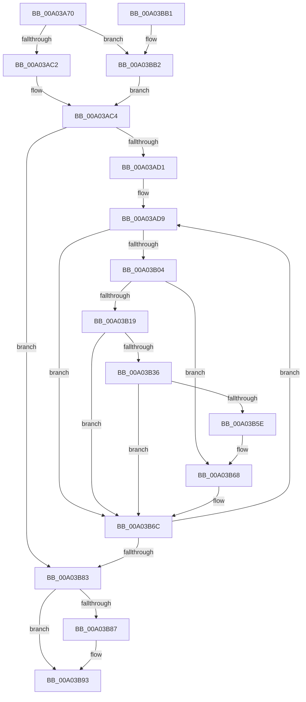

# EtwpTiQueryVad

- RVA: `0x00A03A70`–`0x00A03BCB` (길이 `347` bytes)
- VA: `0x0000000140A03A70`
- 실행 섹션: `PAGE`
- PDB 이름 있음: `예`; PDB Function 태그: `아니요`
- unwind 정보 RVA: `0x000A80C8`
- 디코드: `96`개 명령, `347/347` bytes 표시
- 미해석 바이트: `0` (있으면 어셈블리에 `.byte`로 보존)

> 이 문서는 커널 이미지의 기계어와 PDB 기호를 분석해 생성했습니다. 4번과 5번은 함수 원형과 자료형을 바이너리 사용 방식에서 추정한 C 해석이며 원본 소스 복구 결과는 아닙니다.

## 1. Dependencies

- 직접 호출 지점: **7**; 고유 호출 대상: **6**
- 직접 호출자로 확인된 함수: **1**
- RIP 상대 이미지 참조: **1**

### Outgoing calls
- `0x00A03AF8` → [ZwQueryVirtualMemory](../../text/6A/ZwQueryVirtualMemory_function_006AD530.md) (function, `0x006AD530`)
- `0x00A03B29` → [ExAllocatePool2](../../poolcode/B8/ExAllocatePool2_function_00B820F0.md) (function, `0x00B820F0`)
- `0x00A03B55` → [ZwQueryVirtualMemory](../../text/6A/ZwQueryVirtualMemory_function_006AD530.md) (function, `0x006AD530`)
- `0x00A03B63` → [ExFreePoolWithTag](../../poolcode/B8/ExFreePoolWithTag_function_00B82870.md) (function, `0x00B82870`)
- `0x00A03B8E` → [KiUnstackDetachProcess](../../text/21/KiUnstackDetachProcess_function_00217D30.md) (function, `0x00217D30`)
- `0x00A03B9D` → [_security_check_cookie](../../text/6A/_security_check_cookie_function_006AC640.md) (function, `0x006AC640`)
- `0x00A03BBC` → [KiStackAttachProcess](../../text/21/KiStackAttachProcess_function_00216820.md) (function, `0x00216820`)

### Direct callers
- [EtwpTiVadQueryEventWriteCallback](EtwpTiVadQueryEventWriteCallback_function_00A03970.md) at `0x00A039CF`

### Static image references
- `0x00A03A7F` → RVA `0x00E0A740` (`.data`; read)

## 2. Other-region calls and transfers

- 다른 실행 섹션으로 향하는 call: **7**
  - `0x00A03AF8` → [ZwQueryVirtualMemory](../../text/6A/ZwQueryVirtualMemory_function_006AD530.md) (`PAGE` → `.text`)
  - `0x00A03B29` → [ExAllocatePool2](../../poolcode/B8/ExAllocatePool2_function_00B820F0.md) (`PAGE` → `POOLCODE`)
  - `0x00A03B55` → [ZwQueryVirtualMemory](../../text/6A/ZwQueryVirtualMemory_function_006AD530.md) (`PAGE` → `.text`)
  - `0x00A03B63` → [ExFreePoolWithTag](../../poolcode/B8/ExFreePoolWithTag_function_00B82870.md) (`PAGE` → `POOLCODE`)
  - `0x00A03B8E` → [KiUnstackDetachProcess](../../text/21/KiUnstackDetachProcess_function_00217D30.md) (`PAGE` → `.text`)
  - `0x00A03B9D` → [_security_check_cookie](../../text/6A/_security_check_cookie_function_006AC640.md) (`PAGE` → `.text`)
  - `0x00A03BBC` → [KiStackAttachProcess](../../text/21/KiStackAttachProcess_function_00216820.md) (`PAGE` → `.text`)
- 별도 외부 분기/꼬리 이동을 확인하지 못했습니다.

## 3. Assembly (complete function range)

```asm
00A03A70  40 53                           push rbx
00A03A72  55                              push rbp
00A03A73  56                              push rsi
00A03A74  57                              push rdi
00A03A75  41 54                           push r12
00A03A77  41 56                           push r14
00A03A79  41 57                           push r15
00A03A7B  48 83 EC 70                     sub rsp, 0x70
00A03A7F  48 8B 05 BA 6C 40 00            mov rax, qword ptr [rip + 0x406cba]
00A03A86  48 33 C4                        xor rax, rsp
00A03A89  48 89 44 24 60                  mov qword ptr [rsp + 0x60], rax
00A03A8E  0F 57 C0                        xorps xmm0, xmm0
00A03A91  45 8B E1                        mov r12d, r9d
00A03A94  0F 11 44 24 30                  movups xmmword ptr [rsp + 0x30], xmm0
00A03A99  4D 8B F0                        mov r14, r8
00A03A9C  4C 8B D2                        mov r10, rdx
00A03A9F  0F 11 44 24 40                  movups xmmword ptr [rsp + 0x40], xmm0
00A03AA4  4C 8B F9                        mov r15, rcx
00A03AA7  0F 11 44 24 50                  movups xmmword ptr [rsp + 0x50], xmm0
00A03AAC  65 48 8B 04 25 88 01 00 00      mov rax, qword ptr gs:[0x188]
00A03AB5  48 3B 90 B8 00 00 00            cmp rdx, qword ptr [rax + 0xb8]
00A03ABC  0F 85 F0 00 00 00               jne 0x140a03bb2
00A03AC2  33 ED                           xor ebp, ebp
00A03AC4  33 F6                           xor esi, esi
00A03AC6  33 FF                           xor edi, edi
00A03AC8  45 85 E4                        test r12d, r12d
00A03ACB  0F 84 B2 00 00 00               je 0x140a03b83
00A03AD1  49 8D 5F 38                     lea rbx, [r15 + 0x38]
00A03AD5  49 83 C7 08                     add r15, 8
00A03AD9  48 83 64 24 28 00               and qword ptr [rsp + 0x28], 0
00A03ADF  4D 8B CF                        mov r9, r15
00A03AE2  49 8B 16                        mov rdx, qword ptr [r14]
00A03AE5  41 B8 03 00 00 00               mov r8d, 3
00A03AEB  48 83 C9 FF                     or rcx, 0xffffffffffffffff
00A03AEF  48 C7 44 24 20 30 00 00 00      mov qword ptr [rsp + 0x20], 0x30
00A03AF8  E8 33 9A CA FF                  call 0x1406ad530
00A03AFD  89 43 C8                        mov dword ptr [rbx - 0x38], eax
00A03B00  85 C0                           test eax, eax
00A03B02  78 68                           js 0x140a03b6c
00A03B04  8B CF                           mov ecx, edi
00A03B06  B8 01 00 00 00                  mov eax, 1
00A03B0B  D3 E0                           shl eax, cl
00A03B0D  0B F0                           or esi, eax
00A03B0F  80 BC 24 D0 00 00 00 00         cmp byte ptr [rsp + 0xd0], 0
00A03B17  74 4F                           je 0x140a03b68
00A03B19  BA 00 02 00 00                  mov edx, 0x200
00A03B1E  B9 00 01 00 00                  mov ecx, 0x100
00A03B23  41 B8 54 49 73 6E               mov r8d, 0x6e734954
00A03B29  E8 C2 E5 17 00                  call 0x140b820f0
00A03B2E  48 89 03                        mov qword ptr [rbx], rax
00A03B31  48 85 C0                        test rax, rax
00A03B34  74 36                           je 0x140a03b6c
00A03B36  48 83 64 24 28 00               and qword ptr [rsp + 0x28], 0
00A03B3C  4C 8B C8                        mov r9, rax
00A03B3F  49 8B 16                        mov rdx, qword ptr [r14]
00A03B42  41 B8 02 00 00 00               mov r8d, 2
00A03B48  48 83 C9 FF                     or rcx, 0xffffffffffffffff
00A03B4C  48 C7 44 24 20 00 02 00 00      mov qword ptr [rsp + 0x20], 0x200
00A03B55  E8 D6 99 CA FF                  call 0x1406ad530
00A03B5A  85 C0                           test eax, eax
00A03B5C  79 0E                           jns 0x140a03b6c
00A03B5E  48 8B 0B                        mov rcx, qword ptr [rbx]
00A03B61  33 D2                           xor edx, edx
00A03B63  E8 08 ED 17 00                  call 0x140b82870
00A03B68  48 83 23 00                     and qword ptr [rbx], 0
00A03B6C  FF C7                           inc edi
00A03B6E  49 83 C7 40                     add r15, 0x40
00A03B72  49 83 C6 08                     add r14, 8
00A03B76  48 83 C3 40                     add rbx, 0x40
00A03B7A  41 3B FC                        cmp edi, r12d
00A03B7D  0F 82 56 FF FF FF               jb 0x140a03ad9
00A03B83  85 ED                           test ebp, ebp
00A03B85  74 0C                           je 0x140a03b93
00A03B87  33 D2                           xor edx, edx
00A03B89  48 8D 4C 24 30                  lea rcx, [rsp + 0x30]
00A03B8E  E8 9D 41 81 FF                  call 0x140217d30
00A03B93  8B C6                           mov eax, esi
00A03B95  48 8B 4C 24 60                  mov rcx, qword ptr [rsp + 0x60]
00A03B9A  48 33 CC                        xor rcx, rsp
00A03B9D  E8 9E 8A CA FF                  call 0x1406ac640
00A03BA2  48 83 C4 70                     add rsp, 0x70
00A03BA6  41 5F                           pop r15
00A03BA8  41 5E                           pop r14
00A03BAA  41 5C                           pop r12
00A03BAC  5F                              pop rdi
00A03BAD  5E                              pop rsi
00A03BAE  5D                              pop rbp
00A03BAF  5B                              pop rbx
00A03BB0  C3                              ret
00A03BB1  CC                              int3
00A03BB2  4C 8D 44 24 30                  lea r8, [rsp + 0x30]
00A03BB7  33 D2                           xor edx, edx
00A03BB9  49 8B CA                        mov rcx, r10
00A03BBC  E8 5F 2C 81 FF                  call 0x140216820
00A03BC1  BD 01 00 00 00                  mov ebp, 1
00A03BC6  E9 F9 FE FF FF                  jmp 0x140a03ac4
```

## 4. C-style interpretation (structured pseudocode)

```c
__int64 __fastcall EtwpTiQueryVad(__int64 a1, __int64 a2, __int64 a3, int a4, unsigned __int8 a5)
{
    __int64 result;
    __int64 v_r14;
    __int64 v_r15;
    __int64 v_rbp;
    __int64 v_rbx;
    __int64 v_rdi;
    __int64 v_rsi;
    __int64 v_rsp;
    unsigned __int64 v_stack_m48;
    unsigned __int64 v_stack_m58;
    unsigned __int64 v_stack_m68;
    unsigned __int64 v_stack_m78;
    unsigned __int64 v_stack_m80;
    unsigned __int64 v_stack_m88;
    unsigned __int64 v_stack_p30;

    v_rsp = (v_rsp) - (112);
    result = (*(unsigned __int64 *)(v_rip + 4222138)) ^ (v_rsp);
    v_stack_m48 = result;
    v_stack_m78 = v_xmm0;
    v_stack_m68 = v_xmm0;
    v_stack_m58 = v_xmm0;
    if (a2 != (*(unsigned __int64 *)(*(unsigned __int64 *)(gs_base + (0 + 392)) + 184))) goto loc_00A03BB2;
    v_rbp = 0;
loc_00A03AC4:
    v_rsi = 0;
    v_rdi = 0;
    if ((unsigned int)((unsigned int)(a4)) == 0) goto loc_00A03B83;
    v_r15 = (a1) + (8);
loc_00A03AD9:
    a1 = (a1) | (-1);
    v_stack_m88 = 48;
    result = ZwQueryVirtualMemory(a1, *(unsigned __int64 *)(a3), 3, v_r15);
    *(unsigned int *)(a1 + 56 - 56) = (unsigned int)(result);
    if (sign_flag) goto loc_00A03B6C;
    result = (unsigned int)((1) << (0));
    v_rsi = (unsigned int)((v_rsi) | ((unsigned int)(result)));
    if (a5 == 0) goto loc_00A03B68;
    result = ExAllocatePool2(256, 512, (unsigned int)(0x6E734954ULL), v_r15);
    *(unsigned __int64 *)(a1 + 56) = result;
    if (result == 0) goto loc_00A03B6C;
    a1 = (256) | (-1);
    v_stack_m88 = 512;
    result = ZwQueryVirtualMemory(a1, *(unsigned __int64 *)(a3), 2, result);
    if (!sign_flag) goto loc_00A03B6C;
    a2 = 0;
    result = ExFreePoolWithTag(*(unsigned __int64 *)(a1 + 56), a2, 2, result);
loc_00A03B68:
loc_00A03B6C:
    v_rdi = (unsigned int)((v_rdi) + 1);
    v_r15 = (v_r15) + (64);
    v_r14 = (a3) + (8);
    v_rbx = (a1 + 56) + (64);
    if (((unsigned int)(v_rdi)) < ((unsigned int)((unsigned int)(a4)))) goto loc_00A03AD9;
loc_00A03B83:
    if (0 != 0) {
        a2 = 0;
        a1 = v_stack_m78;
        result = KiUnstackDetachProcess(a1, a2, 2, result);
    }
    a1 = (v_stack_m48) ^ (v_rsp);
    result = _security_check_cookie(a1, a2, 2, result);
    v_rsp = (v_rsp) + (112);
    return result;
loc_00A03BB2:
    a2 = 0;
    result = KiStackAttachProcess(0, a2, v_stack_p30, result);
    goto loc_00A03AC4;
}
```

## 5. (Beta) C Style

```c
int64_t EtwpTiQueryVad(void *Arg1, int64_t Arg2, void *Arg3, int32_t Arg4, uint8_t Arg5)
{
    uint8_t *arg1 = (uint8_t *)Arg1;
    uint8_t *arg3 = (uint8_t *)Arg3;

    int64_t result;
    int64_t local_r14;
    int64_t local_r15;
    int64_t local_rbp;
    int64_t local_rbx;
    int64_t local_rdi;
    int64_t local_rsi;
    int64_t local_rsp;
    uint64_t v_stack_m48;
    uint64_t v_stack_m58;
    uint64_t v_stack_m68;
    uint64_t v_stack_m78;
    uint64_t v_stack_m80;
    uint64_t v_stack_m88;
    uint64_t v_stack_p30;

    local_rsp = (local_rsp) - (112);
    result = (*(uint64_t *)(v_rip + 0x406CBA)) ^ (local_rsp);
    v_stack_m48 = result;
    v_stack_m78 = v_xmm0;
    v_stack_m68 = v_xmm0;
    v_stack_m58 = v_xmm0;
    if (Arg2 != (*(uint64_t *)(*(uint64_t *)(gs_base + (0 + 0x188)) + 0xB8))) goto loc_00A03BB2;
    local_rbp = 0;
loc_00A03AC4:
    local_rsi = 0;
    local_rdi = 0;
    if ((uint32_t)((uint32_t)(Arg4)) == 0) goto loc_00A03B83;
    local_r15 = (Arg1) + (8);
loc_00A03AD9:
    Arg1 = (Arg1) | (-1);
    v_stack_m88 = 48;
    result = ZwQueryVirtualMemory(Arg1, *(uint64_t *)(arg3), 3, local_r15);
    *(uint32_t *)(arg1 + 0x38 - 0x38) = (uint32_t)(result);
    if (sign_flag) goto loc_00A03B6C;
    result = (uint32_t)((1) << (0));
    local_rsi = (uint32_t)((local_rsi) | ((uint32_t)(result)));
    if (Arg5 == 0) goto loc_00A03B68;
    result = ExAllocatePool2(256, 512, (uint32_t)(0x6E734954ULL), local_r15);
    *(uint64_t *)(arg1 + 0x38) = result;
    if (result == 0) goto loc_00A03B6C;
    Arg1 = (256) | (-1);
    v_stack_m88 = 512;
    result = ZwQueryVirtualMemory(Arg1, *(uint64_t *)(arg3), 2, result);
    if (!sign_flag) goto loc_00A03B6C;
    Arg2 = 0;
    result = ExFreePoolWithTag(*(uint64_t *)(arg1 + 0x38), Arg2, 2, result);
loc_00A03B68:
loc_00A03B6C:
    local_rdi = (uint32_t)((local_rdi) + 1);
    local_r15 = (local_r15) + (64);
    local_r14 = (Arg3) + (8);
    local_rbx = (Arg1 + 56) + (64);
    if (((uint32_t)(local_rdi)) < ((uint32_t)((uint32_t)(Arg4)))) goto loc_00A03AD9;
loc_00A03B83:
    if (0 != 0) {
        Arg2 = 0;
        Arg1 = v_stack_m78;
        result = KiUnstackDetachProcess(Arg1, Arg2, 2, result);
    }
    Arg1 = (v_stack_m48) ^ (local_rsp);
    result = _security_check_cookie(Arg1, Arg2, 2, result);
    local_rsp = (local_rsp) + (112);
    return result;
loc_00A03BB2:
    Arg2 = 0;
    result = KiStackAttachProcess(0, Arg2, v_stack_p30, result);
    goto loc_00A03AC4;
}
```

### 관측된 메모리 오프셋

구조체 형식이 확인되지 않은 접근은 인자 기준의 오프셋으로만 기록했습니다.

| 기준 인자 | 오프셋 표현 | 폭 (bit) | 접근 |
|---|---:|---:|---|
| `Arg1` | `- 0x38` | `32` | `W` |
| `Arg1` | `+ 0x0` | `64` | `R` |
| `Arg1` | `+ 0x0` | `64` | `R/W` |
| `Arg1` | `+ 0x0` | `64` | `W` |
| `Arg1` | `+ 0x38` | `64` | `R` |
| `Arg3` | `+ 0x0` | `64` | `R` |

## 6. Execution-region graph

[열기: 2D/3D 그래프와 함수 탐색 컨트롤 패널](../../../control-panel.html?section=page&rva=0x00A03A70&view=graph)

- 2D 그래프는 위에서 아래로 흐르고, 3D 그래프는 빈 공간을 드래그해 회전합니다. Shift+드래그는 이동, 휠은 확대·축소, 함수 노드 선택은 대상 보고서 이동입니다.

### Static fallback


