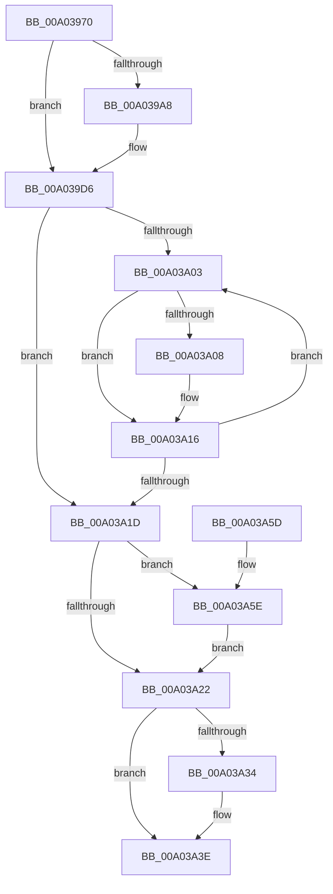

# EtwpTiVadQueryEventWriteCallback

- RVA: `0x00A03970`–`0x00A03A6A` (길이 `250` bytes)
- VA: `0x0000000140A03970`
- 실행 섹션: `PAGE`
- PDB 이름 있음: `예`; PDB Function 태그: `아니요`
- unwind 정보 RVA: `0x000A80B0`
- 디코드: `71`개 명령, `250/250` bytes 표시
- 미해석 바이트: `0` (있으면 어셈블리에 `.byte`로 보존)

> 이 문서는 커널 이미지의 기계어와 PDB 기호를 분석해 생성했습니다. 4번과 5번은 함수 원형과 자료형을 바이너리 사용 방식에서 추정한 C 해석이며 원본 소스 복구 결과는 아닙니다.

## 1. Dependencies

- 직접 호출 지점: **9**; 고유 호출 대상: **8**
- 직접 호출자로 확인된 함수: **0**
- RIP 상대 이미지 참조: **1**

### Outgoing calls
- `0x00A0399B` → [ExAllocatePool2](../../poolcode/B8/ExAllocatePool2_function_00B820F0.md) (function, `0x00B820F0`)
- `0x00A039B7` → [EtwProviderEnabled](../../text/3B/EtwProviderEnabled_function_003BA250.md) (function, `0x003BA250`)
- `0x00A039CF` → [EtwpTiQueryVad](EtwpTiQueryVad_function_00A03A70.md) (function, `0x00A03A70`)
- `0x00A039F7` → [EtwpTiFillVadEventWrite](../../text/46/EtwpTiFillVadEventWrite_function_00469484.md) (function, `0x00469484`)
- `0x00A03A11` → [EtwpTiFreeVad](EtwpTiFreeVad_function_00A03BD4.md) (function, `0x00A03BD4`)
- `0x00A03A26` → [EtwpTiClearBloomFilter](../../text/3B/EtwpTiClearBloomFilter_function_003B92E4.md) (function, `0x003B92E4`)
- `0x00A03A39` → [ObfDereferenceObjectWithTag](../../text/2F/ObfDereferenceObjectWithTag_function_002F78E0.md) (function, `0x002F78E0`)
- `0x00A03A43` → [ExFreePoolWithTag](../../poolcode/B8/ExFreePoolWithTag_function_00B82870.md) (function, `0x00B82870`)
- `0x00A03A63` → [ExFreePoolWithTag](../../poolcode/B8/ExFreePoolWithTag_function_00B82870.md) (function, `0x00B82870`)

### Direct callers
- 이 함수 시작 RVA로 연결되는 직접 call은 확인되지 않았습니다. 간접 호출은 완전히 역산할 수 없습니다.

### Static image references
- `0x00A039A8` → RVA `0x00EFFA30` (`.data`; read)

## 2. Other-region calls and transfers

- 다른 실행 섹션으로 향하는 call: **7**
  - `0x00A0399B` → [ExAllocatePool2](../../poolcode/B8/ExAllocatePool2_function_00B820F0.md) (`PAGE` → `POOLCODE`)
  - `0x00A039B7` → [EtwProviderEnabled](../../text/3B/EtwProviderEnabled_function_003BA250.md) (`PAGE` → `.text`)
  - `0x00A039F7` → [EtwpTiFillVadEventWrite](../../text/46/EtwpTiFillVadEventWrite_function_00469484.md) (`PAGE` → `.text`)
  - `0x00A03A26` → [EtwpTiClearBloomFilter](../../text/3B/EtwpTiClearBloomFilter_function_003B92E4.md) (`PAGE` → `.text`)
  - `0x00A03A39` → [ObfDereferenceObjectWithTag](../../text/2F/ObfDereferenceObjectWithTag_function_002F78E0.md) (`PAGE` → `.text`)
  - `0x00A03A43` → [ExFreePoolWithTag](../../poolcode/B8/ExFreePoolWithTag_function_00B82870.md) (`PAGE` → `POOLCODE`)
  - `0x00A03A63` → [ExFreePoolWithTag](../../poolcode/B8/ExFreePoolWithTag_function_00B82870.md) (`PAGE` → `POOLCODE`)
- 별도 외부 분기/꼬리 이동을 확인하지 못했습니다.

## 3. Assembly (complete function range)

```asm
00A03970  48 89 5C 24 08                  mov qword ptr [rsp + 8], rbx
00A03975  48 89 6C 24 10                  mov qword ptr [rsp + 0x10], rbp
00A0397A  48 89 74 24 18                  mov qword ptr [rsp + 0x18], rsi
00A0397F  57                              push rdi
00A03980  48 83 EC 40                     sub rsp, 0x40
00A03984  8B 51 34                        mov edx, dword ptr [rcx + 0x34]
00A03987  48 8B D9                        mov rbx, rcx
00A0398A  48 C1 E2 06                     shl rdx, 6
00A0398E  B9 00 01 00 00                  mov ecx, 0x100
00A03993  41 B8 54 49 73 6E               mov r8d, 0x6e734954
00A03999  33 ED                           xor ebp, ebp
00A0399B  E8 50 E7 17 00                  call 0x140b820f0
00A039A0  48 8B F0                        mov rsi, rax
00A039A3  48 85 C0                        test rax, rax
00A039A6  74 2E                           je 0x140a039d6
00A039A8  48 8B 0D 81 C0 4F 00            mov rcx, qword ptr [rip + 0x4fc081]
00A039AF  33 D2                           xor edx, edx
00A039B1  41 B8 00 00 00 10               mov r8d, 0x10000000
00A039B7  E8 94 68 9B FF                  call 0x1403ba250
00A039BC  44 8B 4B 34                     mov r9d, dword ptr [rbx + 0x34]
00A039C0  48 8B CE                        mov rcx, rsi
00A039C3  4C 8B 43 48                     mov r8, qword ptr [rbx + 0x48]
00A039C7  48 8B 53 40                     mov rdx, qword ptr [rbx + 0x40]
00A039CB  88 44 24 20                     mov byte ptr [rsp + 0x20], al
00A039CF  E8 9C 00 00 00                  call 0x140a03a70
00A039D4  8B E8                           mov ebp, eax
00A039D6  48 8B 4B 38                     mov rcx, qword ptr [rbx + 0x38]
00A039DA  4C 8B CE                        mov r9, rsi
00A039DD  8B 53 30                        mov edx, dword ptr [rbx + 0x30]
00A039E0  41 B0 01                        mov r8b, 1
00A039E3  48 89 4C 24 30                  mov qword ptr [rsp + 0x30], rcx
00A039E8  8B 4B 34                        mov ecx, dword ptr [rbx + 0x34]
00A039EB  89 4C 24 28                     mov dword ptr [rsp + 0x28], ecx
00A039EF  48 8B 4B 20                     mov rcx, qword ptr [rbx + 0x20]
00A039F3  89 6C 24 20                     mov dword ptr [rsp + 0x20], ebp
00A039F7  E8 88 5A A6 FF                  call 0x140469484
00A039FC  33 FF                           xor edi, edi
00A039FE  39 7B 34                        cmp dword ptr [rbx + 0x34], edi
00A03A01  76 1A                           jbe 0x140a03a1d
00A03A03  0F A3 FD                        bt ebp, edi
00A03A06  73 0E                           jae 0x140a03a16
00A03A08  8B CF                           mov ecx, edi
00A03A0A  48 C1 E1 06                     shl rcx, 6
00A03A0E  48 03 CE                        add rcx, rsi
00A03A11  E8 BE 01 00 00                  call 0x140a03bd4
00A03A16  FF C7                           inc edi
00A03A18  3B 7B 34                        cmp edi, dword ptr [rbx + 0x34]
00A03A1B  72 E6                           jb 0x140a03a03
00A03A1D  48 85 F6                        test rsi, rsi
00A03A20  75 3C                           jne 0x140a03a5e
00A03A22  48 8B 53 50                     mov rdx, qword ptr [rbx + 0x50]
00A03A26  E8 B9 58 9B FF                  call 0x1403b92e4
00A03A2B  48 8B 4B 40                     mov rcx, qword ptr [rbx + 0x40]
00A03A2F  48 85 C9                        test rcx, rcx
00A03A32  74 0A                           je 0x140a03a3e
00A03A34  BA 45 74 54 69                  mov edx, 0x69547445
00A03A39  E8 A2 3E 8F FF                  call 0x1402f78e0
00A03A3E  33 D2                           xor edx, edx
00A03A40  48 8B CB                        mov rcx, rbx
00A03A43  E8 28 EE 17 00                  call 0x140b82870
00A03A48  48 8B 5C 24 50                  mov rbx, qword ptr [rsp + 0x50]
00A03A4D  48 8B 6C 24 58                  mov rbp, qword ptr [rsp + 0x58]
00A03A52  48 8B 74 24 60                  mov rsi, qword ptr [rsp + 0x60]
00A03A57  48 83 C4 40                     add rsp, 0x40
00A03A5B  5F                              pop rdi
00A03A5C  C3                              ret
00A03A5D  CC                              int3
00A03A5E  33 D2                           xor edx, edx
00A03A60  48 8B CE                        mov rcx, rsi
00A03A63  E8 08 EE 17 00                  call 0x140b82870
00A03A68  EB B8                           jmp 0x140a03a22
```

## 4. C-style interpretation (structured pseudocode)

```c
__int64 __fastcall EtwpTiVadQueryEventWriteCallback(__int64 a1)
{
    __int64 result;
    __int64 v_rbp;
    __int64 v_rdi;
    __int64 v_rsp;
    unsigned __int64 v_stack_m18;
    unsigned int v_stack_m20;
    unsigned __int8 v_stack_m28;
    unsigned __int64 v_stack_p10;
    unsigned __int64 v_stack_p18;
    unsigned __int64 v_stack_p8;

    v_stack_p8 = v_rbx;
    v_stack_p10 = v_rbp;
    v_stack_p18 = v_rsi;
    v_rsp = (v_rsp) - (64);
    a2 = ((unsigned int)(*(unsigned int *)(a1 + 52))) << (6);
    v_rbp = 0;
    result = ExAllocatePool2(256, a2, (unsigned int)(0x6E734954ULL), a4);
    if (result != 0) {
        a1 = *(unsigned __int64 *)(v_rip + 5226625);
        a2 = 0;
        a3 = 0x10000000ULL;
        result = EtwProviderEnabled(a1, a2, a3, a4);
        a4 = *(unsigned int *)(a1 + 52);
        a1 = result;
        a3 = *(unsigned __int64 *)(a1 + 72);
        a2 = *(unsigned __int64 *)(a1 + 64);
        v_stack_m28 = (unsigned __int8)(result);
        result = EtwpTiQueryVad(a1, a2, a3, a4);
        v_rbp = (unsigned int)(result);
    }
    v_stack_m18 = *(unsigned __int64 *)(a1 + 56);
    v_stack_m20 = (unsigned int)((unsigned int)(*(unsigned int *)(a1 + 52)));
    v_stack_m28 = (unsigned int)(v_rbp);
    result = EtwpTiFillVadEventWrite(*(unsigned __int64 *)(a1 + 32), (unsigned int)(*(unsigned int *)(a1 + 48)), 1, result);
    v_rdi = 0;
    if ((*(unsigned int *)(a1 + 52)) <= 0) goto loc_00A03A1D;
loc_00A03A03:
    if ((*(unsigned int *)(a1 + 52)) < 0) {
        a1 = 0;
        a1 = (a1) << (6);
        a1 = (a1) + (result);
        result = EtwpTiFreeVad(a1, (unsigned int)(*(unsigned int *)(a1 + 48)), 1, result);
    }
    v_rdi = (unsigned int)((v_rdi) + 1);
    if (((unsigned int)(v_rdi)) < (*(unsigned int *)(a1 + 52))) goto loc_00A03A03;
loc_00A03A1D:
    if (result != 0) goto loc_00A03A5E;
loc_00A03A22:
    result = EtwpTiClearBloomFilter(a1, *(unsigned __int64 *)(a1 + 80), 1, result);
    if (*(unsigned __int64 *)(a1 + 64) != 0) {
        a2 = 0x69547445ULL;
        result = ObfDereferenceObjectWithTag(*(unsigned __int64 *)(a1 + 64), a2, 1, result);
    }
    a2 = 0;
    result = ExFreePoolWithTag(a1, a2, 1, result);
    v_rsp = (v_rsp) + (64);
    return result;
loc_00A03A5E:
    a2 = 0;
    result = ExFreePoolWithTag(v_stack_p18, a2, 1, result);
    goto loc_00A03A22;
}
```

## 5. (Beta) C Style

```c
int64_t EtwpTiVadQueryEventWriteCallback(void *Arg1)
{
    uint8_t *arg1 = (uint8_t *)Arg1;

    int64_t result;
    int64_t local_rbp;
    int64_t local_rdi;
    int64_t local_rsp;
    uint64_t v_stack_m18;
    uint32_t v_stack_m20;
    uint8_t v_stack_m28;
    uint64_t v_stack_p10;
    uint64_t v_stack_p18;
    uint64_t v_stack_p8;

    v_stack_p8 = local_rbx;
    v_stack_p10 = local_rbp;
    v_stack_p18 = local_rsi;
    local_rsp = (local_rsp) - (64);
    a2 = ((uint32_t)(*(uint32_t *)(arg1 + 0x34))) << (6);
    local_rbp = 0;
    result = ExAllocatePool2(256, a2, (uint32_t)(0x6E734954ULL), a4);
    if (result != 0) {
        Arg1 = *(uint64_t *)(v_rip + 0x4FC081);
        a2 = 0;
        a3 = 0x10000000ULL;
        result = EtwProviderEnabled(Arg1, a2, a3, a4);
        a4 = *(uint32_t *)(arg1 + 0x34);
        Arg1 = result;
        a3 = *(uint64_t *)(arg1 + 0x48);
        a2 = *(uint64_t *)(arg1 + 0x40);
        v_stack_m28 = (uint8_t)(result);
        result = EtwpTiQueryVad(Arg1, a2, a3, a4);
        local_rbp = (uint32_t)(result);
    }
    v_stack_m18 = *(uint64_t *)(arg1 + 0x38);
    v_stack_m20 = (uint32_t)((uint32_t)(*(uint32_t *)(arg1 + 0x34)));
    v_stack_m28 = (uint32_t)(local_rbp);
    result = EtwpTiFillVadEventWrite(*(uint64_t *)(arg1 + 0x20), (uint32_t)(*(uint32_t *)(arg1 + 0x30)), 1, result);
    local_rdi = 0;
    if ((*(uint32_t *)(arg1 + 0x34)) <= 0) goto loc_00A03A1D;
loc_00A03A03:
    if ((*(uint32_t *)(arg1 + 0x34)) < 0) {
        Arg1 = 0;
        Arg1 = (Arg1) << (6);
        Arg1 = (Arg1) + (result);
        result = EtwpTiFreeVad(Arg1, (uint32_t)(*(uint32_t *)(arg1 + 0x30)), 1, result);
    }
    local_rdi = (uint32_t)((local_rdi) + 1);
    if (((uint32_t)(local_rdi)) < (*(uint32_t *)(arg1 + 0x34))) goto loc_00A03A03;
loc_00A03A1D:
    if (result != 0) goto loc_00A03A5E;
loc_00A03A22:
    result = EtwpTiClearBloomFilter(Arg1, *(uint64_t *)(arg1 + 0x50), 1, result);
    if (*(uint64_t *)(arg1 + 0x40) != 0) {
        a2 = 0x69547445ULL;
        result = ObfDereferenceObjectWithTag(*(uint64_t *)(arg1 + 0x40), a2, 1, result);
    }
    a2 = 0;
    result = ExFreePoolWithTag(Arg1, a2, 1, result);
    local_rsp = (local_rsp) + (64);
    return result;
loc_00A03A5E:
    a2 = 0;
    result = ExFreePoolWithTag(v_stack_p18, a2, 1, result);
    goto loc_00A03A22;
}
```

### 관측된 메모리 오프셋

구조체 형식이 확인되지 않은 접근은 인자 기준의 오프셋으로만 기록했습니다.

| 기준 인자 | 오프셋 표현 | 폭 (bit) | 접근 |
|---|---:|---:|---|
| `Arg1` | `+ 0x20` | `64` | `R` |
| `Arg1` | `+ 0x30` | `32` | `R` |
| `Arg1` | `+ 0x34` | `32` | `R` |
| `Arg1` | `+ 0x38` | `64` | `R` |
| `Arg1` | `+ 0x40` | `64` | `R` |
| `Arg1` | `+ 0x48` | `64` | `R` |
| `Arg1` | `+ 0x50` | `64` | `R` |

## 6. Execution-region graph

[열기: 2D/3D 그래프와 함수 탐색 컨트롤 패널](../../../control-panel.html?section=page&rva=0x00A03970&view=graph)

- 2D 그래프는 위에서 아래로 흐르고, 3D 그래프는 빈 공간을 드래그해 회전합니다. Shift+드래그는 이동, 휠은 확대·축소, 함수 노드 선택은 대상 보고서 이동입니다.

### Static fallback


