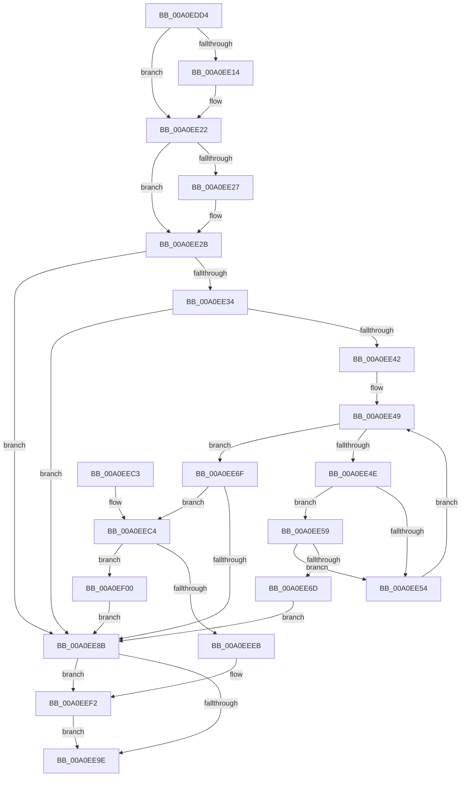

# EtwpTrackDebugIdForSession

- RVA: `0x00A0EDD4`–`0x00A0EF22` (길이 `334` bytes)
- VA: `0x0000000140A0EDD4`
- 실행 섹션: `PAGE`
- PDB 이름 있음: `예`; PDB Function 태그: `아니요`
- unwind 정보 RVA: `0x000A8EA0`
- 디코드: `91`개 명령, `334/334` bytes 표시
- 미해석 바이트: `0` (있으면 어셈블리에 `.byte`로 보존)

> 이 문서는 커널 이미지의 기계어와 PDB 기호를 분석해 생성했습니다. 4번과 5번은 함수 원형과 자료형을 바이너리 사용 방식에서 추정한 C 해석이며 원본 소스 복구 결과는 아닙니다.

## 1. Dependencies

- 직접 호출 지점: **7**; 고유 호출 대상: **7**
- 직접 호출자로 확인된 함수: **1**
- RIP 상대 이미지 참조: **0**

### Outgoing calls
- `0x00A0EE04` → [KeAbPreAcquire](../../text/21/KeAbPreAcquire_function_00210230.md) (function, `0x00210230`)
- `0x00A0EE1D` → [ExfAcquirePushLockExclusiveEx](../../text/20/ExfAcquirePushLockExclusiveEx_function_0020FC90.md) (function, `0x0020FC90`)
- `0x00A0EE63` → [RtlCompareMemory](../../text/6B/RtlCompareMemory_function_006BA670.md) (function, `0x006BA670`)
- `0x00A0EE7E` → [ExAllocatePool2](../../poolcode/B8/ExAllocatePool2_function_00B820F0.md) (function, `0x00B820F0`)
- `0x00A0EEA5` → [KeAbPostRelease](../../text/2E/KeAbPostRelease_function_002E1600.md) (function, `0x002E1600`)
- `0x00A0EED9` → [memcpy](../../text/6C/memcpy_function_006C6840.md) (function, `0x006C6840`)
- `0x00A0EEF9` → [ExfTryToWakePushLock](../../text/26/ExfTryToWakePushLock_function_00265DD0.md) (function, `0x00265DD0`)

### Direct callers
- [EtwpProviderArrivalCallback](EtwpProviderArrivalCallback_function_00A03F94.md) at `0x00A040BD`

### Static image references
- 디코드된 RIP-relative 메모리 참조가 없습니다.

## 2. Other-region calls and transfers

- 다른 실행 섹션으로 향하는 call: **7**
  - `0x00A0EE04` → [KeAbPreAcquire](../../text/21/KeAbPreAcquire_function_00210230.md) (`PAGE` → `.text`)
  - `0x00A0EE1D` → [ExfAcquirePushLockExclusiveEx](../../text/20/ExfAcquirePushLockExclusiveEx_function_0020FC90.md) (`PAGE` → `.text`)
  - `0x00A0EE63` → [RtlCompareMemory](../../text/6B/RtlCompareMemory_function_006BA670.md) (`PAGE` → `.text`)
  - `0x00A0EE7E` → [ExAllocatePool2](../../poolcode/B8/ExAllocatePool2_function_00B820F0.md) (`PAGE` → `POOLCODE`)
  - `0x00A0EEA5` → [KeAbPostRelease](../../text/2E/KeAbPostRelease_function_002E1600.md) (`PAGE` → `.text`)
  - `0x00A0EED9` → [memcpy](../../text/6C/memcpy_function_006C6840.md) (`PAGE` → `.text`)
  - `0x00A0EEF9` → [ExfTryToWakePushLock](../../text/26/ExfTryToWakePushLock_function_00265DD0.md) (`PAGE` → `.text`)
- 별도 외부 분기/꼬리 이동을 확인하지 못했습니다.

## 3. Assembly (complete function range)

```asm
00A0EDD4  48 89 5C 24 08                  mov qword ptr [rsp + 8], rbx
00A0EDD9  48 89 6C 24 10                  mov qword ptr [rsp + 0x10], rbp
00A0EDDE  48 89 74 24 18                  mov qword ptr [rsp + 0x18], rsi
00A0EDE3  57                              push rdi
00A0EDE4  41 56                           push r14
00A0EDE6  41 57                           push r15
00A0EDE8  48 83 EC 20                     sub rsp, 0x20
00A0EDEC  48 8D B1 B0 02 00 00            lea rsi, [rcx + 0x2b0]
00A0EDF3  45 8B F0                        mov r14d, r8d
00A0EDF6  48 8B EA                        mov rbp, rdx
00A0EDF9  48 8B F9                        mov rdi, rcx
00A0EDFC  48 8B CE                        mov rcx, rsi
00A0EDFF  45 33 C0                        xor r8d, r8d
00A0EE02  33 D2                           xor edx, edx
00A0EE04  E8 27 14 80 FF                  call 0x140210230
00A0EE09  F0 48 0F BA 2E 00               lock bts qword ptr [rsi], 0
00A0EE0F  48 8B D8                        mov rbx, rax
00A0EE12  73 0E                           jae 0x140a0ee22
00A0EE14  4C 8B C6                        mov r8, rsi
00A0EE17  48 8B D0                        mov rdx, rax
00A0EE1A  48 8B CE                        mov rcx, rsi
00A0EE1D  E8 6E 0E 80 FF                  call 0x14020fc90
00A0EE22  48 85 DB                        test rbx, rbx
00A0EE25  74 04                           je 0x140a0ee2b
00A0EE27  C6 43 0A 01                     mov byte ptr [rbx + 0xa], 1
00A0EE2B  41 81 FE 00 80 00 00            cmp r14d, 0x8000
00A0EE32  77 57                           ja 0x140a0ee8b
00A0EE34  8B 8F 44 01 00 00               mov ecx, dword ptr [rdi + 0x144]
00A0EE3A  41 03 CE                        add ecx, r14d
00A0EE3D  3B 4F 04                        cmp ecx, dword ptr [rdi + 4]
00A0EE40  77 49                           ja 0x140a0ee8b
00A0EE42  4C 8D 7F 60                     lea r15, [rdi + 0x60]
00A0EE46  49 8B 37                        mov rsi, qword ptr [r15]
00A0EE49  49 3B F7                        cmp rsi, r15
00A0EE4C  74 21                           je 0x140a0ee6f
00A0EE4E  44 39 76 14                     cmp dword ptr [rsi + 0x14], r14d
00A0EE52  74 05                           je 0x140a0ee59
00A0EE54  48 8B 36                        mov rsi, qword ptr [rsi]
00A0EE57  EB F0                           jmp 0x140a0ee49
00A0EE59  48 8D 4E 18                     lea rcx, [rsi + 0x18]
00A0EE5D  4D 8B C6                        mov r8, r14
00A0EE60  48 8B D5                        mov rdx, rbp
00A0EE63  E8 08 B8 CA FF                  call 0x1406ba670
00A0EE68  49 3B C6                        cmp rax, r14
00A0EE6B  75 E7                           jne 0x140a0ee54
00A0EE6D  EB 1C                           jmp 0x140a0ee8b
00A0EE6F  41 8D 56 18                     lea edx, [r14 + 0x18]
00A0EE73  B9 40 00 00 00                  mov ecx, 0x40
00A0EE78  41 B8 45 74 77 62               mov r8d, 0x62777445
00A0EE7E  E8 6D 32 17 00                  call 0x140b820f0
00A0EE83  48 8B D8                        mov rbx, rax
00A0EE86  48 85 C0                        test rax, rax
00A0EE89  75 39                           jne 0x140a0eec4
00A0EE8B  48 83 C8 FF                     or rax, 0xffffffffffffffff
00A0EE8F  F0 48 0F C1 87 B0 02 00 00      lock xadd qword ptr [rdi + 0x2b0], rax
00A0EE98  24 06                           and al, 6
00A0EE9A  3C 02                           cmp al, 2
00A0EE9C  74 54                           je 0x140a0eef2
00A0EE9E  48 8D 8F B0 02 00 00            lea rcx, [rdi + 0x2b0]
00A0EEA5  E8 56 27 8D FF                  call 0x1402e1600
00A0EEAA  48 8B 5C 24 40                  mov rbx, qword ptr [rsp + 0x40]
00A0EEAF  48 8B 6C 24 48                  mov rbp, qword ptr [rsp + 0x48]
00A0EEB4  48 8B 74 24 50                  mov rsi, qword ptr [rsp + 0x50]
00A0EEB9  48 83 C4 20                     add rsp, 0x20
00A0EEBD  41 5F                           pop r15
00A0EEBF  41 5E                           pop r14
00A0EEC1  5F                              pop rdi
00A0EEC2  C3                              ret
00A0EEC3  CC                              int3
00A0EEC4  44 01 B7 44 01 00 00            add dword ptr [rdi + 0x144], r14d
00A0EECB  48 8D 48 18                     lea rcx, [rax + 0x18]
00A0EECF  4D 8B C6                        mov r8, r14
00A0EED2  44 89 70 14                     mov dword ptr [rax + 0x14], r14d
00A0EED6  48 8B D5                        mov rdx, rbp
00A0EED9  E8 62 79 CB FF                  call 0x1406c6840
00A0EEDE  48 8D 47 60                     lea rax, [rdi + 0x60]
00A0EEE2  48 8B 08                        mov rcx, qword ptr [rax]
00A0EEE5  48 39 41 08                     cmp qword ptr [rcx + 8], rax
00A0EEE9  74 15                           je 0x140a0ef00
00A0EEEB  B9 03 00 00 00                  mov ecx, 3
00A0EEF0  CD 29                           int 0x29
00A0EEF2  48 8D 8F B0 02 00 00            lea rcx, [rdi + 0x2b0]
00A0EEF9  E8 D2 6E 85 FF                  call 0x140265dd0
00A0EEFE  EB 9E                           jmp 0x140a0ee9e
00A0EF00  48 89 0B                        mov qword ptr [rbx], rcx
00A0EF03  48 89 43 08                     mov qword ptr [rbx + 8], rax
00A0EF07  48 89 59 08                     mov qword ptr [rcx + 8], rbx
00A0EF0B  48 89 18                        mov qword ptr [rax], rbx
00A0EF0E  C6 43 10 00                     mov byte ptr [rbx + 0x10], 0
00A0EF12  F0 81 8F 38 03 00 00 C0 08 00 00  lock or dword ptr [rdi + 0x338], 0x8c0
00A0EF1D  E9 69 FF FF FF                  jmp 0x140a0ee8b
```

## 4. C-style interpretation (structured pseudocode)

```c
__int64 __fastcall EtwpTrackDebugIdForSession(__int64 a1, __int64 a2, int a3)
{
    __int64 result;
    __int64 v_rsp;
    unsigned __int64 v_stack_p10;
    unsigned __int64 v_stack_p18;
    unsigned __int64 v_stack_p8;

    v_stack_p8 = v_rbx;
    v_stack_p10 = v_rbp;
    v_stack_p18 = v_rsi;
    v_rsp = (v_rsp) - (32);
    a3 = 0;
    a2 = 0;
    result = KeAbPreAcquire(a1 + 688, a2, a3, a4);
    if (!(condition_is_above_or_equal)) {
        a3 = a1 + 688;
        a2 = result;
        a1 = a1 + 688;
        result = ExfAcquirePushLockExclusiveEx(a1, a2, a3, a4);
    }
    if (result != 0) {
        *(unsigned __int8 *)(result + 10) = 1;
    }
    if (((unsigned int)((unsigned int)(a3))) > 0x8000ULL) goto loc_00A0EE8B;
    a1 = (unsigned int)(((unsigned int)(*(unsigned int *)(a1 + 324))) + ((unsigned int)((unsigned int)(a3))));
    if (((unsigned int)(a1)) > (*(unsigned int *)(a1 + 4))) goto loc_00A0EE8B;
loc_00A0EE49:
    if ((*(unsigned __int64 *)(a1 + 96)) == (a1 + 96)) goto loc_00A0EE6F;
    if ((*(unsigned int *)(*(unsigned __int64 *)(a1 + 96) + 20)) == ((unsigned int)((unsigned int)(a3)))) goto loc_00A0EE59;
loc_00A0EE54:
    goto loc_00A0EE49;
loc_00A0EE59:
    result = RtlCompareMemory(*(unsigned __int64 *)(*(unsigned __int64 *)(a1 + 96)) + 24, a2, (unsigned int)(a3), a4);
    if (result != ((unsigned int)(a3))) goto loc_00A0EE54;
    goto loc_00A0EE8B;
loc_00A0EE6F:
    result = ExAllocatePool2(64, (unsigned int)(a3) + 24, (unsigned int)(0x62777445ULL), a4);
    if (result != 0) goto loc_00A0EEC4;
loc_00A0EE8B:
    result = (result) | (-1);
    result = (unsigned __int8)((result) & (6));
    if (((unsigned __int8)(result)) == 2) goto loc_00A0EEF2;
loc_00A0EE9E:
    result = KeAbPostRelease(a1 + 688, (unsigned int)(a3) + 24, (unsigned int)(0x62777445ULL), a4);
    v_rsp = (v_rsp) + (32);
    return result;
loc_00A0EEC4:
    *(unsigned int *)(result + 20) = (unsigned int)((unsigned int)(a3));
    result = memcpy(result + 24, v_stack_p10, (unsigned int)(a3), a4);
    if ((*(unsigned __int64 *)(*(unsigned __int64 *)(a1 + 96) + 8)) == (a1 + 96)) goto loc_00A0EF00;
loc_00A0EEF2:
    result = ExfTryToWakePushLock(a1 + 688, v_stack_p10, (unsigned int)(a3), a4);
    goto loc_00A0EE9E;
loc_00A0EF00:
    *(unsigned __int64 *)(v_stack_p8) = a1 + 688;
    *(unsigned __int64 *)(v_stack_p8 + 8) = result;
    *(unsigned __int64 *)(a1 + 688 + 8) = v_stack_p8;
    *(unsigned __int64 *)(result) = v_stack_p8;
    *(unsigned __int8 *)(v_stack_p8 + 16) = 0;
    goto loc_00A0EE8B;
}
```

## 5. (Beta) C Style

```c
int64_t EtwpTrackDebugIdForSession(void *Arg1, int64_t Arg2, int32_t Arg3)
{
    uint8_t *arg1 = (uint8_t *)Arg1;

    int64_t result;
    int64_t local_rsp;
    uint64_t v_stack_p10;
    uint64_t v_stack_p18;
    uint64_t v_stack_p8;

    v_stack_p8 = local_rbx;
    v_stack_p10 = local_rbp;
    v_stack_p18 = local_rsi;
    local_rsp = (local_rsp) - (32);
    Arg3 = 0;
    Arg2 = 0;
    result = KeAbPreAcquire(Arg1 + 688, Arg2, Arg3, a4);
    if (!(condition_is_above_or_equal)) {
        Arg3 = Arg1 + 688;
        Arg2 = result;
        Arg1 = Arg1 + 688;
        result = ExfAcquirePushLockExclusiveEx(Arg1, Arg2, Arg3, a4);
    }
    if (result != 0) {
        *(uint8_t *)(result + 0xA) = 1;
    }
    if (((uint32_t)((uint32_t)(Arg3))) > 0x8000ULL) goto loc_00A0EE8B;
    Arg1 = (uint32_t)(((uint32_t)(*(uint32_t *)(arg1 + 0x144))) + ((uint32_t)((uint32_t)(Arg3))));
    if (((uint32_t)(Arg1)) > (*(uint32_t *)(arg1 + 0x4))) goto loc_00A0EE8B;
loc_00A0EE49:
    if ((*(uint64_t *)(arg1 + 0x60)) == (Arg1 + 96)) goto loc_00A0EE6F;
    if ((*(uint32_t *)(*(uint64_t *)(arg1 + 0x60) + 0x14)) == ((uint32_t)((uint32_t)(Arg3)))) goto loc_00A0EE59;
loc_00A0EE54:
    goto loc_00A0EE49;
loc_00A0EE59:
    result = RtlCompareMemory(*(uint64_t *)(*(uint64_t *)(arg1 + 0x60)) + 24, Arg2, (uint32_t)(Arg3), a4);
    if (result != ((uint32_t)(Arg3))) goto loc_00A0EE54;
    goto loc_00A0EE8B;
loc_00A0EE6F:
    result = ExAllocatePool2(64, (uint32_t)(Arg3) + 24, (uint32_t)(0x62777445ULL), a4);
    if (result != 0) goto loc_00A0EEC4;
loc_00A0EE8B:
    result = (result) | (-1);
    result = (uint8_t)((result) & (6));
    if (((uint8_t)(result)) == 2) goto loc_00A0EEF2;
loc_00A0EE9E:
    result = KeAbPostRelease(Arg1 + 688, (uint32_t)(Arg3) + 24, (uint32_t)(0x62777445ULL), a4);
    local_rsp = (local_rsp) + (32);
    return result;
loc_00A0EEC4:
    *(uint32_t *)(result + 0x14) = (uint32_t)((uint32_t)(Arg3));
    result = memcpy(result + 24, v_stack_p10, (uint32_t)(Arg3), a4);
    if ((*(uint64_t *)(*(uint64_t *)(arg1 + 0x60) + 0x8)) == (Arg1 + 96)) goto loc_00A0EF00;
loc_00A0EEF2:
    result = ExfTryToWakePushLock(Arg1 + 688, v_stack_p10, (uint32_t)(Arg3), a4);
    goto loc_00A0EE9E;
loc_00A0EF00:
    *(void **)(v_stack_p8) = Arg1 + 688;
    *(uint64_t *)(v_stack_p8 + 0x8) = result;
    *(uint64_t *)(arg1 + 0x2B0 + 0x8) = v_stack_p8;
    *(uint64_t *)(result) = v_stack_p8;
    *(uint8_t *)(v_stack_p8 + 0x10) = 0;
    goto loc_00A0EE8B;
}
```

### 관측된 메모리 오프셋

구조체 형식이 확인되지 않은 접근은 인자 기준의 오프셋으로만 기록했습니다.

| 기준 인자 | 오프셋 표현 | 폭 (bit) | 접근 |
|---|---:|---:|---|
| `Arg1` | `+ 0x0` | `64` | `R` |
| `Arg1` | `+ 0x0` | `64` | `R/W` |
| `Arg1` | `+ 0x0` | `64` | `W` |
| `Arg1` | `+ 0x4` | `32` | `R` |
| `Arg1` | `+ 0x60` | `64` | `R` |
| `Arg1` | `+ 0x144` | `32` | `R` |
| `Arg1` | `+ 0x144` | `32` | `R/W` |
| `Arg1` | `+ 0x2B0` | `64` | `R` |
| `Arg1` | `+ 0x2B0` | `64` | `R/W` |
| `Arg1` | `+ 0x338` | `32` | `R/W` |

## 6. Execution-region graph

[열기: 2D/3D 그래프와 함수 탐색 컨트롤 패널](../../../control-panel.html?section=page&rva=0x00A0EDD4&view=graph)

- 2D 그래프는 위에서 아래로 흐르고, 3D 그래프는 빈 공간을 드래그해 회전합니다. Shift+드래그는 이동, 휠은 확대·축소, 함수 노드 선택은 대상 보고서 이동입니다.

### Static fallback


