# EtwpTrackGuidEntryRegistrations

- RVA: `0x00A03CC0`–`0x00A03F8B` (길이 `715` bytes)
- VA: `0x0000000140A03CC0`
- 실행 섹션: `PAGE`
- PDB 이름 있음: `예`; PDB Function 태그: `아니요`
- unwind 정보 RVA: `0x000A8128`
- 디코드: `184`개 명령, `715/715` bytes 표시
- 미해석 바이트: `0` (있으면 어셈블리에 `.byte`로 보존)

> 이 문서는 커널 이미지의 기계어와 PDB 기호를 분석해 생성했습니다. 4번과 5번은 함수 원형과 자료형을 바이너리 사용 방식에서 추정한 C 해석이며 원본 소스 복구 결과는 아닙니다.

## 1. Dependencies

- 직접 호출 지점: **20**; 고유 호출 대상: **14**
- 직접 호출자로 확인된 함수: **1**
- RIP 상대 이미지 참조: **1**

### Outgoing calls
- `0x00A03D11` → [KeAbPreAcquire](../../text/21/KeAbPreAcquire_function_00210230.md) (function, `0x00210230`)
- `0x00A03D2A` → [ExfAcquirePushLockExclusiveEx](../../text/20/ExfAcquirePushLockExclusiveEx_function_0020FC90.md) (function, `0x0020FC90`)
- `0x00A03DC8` → [KeAbPreAcquire](../../text/21/KeAbPreAcquire_function_00210230.md) (function, `0x00210230`)
- `0x00A03DE1` → [ExfAcquirePushLockExclusiveEx](../../text/20/ExfAcquirePushLockExclusiveEx_function_0020FC90.md) (function, `0x0020FC90`)
- `0x00A03E1E` → [ExAcquireRundownProtection](../../text/21/ExAcquireRundownProtection_function_00216620.md) (function, `0x00216620`)
- `0x00A03E3D` → [PsGetProcessServerSilo](../../text/44/PsGetProcessServerSilo_function_0044BEE0.md) (function, `0x0044BEE0`)
- `0x00A03E45` → [PsAttachSiloToCurrentThread](../../text/44/PsAttachSiloToCurrentThread_function_004428C0.md) (function, `0x004428C0`)
- `0x00A03E58` → [KiStackAttachProcess](../../text/21/KiStackAttachProcess_function_00216820.md) (function, `0x00216820`)
- `0x00A03E65` → [EtwpProviderArrivalCallback](EtwpProviderArrivalCallback_function_00A03F94.md) (function, `0x00A03F94`)
- `0x00A03E71` → [KiUnstackDetachProcess](../../text/21/KiUnstackDetachProcess_function_00217D30.md) (function, `0x00217D30`)
- `0x00A03E79` → [PsDetachSiloFromCurrentThread](../../text/44/PsDetachSiloFromCurrentThread_function_00449AC0.md) (function, `0x00449AC0`)
- `0x00A03E89` → [ExReleaseRundownProtection](../../text/34/ExReleaseRundownProtection_function_00349E80.md) (function, `0x00349E80`)
- `0x00A03EDA` → [KeAbPostRelease](../../text/2E/KeAbPostRelease_function_002E1600.md) (function, `0x002E1600`)
- `0x00A03EDF` → [KeLeaveCriticalRegion](../../text/25/KeLeaveCriticalRegion_function_0025D8B0.md) (function, `0x0025D8B0`)
- `0x00A03F28` → [KeAbPostRelease](../../text/2E/KeAbPostRelease_function_002E1600.md) (function, `0x002E1600`)
- `0x00A03F2D` → [KeLeaveCriticalRegion](../../text/25/KeLeaveCriticalRegion_function_0025D8B0.md) (function, `0x0025D8B0`)
- `0x00A03F3C` → [_security_check_cookie](../../text/6A/_security_check_cookie_function_006AC640.md) (function, `0x006AC640`)
- `0x00A03F5D` → [ExfReleasePushLock](../../text/26/ExfReleasePushLock_function_002638D0.md) (function, `0x002638D0`)
- `0x00A03F6A` → [ExfReleasePushLock](../../text/26/ExfReleasePushLock_function_002638D0.md) (function, `0x002638D0`)
- `0x00A03F81` → [EtwpProviderArrivalCallback](EtwpProviderArrivalCallback_function_00A03F94.md) (function, `0x00A03F94`)

### Direct callers
- [EtwpSetProviderBinaryTracking](EtwpSetProviderBinaryTracking_function_00A03BF4.md) at `0x00A03C44`
- [EtwpSetProviderBinaryTracking](EtwpSetProviderBinaryTracking_function_00A03BF4.md) at `0x00A03C6C`

### Static image references
- `0x00A03CD4` → RVA `0x00E0A740` (`.data`; read)

## 2. Other-region calls and transfers

- 다른 실행 섹션으로 향하는 call: **18**
  - `0x00A03D11` → [KeAbPreAcquire](../../text/21/KeAbPreAcquire_function_00210230.md) (`PAGE` → `.text`)
  - `0x00A03D2A` → [ExfAcquirePushLockExclusiveEx](../../text/20/ExfAcquirePushLockExclusiveEx_function_0020FC90.md) (`PAGE` → `.text`)
  - `0x00A03DC8` → [KeAbPreAcquire](../../text/21/KeAbPreAcquire_function_00210230.md) (`PAGE` → `.text`)
  - `0x00A03DE1` → [ExfAcquirePushLockExclusiveEx](../../text/20/ExfAcquirePushLockExclusiveEx_function_0020FC90.md) (`PAGE` → `.text`)
  - `0x00A03E1E` → [ExAcquireRundownProtection](../../text/21/ExAcquireRundownProtection_function_00216620.md) (`PAGE` → `.text`)
  - `0x00A03E3D` → [PsGetProcessServerSilo](../../text/44/PsGetProcessServerSilo_function_0044BEE0.md) (`PAGE` → `.text`)
  - `0x00A03E45` → [PsAttachSiloToCurrentThread](../../text/44/PsAttachSiloToCurrentThread_function_004428C0.md) (`PAGE` → `.text`)
  - `0x00A03E58` → [KiStackAttachProcess](../../text/21/KiStackAttachProcess_function_00216820.md) (`PAGE` → `.text`)
  - `0x00A03E71` → [KiUnstackDetachProcess](../../text/21/KiUnstackDetachProcess_function_00217D30.md) (`PAGE` → `.text`)
  - `0x00A03E79` → [PsDetachSiloFromCurrentThread](../../text/44/PsDetachSiloFromCurrentThread_function_00449AC0.md) (`PAGE` → `.text`)
  - `0x00A03E89` → [ExReleaseRundownProtection](../../text/34/ExReleaseRundownProtection_function_00349E80.md) (`PAGE` → `.text`)
  - `0x00A03EDA` → [KeAbPostRelease](../../text/2E/KeAbPostRelease_function_002E1600.md) (`PAGE` → `.text`)
  - `0x00A03EDF` → [KeLeaveCriticalRegion](../../text/25/KeLeaveCriticalRegion_function_0025D8B0.md) (`PAGE` → `.text`)
  - `0x00A03F28` → [KeAbPostRelease](../../text/2E/KeAbPostRelease_function_002E1600.md) (`PAGE` → `.text`)
  - `0x00A03F2D` → [KeLeaveCriticalRegion](../../text/25/KeLeaveCriticalRegion_function_0025D8B0.md) (`PAGE` → `.text`)
  - `0x00A03F3C` → [_security_check_cookie](../../text/6A/_security_check_cookie_function_006AC640.md) (`PAGE` → `.text`)
  - `0x00A03F5D` → [ExfReleasePushLock](../../text/26/ExfReleasePushLock_function_002638D0.md) (`PAGE` → `.text`)
  - `0x00A03F6A` → [ExfReleasePushLock](../../text/26/ExfReleasePushLock_function_002638D0.md) (`PAGE` → `.text`)
- 별도 외부 분기/꼬리 이동을 확인하지 못했습니다.

## 3. Assembly (complete function range)

```asm
00A03CC0  48 89 5C 24 18                  mov qword ptr [rsp + 0x18], rbx
00A03CC5  55                              push rbp
00A03CC6  56                              push rsi
00A03CC7  57                              push rdi
00A03CC8  41 54                           push r12
00A03CCA  41 55                           push r13
00A03CCC  41 56                           push r14
00A03CCE  41 57                           push r15
00A03CD0  48 83 EC 60                     sub rsp, 0x60
00A03CD4  48 8B 05 65 6A 40 00            mov rax, qword ptr [rip + 0x406a65]
00A03CDB  48 33 C4                        xor rax, rsp
00A03CDE  48 89 44 24 58                  mov qword ptr [rsp + 0x58], rax
00A03CE3  65 48 8B 04 25 88 01 00 00      mov rax, qword ptr gs:[0x188]
00A03CEC  48 8D BA 98 02 00 00            lea rdi, [rdx + 0x298]
00A03CF3  45 8A F8                        mov r15b, r8b
00A03CF6  44 88 44 24 20                  mov byte ptr [rsp + 0x20], r8b
00A03CFB  4C 8B F2                        mov r14, rdx
00A03CFE  4C 8B E9                        mov r13, rcx
00A03D01  45 33 C0                        xor r8d, r8d
00A03D04  33 D2                           xor edx, edx
00A03D06  66 FF 88 E4 01 00 00            dec word ptr [rax + 0x1e4]
00A03D0D  48 8B CF                        mov rcx, rdi
00A03D10  90                              nop
00A03D11  E8 1A C5 80 FF                  call 0x140210230
00A03D16  F0 48 0F BA 2F 00               lock bts qword ptr [rdi], 0
00A03D1C  48 8B D8                        mov rbx, rax
00A03D1F  73 0E                           jae 0x140a03d2f
00A03D21  4C 8B C7                        mov r8, rdi
00A03D24  48 8B D0                        mov rdx, rax
00A03D27  48 8B CF                        mov rcx, rdi
00A03D2A  E8 61 BF 80 FF                  call 0x14020fc90
00A03D2F  45 33 C9                        xor r9d, r9d
00A03D32  48 85 DB                        test rbx, rbx
00A03D35  74 04                           je 0x140a03d3b
00A03D37  C6 43 0A 01                     mov byte ptr [rbx + 0xa], 1
00A03D3B  65 48 8B 04 25 88 01 00 00      mov rax, qword ptr gs:[0x188]
00A03D44  41 8B C9                        mov ecx, r9d
00A03D47  49 89 86 A0 02 00 00            mov qword ptr [r14 + 0x2a0], rax
00A03D4E  45 8B 45 00                     mov r8d, dword ptr [r13]
00A03D52  83 F9 10                        cmp ecx, 0x10
00A03D55  0F 83 9F 01 00 00               jae 0x140a03efa
00A03D5B  8B C1                           mov eax, ecx
00A03D5D  48 C1 E0 05                     shl rax, 5
00A03D61  8B D1                           mov edx, ecx
00A03D63  42 0F B7 84 30 86 00 00 00      movzx eax, word ptr [rax + r14 + 0x86]
00A03D6C  41 3B C0                        cmp eax, r8d
00A03D6F  74 04                           je 0x140a03d75
00A03D71  FF C1                           inc ecx
00A03D73  EB DD                           jmp 0x140a03d52
00A03D75  48 8D 42 04                     lea rax, [rdx + 4]
00A03D79  48 C1 E0 05                     shl rax, 5
00A03D7D  46 39 0C 30                     cmp dword ptr [rax + r14], r9d
00A03D81  74 EE                           je 0x140a03d71
00A03D83  4D 8D 66 38                     lea r12, [r14 + 0x38]
00A03D87  49 8B 34 24                     mov rsi, qword ptr [r12]
00A03D8B  49 3B F4                        cmp rsi, r12
00A03D8E  0F 84 66 01 00 00               je 0x140a03efa
00A03D94  33 FF                           xor edi, edi
00A03D96  41 80 FF 02                     cmp r15b, 2
00A03D9A  0F 85 D1 01 00 00               jne 0x140a03f71
00A03DA0  65 48 8B 04 25 88 01 00 00      mov rax, qword ptr gs:[0x188]
00A03DA9  48 8D 6E F0                     lea rbp, [rsi - 0x10]
00A03DAD  45 33 C0                        xor r8d, r8d
00A03DB0  33 D2                           xor edx, edx
00A03DB2  66 FF 88 E4 01 00 00            dec word ptr [rax + 0x1e4]
00A03DB9  90                              nop
00A03DBA  48 8B 5E 10                     mov rbx, qword ptr [rsi + 0x10]
00A03DBE  48 81 C3 98 02 00 00            add rbx, 0x298
00A03DC5  48 8B CB                        mov rcx, rbx
00A03DC8  E8 63 C4 80 FF                  call 0x140210230
00A03DCD  F0 48 0F BA 2B 00               lock bts qword ptr [rbx], 0
00A03DD3  4C 8B F8                        mov r15, rax
00A03DD6  73 0E                           jae 0x140a03de6
00A03DD8  4C 8B C3                        mov r8, rbx
00A03DDB  48 8B D0                        mov rdx, rax
00A03DDE  48 8B CB                        mov rcx, rbx
00A03DE1  E8 AA BE 80 FF                  call 0x14020fc90
00A03DE6  4D 85 FF                        test r15, r15
00A03DE9  74 05                           je 0x140a03df0
00A03DEB  41 C6 47 0A 01                  mov byte ptr [r15 + 0xa], 1
00A03DF0  65 48 8B 0C 25 88 01 00 00      mov rcx, qword ptr gs:[0x188]
00A03DF9  48 8B 46 10                     mov rax, qword ptr [rsi + 0x10]
00A03DFD  44 8A 7C 24 20                  mov r15b, byte ptr [rsp + 0x20]
00A03E02  48 89 88 A0 02 00 00            mov qword ptr [rax + 0x2a0], rcx
00A03E09  F6 45 62 01                     test byte ptr [rbp + 0x62], 1
00A03E0D  0F 85 66 01 00 00               jne 0x140a03f79
00A03E13  48 8B 4D 50                     mov rcx, qword ptr [rbp + 0x50]
00A03E17  48 81 C1 E8 01 00 00            add rcx, 0x1e8
00A03E1E  E8 FD 27 81 FF                  call 0x140216620
00A03E23  84 C0                           test al, al
00A03E25  74 67                           je 0x140a03e8e
00A03E27  48 8B 4D 50                     mov rcx, qword ptr [rbp + 0x50]
00A03E2B  0F 57 C0                        xorps xmm0, xmm0
00A03E2E  0F 11 44 24 28                  movups xmmword ptr [rsp + 0x28], xmm0
00A03E33  0F 11 44 24 38                  movups xmmword ptr [rsp + 0x38], xmm0
00A03E38  0F 11 44 24 48                  movups xmmword ptr [rsp + 0x48], xmm0
00A03E3D  E8 9E 80 A4 FF                  call 0x14044bee0
00A03E42  48 8B C8                        mov rcx, rax
00A03E45  E8 76 EA A3 FF                  call 0x1404428c0
00A03E4A  48 8B 4D 50                     mov rcx, qword ptr [rbp + 0x50]
00A03E4E  4C 8D 44 24 28                  lea r8, [rsp + 0x28]
00A03E53  33 D2                           xor edx, edx
00A03E55  48 8B D8                        mov rbx, rax
00A03E58  E8 C3 29 81 FF                  call 0x140216820
00A03E5D  4C 8B C5                        mov r8, rbp
00A03E60  B2 01                           mov dl, 1
00A03E62  49 8B CD                        mov rcx, r13
00A03E65  E8 2A 01 00 00                  call 0x140a03f94
00A03E6A  33 D2                           xor edx, edx
00A03E6C  48 8D 4C 24 28                  lea rcx, [rsp + 0x28]
00A03E71  E8 BA 3E 81 FF                  call 0x140217d30
00A03E76  48 8B CB                        mov rcx, rbx
00A03E79  E8 42 5C A4 FF                  call 0x140449ac0
00A03E7E  48 8B 4D 50                     mov rcx, qword ptr [rbp + 0x50]
00A03E82  48 81 C1 E8 01 00 00            add rcx, 0x1e8
00A03E89  E8 F2 5F 94 FF                  call 0x140349e80
00A03E8E  41 80 FF 02                     cmp r15b, 2
00A03E92  75 50                           jne 0x140a03ee4
00A03E94  48 8B 45 20                     mov rax, qword ptr [rbp + 0x20]
00A03E98  48 89 B8 A0 02 00 00            mov qword ptr [rax + 0x2a0], rdi
00A03E9F  48 8B 5D 20                     mov rbx, qword ptr [rbp + 0x20]
00A03EA3  48 81 C3 98 02 00 00            add rbx, 0x298
00A03EAA  0F 0D 0B                        prefetchw byte ptr [rbx]
00A03EAD  48 8B 03                        mov rax, qword ptr [rbx]
00A03EB0  48 8B C8                        mov rcx, rax
00A03EB3  48 83 E1 F0                     and rcx, 0xfffffffffffffff0
00A03EB7  48 83 F9 10                     cmp rcx, 0x10
00A03EBB  48 8D 50 F0                     lea rdx, [rax - 0x10]
00A03EBF  48 0F 46 D7                     cmovbe rdx, rdi
00A03EC3  41 84 C7                        test r15b, al
00A03EC6  0F 85 8E 00 00 00               jne 0x140a03f5a
00A03ECC  F0 48 0F B1 13                  lock cmpxchg qword ptr [rbx], rdx
00A03ED1  0F 85 83 00 00 00               jne 0x140a03f5a
00A03ED7  48 8B CB                        mov rcx, rbx
00A03EDA  E8 21 D7 8D FF                  call 0x1402e1600
00A03EDF  E8 CC 99 85 FF                  call 0x14025d8b0
00A03EE4  48 8B 36                        mov rsi, qword ptr [rsi]
00A03EE7  49 3B F4                        cmp rsi, r12
00A03EEA  0F 85 A6 FE FF FF               jne 0x140a03d96
00A03EF0  49 8D BE 98 02 00 00            lea rdi, [r14 + 0x298]
00A03EF7  45 33 C9                        xor r9d, r9d
00A03EFA  4D 89 8E A0 02 00 00            mov qword ptr [r14 + 0x2a0], r9
00A03F01  0F 0D 0F                        prefetchw byte ptr [rdi]
00A03F04  48 8B 07                        mov rax, qword ptr [rdi]
00A03F07  48 8B C8                        mov rcx, rax
00A03F0A  48 83 E1 F0                     and rcx, 0xfffffffffffffff0
00A03F0E  48 83 F9 10                     cmp rcx, 0x10
00A03F12  48 8D 50 F0                     lea rdx, [rax - 0x10]
00A03F16  49 0F 46 D1                     cmovbe rdx, r9
00A03F1A  A8 02                           test al, 2
00A03F1C  75 49                           jne 0x140a03f67
00A03F1E  F0 48 0F B1 17                  lock cmpxchg qword ptr [rdi], rdx
00A03F23  75 42                           jne 0x140a03f67
00A03F25  48 8B CF                        mov rcx, rdi
00A03F28  E8 D3 D6 8D FF                  call 0x1402e1600
00A03F2D  E8 7E 99 85 FF                  call 0x14025d8b0
00A03F32  33 C0                           xor eax, eax
00A03F34  48 8B 4C 24 58                  mov rcx, qword ptr [rsp + 0x58]
00A03F39  48 33 CC                        xor rcx, rsp
00A03F3C  E8 FF 86 CA FF                  call 0x1406ac640
00A03F41  48 8B 9C 24 B0 00 00 00         mov rbx, qword ptr [rsp + 0xb0]
00A03F49  48 83 C4 60                     add rsp, 0x60
00A03F4D  41 5F                           pop r15
00A03F4F  41 5E                           pop r14
00A03F51  41 5D                           pop r13
00A03F53  41 5C                           pop r12
00A03F55  5F                              pop rdi
00A03F56  5E                              pop rsi
00A03F57  5D                              pop rbp
00A03F58  C3                              ret
00A03F59  CC                              int3
00A03F5A  48 8B CB                        mov rcx, rbx
00A03F5D  E8 6E F9 85 FF                  call 0x1402638d0
00A03F62  E9 70 FF FF FF                  jmp 0x140a03ed7
00A03F67  48 8B CF                        mov rcx, rdi
00A03F6A  E8 61 F9 85 FF                  call 0x1402638d0
00A03F6F  EB B4                           jmp 0x140a03f25
00A03F71  48 8B EE                        mov rbp, rsi
00A03F74  E9 90 FE FF FF                  jmp 0x140a03e09
00A03F79  4C 8B C5                        mov r8, rbp
00A03F7C  33 D2                           xor edx, edx
00A03F7E  49 8B CD                        mov rcx, r13
00A03F81  E8 0E 00 00 00                  call 0x140a03f94
00A03F86  E9 03 FF FF FF                  jmp 0x140a03e8e
```

## 4. C-style interpretation (structured pseudocode)

```c
__int64 __fastcall EtwpTrackGuidEntryRegistrations(__int64 a1, __int64 a2, int a3, int a4)
{
    __int64 result;
    __int64 v_rbx;
    __int64 v_rdi;
    __int64 v_rsp;
    unsigned __int64 v_stack_m40;
    unsigned __int64 v_stack_m50;
    unsigned __int64 v_stack_m60;
    unsigned __int64 v_stack_m70;
    unsigned __int8 v_stack_m78;
    unsigned __int64 v_stack_p18;

    v_stack_p18 = v_rbx;
    v_rsp = (v_rsp) - (96);
    result = (*(unsigned __int64 *)(v_rip + 4221541)) ^ (v_rsp);
    v_stack_m40 = result;
    v_stack_m78 = (unsigned __int8)(a3);
    a3 = 0;
    a2 = 0;
    result = KeAbPreAcquire(a2 + 664, a2, a3, a4);
    if (!(condition_is_above_or_equal)) {
        a3 = a2 + 664;
        a2 = result;
        a1 = a2 + 664;
        result = ExfAcquirePushLockExclusiveEx(a1, a2, a3, a4);
    }
    a4 = 0;
    if (result != 0) {
        *(unsigned __int8 *)(result + 10) = 1;
    }
    *(unsigned __int64 *)(a2 + 672) = *(unsigned __int64 *)(gs_base + (0 + 392));
loc_00A03D52:
    if (0 >= 16) goto loc_00A03EFA;
    result = (0) << (5);
    if (((unsigned int)(*(unsigned __int16 *)(result + a2 * 1 + 134))) == ((unsigned int)((unsigned int)(*(unsigned int *)(a1))))) goto loc_00A03D75;
loc_00A03D71:
    a1 = (unsigned int)((0) + 1);
    goto loc_00A03D52;
loc_00A03D75:
    result = (0 + 4) << (5);
    if ((*(unsigned int *)(result + a2 * 1)) == 0) goto loc_00A03D71;
    if ((*(unsigned __int64 *)(a2 + 56)) == (a2 + 56)) goto loc_00A03EFA;
    v_rdi = 0;
loc_00A03D96:
    if (((unsigned __int8)((unsigned __int8)(a3))) != 2) goto loc_00A03F71;
    a3 = 0;
    a2 = 0;
    v_rbx = (*(unsigned __int64 *)(*(unsigned __int64 *)(a2 + 56) + 16)) + (664);
    result = KeAbPreAcquire(v_rbx, a2, a3, a4);
    if (!(condition_is_above_or_equal)) {
        a3 = v_rbx;
        a2 = result;
        a1 = v_rbx;
        result = ExfAcquirePushLockExclusiveEx(a1, a2, a3, a4);
    }
    if (result != 0) {
        *(unsigned __int8 *)(result + 10) = 1;
    }
    *(unsigned __int64 *)(*(unsigned __int64 *)(*(unsigned __int64 *)(a2 + 56) + 16) + 672) = *(unsigned __int64 *)(gs_base + (0 + 392));
loc_00A03E09:
    if (((*(unsigned __int8 *)(*(unsigned __int64 *)(a2 + 56) - 16 + 98)) & (1)) != 0) goto loc_00A03F79;
    a1 = (*(unsigned __int64 *)(*(unsigned __int64 *)(a2 + 56) - 16 + 80)) + (488);
    result = ExAcquireRundownProtection(a1, a2, a3, a4);
    if ((unsigned __int8)(result) != 0) {
        a1 = *(unsigned __int64 *)(*(unsigned __int64 *)(a2 + 56) - 16 + 80);
        v_stack_m70 = v_xmm0;
        v_stack_m60 = v_xmm0;
        v_stack_m50 = v_xmm0;
        result = PsGetProcessServerSilo(a1, a2, a3, a4);
        a1 = result;
        result = PsAttachSiloToCurrentThread(a1, a2, a3, a4);
        a1 = *(unsigned __int64 *)(*(unsigned __int64 *)(a2 + 56) - 16 + 80);
        a3 = v_stack_m70;
        a2 = 0;
        v_rbx = result;
        result = KiStackAttachProcess(a1, a2, a3, a4);
        a3 = *(unsigned __int64 *)(a2 + 56) - 16;
        a2 = 1;
        a1 = a1;
        result = EtwpProviderArrivalCallback(a1, a2, a3, a4);
        a2 = 0;
        a1 = v_stack_m70;
        result = KiUnstackDetachProcess(a1, a2, a3, a4);
        a1 = v_rbx;
        result = PsDetachSiloFromCurrentThread(a1, a2, a3, a4);
        a1 = *(unsigned __int64 *)(*(unsigned __int64 *)(a2 + 56) - 16 + 80);
        a1 = (a1) + (488);
        result = ExReleaseRundownProtection(a1, a2, a3, a4);
    }
    if (((unsigned __int8)(v_stack_m78)) != 2) goto loc_00A03EE4;
    *(unsigned __int64 *)(*(unsigned __int64 *)(*(unsigned __int64 *)(a2 + 56) - 16 + 32) + 672) = 0;
    v_rbx = (*(unsigned __int64 *)(*(unsigned __int64 *)(a2 + 56) - 16 + 32)) + (664);
    a1 = (*(unsigned __int64 *)(v_rbx)) & (-16);
    a2 = *(unsigned __int64 *)(v_rbx) - 16;
    if (a1 <= 16) { a2 = 0; }
    if ((((unsigned __int8)(v_stack_m78)) & ((unsigned __int8)(*(unsigned __int64 *)(v_rbx)))) != 0) goto loc_00A03F5A;
    if ((((unsigned __int8)(v_stack_m78)) & ((unsigned __int8)(*(unsigned __int64 *)(v_rbx)))) != 0) goto loc_00A03F5A;
loc_00A03ED7:
    result = KeAbPostRelease(v_rbx, a2, a3, a4);
    result = KeLeaveCriticalRegion(v_rbx, a2, a3, a4);
loc_00A03EE4:
    if ((*(unsigned __int64 *)(*(unsigned __int64 *)(a2 + 56))) != (a2 + 56)) goto loc_00A03D96;
    a4 = 0;
loc_00A03EFA:
    *(unsigned __int64 *)(a2 + 672) = 0;
    a1 = (*(unsigned __int64 *)(a2 + 664)) & (-16);
    a2 = *(unsigned __int64 *)(a2 + 664) - 16;
    if (a1 <= 16) { a2 = 0; }
    if ((((unsigned __int8)(*(unsigned __int64 *)(a2 + 664))) & (2)) != 0) goto loc_00A03F67;
    if ((((unsigned __int8)(*(unsigned __int64 *)(a2 + 664))) & (2)) != 0) goto loc_00A03F67;
loc_00A03F25:
    result = KeAbPostRelease(a2 + 664, a2, a3, a4);
    result = KeLeaveCriticalRegion(a2 + 664, a2, a3, a4);
    result = 0;
    a1 = (v_stack_m40) ^ (v_rsp);
    result = _security_check_cookie(a1, a2, a3, a4);
    v_rsp = (v_rsp) + (96);
    return result;
loc_00A03F5A:
    result = ExfReleasePushLock(v_stack_p18, a2, a3, a4);
    goto loc_00A03ED7;
loc_00A03F67:
    result = ExfReleasePushLock(a2 + 664, a2, a3, a4);
    goto loc_00A03F25;
loc_00A03F71:
    goto loc_00A03E09;
loc_00A03F79:
    a2 = 0;
    result = EtwpProviderArrivalCallback(a1, a2, *(unsigned __int64 *)(*(unsigned __int64 *)(a2 + 56)), a4);
    goto loc_00A03E8E;
}
```

## 5. (Beta) C Style

```c
int64_t EtwpTrackGuidEntryRegistrations(void *Arg1, void *Arg2, int32_t Arg3, int32_t Arg4)
{
    uint8_t *arg1 = (uint8_t *)Arg1;
    uint8_t *arg2 = (uint8_t *)Arg2;

    int64_t result;
    int64_t local_rbx;
    int64_t local_rdi;
    int64_t local_rsp;
    uint64_t v_stack_m40;
    uint64_t v_stack_m50;
    uint64_t v_stack_m60;
    uint64_t v_stack_m70;
    uint8_t v_stack_m78;
    uint64_t v_stack_p18;

    v_stack_p18 = local_rbx;
    local_rsp = (local_rsp) - (96);
    result = (*(uint64_t *)(v_rip + 0x406A65)) ^ (local_rsp);
    v_stack_m40 = result;
    v_stack_m78 = (uint8_t)(Arg3);
    Arg3 = 0;
    Arg2 = 0;
    result = KeAbPreAcquire(Arg2 + 664, Arg2, Arg3, Arg4);
    if (!(condition_is_above_or_equal)) {
        Arg3 = Arg2 + 664;
        Arg2 = result;
        Arg1 = Arg2 + 664;
        result = ExfAcquirePushLockExclusiveEx(Arg1, Arg2, Arg3, Arg4);
    }
    Arg4 = 0;
    if (result != 0) {
        *(uint8_t *)(result + 0xA) = 1;
    }
    *(uint64_t *)(arg2 + 0x2A0) = *(uint64_t *)(gs_base + (0 + 0x188));
loc_00A03D52:
    if (0 >= 16) goto loc_00A03EFA;
    result = (0) << (5);
    if (((uint32_t)(*(uint16_t *)(result + arg2 * 1 + 0x86))) == ((uint32_t)((uint32_t)(*(uint32_t *)(arg1))))) goto loc_00A03D75;
loc_00A03D71:
    Arg1 = (uint32_t)((0) + 1);
    goto loc_00A03D52;
loc_00A03D75:
    result = (0 + 4) << (5);
    if ((*(uint32_t *)(result + arg2 * 1)) == 0) goto loc_00A03D71;
    if ((*(uint64_t *)(arg2 + 0x38)) == (Arg2 + 56)) goto loc_00A03EFA;
    local_rdi = 0;
loc_00A03D96:
    if (((uint8_t)((uint8_t)(Arg3))) != 2) goto loc_00A03F71;
    Arg3 = 0;
    Arg2 = 0;
    local_rbx = (*(uint64_t *)(*(uint64_t *)(arg2 + 0x38) + 0x10)) + (664);
    result = KeAbPreAcquire(local_rbx, Arg2, Arg3, Arg4);
    if (!(condition_is_above_or_equal)) {
        Arg3 = local_rbx;
        Arg2 = result;
        Arg1 = local_rbx;
        result = ExfAcquirePushLockExclusiveEx(Arg1, Arg2, Arg3, Arg4);
    }
    if (result != 0) {
        *(uint8_t *)(result + 0xA) = 1;
    }
    *(uint64_t *)(*(uint64_t *)(*(uint64_t *)(arg2 + 0x38) + 0x10) + 0x2A0) = *(uint64_t *)(gs_base + (0 + 0x188));
loc_00A03E09:
    if (((*(uint8_t *)(*(uint64_t *)(arg2 + 0x38) - 0x10 + 0x62)) & (1)) != 0) goto loc_00A03F79;
    Arg1 = (*(uint64_t *)(*(uint64_t *)(arg2 + 0x38) - 0x10 + 0x50)) + (488);
    result = ExAcquireRundownProtection(Arg1, Arg2, Arg3, Arg4);
    if ((uint8_t)(result) != 0) {
        Arg1 = *(uint64_t *)(*(uint64_t *)(arg2 + 0x38) - 0x10 + 0x50);
        v_stack_m70 = v_xmm0;
        v_stack_m60 = v_xmm0;
        v_stack_m50 = v_xmm0;
        result = PsGetProcessServerSilo(Arg1, Arg2, Arg3, Arg4);
        Arg1 = result;
        result = PsAttachSiloToCurrentThread(Arg1, Arg2, Arg3, Arg4);
        Arg1 = *(uint64_t *)(*(uint64_t *)(arg2 + 0x38) - 0x10 + 0x50);
        Arg3 = v_stack_m70;
        Arg2 = 0;
        local_rbx = result;
        result = KiStackAttachProcess(Arg1, Arg2, Arg3, Arg4);
        Arg3 = *(uint64_t *)(arg2 + 0x38) - 16;
        Arg2 = 1;
        Arg1 = Arg1;
        result = EtwpProviderArrivalCallback(Arg1, Arg2, Arg3, Arg4);
        Arg2 = 0;
        Arg1 = v_stack_m70;
        result = KiUnstackDetachProcess(Arg1, Arg2, Arg3, Arg4);
        Arg1 = local_rbx;
        result = PsDetachSiloFromCurrentThread(Arg1, Arg2, Arg3, Arg4);
        Arg1 = *(uint64_t *)(*(uint64_t *)(arg2 + 0x38) - 0x10 + 0x50);
        Arg1 = (Arg1) + (488);
        result = ExReleaseRundownProtection(Arg1, Arg2, Arg3, Arg4);
    }
    if (((uint8_t)(v_stack_m78)) != 2) goto loc_00A03EE4;
    *(uint64_t *)(*(uint64_t *)(*(uint64_t *)(arg2 + 0x38) - 0x10 + 0x20) + 0x2A0) = 0;
    local_rbx = (*(uint64_t *)(*(uint64_t *)(arg2 + 0x38) - 0x10 + 0x20)) + (664);
    Arg1 = (*(uint64_t *)(local_rbx)) & (-16);
    Arg2 = *(uint64_t *)(local_rbx) - 16;
    if (Arg1 <= 16) { Arg2 = 0; }
    if ((((uint8_t)(v_stack_m78)) & ((uint8_t)(*(uint64_t *)(local_rbx)))) != 0) goto loc_00A03F5A;
    if ((((uint8_t)(v_stack_m78)) & ((uint8_t)(*(uint64_t *)(local_rbx)))) != 0) goto loc_00A03F5A;
loc_00A03ED7:
    result = KeAbPostRelease(local_rbx, Arg2, Arg3, Arg4);
    result = KeLeaveCriticalRegion(local_rbx, Arg2, Arg3, Arg4);
loc_00A03EE4:
    if ((*(uint64_t *)(*(uint64_t *)(arg2 + 0x38))) != (Arg2 + 56)) goto loc_00A03D96;
    Arg4 = 0;
loc_00A03EFA:
    *(uint64_t *)(arg2 + 0x2A0) = 0;
    Arg1 = (*(uint64_t *)(arg2 + 0x298)) & (-16);
    Arg2 = *(uint64_t *)(arg2 + 0x298) - 16;
    if (Arg1 <= 16) { Arg2 = 0; }
    if ((((uint8_t)(*(uint64_t *)(arg2 + 0x298))) & (2)) != 0) goto loc_00A03F67;
    if ((((uint8_t)(*(uint64_t *)(arg2 + 0x298))) & (2)) != 0) goto loc_00A03F67;
loc_00A03F25:
    result = KeAbPostRelease(Arg2 + 664, Arg2, Arg3, Arg4);
    result = KeLeaveCriticalRegion(Arg2 + 664, Arg2, Arg3, Arg4);
    result = 0;
    Arg1 = (v_stack_m40) ^ (local_rsp);
    result = _security_check_cookie(Arg1, Arg2, Arg3, Arg4);
    local_rsp = (local_rsp) + (96);
    return result;
loc_00A03F5A:
    result = ExfReleasePushLock(v_stack_p18, Arg2, Arg3, Arg4);
    goto loc_00A03ED7;
loc_00A03F67:
    result = ExfReleasePushLock(Arg2 + 664, Arg2, Arg3, Arg4);
    goto loc_00A03F25;
loc_00A03F71:
    goto loc_00A03E09;
loc_00A03F79:
    Arg2 = 0;
    result = EtwpProviderArrivalCallback(Arg1, Arg2, *(uint64_t *)(*(uint64_t *)(arg2 + 0x38)), Arg4);
    goto loc_00A03E8E;
}
```

### 관측된 메모리 오프셋

구조체 형식이 확인되지 않은 접근은 인자 기준의 오프셋으로만 기록했습니다.

| 기준 인자 | 오프셋 표현 | 폭 (bit) | 접근 |
|---|---:|---:|---|
| `Arg1` | `+ 0x0` | `32` | `R` |
| `Arg2` | `+ 0x0` | `8` | `R` |
| `Arg2` | `+ 0x0` | `64` | `R` |
| `Arg2` | `+ 0x0` | `64` | `R/W` |
| `Arg2` | `+ 0x38` | `64` | `R` |
| `Arg2` | `+ 0x298` | `64` | `R` |
| `Arg2` | `+ 0x2A0` | `64` | `W` |

## 6. Execution-region graph

[열기: 2D/3D 그래프와 함수 탐색 컨트롤 패널](../../../control-panel.html?section=page&rva=0x00A03CC0&view=graph)

- 2D 그래프는 위에서 아래로 흐르고, 3D 그래프는 빈 공간을 드래그해 회전합니다. Shift+드래그는 이동, 휠은 확대·축소, 함수 노드 선택은 대상 보고서 이동입니다.

### Static fallback

```mermaid
flowchart TD
  bb_00A03CC0[BB_00A03CC0]
  bb_00A03D21[BB_00A03D21]
  bb_00A03D2F[BB_00A03D2F]
  bb_00A03D37[BB_00A03D37]
  bb_00A03D3B[BB_00A03D3B]
  bb_00A03D52[BB_00A03D52]
  bb_00A03D5B[BB_00A03D5B]
  bb_00A03D71[BB_00A03D71]
  bb_00A03D75[BB_00A03D75]
  bb_00A03D83[BB_00A03D83]
  bb_00A03D94[BB_00A03D94]
  bb_00A03D96[BB_00A03D96]
  bb_00A03DA0[BB_00A03DA0]
  bb_00A03DD8[BB_00A03DD8]
  bb_00A03DE6[BB_00A03DE6]
  bb_00A03DEB[BB_00A03DEB]
  bb_00A03DF0[BB_00A03DF0]
  bb_00A03E09[BB_00A03E09]
  bb_00A03E13[BB_00A03E13]
  bb_00A03E27[BB_00A03E27]
  bb_00A03E8E[BB_00A03E8E]
  bb_00A03E94[BB_00A03E94]
  bb_00A03ECC[BB_00A03ECC]
  bb_00A03ED7[BB_00A03ED7]
  bb_00A03EE4[BB_00A03EE4]
  bb_00A03EF0[BB_00A03EF0]
  bb_00A03EFA[BB_00A03EFA]
  bb_00A03F1E[BB_00A03F1E]
  bb_00A03F25[BB_00A03F25]
  bb_00A03F59[BB_00A03F59]
  bb_00A03F5A[BB_00A03F5A]
  bb_00A03F67[BB_00A03F67]
  bb_00A03F71[BB_00A03F71]
  bb_00A03F79[BB_00A03F79]
  bb_00A03CC0 -->|branch| bb_00A03D2F
  bb_00A03CC0 -->|fallthrough| bb_00A03D21
  bb_00A03D21 -->|flow| bb_00A03D2F
  bb_00A03D2F -->|branch| bb_00A03D3B
  bb_00A03D2F -->|fallthrough| bb_00A03D37
  bb_00A03D37 -->|flow| bb_00A03D3B
  bb_00A03D3B -->|flow| bb_00A03D52
  bb_00A03D52 -->|branch| bb_00A03EFA
  bb_00A03D52 -->|fallthrough| bb_00A03D5B
  bb_00A03D5B -->|branch| bb_00A03D75
  bb_00A03D5B -->|fallthrough| bb_00A03D71
  bb_00A03D71 -->|branch| bb_00A03D52
  bb_00A03D75 -->|branch| bb_00A03D71
  bb_00A03D75 -->|fallthrough| bb_00A03D83
  bb_00A03D83 -->|branch| bb_00A03EFA
  bb_00A03D83 -->|fallthrough| bb_00A03D94
  bb_00A03D94 -->|flow| bb_00A03D96
  bb_00A03D96 -->|branch| bb_00A03F71
  bb_00A03D96 -->|fallthrough| bb_00A03DA0
  bb_00A03DA0 -->|branch| bb_00A03DE6
  bb_00A03DA0 -->|fallthrough| bb_00A03DD8
  bb_00A03DD8 -->|flow| bb_00A03DE6
  bb_00A03DE6 -->|branch| bb_00A03DF0
  bb_00A03DE6 -->|fallthrough| bb_00A03DEB
  bb_00A03DEB -->|flow| bb_00A03DF0
  bb_00A03DF0 -->|flow| bb_00A03E09
  bb_00A03E09 -->|branch| bb_00A03F79
  bb_00A03E09 -->|fallthrough| bb_00A03E13
  bb_00A03E13 -->|branch| bb_00A03E8E
  bb_00A03E13 -->|fallthrough| bb_00A03E27
  bb_00A03E27 -->|flow| bb_00A03E8E
  bb_00A03E8E -->|branch| bb_00A03EE4
  bb_00A03E8E -->|fallthrough| bb_00A03E94
  bb_00A03E94 -->|branch| bb_00A03F5A
  bb_00A03E94 -->|fallthrough| bb_00A03ECC
  bb_00A03ECC -->|branch| bb_00A03F5A
  bb_00A03ECC -->|fallthrough| bb_00A03ED7
  bb_00A03ED7 -->|flow| bb_00A03EE4
  bb_00A03EE4 -->|branch| bb_00A03D96
  bb_00A03EE4 -->|fallthrough| bb_00A03EF0
  bb_00A03EF0 -->|flow| bb_00A03EFA
  bb_00A03EFA -->|branch| bb_00A03F67
  bb_00A03EFA -->|fallthrough| bb_00A03F1E
  bb_00A03F1E -->|branch| bb_00A03F67
  bb_00A03F1E -->|fallthrough| bb_00A03F25
  bb_00A03F59 -->|flow| bb_00A03F5A
  bb_00A03F5A -->|branch| bb_00A03ED7
  bb_00A03F67 -->|branch| bb_00A03F25
  bb_00A03F71 -->|branch| bb_00A03E09
  bb_00A03F79 -->|branch| bb_00A03E8E
```


