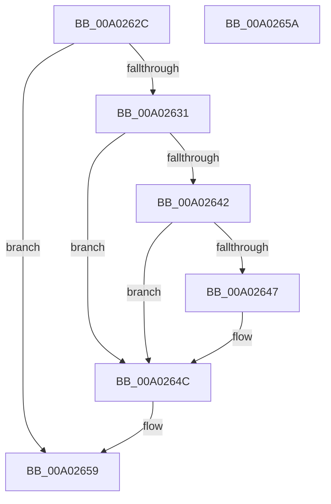

# FreeOperandValue

- RVA: `0x00A0262C`–`0x00A0265B` (길이 `47` bytes)
- VA: `0x0000000140A0262C`
- 실행 섹션: `PAGE`
- PDB 이름 있음: `예`; PDB Function 태그: `아니요`
- unwind 정보 RVA: `0x000805BC`
- 디코드: `17`개 명령, `47/47` bytes 표시
- 미해석 바이트: `0` (있으면 어셈블리에 `.byte`로 보존)

> 이 문서는 커널 이미지의 기계어와 PDB 기호를 분석해 생성했습니다. 4번과 5번은 함수 원형과 자료형을 바이너리 사용 방식에서 추정한 C 해석이며 원본 소스 복구 결과는 아닙니다.

## 1. Dependencies

- 직접 호출 지점: **2**; 고유 호출 대상: **1**
- 직접 호출자로 확인된 함수: **3**
- RIP 상대 이미지 참조: **0**

### Outgoing calls
- `0x00A02647` → [PdcCloseEvent](../8D/PdcCloseEvent_function_008D2404.md) (function, `0x008D2404`)
- `0x00A0264F` → [PdcCloseEvent](../8D/PdcCloseEvent_function_008D2404.md) (function, `0x008D2404`)

### Direct callers
- [LocalGetConditionForString](LocalGetConditionForString_function_00A01C20.md) at `0x00A01F59`
- [LocalGetConditionForString](LocalGetConditionForString_function_00A01C20.md) at `0x00A02409`
- [GetOperandValue](GetOperandValue_function_00A024C0.md) at `0x00A025CA`
- [GetOperandValue](GetOperandValue_function_00A024C0.md) at `0x00A02601`
- [sub_00B32FE4](../B3/Unknown_function_00B32FE4.md) at `0x00B3314E`

### Static image references
- 디코드된 RIP-relative 메모리 참조가 없습니다.

## 2. Other-region calls and transfers

- 다른 실행 섹션으로 향하는 call: **0**
- 별도 외부 분기/꼬리 이동을 확인하지 못했습니다.

## 3. Assembly (complete function range)

```asm
00A0262C  48 85 C9                        test rcx, rcx
00A0262F  74 28                           je 0x140a02659
00A02631  53                              push rbx
00A02632  48 83 EC 20                     sub rsp, 0x20
00A02636  48 8B D9                        mov rbx, rcx
00A02639  48 8B 49 08                     mov rcx, qword ptr [rcx + 8]
00A0263D  48 85 C9                        test rcx, rcx
00A02640  74 0A                           je 0x140a0264c
00A02642  80 3B 00                        cmp byte ptr [rbx], 0
00A02645  75 05                           jne 0x140a0264c
00A02647  E8 B8 FD EC FF                  call 0x1408d2404
00A0264C  48 8B CB                        mov rcx, rbx
00A0264F  E8 B0 FD EC FF                  call 0x1408d2404
00A02654  48 83 C4 20                     add rsp, 0x20
00A02658  5B                              pop rbx
00A02659  C3                              ret
00A0265A  CC                              int3
```

## 4. C-style interpretation (structured pseudocode)

```c
__int64 __fastcall FreeOperandValue(__int64 a1)
{
    __int64 result;
    __int64 v_rsp;

    if (a1 == 0) goto loc_00A02659;
    v_rsp = (v_rsp) - (32);
    if (*(unsigned __int64 *)(a1 + 8) == 0) goto loc_00A0264C;
    if ((*(unsigned __int8 *)(a1)) == 0) {
        result = PdcCloseEvent(*(unsigned __int64 *)(a1 + 8), a2, a3, a4);
    }
    result = PdcCloseEvent(a1, a2, a3, a4);
    v_rsp = (v_rsp) + (32);
loc_00A02659:
    return result;
}
```

## 5. (Beta) C Style

```c
int64_t FreeOperandValue(int64_t Arg1)
{
    int64_t result;
    int64_t local_rsp;

    if (Arg1 == 0) goto loc_00A02659;
    local_rsp = (local_rsp) - (32);
    if (*(uint64_t *)(Arg1 + 0x8) == 0) goto loc_00A0264C;
    if ((*(uint8_t *)(Arg1)) == 0) {
        result = PdcCloseEvent(*(uint64_t *)(Arg1 + 0x8), a2, a3, a4);
    }
    result = PdcCloseEvent(Arg1, a2, a3, a4);
    local_rsp = (local_rsp) + (32);
loc_00A02659:
    return result;
}
```

## 6. Execution-region graph

[열기: 2D/3D 그래프와 함수 탐색 컨트롤 패널](../../../control-panel.html?section=page&rva=0x00A0262C&view=graph)

- 2D 그래프는 위에서 아래로 흐르고, 3D 그래프는 빈 공간을 드래그해 회전합니다. Shift+드래그는 이동, 휠은 확대·축소, 함수 노드 선택은 대상 보고서 이동입니다.

### Static fallback


