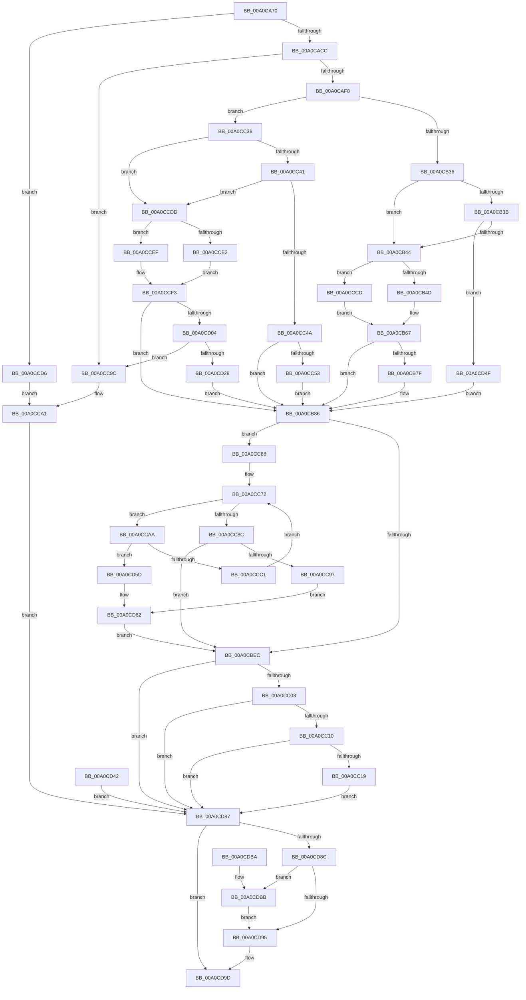

# FsRtlKernelFsControlFile

- RVA: `0x00A0CA70`–`0x00A0CDC7` (길이 `855` bytes)
- VA: `0x0000000140A0CA70`
- 실행 섹션: `PAGE`
- PDB 이름 있음: `예`; PDB Function 태그: `아니요`
- unwind 정보 RVA: `0x000A8B14`
- 디코드: `209`개 명령, `855/855` bytes 표시
- 미해석 바이트: `0` (있으면 어셈블리에 `.byte`로 보존)

> 이 문서는 커널 이미지의 기계어와 PDB 기호를 분석해 생성했습니다. 4번과 5번은 함수 원형과 자료형을 바이너리 사용 방식에서 추정한 C 해석이며 원본 소스 복구 결과는 아닙니다.

## 1. Dependencies

- 직접 호출 지점: **13**; 고유 호출 대상: **11**
- 직접 호출자로 확인된 함수: **3**
- RIP 상대 이미지 참조: **1**

### Outgoing calls
- `0x00A0CAB6` → [KeInitializeEvent](../../text/40/KeInitializeEvent_function_0040DD10.md) (function, `0x0040DD10`)
- `0x00A0CACF` → [IoGetRelatedDeviceObject](../../text/29/IoGetRelatedDeviceObject_function_0029B120.md) (function, `0x0029B120`)
- `0x00A0CAE2` → [IoAllocateIrpEx](../../text/20/IoAllocateIrpEx_function_00207510.md) (function, `0x00207510`)
- `0x00A0CB62` → [memcpy](../../text/6C/memcpy_function_006C6840.md) (function, `0x006C6840`)
- `0x00A0CBDC` → [IofCallDriver](../../text/29/IofCallDriver_function_0029B4B0.md) (function, `0x0029B4B0`)
- `0x00A0CC2E` → [memcpy](../../text/6C/memcpy_function_006C6840.md) (function, `0x006C6840`)
- `0x00A0CC80` → [KeWaitForSingleObject](../../text/20/KeWaitForSingleObject_function_0020E6B0.md) (function, `0x0020E6B0`)
- `0x00A0CD16` → [IoAllocateMdl](../../text/29/IoAllocateMdl_function_0029EBF0.md) (function, `0x0029EBF0`)
- `0x00A0CD38` → [MmProbeAndLockPages](../../text/23/MmProbeAndLockPages_function_0023B990.md) (function, `0x0023B990`)
- `0x00A0CD65` → [IoCancelIrp](../../text/27/IoCancelIrp_function_002720E0.md) (function, `0x002720E0`)
- `0x00A0CD7D` → [KeWaitForSingleObject](../../text/20/KeWaitForSingleObject_function_0020E6B0.md) (function, `0x0020E6B0`)
- `0x00A0CD98` → [IoFreeIrp](../../text/24/IoFreeIrp_function_0024DF70.md) (function, `0x0024DF70`)
- `0x00A0CDBB` → [FsRtlpFreeMdlChain](../71/FsRtlpFreeMdlChain_function_00716394.md) (function, `0x00716394`)

### Direct callers
- [sub_00A0B648](Unknown_function_00A0B648.md) at `0x00A0B82B`
- [sub_00A0B648](Unknown_function_00A0B648.md) at `0x00A0B871`
- [sub_00A0B648](Unknown_function_00A0B648.md) at `0x00A0BA15`
- [sub_00A0BA74](Unknown_function_00A0BA74.md) at `0x00A0BCD3`
- [sub_00A0BA74](Unknown_function_00A0BA74.md) at `0x00A0BD11`
- [sub_00A0BA74](Unknown_function_00A0BA74.md) at `0x00A0BE5C`
- [sub_00A0BA74](Unknown_function_00A0BA74.md) at `0x00A0BE96`
- [sub_00A0C12C](Unknown_function_00A0C12C.md) at `0x00A0C412`
- [sub_00A0C12C](Unknown_function_00A0C12C.md) at `0x00A0C454`

### Static image references
- `0x00A0CBB0` → RVA `0x0048B010` (`CmpCompleteFlushAndPurgeIrp`; read)

## 2. Other-region calls and transfers

- 다른 실행 섹션으로 향하는 call: **12**
  - `0x00A0CAB6` → [KeInitializeEvent](../../text/40/KeInitializeEvent_function_0040DD10.md) (`PAGE` → `.text`)
  - `0x00A0CACF` → [IoGetRelatedDeviceObject](../../text/29/IoGetRelatedDeviceObject_function_0029B120.md) (`PAGE` → `.text`)
  - `0x00A0CAE2` → [IoAllocateIrpEx](../../text/20/IoAllocateIrpEx_function_00207510.md) (`PAGE` → `.text`)
  - `0x00A0CB62` → [memcpy](../../text/6C/memcpy_function_006C6840.md) (`PAGE` → `.text`)
  - `0x00A0CBDC` → [IofCallDriver](../../text/29/IofCallDriver_function_0029B4B0.md) (`PAGE` → `.text`)
  - `0x00A0CC2E` → [memcpy](../../text/6C/memcpy_function_006C6840.md) (`PAGE` → `.text`)
  - `0x00A0CC80` → [KeWaitForSingleObject](../../text/20/KeWaitForSingleObject_function_0020E6B0.md) (`PAGE` → `.text`)
  - `0x00A0CD16` → [IoAllocateMdl](../../text/29/IoAllocateMdl_function_0029EBF0.md) (`PAGE` → `.text`)
  - `0x00A0CD38` → [MmProbeAndLockPages](../../text/23/MmProbeAndLockPages_function_0023B990.md) (`PAGE` → `.text`)
  - `0x00A0CD65` → [IoCancelIrp](../../text/27/IoCancelIrp_function_002720E0.md) (`PAGE` → `.text`)
  - `0x00A0CD7D` → [KeWaitForSingleObject](../../text/20/KeWaitForSingleObject_function_0020E6B0.md) (`PAGE` → `.text`)
  - `0x00A0CD98` → [IoFreeIrp](../../text/24/IoFreeIrp_function_0024DF70.md) (`PAGE` → `.text`)
- 별도 외부 분기/꼬리 이동을 확인하지 못했습니다.

## 3. Assembly (complete function range)

```asm
00A0CA70  4C 8B DC                        mov r11, rsp
00A0CA73  49 89 5B 08                     mov qword ptr [r11 + 8], rbx
00A0CA77  49 89 73 18                     mov qword ptr [r11 + 0x18], rsi
00A0CA7B  4D 89 63 20                     mov qword ptr [r11 + 0x20], r12
00A0CA7F  89 54 24 10                     mov dword ptr [rsp + 0x10], edx
00A0CA83  41 55                           push r13
00A0CA85  41 56                           push r14
00A0CA87  41 57                           push r15
00A0CA89  48 83 EC 70                     sub rsp, 0x70
00A0CA8D  45 8B E1                        mov r12d, r9d
00A0CA90  4D 8B F8                        mov r15, r8
00A0CA93  44 8B EA                        mov r13d, edx
00A0CA96  48 8B F1                        mov rsi, rcx
00A0CA99  33 DB                           xor ebx, ebx
00A0CA9B  49 89 5B B0                     mov qword ptr [r11 - 0x50], rbx
00A0CA9F  0F 57 C0                        xorps xmm0, xmm0
00A0CAA2  33 C0                           xor eax, eax
00A0CAA4  0F 11 44 24 50                  movups xmmword ptr [rsp + 0x50], xmm0
00A0CAA9  49 89 43 D8                     mov qword ptr [r11 - 0x28], rax
00A0CAAD  45 33 C0                        xor r8d, r8d
00A0CAB0  33 D2                           xor edx, edx
00A0CAB2  49 8D 4B C8                     lea rcx, [r11 - 0x38]
00A0CAB6  E8 55 12 A0 FF                  call 0x14040dd10
00A0CABB  41 83 E5 03                     and r13d, 3
00A0CABF  8B 46 50                        mov eax, dword ptr [rsi + 0x50]
00A0CAC2  0F BA E0 0B                     bt eax, 0xb
00A0CAC6  0F 82 0A 02 00 00               jb 0x140a0ccd6
00A0CACC  48 8B CE                        mov rcx, rsi
00A0CACF  E8 4C E6 88 FF                  call 0x14029b120
00A0CAD4  48 89 44 24 48                  mov qword ptr [rsp + 0x48], rax
00A0CAD9  45 33 C0                        xor r8d, r8d
00A0CADC  8A 50 4C                        mov dl, byte ptr [rax + 0x4c]
00A0CADF  48 8B C8                        mov rcx, rax
00A0CAE2  E8 29 AA 7F FF                  call 0x140207510
00A0CAE7  48 8B D8                        mov rbx, rax
00A0CAEA  48 89 44 24 38                  mov qword ptr [rsp + 0x38], rax
00A0CAEF  48 85 C0                        test rax, rax
00A0CAF2  0F 84 A4 01 00 00               je 0x140a0cc9c
00A0CAF8  48 05 B8 00 00 00               add rax, 0xb8
00A0CAFE  48 89 44 24 40                  mov qword ptr [rsp + 0x40], rax
00A0CB03  48 8B 08                        mov rcx, qword ptr [rax]
00A0CB06  66 C7 41 B8 0D 04               mov word ptr [rcx - 0x48], 0x40d
00A0CB0C  48 89 71 E8                     mov qword ptr [rcx - 0x18], rsi
00A0CB10  44 8B B4 24 B8 00 00 00         mov r14d, dword ptr [rsp + 0xb8]
00A0CB18  44 89 71 C0                     mov dword ptr [rcx - 0x40], r14d
00A0CB1C  44 89 61 C8                     mov dword ptr [rcx - 0x38], r12d
00A0CB20  8B 84 24 98 00 00 00            mov eax, dword ptr [rsp + 0x98]
00A0CB27  89 41 D0                        mov dword ptr [rcx - 0x30], eax
00A0CB2A  41 8B C5                        mov eax, r13d
00A0CB2D  45 85 ED                        test r13d, r13d
00A0CB30  0F 85 02 01 00 00               jne 0x140a0cc38
00A0CB36  45 85 E4                        test r12d, r12d
00A0CB39  75 09                           jne 0x140a0cb44
00A0CB3B  45 85 F6                        test r14d, r14d
00A0CB3E  0F 84 0B 02 00 00               je 0x140a0cd4f
00A0CB44  45 3B E6                        cmp r12d, r14d
00A0CB47  0F 83 80 01 00 00               jae 0x140a0cccd
00A0CB4D  48 8B 84 24 B0 00 00 00         mov rax, qword ptr [rsp + 0xb0]
00A0CB55  48 89 43 18                     mov qword ptr [rbx + 0x18], rax
00A0CB59  4D 8B C4                        mov r8, r12
00A0CB5C  49 8B D7                        mov rdx, r15
00A0CB5F  48 8B C8                        mov rcx, rax
00A0CB62  E8 D9 9C CB FF                  call 0x1406c6840
00A0CB67  C7 43 10 10 00 00 00            mov dword ptr [rbx + 0x10], 0x10
00A0CB6E  48 8B 84 24 B0 00 00 00         mov rax, qword ptr [rsp + 0xb0]
00A0CB76  48 89 43 70                     mov qword ptr [rbx + 0x70], rax
00A0CB7A  48 85 C0                        test rax, rax
00A0CB7D  74 07                           je 0x140a0cb86
00A0CB7F  C7 43 10 50 00 00 00            mov dword ptr [rbx + 0x10], 0x50
00A0CB86  65 48 8B 04 25 88 01 00 00      mov rax, qword ptr gs:[0x188]
00A0CB8F  48 8B 5C 24 38                  mov rbx, qword ptr [rsp + 0x38]
00A0CB94  48 89 83 98 00 00 00            mov qword ptr [rbx + 0x98], rax
00A0CB9B  8B 43 10                        mov eax, dword ptr [rbx + 0x10]
00A0CB9E  83 C8 04                        or eax, 4
00A0CBA1  89 43 10                        mov dword ptr [rbx + 0x10], eax
00A0CBA4  C6 43 40 00                     mov byte ptr [rbx + 0x40], 0
00A0CBA8  48 8B 44 24 40                  mov rax, qword ptr [rsp + 0x40]
00A0CBAD  48 8B 00                        mov rax, qword ptr [rax]
00A0CBB0  48 8D 0D 59 E4 A7 FF            lea rcx, [rip - 0x581ba7]
00A0CBB7  48 89 48 F0                     mov qword ptr [rax - 0x10], rcx
00A0CBBB  48 8D 4C 24 50                  lea rcx, [rsp + 0x50]
00A0CBC0  48 89 48 F8                     mov qword ptr [rax - 8], rcx
00A0CBC4  C6 40 BB 00                     mov byte ptr [rax - 0x45], 0
00A0CBC8  C6 40 BB 40                     mov byte ptr [rax - 0x45], 0x40
00A0CBCC  C6 40 BB C0                     mov byte ptr [rax - 0x45], 0xc0
00A0CBD0  C6 40 BB E0                     mov byte ptr [rax - 0x45], 0xe0
00A0CBD4  48 8B D3                        mov rdx, rbx
00A0CBD7  48 8B 4C 24 48                  mov rcx, qword ptr [rsp + 0x48]
00A0CBDC  E8 CF E8 88 FF                  call 0x14029b4b0
00A0CBE1  89 44 24 30                     mov dword ptr [rsp + 0x30], eax
00A0CBE5  3D 03 01 00 00                  cmp eax, 0x103
00A0CBEA  74 7C                           je 0x140a0cc68
00A0CBEC  8B 73 30                        mov esi, dword ptr [rbx + 0x30]
00A0CBEF  89 74 24 30                     mov dword ptr [rsp + 0x30], esi
00A0CBF3  8B 4B 38                        mov ecx, dword ptr [rbx + 0x38]
00A0CBF6  48 8B 84 24 C0 00 00 00         mov rax, qword ptr [rsp + 0xc0]
00A0CBFE  89 08                           mov dword ptr [rax], ecx
00A0CC00  85 F6                           test esi, esi
00A0CC02  0F 88 7F 01 00 00               js 0x140a0cd87
00A0CC08  85 C9                           test ecx, ecx
00A0CC0A  0F 84 77 01 00 00               je 0x140a0cd87
00A0CC10  45 3B E6                        cmp r12d, r14d
00A0CC13  0F 82 6E 01 00 00               jb 0x140a0cd87
00A0CC19  41 3B CE                        cmp ecx, r14d
00A0CC1C  44 0F 42 F1                     cmovb r14d, ecx
00A0CC20  45 8B C6                        mov r8d, r14d
00A0CC23  49 8B D7                        mov rdx, r15
00A0CC26  48 8B 8C 24 B0 00 00 00         mov rcx, qword ptr [rsp + 0xb0]
00A0CC2E  E8 0D 9C CB FF                  call 0x1406c6840
00A0CC33  E9 4F 01 00 00                  jmp 0x140a0cd87
00A0CC38  83 E8 01                        sub eax, 1
00A0CC3B  0F 84 9C 00 00 00               je 0x140a0ccdd
00A0CC41  83 E8 01                        sub eax, 1
00A0CC44  0F 84 93 00 00 00               je 0x140a0ccdd
00A0CC4A  83 F8 01                        cmp eax, 1
00A0CC4D  0F 85 33 FF FF FF               jne 0x140a0cb86
00A0CC53  48 8B 84 24 B0 00 00 00         mov rax, qword ptr [rsp + 0xb0]
00A0CC5B  48 89 43 70                     mov qword ptr [rbx + 0x70], rax
00A0CC5F  4C 89 79 D8                     mov qword ptr [rcx - 0x28], r15
00A0CC63  E9 1E FF FF FF                  jmp 0x140a0cb86
00A0CC68  48 8D 4C 24 50                  lea rcx, [rsp + 0x50]
00A0CC6D  48 89 4C 24 48                  mov qword ptr [rsp + 0x48], rcx
00A0CC72  48 83 64 24 20 00               and qword ptr [rsp + 0x20], 0
00A0CC78  41 B1 01                        mov r9b, 1
00A0CC7B  45 33 C0                        xor r8d, r8d
00A0CC7E  33 D2                           xor edx, edx
00A0CC80  E8 2B 1A 80 FF                  call 0x14020e6b0
00A0CC85  3D 01 01 00 00                  cmp eax, 0x101
00A0CC8A  74 1E                           je 0x140a0ccaa
00A0CC8C  3D 4B 00 00 C0                  cmp eax, 0xc000004b
00A0CC91  0F 85 55 FF FF FF               jne 0x140a0cbec
00A0CC97  E9 C6 00 00 00                  jmp 0x140a0cd62
00A0CC9C  BE 9A 00 00 C0                  mov esi, 0xc000009a
00A0CCA1  89 74 24 30                     mov dword ptr [rsp + 0x30], esi
00A0CCA5  E9 DD 00 00 00                  jmp 0x140a0cd87
00A0CCAA  65 48 8B 04 25 88 01 00 00      mov rax, qword ptr gs:[0x188]
00A0CCB3  8B 80 A0 05 00 00               mov eax, dword ptr [rax + 0x5a0]
00A0CCB9  A8 01                           test al, 1
00A0CCBB  0F 85 9C 00 00 00               jne 0x140a0cd5d
00A0CCC1  48 8B 5C 24 38                  mov rbx, qword ptr [rsp + 0x38]
00A0CCC6  48 8B 4C 24 48                  mov rcx, qword ptr [rsp + 0x48]
00A0CCCB  EB A5                           jmp 0x140a0cc72
00A0CCCD  4C 89 7B 18                     mov qword ptr [rbx + 0x18], r15
00A0CCD1  E9 91 FE FF FF                  jmp 0x140a0cb67
00A0CCD6  BE 10 00 00 C0                  mov esi, 0xc0000010
00A0CCDB  EB C4                           jmp 0x140a0cca1
00A0CCDD  4D 85 FF                        test r15, r15
00A0CCE0  74 0D                           je 0x140a0ccef
00A0CCE2  4C 89 7B 18                     mov qword ptr [rbx + 0x18], r15
00A0CCE6  C7 43 10 10 00 00 00            mov dword ptr [rbx + 0x10], 0x10
00A0CCED  EB 04                           jmp 0x140a0ccf3
00A0CCEF  83 63 10 00                     and dword ptr [rbx + 0x10], 0
00A0CCF3  48 8B 84 24 B0 00 00 00         mov rax, qword ptr [rsp + 0xb0]
00A0CCFB  48 85 C0                        test rax, rax
00A0CCFE  0F 84 82 FE FF FF               je 0x140a0cb86
00A0CD04  48 83 64 24 20 00               and qword ptr [rsp + 0x20], 0
00A0CD0A  45 33 C9                        xor r9d, r9d
00A0CD0D  45 33 C0                        xor r8d, r8d
00A0CD10  41 8B D6                        mov edx, r14d
00A0CD13  48 8B C8                        mov rcx, rax
00A0CD16  E8 D5 1E 89 FF                  call 0x14029ebf0
00A0CD1B  48 89 43 08                     mov qword ptr [rbx + 8], rax
00A0CD1F  48 85 C0                        test rax, rax
00A0CD22  0F 84 74 FF FF FF               je 0x140a0cc9c
00A0CD28  45 33 C0                        xor r8d, r8d
00A0CD2B  41 83 FD 01                     cmp r13d, 1
00A0CD2F  41 0F 95 C0                     setne r8b
00A0CD33  33 D2                           xor edx, edx
00A0CD35  48 8B C8                        mov rcx, rax
00A0CD38  E8 53 EC 82 FF                  call 0x14023b990
00A0CD3D  E9 44 FE FF FF                  jmp 0x140a0cb86
00A0CD42  8B F0                           mov esi, eax
00A0CD44  89 44 24 30                     mov dword ptr [rsp + 0x30], eax
00A0CD48  48 8B 5C 24 38                  mov rbx, qword ptr [rsp + 0x38]
00A0CD4D  EB 38                           jmp 0x140a0cd87
00A0CD4F  83 63 10 00                     and dword ptr [rbx + 0x10], 0
00A0CD53  48 83 63 70 00                  and qword ptr [rbx + 0x70], 0
00A0CD58  E9 29 FE FF FF                  jmp 0x140a0cb86
00A0CD5D  48 8B 5C 24 38                  mov rbx, qword ptr [rsp + 0x38]
00A0CD62  48 8B CB                        mov rcx, rbx
00A0CD65  E8 76 53 86 FF                  call 0x1402720e0
00A0CD6A  48 83 64 24 20 00               and qword ptr [rsp + 0x20], 0
00A0CD70  45 33 C9                        xor r9d, r9d
00A0CD73  45 33 C0                        xor r8d, r8d
00A0CD76  33 D2                           xor edx, edx
00A0CD78  48 8D 4C 24 50                  lea rcx, [rsp + 0x50]
00A0CD7D  E8 2E 19 80 FF                  call 0x14020e6b0
00A0CD82  E9 65 FE FF FF                  jmp 0x140a0cbec
00A0CD87  48 85 DB                        test rbx, rbx
00A0CD8A  74 11                           je 0x140a0cd9d
00A0CD8C  48 8B 4B 08                     mov rcx, qword ptr [rbx + 8]
00A0CD90  48 85 C9                        test rcx, rcx
00A0CD93  75 26                           jne 0x140a0cdbb
00A0CD95  48 8B CB                        mov rcx, rbx
00A0CD98  E8 D3 11 84 FF                  call 0x14024df70
00A0CD9D  8B C6                           mov eax, esi
00A0CD9F  4C 8D 5C 24 70                  lea r11, [rsp + 0x70]
00A0CDA4  49 8B 5B 20                     mov rbx, qword ptr [r11 + 0x20]
00A0CDA8  49 8B 73 30                     mov rsi, qword ptr [r11 + 0x30]
00A0CDAC  4D 8B 63 38                     mov r12, qword ptr [r11 + 0x38]
00A0CDB0  49 8B E3                        mov rsp, r11
00A0CDB3  41 5F                           pop r15
00A0CDB5  41 5E                           pop r14
00A0CDB7  41 5D                           pop r13
00A0CDB9  C3                              ret
00A0CDBA  CC                              int3
00A0CDBB  E8 D4 95 D0 FF                  call 0x140716394
00A0CDC0  48 83 63 08 00                  and qword ptr [rbx + 8], 0
00A0CDC5  EB CE                           jmp 0x140a0cd95
```

## 4. C-style interpretation (structured pseudocode)

```c
__int64 __fastcall FsRtlKernelFsControlFile(__int64 a1, int a2, __int64 a3, int a4, __int64 a5, unsigned int a6, __int64 a7)
{
    __int64 result;
    __int64 v_r13;
    __int64 v_r14;
    __int64 v_rbx;
    __int64 v_rsp;
    unsigned __int64 v_stack_m18;
    unsigned __int64 v_stack_m38;
    unsigned __int64 v_stack_m40;
    unsigned __int64 v_stack_m48;
    unsigned __int64 v_stack_m50;
    unsigned int v_stack_m58;
    unsigned __int64 v_stack_m68;
    unsigned int v_stack_p10;

    *(unsigned __int64 *)(v_rsp + 8) = v_rbx;
    *(unsigned __int64 *)(v_rsp + 24) = v_rsi;
    *(unsigned __int64 *)(v_rsp + 32) = v_r12;
    v_stack_p10 = a2;
    v_rsp = (v_rsp) - (112);
    v_rbx = 0;
    *(unsigned __int64 *)(v_rsp - 80) = 0;
    result = 0;
    v_stack_m38 = v_xmm0;
    *(unsigned __int64 *)(v_rsp - 40) = 0;
    a3 = 0;
    a2 = 0;
    result = KeInitializeEvent(v_rsp - 56, a2, a3, a4);
    v_r13 = (unsigned int)(((unsigned int)(a2)) & (3));
    if (condition_is_below) goto loc_00A0CCD6;
    result = IoGetRelatedDeviceObject(a1, a2, a3, a4);
    v_stack_m40 = result;
    a3 = 0;
    result = IoAllocateIrpEx(result, *(unsigned __int8 *)(result + 76), a3, a4);
    v_stack_m50 = result;
    if (result == 0) goto loc_00A0CC9C;
    result = (result) + (184);
    v_stack_m48 = result;
    *(unsigned __int16 *)(*(unsigned __int64 *)(result) - 72) = 0x40DULL;
    *(unsigned __int64 *)(*(unsigned __int64 *)(result) - 24) = a1;
    *(unsigned int *)(*(unsigned __int64 *)(result) - 64) = (unsigned int)((unsigned int)(a6));
    *(unsigned int *)(*(unsigned __int64 *)(result) - 56) = (unsigned int)((unsigned int)(a4));
    *(unsigned int *)(*(unsigned __int64 *)(result) - 48) = (unsigned int)((unsigned int)(v_stack_p10));
    if ((unsigned int)(v_r13) != 0) goto loc_00A0CC38;
    if ((unsigned int)((unsigned int)(a4)) != 0) goto loc_00A0CB44;
    if ((unsigned int)((unsigned int)(a6)) == 0) goto loc_00A0CD4F;
loc_00A0CB44:
    if (((unsigned int)((unsigned int)(a4))) >= ((unsigned int)((unsigned int)(a6)))) goto loc_00A0CCCD;
    *(unsigned __int64 *)(result + 24) = a5;
    result = memcpy(a5, 0, (unsigned int)(a4), a4);
loc_00A0CB67:
    *(unsigned int *)(result + 16) = 16;
    *(unsigned __int64 *)(result + 112) = a5;
    if (a5 != 0) {
        *(unsigned int *)(result + 16) = 80;
    }
    *(unsigned __int64 *)(v_stack_m50 + 152) = *(unsigned __int64 *)(gs_base + (0 + 392));
    result = (unsigned int)(((unsigned int)(*(unsigned int *)(v_stack_m50 + 16))) | (4));
    *(unsigned int *)(v_stack_m50 + 16) = (unsigned int)(result);
    *(unsigned __int8 *)(v_stack_m50 + 64) = 0;
    *(unsigned __int64 *)(*(unsigned __int64 *)(v_stack_m48) - 16) = v_rip - 5774247;
    *(unsigned __int64 *)(*(unsigned __int64 *)(v_stack_m48) - 8) = v_stack_m38;
    *(unsigned __int8 *)(*(unsigned __int64 *)(v_stack_m48) - 69) = 0;
    *(unsigned __int8 *)(*(unsigned __int64 *)(v_stack_m48) - 69) = 64;
    *(unsigned __int8 *)(*(unsigned __int64 *)(v_stack_m48) - 69) = 192;
    *(unsigned __int8 *)(*(unsigned __int64 *)(v_stack_m48) - 69) = 224;
    result = IofCallDriver(v_stack_m40, v_stack_m50, (unsigned int)(a4), a4);
    v_stack_m58 = (unsigned int)(result);
    if (((unsigned int)(result)) == 259) goto loc_00A0CC68;
loc_00A0CBEC:
    v_stack_m58 = (unsigned int)((unsigned int)(*(unsigned int *)(v_stack_m50 + 48)));
    *(unsigned int *)(a7) = (unsigned int)((unsigned int)(*(unsigned int *)(v_stack_m50 + 56)));
    if (sign_flag) goto loc_00A0CD87;
    if ((unsigned int)((unsigned int)(*(unsigned int *)(v_stack_m50 + 56))) == 0) goto loc_00A0CD87;
    if (((unsigned int)((unsigned int)(a4))) < ((unsigned int)((unsigned int)(a6)))) goto loc_00A0CD87;
    v_r14 = (unsigned int)(a6);
    if (((unsigned int)((unsigned int)(*(unsigned int *)(v_stack_m50 + 56)))) < ((unsigned int)((unsigned int)(a6)))) { v_r14 = (unsigned int)((unsigned int)(*(unsigned int *)(v_stack_m50 + 56))); }
    result = memcpy(a5, 0, (unsigned int)((unsigned int)(v_r14)), a4);
    goto loc_00A0CD87;
loc_00A0CC38:
    result = (unsigned int)((result) - (1));
    if (condition_is_equal) goto loc_00A0CCDD;
    result = (unsigned int)((result) - (1));
    if (condition_is_equal) goto loc_00A0CCDD;
    if (((unsigned int)(result)) != 1) goto loc_00A0CB86;
    *(unsigned __int64 *)(v_stack_m50 + 112) = a5;
    *(unsigned __int64 *)(a5 - 40) = 0;
    goto loc_00A0CB86;
loc_00A0CC68:
    v_stack_m40 = v_stack_m38;
loc_00A0CC72:
    a3 = 0;
    a2 = 0;
    result = KeWaitForSingleObject(v_stack_m38, a2, a3, 1);
    if (((unsigned int)(result)) == 257) goto loc_00A0CCAA;
    if (((unsigned int)(result)) != 0xC000004BULL) goto loc_00A0CBEC;
    goto loc_00A0CD62;
loc_00A0CC9C:
loc_00A0CCA1:
    v_stack_m58 = (unsigned int)((unsigned int)(0xC000009AULL));
    goto loc_00A0CD87;
loc_00A0CCAA:
    if ((((unsigned __int8)((unsigned int)(*(unsigned int *)(*(unsigned __int64 *)(gs_base + (0 + 392)) + 1440)))) & (1)) != 0) goto loc_00A0CD5D;
    goto loc_00A0CC72;
loc_00A0CCCD:
    *(unsigned __int64 *)(v_stack_m50 + 24) = 0;
    goto loc_00A0CB67;
loc_00A0CCD6:
    goto loc_00A0CCA1;
loc_00A0CCDD:
    if (0 == 0) goto loc_00A0CCEF;
    *(unsigned __int64 *)(v_stack_m50 + 24) = 0;
    *(unsigned int *)(v_stack_m50 + 16) = 16;
    goto loc_00A0CCF3;
loc_00A0CCEF:
loc_00A0CCF3:
    if (a5 == 0) goto loc_00A0CB86;
    a4 = 0;
    a3 = 0;
    result = IoAllocateMdl(a5, (unsigned int)((unsigned int)(v_r14)), a3, a4);
    *(unsigned __int64 *)(v_stack_m50 + 8) = result;
    if (result == 0) goto loc_00A0CC9C;
    a3 = 0;
    a3 = (((unsigned int)(v_r13)) != 1) ? 1 : 0;
    a2 = 0;
    result = MmProbeAndLockPages(result, a2, a3, a4);
    goto loc_00A0CB86;
loc_00A0CD4F:
    goto loc_00A0CB86;
loc_00A0CD5D:
loc_00A0CD62:
    result = IoCancelIrp(v_stack_m50, a2, a3, a4);
    a4 = 0;
    a3 = 0;
    a2 = 0;
    result = KeWaitForSingleObject(v_stack_m38, a2, a3, a4);
    goto loc_00A0CBEC;
loc_00A0CD87:
    if (v_stack_m50 == 0) goto loc_00A0CD9D;
    if (*(unsigned __int64 *)(v_stack_m50 + 8) != 0) goto loc_00A0CDBB;
loc_00A0CD95:
    result = IoFreeIrp(v_stack_m50, a2, a3, a4);
loc_00A0CD9D:
    return (unsigned int)((unsigned int)((unsigned int)(0xC0000010ULL)));
loc_00A0CDBB:
    result = FsRtlpFreeMdlChain(v_stack_m50, a2, a3, a4);
    goto loc_00A0CD95;
}
```

## 5. (Beta) C Style

```c
int64_t FsRtlKernelFsControlFile(void *Arg1, int32_t Arg2, int64_t Arg3, int32_t Arg4, int64_t Arg5, uint32_t Arg6, void *Arg7)
{
    uint8_t *arg1 = (uint8_t *)Arg1;
    uint8_t *arg7 = (uint8_t *)Arg7;

    int64_t result;
    int64_t local_r13;
    int64_t local_r14;
    int64_t local_rbx;
    int64_t local_rsp;
    uint64_t v_stack_m18;
    uint64_t v_stack_m38;
    uint64_t v_stack_m40;
    uint64_t v_stack_m48;
    uint64_t v_stack_m50;
    uint32_t v_stack_m58;
    uint64_t v_stack_m68;
    uint32_t v_stack_p10;

    *(uint64_t *)(local_rsp + 0x8) = local_rbx;
    *(uint64_t *)(local_rsp + 0x18) = local_rsi;
    *(uint64_t *)(local_rsp + 0x20) = local_r12;
    v_stack_p10 = Arg2;
    local_rsp = (local_rsp) - (112);
    local_rbx = 0;
    *(uint64_t *)(local_rsp - 0x50) = 0;
    result = 0;
    v_stack_m38 = v_xmm0;
    *(uint64_t *)(local_rsp - 0x28) = 0;
    Arg3 = 0;
    Arg2 = 0;
    result = KeInitializeEvent(local_rsp - 56, Arg2, Arg3, Arg4);
    local_r13 = (uint32_t)(((uint32_t)(Arg2)) & (3));
    if (condition_is_below) goto loc_00A0CCD6;
    result = IoGetRelatedDeviceObject(Arg1, Arg2, Arg3, Arg4);
    v_stack_m40 = result;
    Arg3 = 0;
    result = IoAllocateIrpEx(result, *(uint8_t *)(result + 0x4C), Arg3, Arg4);
    v_stack_m50 = result;
    if (result == 0) goto loc_00A0CC9C;
    result = (result) + (184);
    v_stack_m48 = result;
    *(uint16_t *)(*(uint64_t *)(result) - 0x48) = 0x40DULL;
    *(void **)(*(uint64_t *)(result) - 0x18) = Arg1;
    *(uint32_t *)(*(uint64_t *)(result) - 0x40) = (uint32_t)((uint32_t)(Arg6));
    *(uint32_t *)(*(uint64_t *)(result) - 0x38) = (uint32_t)((uint32_t)(Arg4));
    *(uint32_t *)(*(uint64_t *)(result) - 0x30) = (uint32_t)((uint32_t)(v_stack_p10));
    if ((uint32_t)(local_r13) != 0) goto loc_00A0CC38;
    if ((uint32_t)((uint32_t)(Arg4)) != 0) goto loc_00A0CB44;
    if ((uint32_t)((uint32_t)(Arg6)) == 0) goto loc_00A0CD4F;
loc_00A0CB44:
    if (((uint32_t)((uint32_t)(Arg4))) >= ((uint32_t)((uint32_t)(Arg6)))) goto loc_00A0CCCD;
    *(uint64_t *)(result + 0x18) = Arg5;
    result = memcpy(Arg5, 0, (uint32_t)(Arg4), Arg4);
loc_00A0CB67:
    *(uint32_t *)(result + 0x10) = 16;
    *(uint64_t *)(result + 0x70) = Arg5;
    if (Arg5 != 0) {
        *(uint32_t *)(result + 0x10) = 80;
    }
    *(uint64_t *)(v_stack_m50 + 0x98) = *(uint64_t *)(gs_base + (0 + 0x188));
    result = (uint32_t)(((uint32_t)(*(uint32_t *)(v_stack_m50 + 0x10))) | (4));
    *(uint32_t *)(v_stack_m50 + 0x10) = (uint32_t)(result);
    *(uint8_t *)(v_stack_m50 + 0x40) = 0;
    *(uint64_t *)(*(uint64_t *)(v_stack_m48) - 0x10) = v_rip - 5774247;
    *(uint64_t *)(*(uint64_t *)(v_stack_m48) - 0x8) = v_stack_m38;
    *(uint8_t *)(*(uint64_t *)(v_stack_m48) - 0x45) = 0;
    *(uint8_t *)(*(uint64_t *)(v_stack_m48) - 0x45) = 64;
    *(uint8_t *)(*(uint64_t *)(v_stack_m48) - 0x45) = 192;
    *(uint8_t *)(*(uint64_t *)(v_stack_m48) - 0x45) = 224;
    result = IofCallDriver(v_stack_m40, v_stack_m50, (uint32_t)(Arg4), Arg4);
    v_stack_m58 = (uint32_t)(result);
    if (((uint32_t)(result)) == 259) goto loc_00A0CC68;
loc_00A0CBEC:
    v_stack_m58 = (uint32_t)((uint32_t)(*(uint32_t *)(v_stack_m50 + 0x30)));
    *(uint32_t *)(arg7) = (uint32_t)((uint32_t)(*(uint32_t *)(v_stack_m50 + 0x38)));
    if (sign_flag) goto loc_00A0CD87;
    if ((uint32_t)((uint32_t)(*(uint32_t *)(v_stack_m50 + 0x38))) == 0) goto loc_00A0CD87;
    if (((uint32_t)((uint32_t)(Arg4))) < ((uint32_t)((uint32_t)(Arg6)))) goto loc_00A0CD87;
    local_r14 = (uint32_t)(Arg6);
    if (((uint32_t)((uint32_t)(*(uint32_t *)(v_stack_m50 + 0x38)))) < ((uint32_t)((uint32_t)(Arg6)))) { local_r14 = (uint32_t)((uint32_t)(*(uint32_t *)(v_stack_m50 + 0x38))); }
    result = memcpy(Arg5, 0, (uint32_t)((uint32_t)(local_r14)), Arg4);
    goto loc_00A0CD87;
loc_00A0CC38:
    result = (uint32_t)((result) - (1));
    if (condition_is_equal) goto loc_00A0CCDD;
    result = (uint32_t)((result) - (1));
    if (condition_is_equal) goto loc_00A0CCDD;
    if (((uint32_t)(result)) != 1) goto loc_00A0CB86;
    *(uint64_t *)(v_stack_m50 + 0x70) = Arg5;
    *(uint64_t *)(Arg5 - 0x28) = 0;
    goto loc_00A0CB86;
loc_00A0CC68:
    v_stack_m40 = v_stack_m38;
loc_00A0CC72:
    Arg3 = 0;
    Arg2 = 0;
    result = KeWaitForSingleObject(v_stack_m38, Arg2, Arg3, 1);
    if (((uint32_t)(result)) == 257) goto loc_00A0CCAA;
    if (((uint32_t)(result)) != 0xC000004BULL) goto loc_00A0CBEC;
    goto loc_00A0CD62;
loc_00A0CC9C:
loc_00A0CCA1:
    v_stack_m58 = (uint32_t)((uint32_t)(0xC000009AULL));
    goto loc_00A0CD87;
loc_00A0CCAA:
    if ((((uint8_t)((uint32_t)(*(uint32_t *)(*(uint64_t *)(gs_base + (0 + 0x188)) + 0x5A0)))) & (1)) != 0) goto loc_00A0CD5D;
    goto loc_00A0CC72;
loc_00A0CCCD:
    *(uint64_t *)(v_stack_m50 + 0x18) = 0;
    goto loc_00A0CB67;
loc_00A0CCD6:
    goto loc_00A0CCA1;
loc_00A0CCDD:
    if (0 == 0) goto loc_00A0CCEF;
    *(uint64_t *)(v_stack_m50 + 0x18) = 0;
    *(uint32_t *)(v_stack_m50 + 0x10) = 16;
    goto loc_00A0CCF3;
loc_00A0CCEF:
loc_00A0CCF3:
    if (Arg5 == 0) goto loc_00A0CB86;
    Arg4 = 0;
    Arg3 = 0;
    result = IoAllocateMdl(Arg5, (uint32_t)((uint32_t)(local_r14)), Arg3, Arg4);
    *(uint64_t *)(v_stack_m50 + 0x8) = result;
    if (result == 0) goto loc_00A0CC9C;
    Arg3 = 0;
    Arg3 = (((uint32_t)(local_r13)) != 1) ? 1 : 0;
    Arg2 = 0;
    result = MmProbeAndLockPages(result, Arg2, Arg3, Arg4);
    goto loc_00A0CB86;
loc_00A0CD4F:
    goto loc_00A0CB86;
loc_00A0CD5D:
loc_00A0CD62:
    result = IoCancelIrp(v_stack_m50, Arg2, Arg3, Arg4);
    Arg4 = 0;
    Arg3 = 0;
    Arg2 = 0;
    result = KeWaitForSingleObject(v_stack_m38, Arg2, Arg3, Arg4);
    goto loc_00A0CBEC;
loc_00A0CD87:
    if (v_stack_m50 == 0) goto loc_00A0CD9D;
    if (*(uint64_t *)(v_stack_m50 + 0x8) != 0) goto loc_00A0CDBB;
loc_00A0CD95:
    result = IoFreeIrp(v_stack_m50, Arg2, Arg3, Arg4);
loc_00A0CD9D:
    return (uint32_t)((uint32_t)((uint32_t)(0xC0000010ULL)));
loc_00A0CDBB:
    result = FsRtlpFreeMdlChain(v_stack_m50, Arg2, Arg3, Arg4);
    goto loc_00A0CD95;
}
```

### 관측된 메모리 오프셋

구조체 형식이 확인되지 않은 접근은 인자 기준의 오프셋으로만 기록했습니다.

| 기준 인자 | 오프셋 표현 | 폭 (bit) | 접근 |
|---|---:|---:|---|
| `Arg1` | `+ 0x50` | `32` | `R` |
| `Arg7` | `+ 0x0` | `32` | `W` |

## 6. Execution-region graph

[열기: 2D/3D 그래프와 함수 탐색 컨트롤 패널](../../../control-panel.html?section=page&rva=0x00A0CA70&view=graph)

- 2D 그래프는 위에서 아래로 흐르고, 3D 그래프는 빈 공간을 드래그해 회전합니다. Shift+드래그는 이동, 휠은 확대·축소, 함수 노드 선택은 대상 보고서 이동입니다.

### Static fallback


