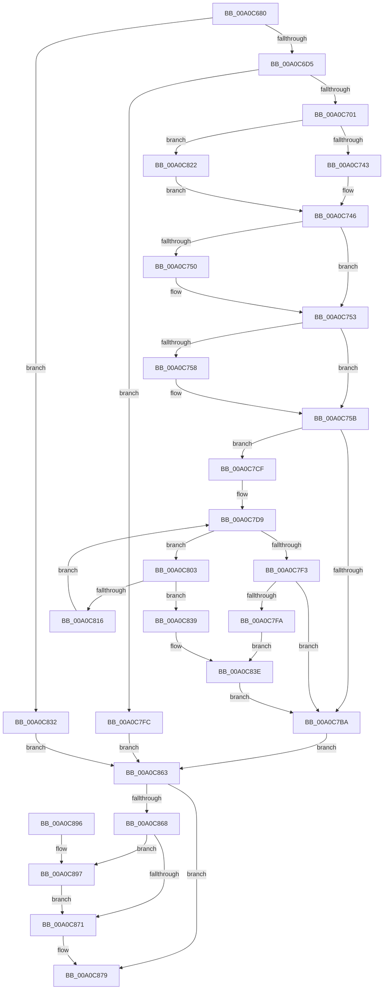

# FsRtlQueryKernelEaFile

- RVA: `0x00A0C680`–`0x00A0C8A3` (길이 `547` bytes)
- VA: `0x0000000140A0C680`
- 실행 섹션: `PAGE`
- PDB 이름 있음: `예`; PDB Function 태그: `아니요`
- unwind 정보 RVA: `0x000A8A90`
- 디코드: `139`개 명령, `547/547` bytes 표시
- 미해석 바이트: `0` (있으면 어셈블리에 `.byte`로 보존)

> 이 문서는 커널 이미지의 기계어와 PDB 기호를 분석해 생성했습니다. 4번과 5번은 함수 원형과 자료형을 바이너리 사용 방식에서 추정한 C 해석이며 원본 소스 복구 결과는 아닙니다.

## 1. Dependencies

- 직접 호출 지점: **9**; 고유 호출 대상: **8**
- 직접 호출자로 확인된 함수: **1**
- RIP 상대 이미지 참조: **1**

### Outgoing calls
- `0x00A0C6C2` → [KeInitializeEvent](../../text/40/KeInitializeEvent_function_0040DD10.md) (function, `0x0040DD10`)
- `0x00A0C6D8` → [IoGetRelatedDeviceObject](../../text/29/IoGetRelatedDeviceObject_function_0029B120.md) (function, `0x0029B120`)
- `0x00A0C6EB` → [IoAllocateIrpEx](../../text/20/IoAllocateIrpEx_function_00207510.md) (function, `0x00207510`)
- `0x00A0C7AE` → [IofCallDriver](../../text/29/IofCallDriver_function_0029B4B0.md) (function, `0x0029B4B0`)
- `0x00A0C7E7` → [KeWaitForSingleObject](../../text/20/KeWaitForSingleObject_function_0020E6B0.md) (function, `0x0020E6B0`)
- `0x00A0C841` → [IoCancelIrp](../../text/27/IoCancelIrp_function_002720E0.md) (function, `0x002720E0`)
- `0x00A0C859` → [KeWaitForSingleObject](../../text/20/KeWaitForSingleObject_function_0020E6B0.md) (function, `0x0020E6B0`)
- `0x00A0C874` → [IoFreeIrp](../../text/24/IoFreeIrp_function_0024DF70.md) (function, `0x0024DF70`)
- `0x00A0C897` → [FsRtlpFreeMdlChain](../71/FsRtlpFreeMdlChain_function_00716394.md) (function, `0x00716394`)

### Direct callers
- [sub_00A0C12C](Unknown_function_00A0C12C.md) at `0x00A0C353`

### Static image references
- `0x00A0C782` → RVA `0x0048B010` (`CmpCompleteFlushAndPurgeIrp`; read)

## 2. Other-region calls and transfers

- 다른 실행 섹션으로 향하는 call: **8**
  - `0x00A0C6C2` → [KeInitializeEvent](../../text/40/KeInitializeEvent_function_0040DD10.md) (`PAGE` → `.text`)
  - `0x00A0C6D8` → [IoGetRelatedDeviceObject](../../text/29/IoGetRelatedDeviceObject_function_0029B120.md) (`PAGE` → `.text`)
  - `0x00A0C6EB` → [IoAllocateIrpEx](../../text/20/IoAllocateIrpEx_function_00207510.md) (`PAGE` → `.text`)
  - `0x00A0C7AE` → [IofCallDriver](../../text/29/IofCallDriver_function_0029B4B0.md) (`PAGE` → `.text`)
  - `0x00A0C7E7` → [KeWaitForSingleObject](../../text/20/KeWaitForSingleObject_function_0020E6B0.md) (`PAGE` → `.text`)
  - `0x00A0C841` → [IoCancelIrp](../../text/27/IoCancelIrp_function_002720E0.md) (`PAGE` → `.text`)
  - `0x00A0C859` → [KeWaitForSingleObject](../../text/20/KeWaitForSingleObject_function_0020E6B0.md) (`PAGE` → `.text`)
  - `0x00A0C874` → [IoFreeIrp](../../text/24/IoFreeIrp_function_0024DF70.md) (`PAGE` → `.text`)
- 별도 외부 분기/꼬리 이동을 확인하지 못했습니다.

## 3. Assembly (complete function range)

```asm
00A0C680  4C 8B DC                        mov r11, rsp
00A0C683  49 89 5B 08                     mov qword ptr [r11 + 8], rbx
00A0C687  49 89 73 10                     mov qword ptr [r11 + 0x10], rsi
00A0C68B  49 89 7B 18                     mov qword ptr [r11 + 0x18], rdi
00A0C68F  4D 89 73 20                     mov qword ptr [r11 + 0x20], r14
00A0C693  41 57                           push r15
00A0C695  48 83 EC 60                     sub rsp, 0x60
00A0C699  41 8A F1                        mov sil, r9b
00A0C69C  45 8B F0                        mov r14d, r8d
00A0C69F  4C 8B FA                        mov r15, rdx
00A0C6A2  48 8B F9                        mov rdi, rcx
00A0C6A5  33 DB                           xor ebx, ebx
00A0C6A7  49 89 5B C8                     mov qword ptr [r11 - 0x38], rbx
00A0C6AB  0F 57 C0                        xorps xmm0, xmm0
00A0C6AE  33 C0                           xor eax, eax
00A0C6B0  0F 11 44 24 40                  movups xmmword ptr [rsp + 0x40], xmm0
00A0C6B5  49 89 43 E8                     mov qword ptr [r11 - 0x18], rax
00A0C6B9  45 33 C0                        xor r8d, r8d
00A0C6BC  33 D2                           xor edx, edx
00A0C6BE  49 8D 4B D8                     lea rcx, [r11 - 0x28]
00A0C6C2  E8 49 16 A0 FF                  call 0x14040dd10
00A0C6C7  90                              nop
00A0C6C8  8B 47 50                        mov eax, dword ptr [rdi + 0x50]
00A0C6CB  0F BA E0 0B                     bt eax, 0xb
00A0C6CF  0F 82 5D 01 00 00               jb 0x140a0c832
00A0C6D5  48 8B CF                        mov rcx, rdi
00A0C6D8  E8 43 EA 88 FF                  call 0x14029b120
00A0C6DD  48 89 44 24 38                  mov qword ptr [rsp + 0x38], rax
00A0C6E2  45 33 C0                        xor r8d, r8d
00A0C6E5  8A 50 4C                        mov dl, byte ptr [rax + 0x4c]
00A0C6E8  48 8B C8                        mov rcx, rax
00A0C6EB  E8 20 AE 7F FF                  call 0x140207510
00A0C6F0  48 8B D8                        mov rbx, rax
00A0C6F3  48 89 44 24 30                  mov qword ptr [rsp + 0x30], rax
00A0C6F8  48 85 C0                        test rax, rax
00A0C6FB  0F 84 FB 00 00 00               je 0x140a0c7fc
00A0C701  48 8B 90 B8 00 00 00            mov rdx, qword ptr [rax + 0xb8]
00A0C708  C6 42 B8 07                     mov byte ptr [rdx - 0x48], 7
00A0C70C  48 89 7A E8                     mov qword ptr [rdx - 0x18], rdi
00A0C710  4C 89 78 70                     mov qword ptr [rax + 0x70], r15
00A0C714  44 89 72 C0                     mov dword ptr [rdx - 0x40], r14d
00A0C718  48 8B 84 24 90 00 00 00         mov rax, qword ptr [rsp + 0x90]
00A0C720  48 89 42 C8                     mov qword ptr [rdx - 0x38], rax
00A0C724  8B 84 24 98 00 00 00            mov eax, dword ptr [rsp + 0x98]
00A0C72B  89 42 D0                        mov dword ptr [rdx - 0x30], eax
00A0C72E  48 8D 4A BA                     lea rcx, [rdx - 0x46]
00A0C732  48 8B 84 24 A0 00 00 00         mov rax, qword ptr [rsp + 0xa0]
00A0C73A  48 85 C0                        test rax, rax
00A0C73D  0F 85 DF 00 00 00               jne 0x140a0c822
00A0C743  21 42 D8                        and dword ptr [rdx - 0x28], eax
00A0C746  80 BC 24 A8 00 00 00 00         cmp byte ptr [rsp + 0xa8], 0
00A0C74E  74 03                           je 0x140a0c753
00A0C750  80 09 01                        or byte ptr [rcx], 1
00A0C753  40 84 F6                        test sil, sil
00A0C756  74 03                           je 0x140a0c75b
00A0C758  80 09 02                        or byte ptr [rcx], 2
00A0C75B  65 48 8B 04 25 88 01 00 00      mov rax, qword ptr gs:[0x188]
00A0C764  48 8B 5C 24 30                  mov rbx, qword ptr [rsp + 0x30]
00A0C769  48 89 83 98 00 00 00            mov qword ptr [rbx + 0x98], rax
00A0C770  C7 43 10 04 00 00 00            mov dword ptr [rbx + 0x10], 4
00A0C777  C6 43 40 00                     mov byte ptr [rbx + 0x40], 0
00A0C77B  48 8B 83 B8 00 00 00            mov rax, qword ptr [rbx + 0xb8]
00A0C782  48 8D 0D 87 E8 A7 FF            lea rcx, [rip - 0x581779]
00A0C789  48 89 48 F0                     mov qword ptr [rax - 0x10], rcx
00A0C78D  48 8D 4C 24 40                  lea rcx, [rsp + 0x40]
00A0C792  48 89 48 F8                     mov qword ptr [rax - 8], rcx
00A0C796  C6 40 BB 00                     mov byte ptr [rax - 0x45], 0
00A0C79A  C6 40 BB 40                     mov byte ptr [rax - 0x45], 0x40
00A0C79E  C6 40 BB C0                     mov byte ptr [rax - 0x45], 0xc0
00A0C7A2  C6 40 BB E0                     mov byte ptr [rax - 0x45], 0xe0
00A0C7A6  48 8B D3                        mov rdx, rbx
00A0C7A9  48 8B 4C 24 38                  mov rcx, qword ptr [rsp + 0x38]
00A0C7AE  E8 FD EC 88 FF                  call 0x14029b4b0
00A0C7B3  3D 03 01 00 00                  cmp eax, 0x103
00A0C7B8  74 15                           je 0x140a0c7cf
00A0C7BA  8B 7B 30                        mov edi, dword ptr [rbx + 0x30]
00A0C7BD  8B 4B 38                        mov ecx, dword ptr [rbx + 0x38]
00A0C7C0  48 8B 84 24 B0 00 00 00         mov rax, qword ptr [rsp + 0xb0]
00A0C7C8  89 08                           mov dword ptr [rax], ecx
00A0C7CA  E9 94 00 00 00                  jmp 0x140a0c863
00A0C7CF  48 8D 4C 24 40                  lea rcx, [rsp + 0x40]
00A0C7D4  48 89 4C 24 38                  mov qword ptr [rsp + 0x38], rcx
00A0C7D9  48 83 64 24 20 00               and qword ptr [rsp + 0x20], 0
00A0C7DF  41 B1 01                        mov r9b, 1
00A0C7E2  45 33 C0                        xor r8d, r8d
00A0C7E5  33 D2                           xor edx, edx
00A0C7E7  E8 C4 1E 80 FF                  call 0x14020e6b0
00A0C7EC  3D 01 01 00 00                  cmp eax, 0x101
00A0C7F1  74 10                           je 0x140a0c803
00A0C7F3  3D 4B 00 00 C0                  cmp eax, 0xc000004b
00A0C7F8  75 C0                           jne 0x140a0c7ba
00A0C7FA  EB 42                           jmp 0x140a0c83e
00A0C7FC  BF 9A 00 00 C0                  mov edi, 0xc000009a
00A0C801  EB 60                           jmp 0x140a0c863
00A0C803  65 48 8B 04 25 88 01 00 00      mov rax, qword ptr gs:[0x188]
00A0C80C  8B 80 A0 05 00 00               mov eax, dword ptr [rax + 0x5a0]
00A0C812  A8 01                           test al, 1
00A0C814  75 23                           jne 0x140a0c839
00A0C816  48 8B 5C 24 30                  mov rbx, qword ptr [rsp + 0x30]
00A0C81B  48 8B 4C 24 38                  mov rcx, qword ptr [rsp + 0x38]
00A0C820  EB B7                           jmp 0x140a0c7d9
00A0C822  8B 00                           mov eax, dword ptr [rax]
00A0C824  89 42 D8                        mov dword ptr [rdx - 0x28], eax
00A0C827  8A 01                           mov al, byte ptr [rcx]
00A0C829  0C 04                           or al, 4
00A0C82B  88 01                           mov byte ptr [rcx], al
00A0C82D  E9 14 FF FF FF                  jmp 0x140a0c746
00A0C832  BF 10 00 00 C0                  mov edi, 0xc0000010
00A0C837  EB 2A                           jmp 0x140a0c863
00A0C839  48 8B 5C 24 30                  mov rbx, qword ptr [rsp + 0x30]
00A0C83E  48 8B CB                        mov rcx, rbx
00A0C841  E8 9A 58 86 FF                  call 0x1402720e0
00A0C846  48 83 64 24 20 00               and qword ptr [rsp + 0x20], 0
00A0C84C  45 33 C9                        xor r9d, r9d
00A0C84F  45 33 C0                        xor r8d, r8d
00A0C852  33 D2                           xor edx, edx
00A0C854  48 8D 4C 24 40                  lea rcx, [rsp + 0x40]
00A0C859  E8 52 1E 80 FF                  call 0x14020e6b0
00A0C85E  E9 57 FF FF FF                  jmp 0x140a0c7ba
00A0C863  48 85 DB                        test rbx, rbx
00A0C866  74 11                           je 0x140a0c879
00A0C868  48 8B 4B 08                     mov rcx, qword ptr [rbx + 8]
00A0C86C  48 85 C9                        test rcx, rcx
00A0C86F  75 26                           jne 0x140a0c897
00A0C871  48 8B CB                        mov rcx, rbx
00A0C874  E8 F7 16 84 FF                  call 0x14024df70
00A0C879  8B C7                           mov eax, edi
00A0C87B  4C 8D 5C 24 60                  lea r11, [rsp + 0x60]
00A0C880  49 8B 5B 10                     mov rbx, qword ptr [r11 + 0x10]
00A0C884  49 8B 73 18                     mov rsi, qword ptr [r11 + 0x18]
00A0C888  49 8B 7B 20                     mov rdi, qword ptr [r11 + 0x20]
00A0C88C  4D 8B 73 28                     mov r14, qword ptr [r11 + 0x28]
00A0C890  49 8B E3                        mov rsp, r11
00A0C893  41 5F                           pop r15
00A0C895  C3                              ret
00A0C896  CC                              int3
00A0C897  E8 F8 9A D0 FF                  call 0x140716394
00A0C89C  48 83 63 08 00                  and qword ptr [rbx + 8], 0
00A0C8A1  EB CE                           jmp 0x140a0c871
```

## 4. C-style interpretation (structured pseudocode)

```c
__int64 __fastcall FsRtlQueryKernelEaFile(__int64 a1, __int64 a2, int a3, unsigned __int8 a4, __int64 a5, unsigned int a6, __int64 a7, unsigned __int8 a8, __int64 a9)
{
    __int64 result;
    __int64 v_rbx;
    __int64 v_rsp;
    unsigned __int64 v_stack_m28;
    unsigned __int64 v_stack_m30;
    unsigned __int64 v_stack_m38;
    unsigned __int64 v_stack_m48;
    unsigned __int64 v_stack_m8;

    *(unsigned __int64 *)(v_rsp + 8) = v_rbx;
    *(unsigned __int64 *)(v_rsp + 16) = v_rsi;
    *(unsigned __int64 *)(v_rsp + 24) = v_rdi;
    *(unsigned __int64 *)(v_rsp + 32) = v_r14;
    v_rsp = (v_rsp) - (96);
    v_rbx = 0;
    *(unsigned __int64 *)(v_rsp - 56) = 0;
    result = 0;
    v_stack_m28 = v_xmm0;
    *(unsigned __int64 *)(v_rsp - 24) = 0;
    a3 = 0;
    a2 = 0;
    result = KeInitializeEvent(v_rsp - 40, a2, a3, a4);
    if (condition_is_below) goto loc_00A0C832;
    result = IoGetRelatedDeviceObject(a1, a2, a3, a4);
    v_stack_m30 = result;
    a3 = 0;
    result = IoAllocateIrpEx(result, *(unsigned __int8 *)(result + 76), a3, a4);
    v_stack_m38 = result;
    if (result == 0) goto loc_00A0C7FC;
    *(unsigned __int8 *)(*(unsigned __int64 *)(result + 184) - 72) = 7;
    *(unsigned __int64 *)(*(unsigned __int64 *)(result + 184) - 24) = a1;
    *(unsigned __int64 *)(result + 112) = 0;
    *(unsigned int *)(*(unsigned __int64 *)(result + 184) - 64) = (unsigned int)((unsigned int)(a3));
    *(unsigned __int64 *)(*(unsigned __int64 *)(result + 184) - 56) = a5;
    *(unsigned int *)(*(unsigned __int64 *)(result + 184) - 48) = (unsigned int)((unsigned int)(a6));
    if (a7 != 0) goto loc_00A0C822;
loc_00A0C746:
    if (a8 != 0) {
    }
    if (a4 != 0) {
    }
    *(unsigned __int64 *)(v_stack_m38 + 152) = *(unsigned __int64 *)(gs_base + (0 + 392));
    *(unsigned int *)(v_stack_m38 + 16) = 4;
    *(unsigned __int8 *)(v_stack_m38 + 64) = 0;
    *(unsigned __int64 *)(*(unsigned __int64 *)(v_stack_m38 + 184) - 16) = v_rip - 5773177;
    *(unsigned __int64 *)(*(unsigned __int64 *)(v_stack_m38 + 184) - 8) = v_stack_m28;
    *(unsigned __int8 *)(*(unsigned __int64 *)(v_stack_m38 + 184) - 69) = 0;
    *(unsigned __int8 *)(*(unsigned __int64 *)(v_stack_m38 + 184) - 69) = 64;
    *(unsigned __int8 *)(*(unsigned __int64 *)(v_stack_m38 + 184) - 69) = 192;
    *(unsigned __int8 *)(*(unsigned __int64 *)(v_stack_m38 + 184) - 69) = 224;
    result = IofCallDriver(v_stack_m30, v_stack_m38, a3, a4);
    if (((unsigned int)(result)) == 259) goto loc_00A0C7CF;
loc_00A0C7BA:
    *(unsigned int *)(a9) = (unsigned int)((unsigned int)(*(unsigned int *)(v_stack_m38 + 56)));
    goto loc_00A0C863;
loc_00A0C7CF:
    v_stack_m30 = v_stack_m28;
loc_00A0C7D9:
    a3 = 0;
    a2 = 0;
    result = KeWaitForSingleObject(v_stack_m28, a2, a3, 1);
    if (((unsigned int)(result)) == 257) goto loc_00A0C803;
    if (((unsigned int)(result)) != 0xC000004BULL) goto loc_00A0C7BA;
    goto loc_00A0C83E;
loc_00A0C7FC:
    goto loc_00A0C863;
loc_00A0C803:
    if ((((unsigned __int8)((unsigned int)(*(unsigned int *)(*(unsigned __int64 *)(gs_base + (0 + 392)) + 1440)))) & (1)) != 0) goto loc_00A0C839;
    goto loc_00A0C7D9;
loc_00A0C822:
    *(unsigned int *)(a2 - 40) = (unsigned int)((unsigned int)(*(unsigned int *)((unsigned int)(*(unsigned int *)(*(unsigned __int64 *)(gs_base + (0 + 392)) + 1440)))));
    result = (unsigned __int8)((*(unsigned __int8 *)(v_stack_m30)) | (4));
    *(unsigned __int8 *)(v_stack_m30) = (unsigned __int8)(result);
    goto loc_00A0C746;
loc_00A0C832:
    goto loc_00A0C863;
loc_00A0C839:
loc_00A0C83E:
    result = IoCancelIrp(v_stack_m38, a2, a3, 1);
    a4 = 0;
    a3 = 0;
    a2 = 0;
    result = KeWaitForSingleObject(v_stack_m28, a2, a3, a4);
    goto loc_00A0C7BA;
loc_00A0C863:
    if (v_stack_m38 == 0) goto loc_00A0C879;
    if (*(unsigned __int64 *)(v_stack_m38 + 8) != 0) goto loc_00A0C897;
loc_00A0C871:
    result = IoFreeIrp(v_stack_m38, a2, a3, a4);
loc_00A0C879:
    return (unsigned int)((unsigned int)((unsigned int)(0xC0000010ULL)));
loc_00A0C897:
    result = FsRtlpFreeMdlChain(v_stack_m38, a2, a3, a4);
    goto loc_00A0C871;
}
```

## 5. (Beta) C Style

```c
int64_t FsRtlQueryKernelEaFile(void *Arg1, int64_t Arg2, int32_t Arg3, uint8_t Arg4, int64_t Arg5, uint32_t Arg6, int64_t Arg7, uint8_t Arg8, void *Arg9)
{
    uint8_t *arg1 = (uint8_t *)Arg1;
    uint8_t *arg9 = (uint8_t *)Arg9;

    int64_t result;
    int64_t local_rbx;
    int64_t local_rsp;
    uint64_t v_stack_m28;
    uint64_t v_stack_m30;
    uint64_t v_stack_m38;
    uint64_t v_stack_m48;
    uint64_t v_stack_m8;

    *(uint64_t *)(local_rsp + 0x8) = local_rbx;
    *(uint64_t *)(local_rsp + 0x10) = local_rsi;
    *(uint64_t *)(local_rsp + 0x18) = local_rdi;
    *(uint64_t *)(local_rsp + 0x20) = local_r14;
    local_rsp = (local_rsp) - (96);
    local_rbx = 0;
    *(uint64_t *)(local_rsp - 0x38) = 0;
    result = 0;
    v_stack_m28 = v_xmm0;
    *(uint64_t *)(local_rsp - 0x18) = 0;
    Arg3 = 0;
    Arg2 = 0;
    result = KeInitializeEvent(local_rsp - 40, Arg2, Arg3, Arg4);
    if (condition_is_below) goto loc_00A0C832;
    result = IoGetRelatedDeviceObject(Arg1, Arg2, Arg3, Arg4);
    v_stack_m30 = result;
    Arg3 = 0;
    result = IoAllocateIrpEx(result, *(uint8_t *)(result + 0x4C), Arg3, Arg4);
    v_stack_m38 = result;
    if (result == 0) goto loc_00A0C7FC;
    *(uint8_t *)(*(uint64_t *)(result + 0xB8) - 0x48) = 7;
    *(void **)(*(uint64_t *)(result + 0xB8) - 0x18) = Arg1;
    *(uint64_t *)(result + 0x70) = 0;
    *(uint32_t *)(*(uint64_t *)(result + 0xB8) - 0x40) = (uint32_t)((uint32_t)(Arg3));
    *(uint64_t *)(*(uint64_t *)(result + 0xB8) - 0x38) = Arg5;
    *(uint32_t *)(*(uint64_t *)(result + 0xB8) - 0x30) = (uint32_t)((uint32_t)(Arg6));
    if (Arg7 != 0) goto loc_00A0C822;
loc_00A0C746:
    if (Arg8 != 0) {
    }
    if (Arg4 != 0) {
    }
    *(uint64_t *)(v_stack_m38 + 0x98) = *(uint64_t *)(gs_base + (0 + 0x188));
    *(uint32_t *)(v_stack_m38 + 0x10) = 4;
    *(uint8_t *)(v_stack_m38 + 0x40) = 0;
    *(uint64_t *)(*(uint64_t *)(v_stack_m38 + 0xB8) - 0x10) = v_rip - 5773177;
    *(uint64_t *)(*(uint64_t *)(v_stack_m38 + 0xB8) - 0x8) = v_stack_m28;
    *(uint8_t *)(*(uint64_t *)(v_stack_m38 + 0xB8) - 0x45) = 0;
    *(uint8_t *)(*(uint64_t *)(v_stack_m38 + 0xB8) - 0x45) = 64;
    *(uint8_t *)(*(uint64_t *)(v_stack_m38 + 0xB8) - 0x45) = 192;
    *(uint8_t *)(*(uint64_t *)(v_stack_m38 + 0xB8) - 0x45) = 224;
    result = IofCallDriver(v_stack_m30, v_stack_m38, Arg3, Arg4);
    if (((uint32_t)(result)) == 259) goto loc_00A0C7CF;
loc_00A0C7BA:
    *(uint32_t *)(arg9) = (uint32_t)((uint32_t)(*(uint32_t *)(v_stack_m38 + 0x38)));
    goto loc_00A0C863;
loc_00A0C7CF:
    v_stack_m30 = v_stack_m28;
loc_00A0C7D9:
    Arg3 = 0;
    Arg2 = 0;
    result = KeWaitForSingleObject(v_stack_m28, Arg2, Arg3, 1);
    if (((uint32_t)(result)) == 257) goto loc_00A0C803;
    if (((uint32_t)(result)) != 0xC000004BULL) goto loc_00A0C7BA;
    goto loc_00A0C83E;
loc_00A0C7FC:
    goto loc_00A0C863;
loc_00A0C803:
    if ((((uint8_t)((uint32_t)(*(uint32_t *)(*(uint64_t *)(gs_base + (0 + 0x188)) + 0x5A0)))) & (1)) != 0) goto loc_00A0C839;
    goto loc_00A0C7D9;
loc_00A0C822:
    *(uint32_t *)(Arg2 - 0x28) = (uint32_t)((uint32_t)(*(uint32_t *)((uint32_t)(*(uint32_t *)(*(uint64_t *)(gs_base + (0 + 0x188)) + 0x5A0)))));
    result = (uint8_t)((*(uint8_t *)(v_stack_m30)) | (4));
    *(uint8_t *)(v_stack_m30) = (uint8_t)(result);
    goto loc_00A0C746;
loc_00A0C832:
    goto loc_00A0C863;
loc_00A0C839:
loc_00A0C83E:
    result = IoCancelIrp(v_stack_m38, Arg2, Arg3, 1);
    Arg4 = 0;
    Arg3 = 0;
    Arg2 = 0;
    result = KeWaitForSingleObject(v_stack_m28, Arg2, Arg3, Arg4);
    goto loc_00A0C7BA;
loc_00A0C863:
    if (v_stack_m38 == 0) goto loc_00A0C879;
    if (*(uint64_t *)(v_stack_m38 + 0x8) != 0) goto loc_00A0C897;
loc_00A0C871:
    result = IoFreeIrp(v_stack_m38, Arg2, Arg3, Arg4);
loc_00A0C879:
    return (uint32_t)((uint32_t)((uint32_t)(0xC0000010ULL)));
loc_00A0C897:
    result = FsRtlpFreeMdlChain(v_stack_m38, Arg2, Arg3, Arg4);
    goto loc_00A0C871;
}
```

### 관측된 메모리 오프셋

구조체 형식이 확인되지 않은 접근은 인자 기준의 오프셋으로만 기록했습니다.

| 기준 인자 | 오프셋 표현 | 폭 (bit) | 접근 |
|---|---:|---:|---|
| `Arg1` | `+ 0x50` | `32` | `R` |
| `Arg9` | `+ 0x0` | `32` | `W` |

## 6. Execution-region graph

[열기: 2D/3D 그래프와 함수 탐색 컨트롤 패널](../../../control-panel.html?section=page&rva=0x00A0C680&view=graph)

- 2D 그래프는 위에서 아래로 흐르고, 3D 그래프는 빈 공간을 드래그해 회전합니다. Shift+드래그는 이동, 휠은 확대·축소, 함수 노드 선택은 대상 보고서 이동입니다.

### Static fallback


