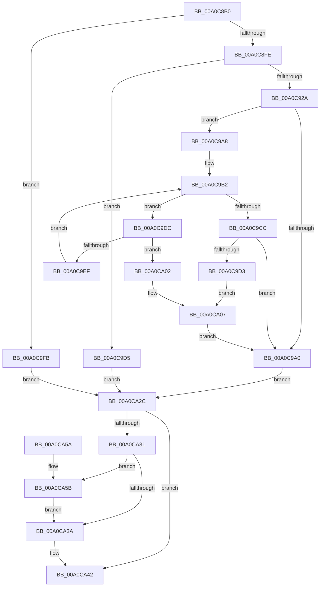

# FsRtlSetKernelEaFile

- RVA: `0x00A0C8B0`–`0x00A0CA67` (길이 `439` bytes)
- VA: `0x0000000140A0C8B0`
- 실행 섹션: `PAGE`
- PDB 이름 있음: `예`; PDB Function 태그: `아니요`
- unwind 정보 RVA: `0x000A8AD4`
- 디코드: `112`개 명령, `439/439` bytes 표시
- 미해석 바이트: `0` (있으면 어셈블리에 `.byte`로 보존)

> 이 문서는 커널 이미지의 기계어와 PDB 기호를 분석해 생성했습니다. 4번과 5번은 함수 원형과 자료형을 바이너리 사용 방식에서 추정한 C 해석이며 원본 소스 복구 결과는 아닙니다.

## 1. Dependencies

- 직접 호출 지점: **9**; 고유 호출 대상: **8**
- 직접 호출자로 확인된 함수: **3**
- RIP 상대 이미지 참조: **1**

### Outgoing calls
- `0x00A0C8EB` → [KeInitializeEvent](../../text/40/KeInitializeEvent_function_0040DD10.md) (function, `0x0040DD10`)
- `0x00A0C901` → [IoGetRelatedDeviceObject](../../text/29/IoGetRelatedDeviceObject_function_0029B120.md) (function, `0x0029B120`)
- `0x00A0C914` → [IoAllocateIrpEx](../../text/20/IoAllocateIrpEx_function_00207510.md) (function, `0x00207510`)
- `0x00A0C994` → [IofCallDriver](../../text/29/IofCallDriver_function_0029B4B0.md) (function, `0x0029B4B0`)
- `0x00A0C9C0` → [KeWaitForSingleObject](../../text/20/KeWaitForSingleObject_function_0020E6B0.md) (function, `0x0020E6B0`)
- `0x00A0CA0A` → [IoCancelIrp](../../text/27/IoCancelIrp_function_002720E0.md) (function, `0x002720E0`)
- `0x00A0CA22` → [KeWaitForSingleObject](../../text/20/KeWaitForSingleObject_function_0020E6B0.md) (function, `0x0020E6B0`)
- `0x00A0CA3D` → [IoFreeIrp](../../text/24/IoFreeIrp_function_0024DF70.md) (function, `0x0024DF70`)
- `0x00A0CA5B` → [FsRtlpFreeMdlChain](../71/FsRtlpFreeMdlChain_function_00716394.md) (function, `0x00716394`)

### Direct callers
- [CmpAdjustFileCFSafety](../../text/4B/CmpAdjustFileCFSafety_function_004BCEF8.md) at `0x004BD003`
- [CmpAdjustFileCFSafety](../../text/4B/CmpAdjustFileCFSafety_function_004BCEF8.md) at `0x004BD04A`
- [SepSetImageEa](../../text/60/SepSetImageEa_function_0060874C.md) at `0x00608800`
- [sub_00A0BA74](Unknown_function_00A0BA74.md) at `0x00A0BF4B`

### Static image references
- `0x00A0C968` → RVA `0x0048B010` (`CmpCompleteFlushAndPurgeIrp`; read)

## 2. Other-region calls and transfers

- 다른 실행 섹션으로 향하는 call: **8**
  - `0x00A0C8EB` → [KeInitializeEvent](../../text/40/KeInitializeEvent_function_0040DD10.md) (`PAGE` → `.text`)
  - `0x00A0C901` → [IoGetRelatedDeviceObject](../../text/29/IoGetRelatedDeviceObject_function_0029B120.md) (`PAGE` → `.text`)
  - `0x00A0C914` → [IoAllocateIrpEx](../../text/20/IoAllocateIrpEx_function_00207510.md) (`PAGE` → `.text`)
  - `0x00A0C994` → [IofCallDriver](../../text/29/IofCallDriver_function_0029B4B0.md) (`PAGE` → `.text`)
  - `0x00A0C9C0` → [KeWaitForSingleObject](../../text/20/KeWaitForSingleObject_function_0020E6B0.md) (`PAGE` → `.text`)
  - `0x00A0CA0A` → [IoCancelIrp](../../text/27/IoCancelIrp_function_002720E0.md) (`PAGE` → `.text`)
  - `0x00A0CA22` → [KeWaitForSingleObject](../../text/20/KeWaitForSingleObject_function_0020E6B0.md) (`PAGE` → `.text`)
  - `0x00A0CA3D` → [IoFreeIrp](../../text/24/IoFreeIrp_function_0024DF70.md) (`PAGE` → `.text`)
- 별도 외부 분기/꼬리 이동을 확인하지 못했습니다.

## 3. Assembly (complete function range)

```asm
00A0C8B0  4C 8B DC                        mov r11, rsp
00A0C8B3  49 89 5B 08                     mov qword ptr [r11 + 8], rbx
00A0C8B7  49 89 73 10                     mov qword ptr [r11 + 0x10], rsi
00A0C8BB  49 89 7B 18                     mov qword ptr [r11 + 0x18], rdi
00A0C8BF  41 56                           push r14
00A0C8C1  48 83 EC 50                     sub rsp, 0x50
00A0C8C5  41 8B F0                        mov esi, r8d
00A0C8C8  4C 8B F2                        mov r14, rdx
00A0C8CB  48 8B F9                        mov rdi, rcx
00A0C8CE  33 DB                           xor ebx, ebx
00A0C8D0  49 89 5B D8                     mov qword ptr [r11 - 0x28], rbx
00A0C8D4  0F 57 C0                        xorps xmm0, xmm0
00A0C8D7  33 C0                           xor eax, eax
00A0C8D9  0F 11 44 24 38                  movups xmmword ptr [rsp + 0x38], xmm0
00A0C8DE  49 89 43 F0                     mov qword ptr [r11 - 0x10], rax
00A0C8E2  45 33 C0                        xor r8d, r8d
00A0C8E5  33 D2                           xor edx, edx
00A0C8E7  49 8D 4B E0                     lea rcx, [r11 - 0x20]
00A0C8EB  E8 20 14 A0 FF                  call 0x14040dd10
00A0C8F0  90                              nop
00A0C8F1  8B 47 50                        mov eax, dword ptr [rdi + 0x50]
00A0C8F4  0F BA E0 0B                     bt eax, 0xb
00A0C8F8  0F 82 FD 00 00 00               jb 0x140a0c9fb
00A0C8FE  48 8B CF                        mov rcx, rdi
00A0C901  E8 1A E8 88 FF                  call 0x14029b120
00A0C906  48 89 44 24 78                  mov qword ptr [rsp + 0x78], rax
00A0C90B  45 33 C0                        xor r8d, r8d
00A0C90E  8A 50 4C                        mov dl, byte ptr [rax + 0x4c]
00A0C911  48 8B C8                        mov rcx, rax
00A0C914  E8 F7 AB 7F FF                  call 0x140207510
00A0C919  48 8B D8                        mov rbx, rax
00A0C91C  48 89 44 24 30                  mov qword ptr [rsp + 0x30], rax
00A0C921  48 85 C0                        test rax, rax
00A0C924  0F 84 AB 00 00 00               je 0x140a0c9d5
00A0C92A  48 8D 88 B8 00 00 00            lea rcx, [rax + 0xb8]
00A0C931  48 8B 01                        mov rax, qword ptr [rcx]
00A0C934  66 C7 40 B8 08 04               mov word ptr [rax - 0x48], 0x408
00A0C93A  48 89 78 E8                     mov qword ptr [rax - 0x18], rdi
00A0C93E  4C 89 73 70                     mov qword ptr [rbx + 0x70], r14
00A0C942  89 70 C0                        mov dword ptr [rax - 0x40], esi
00A0C945  65 48 8B 04 25 88 01 00 00      mov rax, qword ptr gs:[0x188]
00A0C94E  48 8B 5C 24 30                  mov rbx, qword ptr [rsp + 0x30]
00A0C953  48 89 83 98 00 00 00            mov qword ptr [rbx + 0x98], rax
00A0C95A  C7 43 10 04 00 00 00            mov dword ptr [rbx + 0x10], 4
00A0C961  C6 43 40 00                     mov byte ptr [rbx + 0x40], 0
00A0C965  48 8B 01                        mov rax, qword ptr [rcx]
00A0C968  48 8D 0D A1 E6 A7 FF            lea rcx, [rip - 0x58195f]
00A0C96F  48 89 48 F0                     mov qword ptr [rax - 0x10], rcx
00A0C973  48 8D 4C 24 38                  lea rcx, [rsp + 0x38]
00A0C978  48 89 48 F8                     mov qword ptr [rax - 8], rcx
00A0C97C  C6 40 BB 00                     mov byte ptr [rax - 0x45], 0
00A0C980  C6 40 BB 40                     mov byte ptr [rax - 0x45], 0x40
00A0C984  C6 40 BB C0                     mov byte ptr [rax - 0x45], 0xc0
00A0C988  C6 40 BB E0                     mov byte ptr [rax - 0x45], 0xe0
00A0C98C  48 8B D3                        mov rdx, rbx
00A0C98F  48 8B 4C 24 78                  mov rcx, qword ptr [rsp + 0x78]
00A0C994  E8 17 EB 88 FF                  call 0x14029b4b0
00A0C999  3D 03 01 00 00                  cmp eax, 0x103
00A0C99E  74 08                           je 0x140a0c9a8
00A0C9A0  8B 7B 30                        mov edi, dword ptr [rbx + 0x30]
00A0C9A3  E9 84 00 00 00                  jmp 0x140a0ca2c
00A0C9A8  48 8D 4C 24 38                  lea rcx, [rsp + 0x38]
00A0C9AD  48 89 4C 24 78                  mov qword ptr [rsp + 0x78], rcx
00A0C9B2  48 83 64 24 20 00               and qword ptr [rsp + 0x20], 0
00A0C9B8  41 B1 01                        mov r9b, 1
00A0C9BB  45 33 C0                        xor r8d, r8d
00A0C9BE  33 D2                           xor edx, edx
00A0C9C0  E8 EB 1C 80 FF                  call 0x14020e6b0
00A0C9C5  3D 01 01 00 00                  cmp eax, 0x101
00A0C9CA  74 10                           je 0x140a0c9dc
00A0C9CC  3D 4B 00 00 C0                  cmp eax, 0xc000004b
00A0C9D1  75 CD                           jne 0x140a0c9a0
00A0C9D3  EB 32                           jmp 0x140a0ca07
00A0C9D5  BF 9A 00 00 C0                  mov edi, 0xc000009a
00A0C9DA  EB 50                           jmp 0x140a0ca2c
00A0C9DC  65 48 8B 04 25 88 01 00 00      mov rax, qword ptr gs:[0x188]
00A0C9E5  8B 80 A0 05 00 00               mov eax, dword ptr [rax + 0x5a0]
00A0C9EB  A8 01                           test al, 1
00A0C9ED  75 13                           jne 0x140a0ca02
00A0C9EF  48 8B 5C 24 30                  mov rbx, qword ptr [rsp + 0x30]
00A0C9F4  48 8B 4C 24 78                  mov rcx, qword ptr [rsp + 0x78]
00A0C9F9  EB B7                           jmp 0x140a0c9b2
00A0C9FB  BF 10 00 00 C0                  mov edi, 0xc0000010
00A0CA00  EB 2A                           jmp 0x140a0ca2c
00A0CA02  48 8B 5C 24 30                  mov rbx, qword ptr [rsp + 0x30]
00A0CA07  48 8B CB                        mov rcx, rbx
00A0CA0A  E8 D1 56 86 FF                  call 0x1402720e0
00A0CA0F  48 83 64 24 20 00               and qword ptr [rsp + 0x20], 0
00A0CA15  45 33 C9                        xor r9d, r9d
00A0CA18  45 33 C0                        xor r8d, r8d
00A0CA1B  33 D2                           xor edx, edx
00A0CA1D  48 8D 4C 24 38                  lea rcx, [rsp + 0x38]
00A0CA22  E8 89 1C 80 FF                  call 0x14020e6b0
00A0CA27  E9 74 FF FF FF                  jmp 0x140a0c9a0
00A0CA2C  48 85 DB                        test rbx, rbx
00A0CA2F  74 11                           je 0x140a0ca42
00A0CA31  48 8B 4B 08                     mov rcx, qword ptr [rbx + 8]
00A0CA35  48 85 C9                        test rcx, rcx
00A0CA38  75 21                           jne 0x140a0ca5b
00A0CA3A  48 8B CB                        mov rcx, rbx
00A0CA3D  E8 2E 15 84 FF                  call 0x14024df70
00A0CA42  8B C7                           mov eax, edi
00A0CA44  48 8B 5C 24 60                  mov rbx, qword ptr [rsp + 0x60]
00A0CA49  48 8B 74 24 68                  mov rsi, qword ptr [rsp + 0x68]
00A0CA4E  48 8B 7C 24 70                  mov rdi, qword ptr [rsp + 0x70]
00A0CA53  48 83 C4 50                     add rsp, 0x50
00A0CA57  41 5E                           pop r14
00A0CA59  C3                              ret
00A0CA5A  CC                              int3
00A0CA5B  E8 34 99 D0 FF                  call 0x140716394
00A0CA60  48 83 63 08 00                  and qword ptr [rbx + 8], 0
00A0CA65  EB D3                           jmp 0x140a0ca3a
```

## 4. C-style interpretation (structured pseudocode)

```c
__int64 __fastcall FsRtlSetKernelEaFile(__int64 a1, __int64 a2, int a3)
{
    __int64 result;
    __int64 v_rbx;
    __int64 v_rsp;
    unsigned __int64 v_stack_m20;
    unsigned __int64 v_stack_m28;
    unsigned __int64 v_stack_m38;
    unsigned __int64 v_stack_p10;
    unsigned __int64 v_stack_p18;
    unsigned __int64 v_stack_p20;
    unsigned __int64 v_stack_p8;

    *(unsigned __int64 *)(v_rsp + 8) = v_rbx;
    *(unsigned __int64 *)(v_rsp + 16) = v_rsi;
    *(unsigned __int64 *)(v_rsp + 24) = v_rdi;
    v_rsp = (v_rsp) - (80);
    v_rbx = 0;
    *(unsigned __int64 *)(v_rsp - 40) = 0;
    result = 0;
    v_stack_m20 = v_xmm0;
    *(unsigned __int64 *)(v_rsp - 16) = 0;
    a3 = 0;
    a2 = 0;
    result = KeInitializeEvent(v_rsp - 32, a2, a3, a4);
    if (condition_is_below) goto loc_00A0C9FB;
    result = IoGetRelatedDeviceObject(a1, a2, a3, a4);
    v_stack_p20 = result;
    a3 = 0;
    result = IoAllocateIrpEx(result, *(unsigned __int8 *)(result + 76), a3, a4);
    v_stack_m28 = result;
    if (result == 0) goto loc_00A0C9D5;
    *(unsigned __int16 *)(*(unsigned __int64 *)(result + 184) - 72) = 0x408ULL;
    *(unsigned __int64 *)(*(unsigned __int64 *)(result + 184) - 24) = a1;
    *(unsigned __int64 *)(result + 112) = 0;
    *(unsigned int *)(*(unsigned __int64 *)(result + 184) - 64) = (unsigned int)((unsigned int)(a3));
    *(unsigned __int64 *)(v_stack_m28 + 152) = *(unsigned __int64 *)(gs_base + (0 + 392));
    *(unsigned int *)(v_stack_m28 + 16) = 4;
    *(unsigned __int8 *)(v_stack_m28 + 64) = 0;
    *(unsigned __int64 *)(*(unsigned __int64 *)(result + 184) - 16) = v_rip - 5773663;
    *(unsigned __int64 *)(*(unsigned __int64 *)(result + 184) - 8) = v_stack_m20;
    *(unsigned __int8 *)(*(unsigned __int64 *)(result + 184) - 69) = 0;
    *(unsigned __int8 *)(*(unsigned __int64 *)(result + 184) - 69) = 64;
    *(unsigned __int8 *)(*(unsigned __int64 *)(result + 184) - 69) = 192;
    *(unsigned __int8 *)(*(unsigned __int64 *)(result + 184) - 69) = 224;
    result = IofCallDriver(v_stack_p20, v_stack_m28, a3, a4);
    if (((unsigned int)(result)) == 259) goto loc_00A0C9A8;
loc_00A0C9A0:
    goto loc_00A0CA2C;
loc_00A0C9A8:
    v_stack_p20 = v_stack_m20;
loc_00A0C9B2:
    a3 = 0;
    a2 = 0;
    result = KeWaitForSingleObject(v_stack_m20, a2, a3, 1);
    if (((unsigned int)(result)) == 257) goto loc_00A0C9DC;
    if (((unsigned int)(result)) != 0xC000004BULL) goto loc_00A0C9A0;
    goto loc_00A0CA07;
loc_00A0C9D5:
    goto loc_00A0CA2C;
loc_00A0C9DC:
    if ((((unsigned __int8)((unsigned int)(*(unsigned int *)(*(unsigned __int64 *)(gs_base + (0 + 392)) + 1440)))) & (1)) != 0) goto loc_00A0CA02;
    goto loc_00A0C9B2;
loc_00A0C9FB:
    goto loc_00A0CA2C;
loc_00A0CA02:
loc_00A0CA07:
    result = IoCancelIrp(v_stack_m28, a2, a3, 1);
    a4 = 0;
    a3 = 0;
    a2 = 0;
    result = KeWaitForSingleObject(v_stack_m20, a2, a3, a4);
    goto loc_00A0C9A0;
loc_00A0CA2C:
    if (v_stack_m28 == 0) goto loc_00A0CA42;
    if (*(unsigned __int64 *)(v_stack_m28 + 8) != 0) goto loc_00A0CA5B;
loc_00A0CA3A:
    result = IoFreeIrp(v_stack_m28, a2, a3, a4);
loc_00A0CA42:
    v_rsp = (v_rsp) + (80);
    return (unsigned int)((unsigned int)((unsigned int)(0xC0000010ULL)));
loc_00A0CA5B:
    result = FsRtlpFreeMdlChain(v_stack_m28, a2, a3, a4);
    goto loc_00A0CA3A;
}
```

## 5. (Beta) C Style

```c
int64_t FsRtlSetKernelEaFile(void *Arg1, int64_t Arg2, int32_t Arg3)
{
    uint8_t *arg1 = (uint8_t *)Arg1;

    int64_t result;
    int64_t local_rbx;
    int64_t local_rsp;
    uint64_t v_stack_m20;
    uint64_t v_stack_m28;
    uint64_t v_stack_m38;
    uint64_t v_stack_p10;
    uint64_t v_stack_p18;
    uint64_t v_stack_p20;
    uint64_t v_stack_p8;

    *(uint64_t *)(local_rsp + 0x8) = local_rbx;
    *(uint64_t *)(local_rsp + 0x10) = local_rsi;
    *(uint64_t *)(local_rsp + 0x18) = local_rdi;
    local_rsp = (local_rsp) - (80);
    local_rbx = 0;
    *(uint64_t *)(local_rsp - 0x28) = 0;
    result = 0;
    v_stack_m20 = v_xmm0;
    *(uint64_t *)(local_rsp - 0x10) = 0;
    Arg3 = 0;
    Arg2 = 0;
    result = KeInitializeEvent(local_rsp - 32, Arg2, Arg3, a4);
    if (condition_is_below) goto loc_00A0C9FB;
    result = IoGetRelatedDeviceObject(Arg1, Arg2, Arg3, a4);
    v_stack_p20 = result;
    Arg3 = 0;
    result = IoAllocateIrpEx(result, *(uint8_t *)(result + 0x4C), Arg3, a4);
    v_stack_m28 = result;
    if (result == 0) goto loc_00A0C9D5;
    *(uint16_t *)(*(uint64_t *)(result + 0xB8) - 0x48) = 0x408ULL;
    *(void **)(*(uint64_t *)(result + 0xB8) - 0x18) = Arg1;
    *(uint64_t *)(result + 0x70) = 0;
    *(uint32_t *)(*(uint64_t *)(result + 0xB8) - 0x40) = (uint32_t)((uint32_t)(Arg3));
    *(uint64_t *)(v_stack_m28 + 0x98) = *(uint64_t *)(gs_base + (0 + 0x188));
    *(uint32_t *)(v_stack_m28 + 0x10) = 4;
    *(uint8_t *)(v_stack_m28 + 0x40) = 0;
    *(uint64_t *)(*(uint64_t *)(result + 0xB8) - 0x10) = v_rip - 5773663;
    *(uint64_t *)(*(uint64_t *)(result + 0xB8) - 0x8) = v_stack_m20;
    *(uint8_t *)(*(uint64_t *)(result + 0xB8) - 0x45) = 0;
    *(uint8_t *)(*(uint64_t *)(result + 0xB8) - 0x45) = 64;
    *(uint8_t *)(*(uint64_t *)(result + 0xB8) - 0x45) = 192;
    *(uint8_t *)(*(uint64_t *)(result + 0xB8) - 0x45) = 224;
    result = IofCallDriver(v_stack_p20, v_stack_m28, Arg3, a4);
    if (((uint32_t)(result)) == 259) goto loc_00A0C9A8;
loc_00A0C9A0:
    goto loc_00A0CA2C;
loc_00A0C9A8:
    v_stack_p20 = v_stack_m20;
loc_00A0C9B2:
    Arg3 = 0;
    Arg2 = 0;
    result = KeWaitForSingleObject(v_stack_m20, Arg2, Arg3, 1);
    if (((uint32_t)(result)) == 257) goto loc_00A0C9DC;
    if (((uint32_t)(result)) != 0xC000004BULL) goto loc_00A0C9A0;
    goto loc_00A0CA07;
loc_00A0C9D5:
    goto loc_00A0CA2C;
loc_00A0C9DC:
    if ((((uint8_t)((uint32_t)(*(uint32_t *)(*(uint64_t *)(gs_base + (0 + 0x188)) + 0x5A0)))) & (1)) != 0) goto loc_00A0CA02;
    goto loc_00A0C9B2;
loc_00A0C9FB:
    goto loc_00A0CA2C;
loc_00A0CA02:
loc_00A0CA07:
    result = IoCancelIrp(v_stack_m28, Arg2, Arg3, 1);
    a4 = 0;
    Arg3 = 0;
    Arg2 = 0;
    result = KeWaitForSingleObject(v_stack_m20, Arg2, Arg3, a4);
    goto loc_00A0C9A0;
loc_00A0CA2C:
    if (v_stack_m28 == 0) goto loc_00A0CA42;
    if (*(uint64_t *)(v_stack_m28 + 0x8) != 0) goto loc_00A0CA5B;
loc_00A0CA3A:
    result = IoFreeIrp(v_stack_m28, Arg2, Arg3, a4);
loc_00A0CA42:
    local_rsp = (local_rsp) + (80);
    return (uint32_t)((uint32_t)((uint32_t)(0xC0000010ULL)));
loc_00A0CA5B:
    result = FsRtlpFreeMdlChain(v_stack_m28, Arg2, Arg3, a4);
    goto loc_00A0CA3A;
}
```

### 관측된 메모리 오프셋

구조체 형식이 확인되지 않은 접근은 인자 기준의 오프셋으로만 기록했습니다.

| 기준 인자 | 오프셋 표현 | 폭 (bit) | 접근 |
|---|---:|---:|---|
| `Arg1` | `+ 0x50` | `32` | `R` |

## 6. Execution-region graph

[열기: 2D/3D 그래프와 함수 탐색 컨트롤 패널](../../../control-panel.html?section=page&rva=0x00A0C8B0&view=graph)

- 2D 그래프는 위에서 아래로 흐르고, 3D 그래프는 빈 공간을 드래그해 회전합니다. Shift+드래그는 이동, 휠은 확대·축소, 함수 노드 선택은 대상 보고서 이동입니다.

### Static fallback


