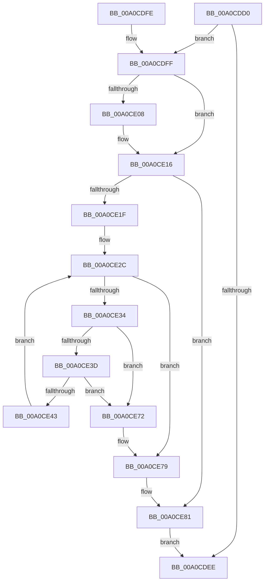

# FsRtlTeardownPerFileContexts

- RVA: `0x00A0CDD0`–`0x00A0CE9B` (길이 `203` bytes)
- VA: `0x0000000140A0CDD0`
- 실행 섹션: `PAGE`
- PDB 이름 있음: `예`; PDB Function 태그: `아니요`
- unwind 정보 RVA: `0x000A8B68`
- 디코드: `57`개 명령, `203/203` bytes 표시
- 미해석 바이트: `0` (있으면 어셈블리에 `.byte`로 보존)

> 이 문서는 커널 이미지의 기계어와 PDB 기호를 분석해 생성했습니다. 4번과 5번은 함수 원형과 자료형을 바이너리 사용 방식에서 추정한 C 해석이며 원본 소스 복구 결과는 아닙니다.

## 1. Dependencies

- 직접 호출 지점: **8**; 고유 호출 대상: **5**
- 직접 호출자로 확인된 함수: **0**
- RIP 상대 이미지 참조: **0**

### Outgoing calls
- `0x00A0CE0C` → [guard_dispatch_icall](../../text/6B/guard_dispatch_icall_function_006BAAD0.md) (function, `0x006BAAD0`)
- `0x00A0CE22` → [FsRtlAcquireAutoExpandPushLockExclusive](../../text/26/FsRtlAcquireAutoExpandPushLockExclusive_function_0026539C.md) (function, `0x0026539C`)
- `0x00A0CE4D` → [FsRtlReleaseAutoExpandPushLockExclusive](../../text/26/FsRtlReleaseAutoExpandPushLockExclusive_function_00265B5C.md) (function, `0x00265B5C`)
- `0x00A0CE5E` → [guard_dispatch_icall](../../text/6B/guard_dispatch_icall_function_006BAAD0.md) (function, `0x006BAAD0`)
- `0x00A0CE66` → [FsRtlAcquireAutoExpandPushLockExclusive](../../text/26/FsRtlAcquireAutoExpandPushLockExclusive_function_0026539C.md) (function, `0x0026539C`)
- `0x00A0CE7C` → [FsRtlReleaseAutoExpandPushLockExclusive](../../text/26/FsRtlReleaseAutoExpandPushLockExclusive_function_00265B5C.md) (function, `0x00265B5C`)
- `0x00A0CE84` → [ExCleanupAutoExpandPushLock](../../text/43/ExCleanupAutoExpandPushLock_function_0043FAA0.md) (function, `0x0043FAA0`)
- `0x00A0CE91` → [ExFreePoolWithTag](../../poolcode/B8/ExFreePoolWithTag_function_00B82870.md) (function, `0x00B82870`)

### Direct callers
- 이 함수 시작 RVA로 연결되는 직접 call은 확인되지 않았습니다. 간접 호출은 완전히 역산할 수 없습니다.

### Static image references
- 디코드된 RIP-relative 메모리 참조가 없습니다.

## 2. Other-region calls and transfers

- 다른 실행 섹션으로 향하는 call: **8**
  - `0x00A0CE0C` → [guard_dispatch_icall](../../text/6B/guard_dispatch_icall_function_006BAAD0.md) (`PAGE` → `.text`)
  - `0x00A0CE22` → [FsRtlAcquireAutoExpandPushLockExclusive](../../text/26/FsRtlAcquireAutoExpandPushLockExclusive_function_0026539C.md) (`PAGE` → `.text`)
  - `0x00A0CE4D` → [FsRtlReleaseAutoExpandPushLockExclusive](../../text/26/FsRtlReleaseAutoExpandPushLockExclusive_function_00265B5C.md) (`PAGE` → `.text`)
  - `0x00A0CE5E` → [guard_dispatch_icall](../../text/6B/guard_dispatch_icall_function_006BAAD0.md) (`PAGE` → `.text`)
  - `0x00A0CE66` → [FsRtlAcquireAutoExpandPushLockExclusive](../../text/26/FsRtlAcquireAutoExpandPushLockExclusive_function_0026539C.md) (`PAGE` → `.text`)
  - `0x00A0CE7C` → [FsRtlReleaseAutoExpandPushLockExclusive](../../text/26/FsRtlReleaseAutoExpandPushLockExclusive_function_00265B5C.md) (`PAGE` → `.text`)
  - `0x00A0CE84` → [ExCleanupAutoExpandPushLock](../../text/43/ExCleanupAutoExpandPushLock_function_0043FAA0.md) (`PAGE` → `.text`)
  - `0x00A0CE91` → [ExFreePoolWithTag](../../poolcode/B8/ExFreePoolWithTag_function_00B82870.md) (`PAGE` → `POOLCODE`)
- 별도 외부 분기/꼬리 이동을 확인하지 못했습니다.

## 3. Assembly (complete function range)

```asm
00A0CDD0  48 89 5C 24 08                  mov qword ptr [rsp + 8], rbx
00A0CDD5  48 89 74 24 18                  mov qword ptr [rsp + 0x18], rsi
00A0CDDA  57                              push rdi
00A0CDDB  48 83 EC 30                     sub rsp, 0x30
00A0CDDF  33 DB                           xor ebx, ebx
00A0CDE1  48 87 19                        xchg qword ptr [rcx], rbx
00A0CDE4  48 89 5C 24 48                  mov qword ptr [rsp + 0x48], rbx
00A0CDE9  48 85 DB                        test rbx, rbx
00A0CDEC  75 11                           jne 0x140a0cdff
00A0CDEE  48 8B 5C 24 40                  mov rbx, qword ptr [rsp + 0x40]
00A0CDF3  48 8B 74 24 50                  mov rsi, qword ptr [rsp + 0x50]
00A0CDF8  48 83 C4 30                     add rsp, 0x30
00A0CDFC  5F                              pop rdi
00A0CDFD  C3                              ret
00A0CDFE  CC                              int3
00A0CDFF  48 8B 4B 20                     mov rcx, qword ptr [rbx + 0x20]
00A0CE03  48 85 C9                        test rcx, rcx
00A0CE06  74 0E                           je 0x140a0ce16
00A0CE08  48 8B 41 20                     mov rax, qword ptr [rcx + 0x20]
00A0CE0C  E8 BF DC CA FF                  call 0x1406baad0
00A0CE11  48 83 63 20 00                  and qword ptr [rbx + 0x20], 0
00A0CE16  48 8D 7B 10                     lea rdi, [rbx + 0x10]
00A0CE1A  48 39 3F                        cmp qword ptr [rdi], rdi
00A0CE1D  74 62                           je 0x140a0ce81
00A0CE1F  48 8B CB                        mov rcx, rbx
00A0CE22  E8 75 85 85 FF                  call 0x14026539c
00A0CE27  C6 44 24 20 01                  mov byte ptr [rsp + 0x20], 1
00A0CE2C  48 8B 37                        mov rsi, qword ptr [rdi]
00A0CE2F  48 3B F7                        cmp rsi, rdi
00A0CE32  74 45                           je 0x140a0ce79
00A0CE34  48 8B 06                        mov rax, qword ptr [rsi]
00A0CE37  48 39 7E 08                     cmp qword ptr [rsi + 8], rdi
00A0CE3B  75 35                           jne 0x140a0ce72
00A0CE3D  48 39 70 08                     cmp qword ptr [rax + 8], rsi
00A0CE41  75 2F                           jne 0x140a0ce72
00A0CE43  48 89 07                        mov qword ptr [rdi], rax
00A0CE46  48 89 78 08                     mov qword ptr [rax + 8], rdi
00A0CE4A  48 8B CB                        mov rcx, rbx
00A0CE4D  E8 0A 8D 85 FF                  call 0x140265b5c
00A0CE52  C6 44 24 20 00                  mov byte ptr [rsp + 0x20], 0
00A0CE57  48 8B 46 20                     mov rax, qword ptr [rsi + 0x20]
00A0CE5B  48 8B CE                        mov rcx, rsi
00A0CE5E  E8 6D DC CA FF                  call 0x1406baad0
00A0CE63  48 8B CB                        mov rcx, rbx
00A0CE66  E8 31 85 85 FF                  call 0x14026539c
00A0CE6B  C6 44 24 20 01                  mov byte ptr [rsp + 0x20], 1
00A0CE70  EB BA                           jmp 0x140a0ce2c
00A0CE72  B9 03 00 00 00                  mov ecx, 3
00A0CE77  CD 29                           int 0x29
00A0CE79  48 8B CB                        mov rcx, rbx
00A0CE7C  E8 DB 8C 85 FF                  call 0x140265b5c
00A0CE81  48 8B CB                        mov rcx, rbx
00A0CE84  E8 17 2C A3 FF                  call 0x14043faa0
00A0CE89  BA 46 53 66 63                  mov edx, 0x63665346
00A0CE8E  48 8B CB                        mov rcx, rbx
00A0CE91  E8 DA 59 17 00                  call 0x140b82870
00A0CE96  E9 53 FF FF FF                  jmp 0x140a0cdee
```

## 4. C-style interpretation (structured pseudocode)

```c
__int64 __fastcall FsRtlTeardownPerFileContexts(__int64 a1)
{
    __int64 result;
    __int64 v_rbx;
    __int64 v_rsp;
    unsigned __int64 v_stack_p10;
    unsigned __int64 v_stack_p18;
    unsigned __int8 v_stack_p20;
    unsigned __int64 v_stack_p8;

    v_stack_p8 = v_rbx;
    v_stack_p18 = v_rsi;
    v_rsp = (v_rsp) - (48);
    v_rbx = 0;
    v_stack_p10 = 0;
    if (0 != 0) goto loc_00A0CDFF;
loc_00A0CDEE:
    v_rsp = (v_rsp) + (48);
    return result;
loc_00A0CDFF:
    if (*(unsigned __int64 *)(v_stack_p8 + 32) != 0) {
        result = *(unsigned __int64 *)(*(unsigned __int64 *)(v_stack_p8 + 32) + 32);
        result = guard_dispatch_icall(*(unsigned __int64 *)(v_stack_p8 + 32), a2, a3, a4);
    }
    if ((*(unsigned __int64 *)(v_stack_p8 + 16)) == (v_stack_p8 + 16)) goto loc_00A0CE81;
    result = FsRtlAcquireAutoExpandPushLockExclusive(v_stack_p8, a2, a3, a4);
    v_stack_p20 = 1;
loc_00A0CE2C:
    if ((*(unsigned __int64 *)(v_stack_p8 + 16)) == (v_stack_p8 + 16)) goto loc_00A0CE79;
    if ((*(unsigned __int64 *)(*(unsigned __int64 *)(v_stack_p8 + 16) + 8)) != (v_stack_p8 + 16)) goto loc_00A0CE72;
    if ((*(unsigned __int64 *)(*(unsigned __int64 *)(*(unsigned __int64 *)(v_stack_p8 + 16)) + 8)) != (*(unsigned __int64 *)(v_stack_p8 + 16))) goto loc_00A0CE72;
    *(unsigned __int64 *)(v_stack_p8 + 16) = *(unsigned __int64 *)(*(unsigned __int64 *)(v_stack_p8 + 16));
    *(unsigned __int64 *)(*(unsigned __int64 *)(*(unsigned __int64 *)(v_stack_p8 + 16)) + 8) = v_stack_p8 + 16;
    result = FsRtlReleaseAutoExpandPushLockExclusive(v_stack_p8, a2, a3, a4);
    v_stack_p20 = 0;
    result = guard_dispatch_icall(*(unsigned __int64 *)(v_stack_p8 + 16), a2, a3, a4);
    result = FsRtlAcquireAutoExpandPushLockExclusive(v_stack_p8, a2, a3, a4);
    v_stack_p20 = 1;
    goto loc_00A0CE2C;
loc_00A0CE72:
loc_00A0CE79:
    result = FsRtlReleaseAutoExpandPushLockExclusive(v_stack_p8, a2, a3, a4);
loc_00A0CE81:
    result = ExCleanupAutoExpandPushLock(v_stack_p8, a2, a3, a4);
    result = ExFreePoolWithTag(v_stack_p8, (unsigned int)(0x63665346ULL), a3, a4);
    goto loc_00A0CDEE;
}
```

## 5. (Beta) C Style

```c
int64_t FsRtlTeardownPerFileContexts(void *Arg1)
{
    uint8_t *arg1 = (uint8_t *)Arg1;

    int64_t result;
    int64_t local_rbx;
    int64_t local_rsp;
    uint64_t v_stack_p10;
    uint64_t v_stack_p18;
    uint8_t v_stack_p20;
    uint64_t v_stack_p8;

    v_stack_p8 = local_rbx;
    v_stack_p18 = local_rsi;
    local_rsp = (local_rsp) - (48);
    local_rbx = 0;
    v_stack_p10 = 0;
    if (0 != 0) goto loc_00A0CDFF;
loc_00A0CDEE:
    local_rsp = (local_rsp) + (48);
    return result;
loc_00A0CDFF:
    if (*(uint64_t *)(v_stack_p8 + 0x20) != 0) {
        result = *(uint64_t *)(*(uint64_t *)(v_stack_p8 + 0x20) + 0x20);
        result = guard_dispatch_icall(*(uint64_t *)(v_stack_p8 + 0x20), a2, a3, a4);
    }
    if ((*(uint64_t *)(v_stack_p8 + 0x10)) == (v_stack_p8 + 16)) goto loc_00A0CE81;
    result = FsRtlAcquireAutoExpandPushLockExclusive(v_stack_p8, a2, a3, a4);
    v_stack_p20 = 1;
loc_00A0CE2C:
    if ((*(uint64_t *)(v_stack_p8 + 0x10)) == (v_stack_p8 + 16)) goto loc_00A0CE79;
    if ((*(uint64_t *)(*(uint64_t *)(v_stack_p8 + 0x10) + 0x8)) != (v_stack_p8 + 16)) goto loc_00A0CE72;
    if ((*(uint64_t *)(*(uint64_t *)(*(uint64_t *)(v_stack_p8 + 0x10)) + 0x8)) != (*(uint64_t *)(v_stack_p8 + 0x10))) goto loc_00A0CE72;
    *(uint64_t *)(v_stack_p8 + 0x10) = *(uint64_t *)(*(uint64_t *)(v_stack_p8 + 0x10));
    *(uint64_t *)(*(uint64_t *)(*(uint64_t *)(v_stack_p8 + 0x10)) + 0x8) = v_stack_p8 + 16;
    result = FsRtlReleaseAutoExpandPushLockExclusive(v_stack_p8, a2, a3, a4);
    v_stack_p20 = 0;
    result = guard_dispatch_icall(*(uint64_t *)(v_stack_p8 + 0x10), a2, a3, a4);
    result = FsRtlAcquireAutoExpandPushLockExclusive(v_stack_p8, a2, a3, a4);
    v_stack_p20 = 1;
    goto loc_00A0CE2C;
loc_00A0CE72:
loc_00A0CE79:
    result = FsRtlReleaseAutoExpandPushLockExclusive(v_stack_p8, a2, a3, a4);
loc_00A0CE81:
    result = ExCleanupAutoExpandPushLock(v_stack_p8, a2, a3, a4);
    result = ExFreePoolWithTag(v_stack_p8, (uint32_t)(0x63665346ULL), a3, a4);
    goto loc_00A0CDEE;
}
```

### 관측된 메모리 오프셋

구조체 형식이 확인되지 않은 접근은 인자 기준의 오프셋으로만 기록했습니다.

| 기준 인자 | 오프셋 표현 | 폭 (bit) | 접근 |
|---|---:|---:|---|
| `Arg1` | `+ 0x0` | `64` | `R/W` |

## 6. Execution-region graph

[열기: 2D/3D 그래프와 함수 탐색 컨트롤 패널](../../../control-panel.html?section=page&rva=0x00A0CDD0&view=graph)

- 2D 그래프는 위에서 아래로 흐르고, 3D 그래프는 빈 공간을 드래그해 회전합니다. Shift+드래그는 이동, 휠은 확대·축소, 함수 노드 선택은 대상 보고서 이동입니다.

### Static fallback


