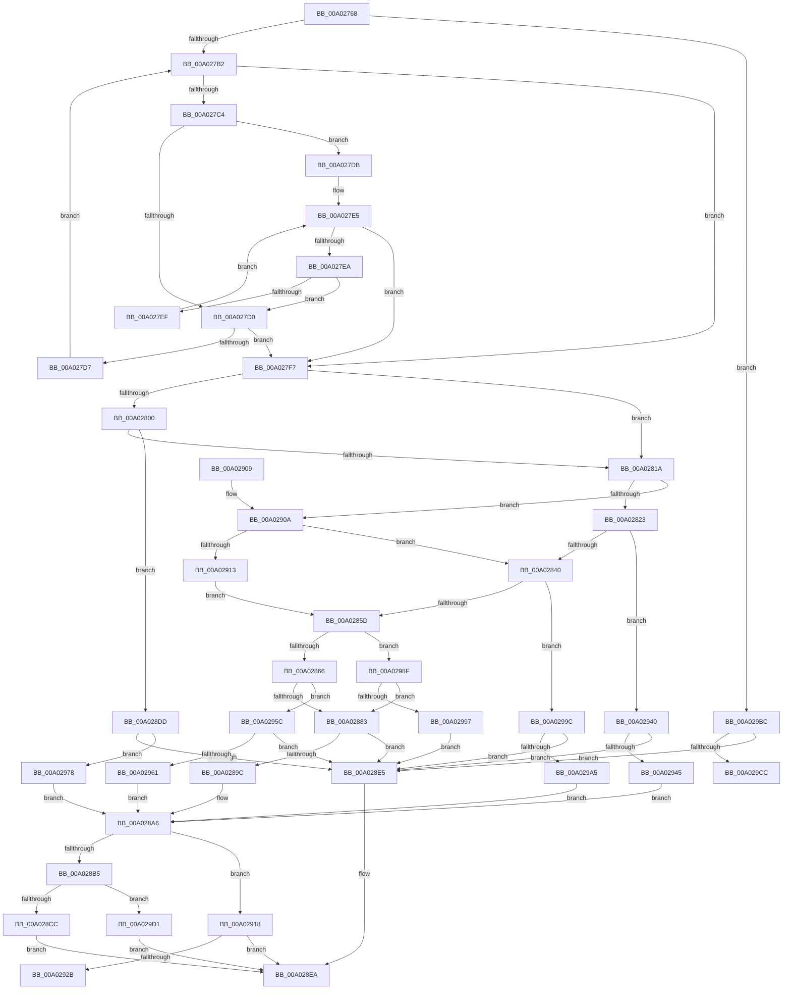

# GetAttributeName

- RVA: `0x00A02768`–`0x00A029D8` (길이 `624` bytes)
- VA: `0x0000000140A02768`
- 실행 섹션: `PAGE`
- PDB 이름 있음: `예`; PDB Function 태그: `예`
- unwind 정보 RVA: `0x000A7F28`
- 디코드: `165`개 명령, `624/624` bytes 표시
- 미해석 바이트: `0` (있으면 어셈블리에 `.byte`로 보존)

> 이 문서는 커널 이미지의 기계어와 PDB 기호를 분석해 생성했습니다. 4번과 5번은 함수 원형과 자료형을 바이너리 사용 방식에서 추정한 C 해석이며 원본 소스 복구 결과는 아닙니다.

## 1. Dependencies

- 직접 호출 지점: **11**; 고유 호출 대상: **6**
- 직접 호출자로 확인된 함수: **1**
- RIP 상대 이미지 참조: **6**

### Outgoing calls
- `0x00A027A5` → [wcsnicmp](../../text/50/wcsnicmp_function_005001C0.md) (function, `0x005001C0`)
- `0x00A027C7` → [iswalnum](../../text/50/iswalnum_function_005007A0.md) (function, `0x005007A0`)
- `0x00A0280D` → [wcsnicmp](../../text/50/wcsnicmp_function_005001C0.md) (function, `0x005001C0`)
- `0x00A02833` → [wcsnicmp](../../text/50/wcsnicmp_function_005001C0.md) (function, `0x005001C0`)
- `0x00A02850` → [wcsnicmp](../../text/50/wcsnicmp_function_005001C0.md) (function, `0x005001C0`)
- `0x00A02876` → [wcsnicmp](../../text/50/wcsnicmp_function_005001C0.md) (function, `0x005001C0`)
- `0x00A02893` → [wcsnicmp](../../text/50/wcsnicmp_function_005001C0.md) (function, `0x005001C0`)
- `0x00A028B7` → [SddlpAlloc](../92/SddlpAlloc_function_00925F88.md) (function, `0x00925F88`)
- `0x00A028D6` → [memcpy](../../text/6C/memcpy_function_006C6840.md) (function, `0x006C6840`)
- `0x00A02920` → [DecodeAttributeName](DecodeAttributeName_function_00A03460.md) (function, `0x00A03460`)
- `0x00A029BF` → [IsLegalAttributeChar2](../7A/IsLegalAttributeChar2_function_007A598C.md) (function, `0x007A598C`)

### Direct callers
- [GetOperandValue](GetOperandValue_function_00A024C0.md) at `0x00A0253E`

### Static image references
- `0x00A02791` → RVA `0x00014AE4` (`.rdata`; read)
- `0x00A027DE` → RVA `0x00014AA0` (`.rdata`; read)
- `0x00A02803` → RVA `0x00014AD0` (`.rdata`; read)
- `0x00A02829` → RVA `0x00014AE8` (`.rdata`; read)
- `0x00A02846` → RVA `0x00014B00` (`.rdata`; read)
- `0x00A0286C` → RVA `0x00014AC0` (`.rdata`; read)

## 2. Other-region calls and transfers

- 다른 실행 섹션으로 향하는 call: **8**
  - `0x00A027A5` → [wcsnicmp](../../text/50/wcsnicmp_function_005001C0.md) (`PAGE` → `.text`)
  - `0x00A027C7` → [iswalnum](../../text/50/iswalnum_function_005007A0.md) (`PAGE` → `.text`)
  - `0x00A0280D` → [wcsnicmp](../../text/50/wcsnicmp_function_005001C0.md) (`PAGE` → `.text`)
  - `0x00A02833` → [wcsnicmp](../../text/50/wcsnicmp_function_005001C0.md) (`PAGE` → `.text`)
  - `0x00A02850` → [wcsnicmp](../../text/50/wcsnicmp_function_005001C0.md) (`PAGE` → `.text`)
  - `0x00A02876` → [wcsnicmp](../../text/50/wcsnicmp_function_005001C0.md) (`PAGE` → `.text`)
  - `0x00A02893` → [wcsnicmp](../../text/50/wcsnicmp_function_005001C0.md) (`PAGE` → `.text`)
  - `0x00A028D6` → [memcpy](../../text/6C/memcpy_function_006C6840.md) (`PAGE` → `.text`)
- call이 아닌 외부 분기/꼬리 이동: **2**
  - `0x00A0293B` → [sub_00B334A0 + 0x1D](../B3/Unknown_function_00B334A0.md) (`tail-transfer`)
  - `0x00A029CC` → [sub_00B334A0](../B3/Unknown_function_00B334A0.md) (`tail-transfer`)

## 3. Assembly (complete function range)

```asm
00A02768  48 8B C4                        mov rax, rsp
00A0276B  48 89 58 08                     mov qword ptr [rax + 8], rbx
00A0276F  48 89 68 10                     mov qword ptr [rax + 0x10], rbp
00A02773  48 89 70 18                     mov qword ptr [rax + 0x18], rsi
00A02777  57                              push rdi
00A02778  41 54                           push r12
00A0277A  41 55                           push r13
00A0277C  41 56                           push r14
00A0277E  41 57                           push r15
00A02780  48 83 EC 20                     sub rsp, 0x20
00A02784  45 33 ED                        xor r13d, r13d
00A02787  4D 8B E0                        mov r12, r8
00A0278A  4C 8B F2                        mov r14, rdx
00A0278D  4C 89 68 20                     mov qword ptr [rax + 0x20], r13
00A02791  48 8D 15 4C 23 61 FF            lea rdx, [rip - 0x9edcb4]
00A02798  48 8B F1                        mov rsi, rcx
00A0279B  41 8B DD                        mov ebx, r13d
00A0279E  41 8B FD                        mov edi, r13d
00A027A1  45 8D 45 01                     lea r8d, [r13 + 1]
00A027A5  E8 16 DA AF FF                  call 0x1405001c0
00A027AA  85 C0                           test eax, eax
00A027AC  0F 84 0A 02 00 00               je 0x140a029bc
00A027B2  44 8B FF                        mov r15d, edi
00A027B5  B8 FF 00 00 00                  mov eax, 0xff
00A027BA  42 0F B7 2C 7E                  movzx ebp, word ptr [rsi + r15*2]
00A027BF  66 3B E8                        cmp bp, ax
00A027C2  77 33                           ja 0x140a027f7
00A027C4  0F B7 CD                        movzx ecx, bp
00A027C7  E8 D4 DF AF FF                  call 0x1405007a0
00A027CC  85 C0                           test eax, eax
00A027CE  74 0B                           je 0x140a027db
00A027D0  66 46 39 2C 7E                  cmp word ptr [rsi + r15*2], r13w
00A027D5  74 20                           je 0x140a027f7
00A027D7  FF C7                           inc edi
00A027D9  EB D7                           jmp 0x140a027b2
00A027DB  41 8B C5                        mov eax, r13d
00A027DE  48 8D 0D BB 22 61 FF            lea rcx, [rip - 0x9edd45]
00A027E5  83 F8 05                        cmp eax, 5
00A027E8  73 0D                           jae 0x140a027f7
00A027EA  66 39 29                        cmp word ptr [rcx], bp
00A027ED  74 E1                           je 0x140a027d0
00A027EF  FF C0                           inc eax
00A027F1  48 83 C1 02                     add rcx, 2
00A027F5  EB EE                           jmp 0x140a027e5
00A027F7  BD 08 00 00 00                  mov ebp, 8
00A027FC  3B FD                           cmp edi, ebp
00A027FE  72 1A                           jb 0x140a0281a
00A02800  44 8B C5                        mov r8d, ebp
00A02803  48 8D 15 C6 22 61 FF            lea rdx, [rip - 0x9edd3a]
00A0280A  48 8B CE                        mov rcx, rsi
00A0280D  E8 AE D9 AF FF                  call 0x1405001c0
00A02812  85 C0                           test eax, eax
00A02814  0F 84 C3 00 00 00               je 0x140a028dd
00A0281A  83 FF 0A                        cmp edi, 0xa
00A0281D  0F 82 E7 00 00 00               jb 0x140a0290a
00A02823  41 B8 0A 00 00 00               mov r8d, 0xa
00A02829  48 8D 15 B8 22 61 FF            lea rdx, [rip - 0x9edd48]
00A02830  48 8B CE                        mov rcx, rsi
00A02833  E8 88 D9 AF FF                  call 0x1405001c0
00A02838  85 C0                           test eax, eax
00A0283A  0F 84 00 01 00 00               je 0x140a02940
00A02840  41 B8 06 00 00 00               mov r8d, 6
00A02846  48 8D 15 B3 22 61 FF            lea rdx, [rip - 0x9edd4d]
00A0284D  48 8B CE                        mov rcx, rsi
00A02850  E8 6B D9 AF FF                  call 0x1405001c0
00A02855  85 C0                           test eax, eax
00A02857  0F 84 3F 01 00 00               je 0x140a0299c
00A0285D  83 FF 07                        cmp edi, 7
00A02860  0F 82 29 01 00 00               jb 0x140a0298f
00A02866  41 B8 07 00 00 00               mov r8d, 7
00A0286C  48 8D 15 4D 22 61 FF            lea rdx, [rip - 0x9eddb3]
00A02873  48 8B CE                        mov rcx, rsi
00A02876  E8 45 D9 AF FF                  call 0x1405001c0
00A0287B  85 C0                           test eax, eax
00A0287D  0F 84 D9 00 00 00               je 0x140a0295c
00A02883  41 B8 01 00 00 00               mov r8d, 1
00A02889  48 8D 15 54 22 61 FF            lea rdx, [rip - 0x9eddac]
00A02890  48 8B CE                        mov rcx, rsi
00A02893  E8 28 D9 AF FF                  call 0x1405001c0
00A02898  85 C0                           test eax, eax
00A0289A  74 49                           je 0x140a028e5
00A0289C  49 8B 0E                        mov rcx, qword ptr [r14]
00A0289F  8D 04 3F                        lea eax, [rdi + rdi]
00A028A2  C6 41 01 F8                     mov byte ptr [rcx + 1], 0xf8
00A028A6  89 41 04                        mov dword ptr [rcx + 4], eax
00A028A9  80 79 01 F8                     cmp byte ptr [rcx + 1], 0xf8
00A028AD  41 89 3C 24                     mov dword ptr [r12], edi
00A028B1  8B D0                           mov edx, eax
00A028B3  75 63                           jne 0x140a02918
00A028B5  8B CA                           mov ecx, edx
00A028B7  E8 CC 36 F2 FF                  call 0x140925f88
00A028BC  49 8B 0E                        mov rcx, qword ptr [r14]
00A028BF  48 89 41 08                     mov qword ptr [rcx + 8], rax
00A028C3  48 85 C0                        test rax, rax
00A028C6  0F 84 05 01 00 00               je 0x140a029d1
00A028CC  44 8B 41 04                     mov r8d, dword ptr [rcx + 4]
00A028D0  48 8B D6                        mov rdx, rsi
00A028D3  48 8B C8                        mov rcx, rax
00A028D6  E8 65 3F CC FF                  call 0x1406c6840
00A028DB  EB 0D                           jmp 0x140a028ea
00A028DD  3B FD                           cmp edi, ebp
00A028DF  0F 85 93 00 00 00               jne 0x140a02978
00A028E5  BB 38 05 00 00                  mov ebx, 0x538
00A028EA  48 8B 6C 24 58                  mov rbp, qword ptr [rsp + 0x58]
00A028EF  8B C3                           mov eax, ebx
00A028F1  48 8B 5C 24 50                  mov rbx, qword ptr [rsp + 0x50]
00A028F6  48 8B 74 24 60                  mov rsi, qword ptr [rsp + 0x60]
00A028FB  48 83 C4 20                     add rsp, 0x20
00A028FF  41 5F                           pop r15
00A02901  41 5E                           pop r14
00A02903  41 5D                           pop r13
00A02905  41 5C                           pop r12
00A02907  5F                              pop rdi
00A02908  C3                              ret
00A02909  CC                              int3
00A0290A  83 FF 06                        cmp edi, 6
00A0290D  0F 83 2D FF FF FF               jae 0x140a02840
00A02913  E9 45 FF FF FF                  jmp 0x140a0285d
00A02918  4C 8D 44 24 68                  lea r8, [rsp + 0x68]
00A0291D  48 8B CE                        mov rcx, rsi
00A02920  E8 3B 0B 00 00                  call 0x140a03460
00A02925  8B D8                           mov ebx, eax
00A02927  85 C0                           test eax, eax
00A02929  75 BF                           jne 0x140a028ea
00A0292B  49 8B 0E                        mov rcx, qword ptr [r14]
00A0292E  48 83 C8 FF                     or rax, 0xffffffffffffffff
00A02932  48 8B 54 24 68                  mov rdx, qword ptr [rsp + 0x68]
00A02937  48 89 51 08                     mov qword ptr [rcx + 8], rdx
00A0293B  E9 7D 0B 13 00                  jmp 0x140b334bd
00A02940  83 FF 0A                        cmp edi, 0xa
00A02943  74 A0                           je 0x140a028e5
00A02945  49 8B 0E                        mov rcx, qword ptr [r14]
00A02948  8D 04 7D EC FF FF FF            lea eax, [rdi*2 - 0x14]
00A0294F  48 83 C6 14                     add rsi, 0x14
00A02953  C6 41 01 FA                     mov byte ptr [rcx + 1], 0xfa
00A02957  E9 4A FF FF FF                  jmp 0x140a028a6
00A0295C  83 FF 07                        cmp edi, 7
00A0295F  74 84                           je 0x140a028e5
00A02961  49 8B 0E                        mov rcx, qword ptr [r14]
00A02964  8D 04 7D F2 FF FF FF            lea eax, [rdi*2 - 0xe]
00A0296B  48 83 C6 0E                     add rsi, 0xe
00A0296F  C6 41 01 FC                     mov byte ptr [rcx + 1], 0xfc
00A02973  E9 2E FF FF FF                  jmp 0x140a028a6
00A02978  49 8B 0E                        mov rcx, qword ptr [r14]
00A0297B  8D 04 7D F0 FF FF FF            lea eax, [rdi*2 - 0x10]
00A02982  48 83 C6 10                     add rsi, 0x10
00A02986  C6 41 01 FB                     mov byte ptr [rcx + 1], 0xfb
00A0298A  E9 17 FF FF FF                  jmp 0x140a028a6
00A0298F  85 FF                           test edi, edi
00A02991  0F 85 EC FE FF FF               jne 0x140a02883
00A02997  E9 49 FF FF FF                  jmp 0x140a028e5
00A0299C  83 FF 06                        cmp edi, 6
00A0299F  0F 84 40 FF FF FF               je 0x140a028e5
00A029A5  49 8B 0E                        mov rcx, qword ptr [r14]
00A029A8  8D 04 7D F4 FF FF FF            lea eax, [rdi*2 - 0xc]
00A029AF  48 83 C6 0C                     add rsi, 0xc
00A029B3  C6 41 01 F9                     mov byte ptr [rcx + 1], 0xf9
00A029B7  E9 EA FE FF FF                  jmp 0x140a028a6
00A029BC  0F B7 0E                        movzx ecx, word ptr [rsi]
00A029BF  E8 C8 2F DA FF                  call 0x1407a598c
00A029C4  84 C0                           test al, al
00A029C6  0F 84 19 FF FF FF               je 0x140a028e5
00A029CC  E9 CF 0A 13 00                  jmp 0x140b334a0
00A029D1  8B DD                           mov ebx, ebp
00A029D3  E9 12 FF FF FF                  jmp 0x140a028ea
```

## 4. C-style interpretation (structured pseudocode)

```c
__int64 __fastcall GetAttributeName(__int64 a1, __int64 a2, __int64 a3)
{
    __int64 result;
    __int64 v_r13;
    __int64 v_rdi;
    __int64 v_rsi;
    __int64 v_rsp;
    unsigned __int64 v_stack_p10;
    unsigned __int64 v_stack_p18;
    unsigned __int64 v_stack_p68;
    unsigned __int64 v_stack_p8;

    *(unsigned __int64 *)(v_rsp + 8) = v_rbx;
    *(unsigned __int64 *)(v_rsp + 16) = v_rbp;
    *(unsigned __int64 *)(v_rsp + 24) = v_rsi;
    v_rsp = (v_rsp) - (32);
    v_r13 = 0;
    *(unsigned __int64 *)(v_rsp + 32) = 0;
    result = wcsnicmp(a1, v_rip - 10411188, v_r13 + 1, a4);
    if ((unsigned int)(result) == 0) goto loc_00A029BC;
loc_00A027B2:
    if (((unsigned __int16)(*(unsigned __int16 *)(a1 + 0 * 2))) > 255) goto loc_00A027F7;
    result = iswalnum((unsigned __int16)(*(unsigned __int16 *)(a1 + 0 * 2)), v_rip - 10411188, v_r13 + 1, a4);
    if ((unsigned int)(result) == 0) goto loc_00A027DB;
loc_00A027D0:
    if ((*(unsigned __int16 *)(a1 + 0 * 2)) == 0) goto loc_00A027F7;
    v_rdi = (unsigned int)((0) + 1);
    goto loc_00A027B2;
loc_00A027DB:
loc_00A027E5:
    if (0 >= 5) goto loc_00A027F7;
    if ((*(unsigned __int16 *)(v_rip - 10411333)) == ((unsigned __int16)(*(unsigned __int16 *)(a1 + 0 * 2)))) goto loc_00A027D0;
    result = (unsigned int)((0) + 1);
    a1 = (v_rip - 10411333) + (2);
    goto loc_00A027E5;
loc_00A027F7:
    if (((unsigned int)(v_rdi)) < 8) goto loc_00A0281A;
    result = wcsnicmp(a1, v_rip - 10411322, 8, a4);
    if ((unsigned int)(result) == 0) goto loc_00A028DD;
loc_00A0281A:
    if (((unsigned int)(v_rdi)) < 10) goto loc_00A0290A;
    result = wcsnicmp(a1, v_rip - 10411336, 10, a4);
    if ((unsigned int)(result) == 0) goto loc_00A02940;
loc_00A02840:
    result = wcsnicmp(a1, v_rip - 10411341, 6, a4);
    if ((unsigned int)(result) == 0) goto loc_00A0299C;
loc_00A0285D:
    if (((unsigned int)(v_rdi)) < 7) goto loc_00A0298F;
    result = wcsnicmp(a1, v_rip - 10411443, 7, a4);
    if ((unsigned int)(result) == 0) goto loc_00A0295C;
loc_00A02883:
    result = wcsnicmp(a1, v_rip - 10411436, 1, a4);
    if ((unsigned int)(result) == 0) goto loc_00A028E5;
    *(unsigned __int8 *)(*(unsigned __int64 *)(a2) + 1) = 248;
loc_00A028A6:
    *(unsigned int *)(*(unsigned __int64 *)(a2) + 4) = (unsigned int)(v_rdi + v_rdi * 1);
    *(unsigned int *)(a3) = (unsigned int)(v_rdi);
    if ((*(unsigned __int8 *)(*(unsigned __int64 *)(a2) + 1)) != 248) goto loc_00A02918;
    result = SddlpAlloc((unsigned int)((unsigned int)((unsigned int)((unsigned int)(v_rdi + v_rdi * 1)))), (unsigned int)((unsigned int)(v_rdi + v_rdi * 1)), 1, a4);
    *(unsigned __int64 *)(*(unsigned __int64 *)(a2) + 8) = result;
    if (result == 0) goto loc_00A029D1;
    result = memcpy(result, a1, (unsigned int)(*(unsigned int *)(*(unsigned __int64 *)(a2) + 4)), a4);
    goto loc_00A028EA;
loc_00A028DD:
    if (((unsigned int)(v_rdi)) != 8) goto loc_00A02978;
loc_00A028E5:
loc_00A028EA:
    v_rsp = (v_rsp) + (32);
    return (unsigned int)((unsigned int)((unsigned int)(0x538ULL)));
loc_00A0290A:
    if (((unsigned int)(v_rdi)) >= 6) goto loc_00A02840;
    goto loc_00A0285D;
loc_00A02918:
    result = DecodeAttributeName(v_stack_p18, a1, v_stack_p68, a4);
    if ((unsigned int)(result) != 0) goto loc_00A028EA;
    result = (result) | (-1);
    *(unsigned __int64 *)(*(unsigned __int64 *)(a2) + 8) = v_stack_p68;
loc_00A02940:
    if (((unsigned int)(v_rdi)) == 10) goto loc_00A028E5;
    v_rsi = (v_stack_p18) + (20);
    *(unsigned __int8 *)(*(unsigned __int64 *)(a2) + 1) = 250;
    goto loc_00A028A6;
loc_00A0295C:
    if (((unsigned int)(v_rdi)) == 7) goto loc_00A028E5;
    v_rsi = (v_rsi) + (14);
    *(unsigned __int8 *)(*(unsigned __int64 *)(a2) + 1) = 252;
    goto loc_00A028A6;
loc_00A02978:
    v_rsi = (v_rsi) + (16);
    *(unsigned __int8 *)(*(unsigned __int64 *)(a2) + 1) = 251;
    goto loc_00A028A6;
loc_00A0298F:
    if ((unsigned int)(v_rdi) != 0) goto loc_00A02883;
    goto loc_00A028E5;
loc_00A0299C:
    if (((unsigned int)(v_rdi)) == 6) goto loc_00A028E5;
    v_rsi = (v_rsi) + (12);
    *(unsigned __int8 *)(*(unsigned __int64 *)(a2) + 1) = 249;
    goto loc_00A028A6;
loc_00A029BC:
    result = IsLegalAttributeChar2(*(unsigned __int16 *)(v_rsi), v_stack_p68, v_stack_p68, a4);
    if ((unsigned __int8)(result) == 0) goto loc_00A028E5;
loc_00A029D1:
    goto loc_00A028EA;
}
```

## 5. (Beta) C Style

```c
int64_t GetAttributeName(void *Arg1, void *Arg2, void *Arg3)
{
    uint8_t *arg1 = (uint8_t *)Arg1;
    uint8_t *arg2 = (uint8_t *)Arg2;
    uint8_t *arg3 = (uint8_t *)Arg3;

    int64_t result;
    int64_t local_r13;
    int64_t local_rdi;
    int64_t local_rsi;
    int64_t local_rsp;
    uint64_t v_stack_p10;
    uint64_t v_stack_p18;
    uint64_t v_stack_p68;
    uint64_t v_stack_p8;

    *(uint64_t *)(local_rsp + 0x8) = local_rbx;
    *(uint64_t *)(local_rsp + 0x10) = local_rbp;
    *(uint64_t *)(local_rsp + 0x18) = local_rsi;
    local_rsp = (local_rsp) - (32);
    local_r13 = 0;
    *(uint64_t *)(local_rsp + 0x20) = 0;
    result = wcsnicmp(Arg1, v_rip - 10411188, local_r13 + 1, a4);
    if ((uint32_t)(result) == 0) goto loc_00A029BC;
loc_00A027B2:
    if (((uint16_t)(*(uint16_t *)(arg1 + 0x0 * 2))) > 255) goto loc_00A027F7;
    result = iswalnum((uint16_t)(*(uint16_t *)(arg1 + 0x0 * 2)), v_rip - 10411188, local_r13 + 1, a4);
    if ((uint32_t)(result) == 0) goto loc_00A027DB;
loc_00A027D0:
    if ((*(uint16_t *)(arg1 + 0x0 * 2)) == 0) goto loc_00A027F7;
    local_rdi = (uint32_t)((0) + 1);
    goto loc_00A027B2;
loc_00A027DB:
loc_00A027E5:
    if (0 >= 5) goto loc_00A027F7;
    if ((*(uint16_t *)(v_rip - 0x9EDD45)) == ((uint16_t)(*(uint16_t *)(arg1 + 0x0 * 2)))) goto loc_00A027D0;
    result = (uint32_t)((0) + 1);
    Arg1 = (v_rip - 10411333) + (2);
    goto loc_00A027E5;
loc_00A027F7:
    if (((uint32_t)(local_rdi)) < 8) goto loc_00A0281A;
    result = wcsnicmp(Arg1, v_rip - 10411322, 8, a4);
    if ((uint32_t)(result) == 0) goto loc_00A028DD;
loc_00A0281A:
    if (((uint32_t)(local_rdi)) < 10) goto loc_00A0290A;
    result = wcsnicmp(Arg1, v_rip - 10411336, 10, a4);
    if ((uint32_t)(result) == 0) goto loc_00A02940;
loc_00A02840:
    result = wcsnicmp(Arg1, v_rip - 10411341, 6, a4);
    if ((uint32_t)(result) == 0) goto loc_00A0299C;
loc_00A0285D:
    if (((uint32_t)(local_rdi)) < 7) goto loc_00A0298F;
    result = wcsnicmp(Arg1, v_rip - 10411443, 7, a4);
    if ((uint32_t)(result) == 0) goto loc_00A0295C;
loc_00A02883:
    result = wcsnicmp(Arg1, v_rip - 10411436, 1, a4);
    if ((uint32_t)(result) == 0) goto loc_00A028E5;
    *(uint8_t *)(*(uint64_t *)(arg2) + 0x1) = 248;
loc_00A028A6:
    *(uint32_t *)(*(uint64_t *)(arg2) + 0x4) = (uint32_t)(local_rdi + local_rdi * 1);
    *(uint32_t *)(arg3) = (uint32_t)(local_rdi);
    if ((*(uint8_t *)(*(uint64_t *)(arg2) + 0x1)) != 248) goto loc_00A02918;
    result = SddlpAlloc((uint32_t)((uint32_t)((uint32_t)((uint32_t)(local_rdi + local_rdi * 1)))), (uint32_t)((uint32_t)(local_rdi + local_rdi * 1)), 1, a4);
    *(uint64_t *)(*(uint64_t *)(arg2) + 0x8) = result;
    if (result == 0) goto loc_00A029D1;
    result = memcpy(result, Arg1, (uint32_t)(*(uint32_t *)(*(uint64_t *)(arg2) + 0x4)), a4);
    goto loc_00A028EA;
loc_00A028DD:
    if (((uint32_t)(local_rdi)) != 8) goto loc_00A02978;
loc_00A028E5:
loc_00A028EA:
    local_rsp = (local_rsp) + (32);
    return (uint32_t)((uint32_t)((uint32_t)(0x538ULL)));
loc_00A0290A:
    if (((uint32_t)(local_rdi)) >= 6) goto loc_00A02840;
    goto loc_00A0285D;
loc_00A02918:
    result = DecodeAttributeName(v_stack_p18, Arg1, v_stack_p68, a4);
    if ((uint32_t)(result) != 0) goto loc_00A028EA;
    result = (result) | (-1);
    *(uint64_t *)(*(uint64_t *)(arg2) + 0x8) = v_stack_p68;
loc_00A02940:
    if (((uint32_t)(local_rdi)) == 10) goto loc_00A028E5;
    local_rsi = (v_stack_p18) + (20);
    *(uint8_t *)(*(uint64_t *)(arg2) + 0x1) = 250;
    goto loc_00A028A6;
loc_00A0295C:
    if (((uint32_t)(local_rdi)) == 7) goto loc_00A028E5;
    local_rsi = (local_rsi) + (14);
    *(uint8_t *)(*(uint64_t *)(arg2) + 0x1) = 252;
    goto loc_00A028A6;
loc_00A02978:
    local_rsi = (local_rsi) + (16);
    *(uint8_t *)(*(uint64_t *)(arg2) + 0x1) = 251;
    goto loc_00A028A6;
loc_00A0298F:
    if ((uint32_t)(local_rdi) != 0) goto loc_00A02883;
    goto loc_00A028E5;
loc_00A0299C:
    if (((uint32_t)(local_rdi)) == 6) goto loc_00A028E5;
    local_rsi = (local_rsi) + (12);
    *(uint8_t *)(*(uint64_t *)(arg2) + 0x1) = 249;
    goto loc_00A028A6;
loc_00A029BC:
    result = IsLegalAttributeChar2(*(uint16_t *)(local_rsi), v_stack_p68, v_stack_p68, a4);
    if ((uint8_t)(result) == 0) goto loc_00A028E5;
loc_00A029D1:
    goto loc_00A028EA;
}
```

### 관측된 메모리 오프셋

구조체 형식이 확인되지 않은 접근은 인자 기준의 오프셋으로만 기록했습니다.

| 기준 인자 | 오프셋 표현 | 폭 (bit) | 접근 |
|---|---:|---:|---|
| `Arg1` | `+ 0x0` | `16` | `R` |
| `Arg1` | `+ 0x0 + r15*2` | `16` | `R` |
| `Arg2` | `+ 0x0` | `64` | `R` |
| `Arg3` | `+ 0x0` | `32` | `W` |

## 6. Execution-region graph

[열기: 2D/3D 그래프와 함수 탐색 컨트롤 패널](../../../control-panel.html?section=page&rva=0x00A02768&view=graph)

- 2D 그래프는 위에서 아래로 흐르고, 3D 그래프는 빈 공간을 드래그해 회전합니다. Shift+드래그는 이동, 휠은 확대·축소, 함수 노드 선택은 대상 보고서 이동입니다.

### Static fallback


