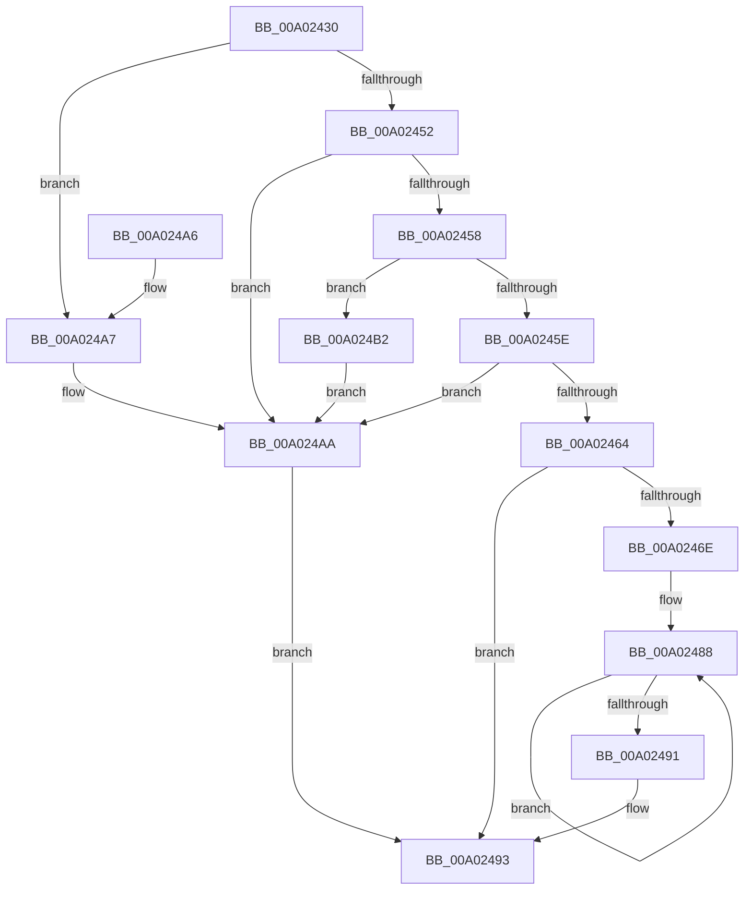

# GetConditionToken

- RVA: `0x00A02430`–`0x00A024B7` (길이 `135` bytes)
- VA: `0x0000000140A02430`
- 실행 섹션: `PAGE`
- PDB 이름 있음: `예`; PDB Function 태그: `아니요`
- unwind 정보 RVA: `0x00083408`
- 디코드: `42`개 명령, `135/135` bytes 표시
- 미해석 바이트: `0` (있으면 어셈블리에 `.byte`로 보존)

> 이 문서는 커널 이미지의 기계어와 PDB 기호를 분석해 생성했습니다. 4번과 5번은 함수 원형과 자료형을 바이너리 사용 방식에서 추정한 C 해석이며 원본 소스 복구 결과는 아닙니다.

## 1. Dependencies

- 직접 호출 지점: **1**; 고유 호출 대상: **1**
- 직접 호출자로 확인된 함수: **1**
- RIP 상대 이미지 참조: **1**

### Outgoing calls
- `0x00A02464` → [GetOperatorIndexByName](GetOperatorIndexByName_function_00A029E0.md) (function, `0x00A029E0`)

### Direct callers
- [LocalGetConditionForString](LocalGetConditionForString_function_00A01C20.md) at `0x00A01D96`

### Static image references
- `0x00A02474` → RVA `0x00002BB0` (`.rdata`; read)

## 2. Other-region calls and transfers

- 다른 실행 섹션으로 향하는 call: **0**
- 별도 외부 분기/꼬리 이동을 확인하지 못했습니다.

## 3. Assembly (complete function range)

```asm
00A02430  48 89 5C 24 08                  mov qword ptr [rsp + 8], rbx
00A02435  48 89 74 24 10                  mov qword ptr [rsp + 0x10], rsi
00A0243A  57                              push rdi
00A0243B  48 83 EC 20                     sub rsp, 0x20
00A0243F  0F B7 01                        movzx eax, word ptr [rcx]
00A02442  33 F6                           xor esi, esi
00A02444  89 32                           mov dword ptr [rdx], esi
00A02446  48 8B DA                        mov rbx, rdx
00A02449  40 8A FE                        mov dil, sil
00A0244C  66 83 F8 28                     cmp ax, 0x28
00A02450  74 55                           je 0x140a024a7
00A02452  66 83 F8 7B                     cmp ax, 0x7b
00A02456  74 52                           je 0x140a024aa
00A02458  66 83 F8 29                     cmp ax, 0x29
00A0245C  74 54                           je 0x140a024b2
00A0245E  66 83 F8 7D                     cmp ax, 0x7d
00A02462  74 46                           je 0x140a024aa
00A02464  E8 77 05 00 00                  call 0x140a029e0
00A02469  83 F8 FF                        cmp eax, -1
00A0246C  74 25                           je 0x140a02493
00A0246E  8B C0                           mov eax, eax
00A02470  48 8D 0C 40                     lea rcx, [rax + rax*2]
00A02474  48 8D 05 35 07 60 FF            lea rax, [rip - 0x9ff8cb]
00A0247B  40 8A 7C C8 08                  mov dil, byte ptr [rax + rcx*8 + 8]
00A02480  48 8B 04 C8                     mov rax, qword ptr [rax + rcx*8]
00A02484  48 83 C9 FF                     or rcx, 0xffffffffffffffff
00A02488  48 FF C1                        inc rcx
00A0248B  66 39 34 48                     cmp word ptr [rax + rcx*2], si
00A0248F  75 F7                           jne 0x140a02488
00A02491  89 0B                           mov dword ptr [rbx], ecx
00A02493  48 8B 5C 24 30                  mov rbx, qword ptr [rsp + 0x30]
00A02498  40 8A C7                        mov al, dil
00A0249B  48 8B 74 24 38                  mov rsi, qword ptr [rsp + 0x38]
00A024A0  48 83 C4 20                     add rsp, 0x20
00A024A4  5F                              pop rdi
00A024A5  C3                              ret
00A024A6  CC                              int3
00A024A7  40 B7 FE                        mov dil, 0xfe
00A024AA  C7 02 01 00 00 00               mov dword ptr [rdx], 1
00A024B0  EB E1                           jmp 0x140a02493
00A024B2  40 B7 FF                        mov dil, 0xff
00A024B5  EB F3                           jmp 0x140a024aa
```

## 4. C-style interpretation (structured pseudocode)

```c
__int64 __fastcall GetConditionToken(__int64 a1, __int64 a2)
{
    __int64 result;
    __int64 v_rsi;
    __int64 v_rsp;
    unsigned __int64 v_stack_p10;
    unsigned __int64 v_stack_p8;

    v_stack_p8 = v_rbx;
    v_stack_p10 = v_rsi;
    v_rsp = (v_rsp) - (32);
    v_rsi = 0;
    *(unsigned int *)(a2) = 0;
    if (((unsigned __int16)(*(unsigned __int16 *)(a1))) == 40) goto loc_00A024A7;
    if (((unsigned __int16)(*(unsigned __int16 *)(a1))) == 123) goto loc_00A024AA;
    if (((unsigned __int16)(*(unsigned __int16 *)(a1))) == 41) goto loc_00A024B2;
    if (((unsigned __int16)(*(unsigned __int16 *)(a1))) == 125) goto loc_00A024AA;
    result = GetOperatorIndexByName(a1, a2, a3, a4);
    if (((unsigned int)(result)) == -1) goto loc_00A02493;
    a1 = ((unsigned int)((unsigned int)(result)) + (unsigned int)((unsigned int)(result)) * 2) | (-1);
loc_00A02488:
    a1 = (a1) + 1;
    if ((*(unsigned __int16 *)(*(unsigned __int64 *)(v_rip - 10483915 + (unsigned int)((unsigned int)(result)) + (unsigned int)((unsigned int)(result)) * 2 * 8) + a1 * 2)) != 0) goto loc_00A02488;
    *(unsigned int *)(a2) = (unsigned int)(a1);
loc_00A02493:
    v_rsp = (v_rsp) + (32);
    return (unsigned __int8)(*(unsigned __int8 *)(v_rip - 10483915 + (unsigned int)((unsigned int)(result)) + (unsigned int)((unsigned int)(result)) * 2 * 8 + 8));
loc_00A024A7:
loc_00A024AA:
    *(unsigned int *)(a2) = 1;
    goto loc_00A02493;
loc_00A024B2:
    goto loc_00A024AA;
}
```

## 5. (Beta) C Style

```c
int64_t GetConditionToken(void *Arg1, void *Arg2)
{
    uint8_t *arg1 = (uint8_t *)Arg1;
    uint8_t *arg2 = (uint8_t *)Arg2;

    int64_t result;
    int64_t local_rsi;
    int64_t local_rsp;
    uint64_t v_stack_p10;
    uint64_t v_stack_p8;

    v_stack_p8 = local_rbx;
    v_stack_p10 = local_rsi;
    local_rsp = (local_rsp) - (32);
    local_rsi = 0;
    *(uint32_t *)(arg2) = 0;
    if (((uint16_t)(*(uint16_t *)(arg1))) == 40) goto loc_00A024A7;
    if (((uint16_t)(*(uint16_t *)(arg1))) == 123) goto loc_00A024AA;
    if (((uint16_t)(*(uint16_t *)(arg1))) == 41) goto loc_00A024B2;
    if (((uint16_t)(*(uint16_t *)(arg1))) == 125) goto loc_00A024AA;
    result = GetOperatorIndexByName(Arg1, Arg2, a3, a4);
    if (((uint32_t)(result)) == -1) goto loc_00A02493;
    Arg1 = ((uint32_t)((uint32_t)(result)) + (uint32_t)((uint32_t)(result)) * 2) | (-1);
loc_00A02488:
    Arg1 = (Arg1) + 1;
    if ((*(uint16_t *)(*(uint64_t *)(v_rip - 0x9FF8CB + (uint32_t)((uint32_t)(result)) + (uint32_t)((uint32_t)(result)) * 2 * 8) + arg1 * 2)) != 0) goto loc_00A02488;
    *(uint32_t *)(arg2) = (uint32_t)(Arg1);
loc_00A02493:
    local_rsp = (local_rsp) + (32);
    return (uint8_t)(*(uint8_t *)(v_rip - 0x9FF8CB + (uint32_t)((uint32_t)(result)) + (uint32_t)((uint32_t)(result)) * 2 * 8 + 0x8));
loc_00A024A7:
loc_00A024AA:
    *(uint32_t *)(arg2) = 1;
    goto loc_00A02493;
loc_00A024B2:
    goto loc_00A024AA;
}
```

### 관측된 메모리 오프셋

구조체 형식이 확인되지 않은 접근은 인자 기준의 오프셋으로만 기록했습니다.

| 기준 인자 | 오프셋 표현 | 폭 (bit) | 접근 |
|---|---:|---:|---|
| `Arg1` | `+ 0x0` | `16` | `R` |
| `Arg2` | `+ 0x0` | `32` | `W` |

## 6. Execution-region graph

[열기: 2D/3D 그래프와 함수 탐색 컨트롤 패널](../../../control-panel.html?section=page&rva=0x00A02430&view=graph)

- 2D 그래프는 위에서 아래로 흐르고, 3D 그래프는 빈 공간을 드래그해 회전합니다. Shift+드래그는 이동, 휠은 확대·축소, 함수 노드 선택은 대상 보고서 이동입니다.

### Static fallback


