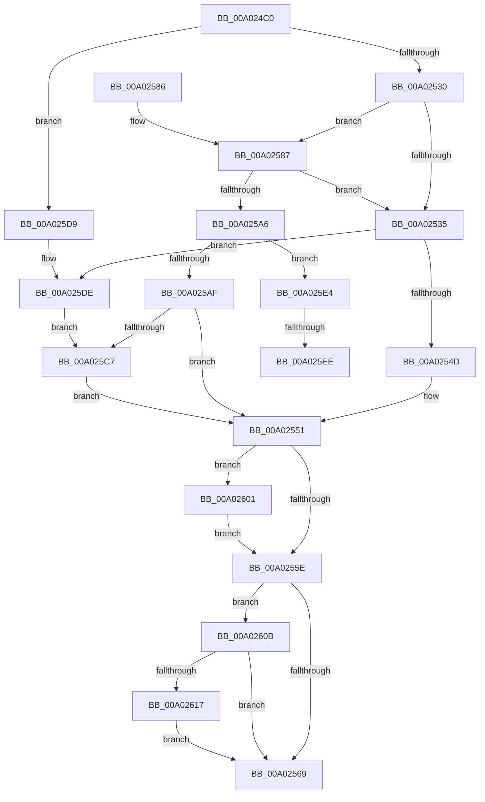

# GetOperandValue

- RVA: `0x00A024C0`–`0x00A02624` (길이 `356` bytes)
- VA: `0x0000000140A024C0`
- 실행 섹션: `PAGE`
- PDB 이름 있음: `예`; PDB Function 태그: `예`
- unwind 정보 RVA: `0x000A7ECC`
- 디코드: `103`개 명령, `356/356` bytes 표시
- 미해석 바이트: `0` (있으면 어셈블리에 `.byte`로 보존)

> 이 문서는 커널 이미지의 기계어와 PDB 기호를 분석해 생성했습니다. 4번과 5번은 함수 원형과 자료형을 바이너리 사용 방식에서 추정한 C 해석이며 원본 소스 복구 결과는 아닙니다.

## 1. Dependencies

- 직접 호출 지점: **7**; 고유 호출 대상: **6**
- 직접 호출자로 확인된 함수: **2**
- RIP 상대 이미지 참조: **1**

### Outgoing calls
- `0x00A0251F` → [SddlpAlloc](../92/SddlpAlloc_function_00925F88.md) (function, `0x00925F88`)
- `0x00A0253E` → [GetAttributeName](GetAttributeName_function_00A02768.md) (function, `0x00A02768`)
- `0x00A0259A` → [wcsnicmp](../../text/50/wcsnicmp_function_005001C0.md) (function, `0x005001C0`)
- `0x00A025B8` → [GetStringOperandValue](GetStringOperandValue_function_00A02B74.md) (function, `0x00A02B74`)
- `0x00A025CA` → [FreeOperandValue](FreeOperandValue_function_00A0262C.md) (function, `0x00A0262C`)
- `0x00A02601` → [FreeOperandValue](FreeOperandValue_function_00A0262C.md) (function, `0x00A0262C`)
- `0x00A0261A` → [PdcCloseEvent](../8D/PdcCloseEvent_function_008D2404.md) (function, `0x008D2404`)

### Direct callers
- [LocalGetConditionForString](LocalGetConditionForString_function_00A01C20.md) at `0x00A01EA5`
- [sub_00B32FE4](../B3/Unknown_function_00B32FE4.md) at `0x00B33039`

### Static image references
- `0x00A0258D` → RVA `0x00014AE4` (`.rdata`; read)

## 2. Other-region calls and transfers

- 다른 실행 섹션으로 향하는 call: **1**
  - `0x00A0259A` → [wcsnicmp](../../text/50/wcsnicmp_function_005001C0.md) (`PAGE` → `.text`)
- call이 아닌 외부 분기/꼬리 이동: **2**
  - `0x00A025E8` → [sub_00B32FE4 + 0x1E1](../B3/Unknown_function_00B32FE4.md) (`tail-transfer`)
  - `0x00A025FC` → [sub_00B32FE4](../B3/Unknown_function_00B32FE4.md) (`tail-transfer`)

## 3. Assembly (complete function range)

```asm
00A024C0  48 89 5C 24 08                  mov qword ptr [rsp + 8], rbx
00A024C5  44 88 44 24 18                  mov byte ptr [rsp + 0x18], r8b
00A024CA  55                              push rbp
00A024CB  56                              push rsi
00A024CC  57                              push rdi
00A024CD  41 54                           push r12
00A024CF  41 55                           push r13
00A024D1  41 56                           push r14
00A024D3  41 57                           push r15
00A024D5  48 8B EC                        mov rbp, rsp
00A024D8  48 81 EC 80 00 00 00            sub rsp, 0x80
00A024DF  4C 8B 7D 60                     mov r15, qword ptr [rbp + 0x60]
00A024E3  33 C0                           xor eax, eax
00A024E5  48 8B D9                        mov rbx, rcx
00A024E8  89 45 70                        mov dword ptr [rbp + 0x70], eax
00A024EB  49 8B F9                        mov rdi, r9
00A024EE  88 45 68                        mov byte ptr [rbp + 0x68], al
00A024F1  44 8A E2                        mov r12b, dl
00A024F4  88 45 58                        mov byte ptr [rbp + 0x58], al
00A024F7  8D 48 10                        lea ecx, [rax + 0x10]
00A024FA  48 89 45 E8                     mov qword ptr [rbp - 0x18], rax
00A024FE  8B F0                           mov esi, eax
00A02500  48 89 45 D0                     mov qword ptr [rbp - 0x30], rax
00A02504  48 89 45 E0                     mov qword ptr [rbp - 0x20], rax
00A02508  44 8A E8                        mov r13b, al
00A0250B  88 85 80 00 00 00               mov byte ptr [rbp + 0x80], al
00A02511  48 89 45 D8                     mov qword ptr [rbp - 0x28], rax
00A02515  48 89 45 F0                     mov qword ptr [rbp - 0x10], rax
00A02519  89 45 78                        mov dword ptr [rbp + 0x78], eax
00A0251C  41 89 07                        mov dword ptr [r15], eax
00A0251F  E8 64 3A F2 FF                  call 0x140925f88
00A02524  48 89 07                        mov qword ptr [rdi], rax
00A02527  48 85 C0                        test rax, rax
00A0252A  0F 84 A9 00 00 00               je 0x140a025d9
00A02530  45 84 E4                        test r12b, r12b
00A02533  74 52                           je 0x140a02587
00A02535  4D 8B C7                        mov r8, r15
00A02538  48 8B D7                        mov rdx, rdi
00A0253B  48 8B CB                        mov rcx, rbx
00A0253E  E8 25 02 00 00                  call 0x140a02768
00A02543  8B F0                           mov esi, eax
00A02545  85 C0                           test eax, eax
00A02547  0F 85 91 00 00 00               jne 0x140a025de
00A0254D  48 8B 5D D0                     mov rbx, qword ptr [rbp - 0x30]
00A02551  48 8B 4D D8                     mov rcx, qword ptr [rbp - 0x28]
00A02555  48 85 C9                        test rcx, rcx
00A02558  0F 85 A3 00 00 00               jne 0x140a02601
00A0255E  33 C9                           xor ecx, ecx
00A02560  48 85 DB                        test rbx, rbx
00A02563  0F 85 A2 00 00 00               jne 0x140a0260b
00A02569  48 8B 9C 24 C0 00 00 00         mov rbx, qword ptr [rsp + 0xc0]
00A02571  8B C6                           mov eax, esi
00A02573  48 81 C4 80 00 00 00            add rsp, 0x80
00A0257A  41 5F                           pop r15
00A0257C  41 5E                           pop r14
00A0257E  41 5D                           pop r13
00A02580  41 5C                           pop r12
00A02582  5F                              pop rdi
00A02583  5E                              pop rsi
00A02584  5D                              pop rbp
00A02585  C3                              ret
00A02586  CC                              int3
00A02587  41 BE 01 00 00 00               mov r14d, 1
00A0258D  48 8D 15 50 25 61 FF            lea rdx, [rip - 0x9edab0]
00A02594  45 8B C6                        mov r8d, r14d
00A02597  48 8B CB                        mov rcx, rbx
00A0259A  E8 21 DC AF FF                  call 0x1405001c0
00A0259F  45 33 E4                        xor r12d, r12d
00A025A2  85 C0                           test eax, eax
00A025A4  74 8F                           je 0x140a02535
00A025A6  0F B7 03                        movzx eax, word ptr [rbx]
00A025A9  66 83 F8 22                     cmp ax, 0x22
00A025AD  75 35                           jne 0x140a025e4
00A025AF  4D 8B C7                        mov r8, r15
00A025B2  48 8B D7                        mov rdx, rdi
00A025B5  48 8B CB                        mov rcx, rbx
00A025B8  E8 B7 05 00 00                  call 0x140a02b74
00A025BD  48 8B 5D D0                     mov rbx, qword ptr [rbp - 0x30]
00A025C1  8B F0                           mov esi, eax
00A025C3  85 C0                           test eax, eax
00A025C5  74 8A                           je 0x140a02551
00A025C7  48 8B 0F                        mov rcx, qword ptr [rdi]
00A025CA  E8 5D 00 00 00                  call 0x140a0262c
00A025CF  33 C9                           xor ecx, ecx
00A025D1  48 89 0F                        mov qword ptr [rdi], rcx
00A025D4  E9 78 FF FF FF                  jmp 0x140a02551
00A025D9  BE 08 00 00 00                  mov esi, 8
00A025DE  48 8B 5D D0                     mov rbx, qword ptr [rbp - 0x30]
00A025E2  EB E3                           jmp 0x140a025c7
00A025E4  66 83 F8 7B                     cmp ax, 0x7b
00A025E8  0F 85 D7 0B 13 00               jne 0x140b331c5
00A025EE  48 8B 07                        mov rax, qword ptr [rdi]
00A025F1  41 8B CE                        mov ecx, r14d
00A025F4  44 89 75 70                     mov dword ptr [rbp + 0x70], r14d
00A025F8  C6 40 01 50                     mov byte ptr [rax + 1], 0x50
00A025FC  E9 E3 09 13 00                  jmp 0x140b32fe4
00A02601  E8 26 00 00 00                  call 0x140a0262c
00A02606  E9 53 FF FF FF                  jmp 0x140a0255e
00A0260B  38 8D 80 00 00 00               cmp byte ptr [rbp + 0x80], cl
00A02611  0F 84 52 FF FF FF               je 0x140a02569
00A02617  48 8B CB                        mov rcx, rbx
00A0261A  E8 E5 FD EC FF                  call 0x1408d2404
00A0261F  E9 45 FF FF FF                  jmp 0x140a02569
```

## 4. C-style interpretation (structured pseudocode)

```c
__int64 __fastcall GetOperandValue(__int64 a1, unsigned __int8 a2, unsigned __int8 a3, __int64 a4, __int64 a5, __int64 a6, __int64 a7, __int64 a8, unsigned __int8 a9)
{
    __int64 result;
    __int64 v_r12;
    __int64 v_rsp;
    unsigned __int64 v_stack_m48;
    unsigned __int64 v_stack_m50;
    unsigned __int64 v_stack_m58;
    unsigned __int64 v_stack_m60;
    unsigned __int64 v_stack_m68;
    unsigned __int8 v_stack_p18;
    unsigned __int8 v_stack_p20;
    unsigned __int8 v_stack_p30;
    unsigned int v_stack_p38;
    unsigned int v_stack_p40;
    unsigned __int8 v_stack_p48;
    unsigned __int64 v_stack_p8;

    v_stack_p8 = v_rbx;
    v_stack_p18 = a3;
    v_rsp = (v_rsp) - (128);
    result = 0;
    v_stack_p38 = 0;
    v_stack_p30 = 0;
    v_stack_p20 = 0;
    v_stack_m50 = 0;
    v_stack_m68 = 0;
    v_stack_m58 = 0;
    v_stack_p48 = 0;
    v_stack_m60 = 0;
    v_stack_m48 = 0;
    v_stack_p40 = 0;
    *(unsigned int *)(a5) = 0;
    result = SddlpAlloc(result + 16, a2, a3, a4);
    *(unsigned __int64 *)(a4) = result;
    if (result == 0) goto loc_00A025D9;
    if (a2 == 0) goto loc_00A02587;
loc_00A02535:
    result = GetAttributeName(a1, a4, a5, a4);
    if ((unsigned int)(result) != 0) goto loc_00A025DE;
loc_00A02551:
    if (v_stack_m60 != 0) goto loc_00A02601;
loc_00A0255E:
    a1 = 0;
    if (v_stack_m68 != 0) goto loc_00A0260B;
loc_00A02569:
    v_rsp = (v_rsp) + (128);
    return (unsigned int)((unsigned int)((unsigned int)((unsigned int)(result))));
loc_00A02587:
    result = wcsnicmp(v_stack_p8, v_rip - 10410672, 1, a4);
    v_r12 = 0;
    if ((unsigned int)(result) == 0) goto loc_00A02535;
    if (((unsigned __int16)(*(unsigned __int16 *)(v_stack_p8))) != 34) goto loc_00A025E4;
    result = GetStringOperandValue(v_stack_p8, a4, a5, a4);
    if ((unsigned int)(result) == 0) goto loc_00A02551;
loc_00A025C7:
    result = FreeOperandValue(*(unsigned __int64 *)(a4), a4, a5, a4);
    a1 = 0;
    *(unsigned __int64 *)(a4) = 0;
    goto loc_00A02551;
loc_00A025D9:
loc_00A025DE:
    goto loc_00A025C7;
loc_00A025E4:
    v_stack_p38 = 1;
    *(unsigned __int8 *)(*(unsigned __int64 *)(a4) + 1) = 80;
loc_00A02601:
    result = FreeOperandValue(1, a4, a5, a4);
    goto loc_00A0255E;
loc_00A0260B:
    if (a9 == 1) goto loc_00A02569;
    result = PdcCloseEvent(v_stack_m68, a4, a5, a4);
    goto loc_00A02569;
}
```

## 5. (Beta) C Style

```c
int64_t GetOperandValue(void *Arg1, uint8_t Arg2, uint8_t Arg3, void *Arg4, void *Arg5, uint64_t Arg6, uint64_t Arg7, uint64_t Arg8, uint8_t Arg9)
{
    uint8_t *arg1 = (uint8_t *)Arg1;
    uint8_t *arg4 = (uint8_t *)Arg4;
    uint8_t *arg5 = (uint8_t *)Arg5;

    int64_t result;
    int64_t local_r12;
    int64_t local_rsp;
    uint64_t v_stack_m48;
    uint64_t v_stack_m50;
    uint64_t v_stack_m58;
    uint64_t v_stack_m60;
    uint64_t v_stack_m68;
    uint8_t v_stack_p18;
    uint8_t v_stack_p20;
    uint8_t v_stack_p30;
    uint32_t v_stack_p38;
    uint32_t v_stack_p40;
    uint8_t v_stack_p48;
    uint64_t v_stack_p8;

    v_stack_p8 = local_rbx;
    v_stack_p18 = Arg3;
    local_rsp = (local_rsp) - (128);
    result = 0;
    v_stack_p38 = 0;
    v_stack_p30 = 0;
    v_stack_p20 = 0;
    v_stack_m50 = 0;
    v_stack_m68 = 0;
    v_stack_m58 = 0;
    v_stack_p48 = 0;
    v_stack_m60 = 0;
    v_stack_m48 = 0;
    v_stack_p40 = 0;
    *(uint32_t *)(arg5) = 0;
    result = SddlpAlloc(result + 16, Arg2, Arg3, Arg4);
    *(uint64_t *)(arg4) = result;
    if (result == 0) goto loc_00A025D9;
    if (Arg2 == 0) goto loc_00A02587;
loc_00A02535:
    result = GetAttributeName(Arg1, Arg4, Arg5, Arg4);
    if ((uint32_t)(result) != 0) goto loc_00A025DE;
loc_00A02551:
    if (v_stack_m60 != 0) goto loc_00A02601;
loc_00A0255E:
    Arg1 = 0;
    if (v_stack_m68 != 0) goto loc_00A0260B;
loc_00A02569:
    local_rsp = (local_rsp) + (128);
    return (uint32_t)((uint32_t)((uint32_t)((uint32_t)(result))));
loc_00A02587:
    result = wcsnicmp(v_stack_p8, v_rip - 10410672, 1, Arg4);
    local_r12 = 0;
    if ((uint32_t)(result) == 0) goto loc_00A02535;
    if (((uint16_t)(*(uint16_t *)(v_stack_p8))) != 34) goto loc_00A025E4;
    result = GetStringOperandValue(v_stack_p8, Arg4, Arg5, Arg4);
    if ((uint32_t)(result) == 0) goto loc_00A02551;
loc_00A025C7:
    result = FreeOperandValue(*(uint64_t *)(arg4), Arg4, Arg5, Arg4);
    Arg1 = 0;
    *(uint64_t *)(arg4) = 0;
    goto loc_00A02551;
loc_00A025D9:
loc_00A025DE:
    goto loc_00A025C7;
loc_00A025E4:
    v_stack_p38 = 1;
    *(uint8_t *)(*(uint64_t *)(arg4) + 0x1) = 80;
loc_00A02601:
    result = FreeOperandValue(1, Arg4, Arg5, Arg4);
    goto loc_00A0255E;
loc_00A0260B:
    if (Arg9 == 1) goto loc_00A02569;
    result = PdcCloseEvent(v_stack_m68, Arg4, Arg5, Arg4);
    goto loc_00A02569;
}
```

### 관측된 메모리 오프셋

구조체 형식이 확인되지 않은 접근은 인자 기준의 오프셋으로만 기록했습니다.

| 기준 인자 | 오프셋 표현 | 폭 (bit) | 접근 |
|---|---:|---:|---|
| `Arg1` | `+ 0x0` | `16` | `R` |
| `Arg4` | `+ 0x0` | `64` | `R` |
| `Arg4` | `+ 0x0` | `64` | `W` |
| `Arg5` | `+ 0x0` | `32` | `W` |

## 6. Execution-region graph

[열기: 2D/3D 그래프와 함수 탐색 컨트롤 패널](../../../control-panel.html?section=page&rva=0x00A024C0&view=graph)

- 2D 그래프는 위에서 아래로 흐르고, 3D 그래프는 빈 공간을 드래그해 회전합니다. Shift+드래그는 이동, 휠은 확대·축소, 함수 노드 선택은 대상 보고서 이동입니다.

### Static fallback


