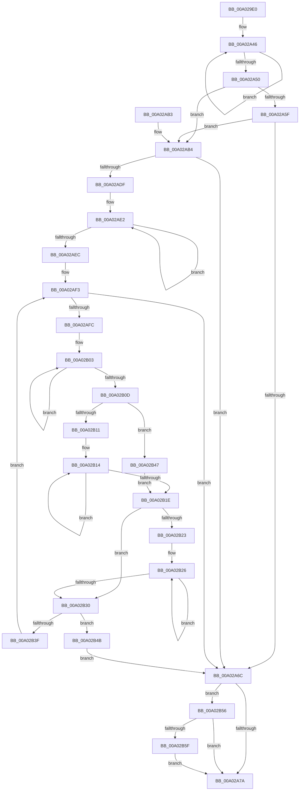

# GetOperatorIndexByName

- RVA: `0x00A029E0`–`0x00A02B6C` (길이 `396` bytes)
- VA: `0x0000000140A029E0`
- 실행 섹션: `PAGE`
- PDB 이름 있음: `예`; PDB Function 태그: `아니요`
- unwind 정보 RVA: `0x000A7F58`
- 디코드: `109`개 명령, `396/396` bytes 표시
- 미해석 바이트: `0` (있으면 어셈블리에 `.byte`로 보존)

> 이 문서는 커널 이미지의 기계어와 PDB 기호를 분석해 생성했습니다. 4번과 5번은 함수 원형과 자료형을 바이너리 사용 방식에서 추정한 C 해석이며 원본 소스 복구 결과는 아닙니다.

## 1. Dependencies

- 직접 호출 지점: **6**; 고유 호출 대상: **6**
- 직접 호출자로 확인된 함수: **1**
- RIP 상대 이미지 참조: **4**

### Outgoing calls
- `0x00A02A5F` → [SddlpAlloc](../92/SddlpAlloc_function_00925F88.md) (function, `0x00925F88`)
- `0x00A02A8D` → [_security_check_cookie](../../text/6A/_security_check_cookie_function_006AC640.md) (function, `0x006AC640`)
- `0x00A02AC0` → [wcsncpy_s](../../text/50/wcsncpy_s_function_00506650.md) (function, `0x00506650`)
- `0x00A02AD2` → [wcstok_s](../../text/50/wcstok_s_function_00506754.md) (function, `0x00506754`)
- `0x00A02B36` → [wcsnicmp](../../text/50/wcsnicmp_function_005001C0.md) (function, `0x005001C0`)
- `0x00A02B62` → [PdcCloseEvent](../8D/PdcCloseEvent_function_008D2404.md) (function, `0x008D2404`)

### Direct callers
- [GetConditionToken](GetConditionToken_function_00A02430.md) at `0x00A02464`

### Static image references
- `0x00A029FF` → RVA `0x00E0A740` (`.data`; read)
- `0x00A02A11` → RVA `0x00014AB8` (`.rdata`; read)
- `0x00A02A1C` → RVA `0x00014AB0` (`.rdata`; read)
- `0x00A02AEC` → RVA `0x00002BC4` (`.rdata`; read)

## 2. Other-region calls and transfers

- 다른 실행 섹션으로 향하는 call: **4**
  - `0x00A02A8D` → [_security_check_cookie](../../text/6A/_security_check_cookie_function_006AC640.md) (`PAGE` → `.text`)
  - `0x00A02AC0` → [wcsncpy_s](../../text/50/wcsncpy_s_function_00506650.md) (`PAGE` → `.text`)
  - `0x00A02AD2` → [wcstok_s](../../text/50/wcstok_s_function_00506754.md) (`PAGE` → `.text`)
  - `0x00A02B36` → [wcsnicmp](../../text/50/wcsnicmp_function_005001C0.md) (`PAGE` → `.text`)
- 별도 외부 분기/꼬리 이동을 확인하지 못했습니다.

## 3. Assembly (complete function range)

```asm
00A029E0  48 89 5C 24 10                  mov qword ptr [rsp + 0x10], rbx
00A029E5  48 89 6C 24 18                  mov qword ptr [rsp + 0x18], rbp
00A029EA  48 89 74 24 20                  mov qword ptr [rsp + 0x20], rsi
00A029EF  57                              push rdi
00A029F0  41 54                           push r12
00A029F2  41 55                           push r13
00A029F4  41 56                           push r14
00A029F6  41 57                           push r15
00A029F8  48 81 EC D0 00 00 00            sub rsp, 0xd0
00A029FF  48 8B 05 3A 7D 40 00            mov rax, qword ptr [rip + 0x407d3a]
00A02A06  48 33 C4                        xor rax, rsp
00A02A09  48 89 84 24 C0 00 00 00         mov qword ptr [rsp + 0xc0], rax
00A02A11  8B 05 A1 20 61 FF               mov eax, dword ptr [rip - 0x9edf5f]
00A02A17  48 8D 7C 24 40                  lea rdi, [rsp + 0x40]
00A02A1C  F2 0F 10 05 8C 20 61 FF         movsd xmm0, qword ptr [rip - 0x9edf74]
00A02A24  45 33 ED                        xor r13d, r13d
00A02A27  48 83 CB FF                     or rbx, 0xffffffffffffffff
00A02A2B  89 44 24 30                     mov dword ptr [rsp + 0x30], eax
00A02A2F  48 8B C3                        mov rax, rbx
00A02A32  F2 0F 11 44 24 28               movsd qword ptr [rsp + 0x28], xmm0
00A02A38  4C 8B F1                        mov r14, rcx
00A02A3B  4C 89 6C 24 20                  mov qword ptr [rsp + 0x20], r13
00A02A40  41 8B ED                        mov ebp, r13d
00A02A43  45 8B E5                        mov r12d, r13d
00A02A46  48 FF C0                        inc rax
00A02A49  66 44 39 2C 41                  cmp word ptr [rcx + rax*2], r13w
00A02A4E  75 F6                           jne 0x140a02a46
00A02A50  8B F0                           mov esi, eax
00A02A52  48 8D 0C 36                     lea rcx, [rsi + rsi]
00A02A56  48 81 F9 80 00 00 00            cmp rcx, 0x80
00A02A5D  76 55                           jbe 0x140a02ab4
00A02A5F  E8 24 35 F2 FF                  call 0x140925f88
00A02A64  48 8B F8                        mov rdi, rax
00A02A67  48 85 C0                        test rax, rax
00A02A6A  75 48                           jne 0x140a02ab4
00A02A6C  48 8D 44 24 40                  lea rax, [rsp + 0x40]
00A02A71  48 3B F8                        cmp rdi, rax
00A02A74  0F 85 DC 00 00 00               jne 0x140a02b56
00A02A7A  45 85 E4                        test r12d, r12d
00A02A7D  0F 45 DD                        cmovne ebx, ebp
00A02A80  8B C3                           mov eax, ebx
00A02A82  48 8B 8C 24 C0 00 00 00         mov rcx, qword ptr [rsp + 0xc0]
00A02A8A  48 33 CC                        xor rcx, rsp
00A02A8D  E8 AE 9B CA FF                  call 0x1406ac640
00A02A92  4C 8D 9C 24 D0 00 00 00         lea r11, [rsp + 0xd0]
00A02A9A  49 8B 5B 38                     mov rbx, qword ptr [r11 + 0x38]
00A02A9E  49 8B 6B 40                     mov rbp, qword ptr [r11 + 0x40]
00A02AA2  49 8B 73 48                     mov rsi, qword ptr [r11 + 0x48]
00A02AA6  49 8B E3                        mov rsp, r11
00A02AA9  41 5F                           pop r15
00A02AAB  41 5E                           pop r14
00A02AAD  41 5D                           pop r13
00A02AAF  41 5C                           pop r12
00A02AB1  5F                              pop rdi
00A02AB2  C3                              ret
00A02AB3  CC                              int3
00A02AB4  4C 8B CB                        mov r9, rbx
00A02AB7  4D 8B C6                        mov r8, r14
00A02ABA  48 8B D6                        mov rdx, rsi
00A02ABD  48 8B CF                        mov rcx, rdi
00A02AC0  E8 8B 3B B0 FF                  call 0x140506650
00A02AC5  4C 8D 44 24 20                  lea r8, [rsp + 0x20]
00A02ACA  48 8B CF                        mov rcx, rdi
00A02ACD  48 8D 54 24 28                  lea rdx, [rsp + 0x28]
00A02AD2  E8 7D 3C B0 FF                  call 0x140506754
00A02AD7  4C 8B F8                        mov r15, rax
00A02ADA  48 85 C0                        test rax, rax
00A02ADD  74 8D                           je 0x140a02a6c
00A02ADF  48 8B F3                        mov rsi, rbx
00A02AE2  48 FF C6                        inc rsi
00A02AE5  66 44 39 2C 70                  cmp word ptr [rax + rsi*2], r13w
00A02AEA  75 F6                           jne 0x140a02ae2
00A02AEC  4C 8D 35 D1 00 60 FF            lea r14, [rip - 0x9fff2f]
00A02AF3  83 FD 18                        cmp ebp, 0x18
00A02AF6  0F 83 70 FF FF FF               jae 0x140a02a6c
00A02AFC  49 8B 56 EC                     mov rdx, qword ptr [r14 - 0x14]
00A02B00  48 8B C3                        mov rax, rbx
00A02B03  48 FF C0                        inc rax
00A02B06  66 44 39 2C 42                  cmp word ptr [rdx + rax*2], r13w
00A02B0B  75 F6                           jne 0x140a02b03
00A02B0D  3B F0                           cmp esi, eax
00A02B0F  77 36                           ja 0x140a02b47
00A02B11  48 8B C3                        mov rax, rbx
00A02B14  48 FF C0                        inc rax
00A02B17  66 44 39 2C 42                  cmp word ptr [rdx + rax*2], r13w
00A02B1C  75 F6                           jne 0x140a02b14
00A02B1E  45 38 2E                        cmp byte ptr [r14], r13b
00A02B21  75 0D                           jne 0x140a02b30
00A02B23  48 8B C3                        mov rax, rbx
00A02B26  48 FF C0                        inc rax
00A02B29  66 44 39 2C 42                  cmp word ptr [rdx + rax*2], r13w
00A02B2E  75 F6                           jne 0x140a02b26
00A02B30  44 8B C0                        mov r8d, eax
00A02B33  49 8B CF                        mov rcx, r15
00A02B36  E8 85 D6 AF FF                  call 0x1405001c0
00A02B3B  85 C0                           test eax, eax
00A02B3D  74 0C                           je 0x140a02b4b
00A02B3F  FF C5                           inc ebp
00A02B41  49 83 C6 18                     add r14, 0x18
00A02B45  EB AC                           jmp 0x140a02af3
00A02B47  8B C6                           mov eax, esi
00A02B49  EB D3                           jmp 0x140a02b1e
00A02B4B  41 BC 01 00 00 00               mov r12d, 1
00A02B51  E9 16 FF FF FF                  jmp 0x140a02a6c
00A02B56  48 85 FF                        test rdi, rdi
00A02B59  0F 84 1B FF FF FF               je 0x140a02a7a
00A02B5F  48 8B CF                        mov rcx, rdi
00A02B62  E8 9D F8 EC FF                  call 0x1408d2404
00A02B67  E9 0E FF FF FF                  jmp 0x140a02a7a
```

## 4. C-style interpretation (structured pseudocode)

```c
__int64 __fastcall GetOperatorIndexByName(__int64 a1)
{
    __int64 result;
    __int64 v_r13;
    __int64 v_r14;
    __int64 v_rbp;
    __int64 v_rbx;
    __int64 v_rsi;
    __int64 v_rsp;
    unsigned __int64 v_stack_m28;
    unsigned __int64 v_stack_m38;
    unsigned __int64 v_stack_mA8;
    unsigned __int64 v_stack_mB0;
    unsigned __int64 v_stack_mB8;
    unsigned int v_stack_mC8;
    unsigned __int64 v_stack_mD0;
    unsigned __int64 v_stack_mD8;
    unsigned __int64 v_stack_p10;
    unsigned __int64 v_stack_p18;
    unsigned __int64 v_stack_p20;

    v_stack_p10 = v_rbx;
    v_stack_p18 = v_rbp;
    v_stack_p20 = v_rsi;
    v_rsp = (v_rsp) - (208);
    result = (*(unsigned __int64 *)(v_rip + 4226362)) ^ (v_rsp);
    v_stack_m38 = result;
    v_r13 = 0;
    v_rbx = (v_rbx) | (-1);
    v_stack_mC8 = (unsigned int)((unsigned int)(*(unsigned int *)(v_rip - 10411871)));
    v_stack_mD0 = v_xmm0;
    v_stack_mD8 = 0;
loc_00A02A46:
    result = (v_rbx) + 1;
    if ((*(unsigned __int16 *)(a1 + result * 2)) != 0) goto loc_00A02A46;
    if (((unsigned int)((unsigned int)(result)) + (unsigned int)((unsigned int)(result)) * 1) <= 128) goto loc_00A02AB4;
    result = SddlpAlloc((unsigned int)((unsigned int)(result)) + (unsigned int)((unsigned int)(result)) * 1, a2, a3, a4);
    if (result != 0) goto loc_00A02AB4;
loc_00A02A6C:
    if (result != v_stack_mB8) goto loc_00A02B56;
loc_00A02A7A:
    if (0 != 0) { v_rbx = 0; }
    a1 = (v_stack_m38) ^ (v_rsp);
    result = _security_check_cookie(a1, a2, a3, a4);
    return result;
loc_00A02AB4:
    result = wcsncpy_s(result, *(unsigned __int64 *)(v_stack_m28 + 72), a1, *(unsigned __int64 *)(v_stack_m28 + 56));
    result = wcstok_s(result, v_stack_mA8, v_stack_mB0, *(unsigned __int64 *)(v_stack_m28 + 56));
    if (result == 0) goto loc_00A02A6C;
loc_00A02AE2:
    v_rsi = (*(unsigned __int64 *)(v_stack_m28 + 56)) + 1;
    if ((*(unsigned __int16 *)(result + v_rsi * 2)) != 0) goto loc_00A02AE2;
loc_00A02AF3:
    if (((unsigned int)(*(unsigned __int64 *)(v_stack_m28 + 64))) >= 24) goto loc_00A02A6C;
loc_00A02B03:
    result = (*(unsigned __int64 *)(v_stack_m28 + 56)) + 1;
    if ((*(unsigned __int16 *)(*(unsigned __int64 *)(v_rip - 10485551 - 20) + result * 2)) != 0) goto loc_00A02B03;
    if (((unsigned int)(v_rsi)) > ((unsigned int)(result))) goto loc_00A02B47;
loc_00A02B14:
    result = (*(unsigned __int64 *)(v_stack_m28 + 56)) + 1;
    if ((*(unsigned __int16 *)(*(unsigned __int64 *)(v_rip - 10485551 - 20) + result * 2)) != 0) goto loc_00A02B14;
loc_00A02B1E:
    if ((*(unsigned __int8 *)(v_rip - 10485551)) != 0) goto loc_00A02B30;
loc_00A02B26:
    result = (*(unsigned __int64 *)(v_stack_m28 + 56)) + 1;
    if ((*(unsigned __int16 *)(*(unsigned __int64 *)(v_rip - 10485551 - 20) + result * 2)) != 0) goto loc_00A02B26;
loc_00A02B30:
    result = wcsnicmp(result, *(unsigned __int64 *)(v_rip - 10485551 - 20), (unsigned int)((unsigned int)(result)), *(unsigned __int64 *)(v_stack_m28 + 56));
    if ((unsigned int)(result) == 0) goto loc_00A02B4B;
    v_rbp = (unsigned int)((*(unsigned __int64 *)(v_stack_m28 + 64)) + 1);
    v_r14 = (v_rip - 10485551) + (24);
    goto loc_00A02AF3;
loc_00A02B47:
    goto loc_00A02B1E;
loc_00A02B4B:
    goto loc_00A02A6C;
loc_00A02B56:
    if (result == 0) goto loc_00A02A7A;
    result = PdcCloseEvent(result, *(unsigned __int64 *)(v_rip - 10485551 - 20), (unsigned int)((unsigned int)(result)), *(unsigned __int64 *)(v_stack_m28 + 56));
    goto loc_00A02A7A;
}
```

## 5. (Beta) C Style

```c
int64_t GetOperatorIndexByName(void *Arg1)
{
    uint8_t *arg1 = (uint8_t *)Arg1;

    int64_t result;
    int64_t local_r13;
    int64_t local_r14;
    int64_t local_rbp;
    int64_t local_rbx;
    int64_t local_rsi;
    int64_t local_rsp;
    uint64_t v_stack_m28;
    uint64_t v_stack_m38;
    uint64_t v_stack_mA8;
    uint64_t v_stack_mB0;
    uint64_t v_stack_mB8;
    uint32_t v_stack_mC8;
    uint64_t v_stack_mD0;
    uint64_t v_stack_mD8;
    uint64_t v_stack_p10;
    uint64_t v_stack_p18;
    uint64_t v_stack_p20;

    v_stack_p10 = local_rbx;
    v_stack_p18 = local_rbp;
    v_stack_p20 = local_rsi;
    local_rsp = (local_rsp) - (208);
    result = (*(uint64_t *)(v_rip + 0x407D3A)) ^ (local_rsp);
    v_stack_m38 = result;
    local_r13 = 0;
    local_rbx = (local_rbx) | (-1);
    v_stack_mC8 = (uint32_t)((uint32_t)(*(uint32_t *)(v_rip - 0x9EDF5F)));
    v_stack_mD0 = v_xmm0;
    v_stack_mD8 = 0;
loc_00A02A46:
    result = (local_rbx) + 1;
    if ((*(uint16_t *)(arg1 + result * 2)) != 0) goto loc_00A02A46;
    if (((uint32_t)((uint32_t)(result)) + (uint32_t)((uint32_t)(result)) * 1) <= 128) goto loc_00A02AB4;
    result = SddlpAlloc((uint32_t)((uint32_t)(result)) + (uint32_t)((uint32_t)(result)) * 1, a2, a3, a4);
    if (result != 0) goto loc_00A02AB4;
loc_00A02A6C:
    if (result != v_stack_mB8) goto loc_00A02B56;
loc_00A02A7A:
    if (0 != 0) { local_rbx = 0; }
    Arg1 = (v_stack_m38) ^ (local_rsp);
    result = _security_check_cookie(Arg1, a2, a3, a4);
    return result;
loc_00A02AB4:
    result = wcsncpy_s(result, *(uint64_t *)(v_stack_m28 + 0x48), Arg1, *(uint64_t *)(v_stack_m28 + 0x38));
    result = wcstok_s(result, v_stack_mA8, v_stack_mB0, *(uint64_t *)(v_stack_m28 + 0x38));
    if (result == 0) goto loc_00A02A6C;
loc_00A02AE2:
    local_rsi = (*(uint64_t *)(v_stack_m28 + 0x38)) + 1;
    if ((*(uint16_t *)(result + local_rsi * 2)) != 0) goto loc_00A02AE2;
loc_00A02AF3:
    if (((uint32_t)(*(uint64_t *)(v_stack_m28 + 0x40))) >= 24) goto loc_00A02A6C;
loc_00A02B03:
    result = (*(uint64_t *)(v_stack_m28 + 0x38)) + 1;
    if ((*(uint16_t *)(*(uint64_t *)(v_rip - 0x9FFF2F - 0x14) + result * 2)) != 0) goto loc_00A02B03;
    if (((uint32_t)(local_rsi)) > ((uint32_t)(result))) goto loc_00A02B47;
loc_00A02B14:
    result = (*(uint64_t *)(v_stack_m28 + 0x38)) + 1;
    if ((*(uint16_t *)(*(uint64_t *)(v_rip - 0x9FFF2F - 0x14) + result * 2)) != 0) goto loc_00A02B14;
loc_00A02B1E:
    if ((*(uint8_t *)(v_rip - 0x9FFF2F)) != 0) goto loc_00A02B30;
loc_00A02B26:
    result = (*(uint64_t *)(v_stack_m28 + 0x38)) + 1;
    if ((*(uint16_t *)(*(uint64_t *)(v_rip - 0x9FFF2F - 0x14) + result * 2)) != 0) goto loc_00A02B26;
loc_00A02B30:
    result = wcsnicmp(result, *(uint64_t *)(v_rip - 0x9FFF2F - 0x14), (uint32_t)((uint32_t)(result)), *(uint64_t *)(v_stack_m28 + 0x38));
    if ((uint32_t)(result) == 0) goto loc_00A02B4B;
    local_rbp = (uint32_t)((*(uint64_t *)(v_stack_m28 + 0x40)) + 1);
    local_r14 = (v_rip - 10485551) + (24);
    goto loc_00A02AF3;
loc_00A02B47:
    goto loc_00A02B1E;
loc_00A02B4B:
    goto loc_00A02A6C;
loc_00A02B56:
    if (result == 0) goto loc_00A02A7A;
    result = PdcCloseEvent(result, *(uint64_t *)(v_rip - 0x9FFF2F - 0x14), (uint32_t)((uint32_t)(result)), *(uint64_t *)(v_stack_m28 + 0x38));
    goto loc_00A02A7A;
}
```

### 관측된 메모리 오프셋

구조체 형식이 확인되지 않은 접근은 인자 기준의 오프셋으로만 기록했습니다.

| 기준 인자 | 오프셋 표현 | 폭 (bit) | 접근 |
|---|---:|---:|---|
| `Arg1` | `+ 0x0 + rax*2` | `16` | `R` |

## 6. Execution-region graph

[열기: 2D/3D 그래프와 함수 탐색 컨트롤 패널](../../../control-panel.html?section=page&rva=0x00A029E0&view=graph)

- 2D 그래프는 위에서 아래로 흐르고, 3D 그래프는 빈 공간을 드래그해 회전합니다. Shift+드래그는 이동, 휠은 확대·축소, 함수 노드 선택은 대상 보고서 이동입니다.

### Static fallback


