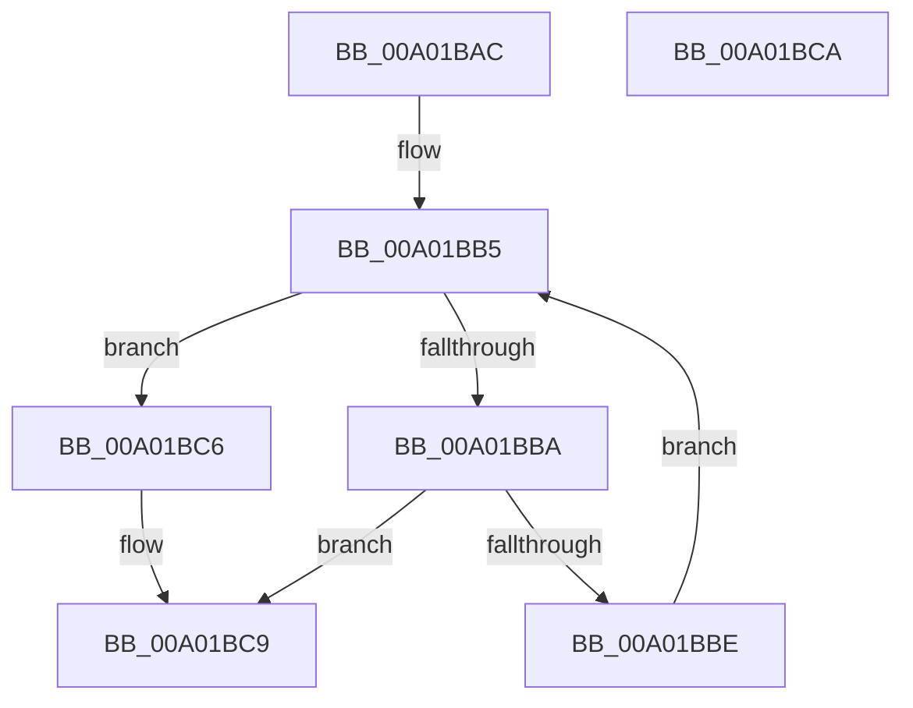

# GetOperatorIndexByToken

- RVA: `0x00A01BAC`–`0x00A01BCB` (길이 `31` bytes)
- VA: `0x0000000140A01BAC`
- 실행 섹션: `PAGE`
- PDB 이름 있음: `예`; PDB Function 태그: `아니요`
- unwind 정보 RVA: `0x000DB714`
- 디코드: `12`개 명령, `31/31` bytes 표시
- 미해석 바이트: `0` (있으면 어셈블리에 `.byte`로 보존)

> 이 문서는 커널 이미지의 기계어와 PDB 기호를 분석해 생성했습니다. 4번과 5번은 함수 원형과 자료형을 바이너리 사용 방식에서 추정한 C 해석이며 원본 소스 복구 결과는 아닙니다.

## 1. Dependencies

- 직접 호출 지점: **0**; 고유 호출 대상: **0**
- 직접 호출자로 확인된 함수: **2**
- RIP 상대 이미지 참조: **1**

### Outgoing calls
- 직접 디코드된 call 명령이 없습니다.

### Direct callers
- [LocalpGetStringForCondition](LocalpGetStringForCondition_function_00A0122C.md) at `0x00A0149C`
- [LocalGetConditionForString](LocalGetConditionForString_function_00A01C20.md) at `0x00A01FC2`
- [LocalGetConditionForString](LocalGetConditionForString_function_00A01C20.md) at `0x00A02039`
- [LocalGetConditionForString](LocalGetConditionForString_function_00A01C20.md) at `0x00A0204E`
- [LocalGetConditionForString](LocalGetConditionForString_function_00A01C20.md) at `0x00A020A3`
- [LocalGetConditionForString](LocalGetConditionForString_function_00A01C20.md) at `0x00A0218A`
- [LocalGetConditionForString](LocalGetConditionForString_function_00A01C20.md) at `0x00A021DE`
- [LocalGetConditionForString](LocalGetConditionForString_function_00A01C20.md) at `0x00A022B2`

### Static image references
- `0x00A01BAE` → RVA `0x00002BB8` (`.rdata`; read)

## 2. Other-region calls and transfers

- 다른 실행 섹션으로 향하는 call: **0**
- 별도 외부 분기/꼬리 이동을 확인하지 못했습니다.

## 3. Assembly (complete function range)

```asm
00A01BAC  33 C0                           xor eax, eax
00A01BAE  48 8D 15 03 10 60 FF            lea rdx, [rip - 0x9feffd]
00A01BB5  83 F8 18                        cmp eax, 0x18
00A01BB8  73 0C                           jae 0x140a01bc6
00A01BBA  38 0A                           cmp byte ptr [rdx], cl
00A01BBC  74 0B                           je 0x140a01bc9
00A01BBE  FF C0                           inc eax
00A01BC0  48 83 C2 18                     add rdx, 0x18
00A01BC4  EB EF                           jmp 0x140a01bb5
00A01BC6  83 C8 FF                        or eax, 0xffffffff
00A01BC9  C3                              ret
00A01BCA  CC                              int3
```

## 4. C-style interpretation (structured pseudocode)

```c
__int64 __fastcall GetOperatorIndexByToken(unsigned __int8 a1)
{
    __int64 result;

    result = 0;
loc_00A01BB5:
    if (0 >= 24) goto loc_00A01BC6;
    if ((*(unsigned __int8 *)(v_rip - 10481661)) == a1) goto loc_00A01BC9;
    result = (unsigned int)((result) + 1);
    a2 = (v_rip - 10481661) + (24);
    goto loc_00A01BB5;
loc_00A01BC6:
    result = (unsigned int)((result) | (0xFFFFFFFFULL));
loc_00A01BC9:
    return result;
}
```

## 5. (Beta) C Style

```c
int64_t GetOperatorIndexByToken(uint8_t Arg1)
{
    int64_t result;

    result = 0;
loc_00A01BB5:
    if (0 >= 24) goto loc_00A01BC6;
    if ((*(uint8_t *)(v_rip - 0x9FEFFD)) == Arg1) goto loc_00A01BC9;
    result = (uint32_t)((result) + 1);
    a2 = (v_rip - 10481661) + (24);
    goto loc_00A01BB5;
loc_00A01BC6:
    result = (uint32_t)((result) | (0xFFFFFFFFULL));
loc_00A01BC9:
    return result;
}
```

## 6. Execution-region graph

[열기: 2D/3D 그래프와 함수 탐색 컨트롤 패널](../../../control-panel.html?section=page&rva=0x00A01BAC&view=graph)

- 2D 그래프는 위에서 아래로 흐르고, 3D 그래프는 빈 공간을 드래그해 회전합니다. Shift+드래그는 이동, 휠은 확대·축소, 함수 노드 선택은 대상 보고서 이동입니다.

### Static fallback


