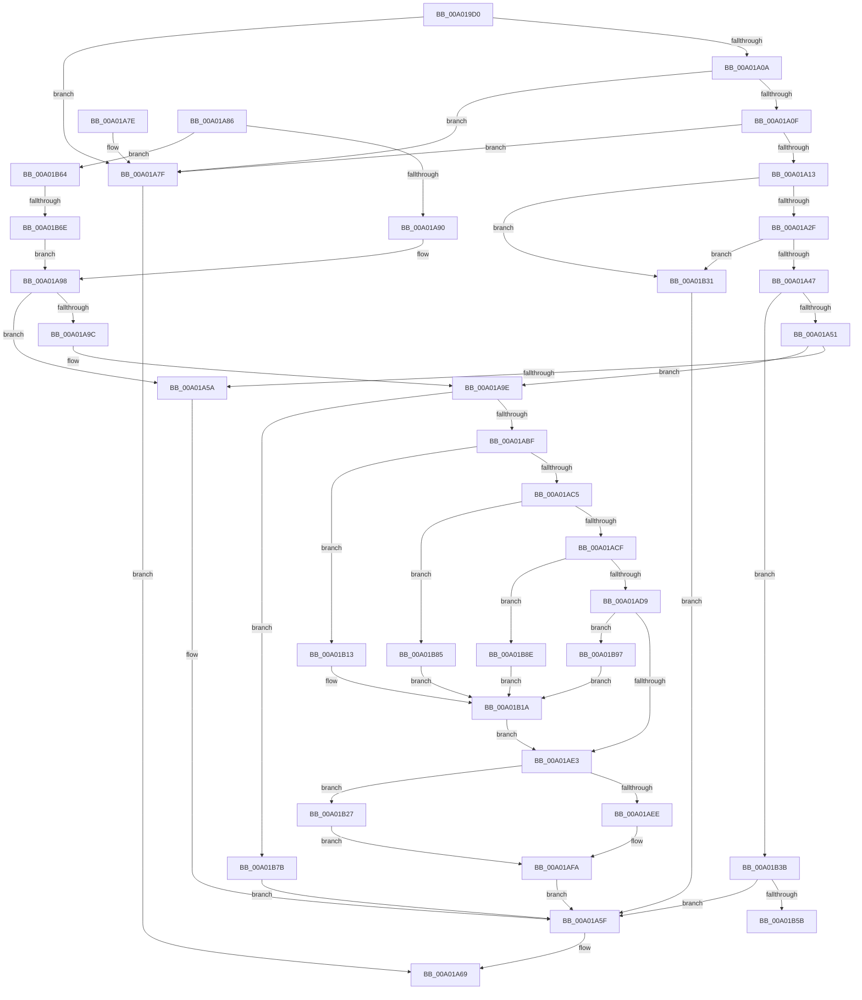

# GetPrintableAttributeName

- RVA: `0x00A019D0`–`0x00A01BA3` (길이 `467` bytes)
- VA: `0x0000000140A019D0`
- 실행 섹션: `PAGE`
- PDB 이름 있음: `예`; PDB Function 태그: `예`
- unwind 정보 RVA: `0x000A7E5C`
- 디코드: `127`개 명령, `467/467` bytes 표시
- 미해석 바이트: `0` (있으면 어셈블리에 `.byte`로 보존)

> 이 문서는 커널 이미지의 기계어와 PDB 기호를 분석해 생성했습니다. 4번과 5번은 함수 원형과 자료형을 바이너리 사용 방식에서 추정한 C 해석이며 원본 소스 복구 결과는 아닙니다.

## 1. Dependencies

- 직접 호출 지점: **5**; 고유 호출 대상: **4**
- 직접 호출자로 확인된 함수: **1**
- RIP 상대 이미지 참조: **4**

### Outgoing calls
- `0x00A01A62` → [PdcCloseEvent](../8D/PdcCloseEvent_function_008D2404.md) (function, `0x008D2404`)
- `0x00A01AA3` → [SddlpAlloc](../92/SddlpAlloc_function_00925F88.md) (function, `0x00925F88`)
- `0x00A01AFA` → [memcpy](../../text/6C/memcpy_function_006C6840.md) (function, `0x006C6840`)
- `0x00A01B20` → [memcpy](../../text/6C/memcpy_function_006C6840.md) (function, `0x006C6840`)
- `0x00A01B47` → [EncodeAttributeName](../7A/EncodeAttributeName_function_007A54D0.md) (function, `0x007A54D0`)

### Direct callers
- [LocalpGetStringForCondition](LocalpGetStringForCondition_function_00A0122C.md) at `0x00A01379`

### Static image references
- `0x00A01B13` → RVA `0x00014AD0` (`.rdata`; read)
- `0x00A01B85` → RVA `0x00014B00` (`.rdata`; read)
- `0x00A01B8E` → RVA `0x00014AE8` (`.rdata`; read)
- `0x00A01B97` → RVA `0x00014AC0` (`.rdata`; read)

## 2. Other-region calls and transfers

- 다른 실행 섹션으로 향하는 call: **2**
  - `0x00A01AFA` → [memcpy](../../text/6C/memcpy_function_006C6840.md) (`PAGE` → `.text`)
  - `0x00A01B20` → [memcpy](../../text/6C/memcpy_function_006C6840.md) (`PAGE` → `.text`)
- call이 아닌 외부 분기/꼬리 이동: **2**
  - `0x00A01B5F` → [sub_00B32EDE](../B3/Unknown_function_00B32EDE.md) (`tail-transfer`)
  - `0x00A01B68` → [sub_00B32EDE + 0x21](../B3/Unknown_function_00B32EDE.md) (`tail-transfer`)

## 3. Assembly (complete function range)

```asm
00A019D0  4C 8B DC                        mov r11, rsp
00A019D3  49 89 5B 10                     mov qword ptr [r11 + 0x10], rbx
00A019D7  4D 89 4B 20                     mov qword ptr [r11 + 0x20], r9
00A019DB  49 89 4B 08                     mov qword ptr [r11 + 8], rcx
00A019DF  55                              push rbp
00A019E0  56                              push rsi
00A019E1  57                              push rdi
00A019E2  41 54                           push r12
00A019E4  41 55                           push r13
00A019E6  41 56                           push r14
00A019E8  41 57                           push r15
00A019EA  48 83 EC 30                     sub rsp, 0x30
00A019EE  33 FF                           xor edi, edi
00A019F0  49 8B C1                        mov rax, r9
00A019F3  89 7C 24 28                     mov dword ptr [rsp + 0x28], edi
00A019F7  41 8A F0                        mov sil, r8b
00A019FA  49 89 7B B8                     mov qword ptr [r11 - 0x48], rdi
00A019FE  8B DF                           mov ebx, edi
00A01A00  8B EF                           mov ebp, edi
00A01A02  44 8B FF                        mov r15d, edi
00A01A05  48 85 C9                        test rcx, rcx
00A01A08  74 75                           je 0x140a01a7f
00A01A0A  48 85 C0                        test rax, rax
00A01A0D  74 70                           je 0x140a01a7f
00A01A0F  85 D2                           test edx, edx
00A01A11  74 6C                           je 0x140a01a7f
00A01A13  4C 8B A4 24 90 00 00 00         mov r12, qword ptr [rsp + 0x90]
00A01A1B  8D 42 FF                        lea eax, [rdx - 1]
00A01A1E  41 C7 04 24 01 00 00 00         mov dword ptr [r12], 1
00A01A26  83 F8 04                        cmp eax, 4
00A01A29  0F 82 02 01 00 00               jb 0x140a01b31
00A01A2F  44 8B 69 01                     mov r13d, dword ptr [rcx + 1]
00A01A33  8D 42 FB                        lea eax, [rdx - 5]
00A01A36  41 C7 04 24 05 00 00 00         mov dword ptr [r12], 5
00A01A3E  41 3B C5                        cmp eax, r13d
00A01A41  0F 82 EA 00 00 00               jb 0x140a01b31
00A01A47  41 80 F8 F8                     cmp r8b, 0xf8
00A01A4B  0F 85 EA 00 00 00               jne 0x140a01b3b
00A01A51  41 8D 45 02                     lea eax, [r13 + 2]
00A01A55  41 3B C5                        cmp eax, r13d
00A01A58  73 44                           jae 0x140a01a9e
00A01A5A  BB 16 02 00 00                  mov ebx, 0x216
00A01A5F  49 8B CF                        mov rcx, r15
00A01A62  E8 9D 09 ED FF                  call 0x1408d2404
00A01A67  8B C3                           mov eax, ebx
00A01A69  48 8B 5C 24 78                  mov rbx, qword ptr [rsp + 0x78]
00A01A6E  48 83 C4 30                     add rsp, 0x30
00A01A72  41 5F                           pop r15
00A01A74  41 5E                           pop r14
00A01A76  41 5D                           pop r13
00A01A78  41 5C                           pop r12
00A01A7A  5F                              pop rdi
00A01A7B  5E                              pop rsi
00A01A7C  5D                              pop rbp
00A01A7D  C3                              ret
00A01A7E  CC                              int3
00A01A7F  B8 57 00 00 00                  mov eax, 0x57
00A01A84  EB E3                           jmp 0x140a01a69
00A01A86  40 80 FE FB                     cmp sil, 0xfb
00A01A8A  0F 85 D4 00 00 00               jne 0x140a01b64
00A01A90  BD 10 00 00 00                  mov ebp, 0x10
00A01A95  8D 48 10                        lea ecx, [rax + 0x10]
00A01A98  3B C8                           cmp ecx, eax
00A01A9A  72 BE                           jb 0x140a01a5a
00A01A9C  8B C1                           mov eax, ecx
00A01A9E  8B C8                           mov ecx, eax
00A01AA0  44 8B F0                        mov r14d, eax
00A01AA3  E8 E0 44 F2 FF                  call 0x140925f88
00A01AA8  48 8B F8                        mov rdi, rax
00A01AAB  48 8B 84 24 88 00 00 00         mov rax, qword ptr [rsp + 0x88]
00A01AB3  48 89 38                        mov qword ptr [rax], rdi
00A01AB6  48 85 FF                        test rdi, rdi
00A01AB9  0F 84 BC 00 00 00               je 0x140a01b7b
00A01ABF  40 80 FE FB                     cmp sil, 0xfb
00A01AC3  74 4E                           je 0x140a01b13
00A01AC5  40 80 FE F9                     cmp sil, 0xf9
00A01AC9  0F 84 B6 00 00 00               je 0x140a01b85
00A01ACF  40 80 FE FA                     cmp sil, 0xfa
00A01AD3  0F 84 B5 00 00 00               je 0x140a01b8e
00A01AD9  40 80 FE FC                     cmp sil, 0xfc
00A01ADD  0F 84 B4 00 00 00               je 0x140a01b97
00A01AE3  8B CD                           mov ecx, ebp
00A01AE5  48 03 CF                        add rcx, rdi
00A01AE8  40 80 FE F8                     cmp sil, 0xf8
00A01AEC  75 39                           jne 0x140a01b27
00A01AEE  41 8B 14 24                     mov edx, dword ptr [r12]
00A01AF2  4D 8B C5                        mov r8, r13
00A01AF5  48 03 54 24 70                  add rdx, qword ptr [rsp + 0x70]
00A01AFA  E8 41 4D CC FF                  call 0x1406c6840
00A01AFF  49 D1 EE                        shr r14, 1
00A01B02  33 C0                           xor eax, eax
00A01B04  45 01 2C 24                     add dword ptr [r12], r13d
00A01B08  66 42 89 44 77 FE               mov word ptr [rdi + r14*2 - 2], ax
00A01B0E  E9 4C FF FF FF                  jmp 0x140a01a5f
00A01B13  48 8D 15 B6 2F 61 FF            lea rdx, [rip - 0x9ed04a]
00A01B1A  44 8B C5                        mov r8d, ebp
00A01B1D  48 8B CF                        mov rcx, rdi
00A01B20  E8 1B 4D CC FF                  call 0x1406c6840
00A01B25  EB BC                           jmp 0x140a01ae3
00A01B27  44 8B 44 24 28                  mov r8d, dword ptr [rsp + 0x28]
00A01B2C  49 8B D7                        mov rdx, r15
00A01B2F  EB C9                           jmp 0x140a01afa
00A01B31  BB 38 05 00 00                  mov ebx, 0x538
00A01B36  E9 24 FF FF FF                  jmp 0x140a01a5f
00A01B3B  48 83 C1 05                     add rcx, 5
00A01B3F  4C 8D 44 24 20                  lea r8, [rsp + 0x20]
00A01B44  41 8B D5                        mov edx, r13d
00A01B47  E8 84 39 DA FF                  call 0x1407a54d0
00A01B4C  4C 8B 7C 24 20                  mov r15, qword ptr [rsp + 0x20]
00A01B51  8B D8                           mov ebx, eax
00A01B53  85 C0                           test eax, eax
00A01B55  0F 85 04 FF FF FF               jne 0x140a01a5f
00A01B5B  48 83 C9 FF                     or rcx, 0xffffffffffffffff
00A01B5F  E9 7A 13 13 00                  jmp 0x140b32ede
00A01B64  40 80 FE F9                     cmp sil, 0xf9
00A01B68  0F 85 91 13 13 00               jne 0x140b32eff
00A01B6E  BD 0C 00 00 00                  mov ebp, 0xc
00A01B73  8D 48 0C                        lea ecx, [rax + 0xc]
00A01B76  E9 1D FF FF FF                  jmp 0x140a01a98
00A01B7B  BB 08 00 00 00                  mov ebx, 8
00A01B80  E9 DA FE FF FF                  jmp 0x140a01a5f
00A01B85  48 8D 15 74 2F 61 FF            lea rdx, [rip - 0x9ed08c]
00A01B8C  EB 8C                           jmp 0x140a01b1a
00A01B8E  48 8D 15 53 2F 61 FF            lea rdx, [rip - 0x9ed0ad]
00A01B95  EB 83                           jmp 0x140a01b1a
00A01B97  48 8D 15 22 2F 61 FF            lea rdx, [rip - 0x9ed0de]
00A01B9E  E9 77 FF FF FF                  jmp 0x140a01b1a
```

## 4. C-style interpretation (structured pseudocode)

```c
__int64 __fastcall GetPrintableAttributeName(__int64 a1, __int64 a2, unsigned __int8 a3, __int64 a4, __int64 a5)
{
    __int64 result;
    __int64 v_r14;
    __int64 v_rdi;
    __int64 v_rsp;
    unsigned int v_stack_m40;
    unsigned __int64 v_stack_p10;
    unsigned __int64 v_stack_p20;
    unsigned int v_stack_p28;
    unsigned __int64 v_stack_p70;
    unsigned __int64 v_stack_p88;

    *(unsigned __int64 *)(v_rsp + 16) = v_rbx;
    *(unsigned __int64 *)(v_rsp + 32) = a4;
    *(unsigned __int64 *)(v_rsp + 8) = a1;
    v_rsp = (v_rsp) - (48);
    v_rdi = 0;
    v_stack_m40 = 0;
    *(unsigned __int64 *)(v_rsp - 72) = 0;
    if (a1 == 0) goto loc_00A01A7F;
    if (a4 == 0) goto loc_00A01A7F;
    if ((unsigned int)(a2) == 0) goto loc_00A01A7F;
    *(unsigned int *)(a5) = 1;
    if (((unsigned int)(a2 - 1)) < 4) goto loc_00A01B31;
    *(unsigned int *)(a5) = 5;
    if (((unsigned int)(a2 - 5)) < ((unsigned int)((unsigned int)(*(unsigned int *)(a1 + 1))))) goto loc_00A01B31;
    if (a3 != 248) goto loc_00A01B3B;
    if (((unsigned int)((unsigned int)(*(unsigned int *)(a1 + 1)) + 2)) >= ((unsigned int)((unsigned int)(*(unsigned int *)(a1 + 1))))) goto loc_00A01A9E;
loc_00A01A5A:
loc_00A01A5F:
    result = PdcCloseEvent(0, a2, a3, a4);
loc_00A01A69:
    v_rsp = (v_rsp) + (48);
    return 534;
loc_00A01A7F:
    goto loc_00A01A69;
loc_00A01A9E:
    result = SddlpAlloc(87, a2, a3, a4);
    *(unsigned __int64 *)(v_stack_p88) = result;
    if (result == 0) goto loc_00A01B7B;
    if (a3 == 251) goto loc_00A01B13;
    if (a3 == 249) goto loc_00A01B85;
    if (a3 == 250) goto loc_00A01B8E;
    if (a3 == 252) goto loc_00A01B97;
loc_00A01AE3:
    a1 = (0) + (result);
    if (a3 != 248) goto loc_00A01B27;
    a2 = ((unsigned int)(*(unsigned int *)(a5))) + (v_stack_p70);
loc_00A01AFA:
    result = memcpy(a1, a2, (unsigned int)(*(unsigned int *)(a1 + 1)), a4);
    v_r14 = (87) >> (1);
    result = 0;
    *(unsigned __int16 *)(result + v_r14 * 2 - 2) = 0;
    goto loc_00A01A5F;
loc_00A01B13:
loc_00A01B1A:
    result = memcpy(0, v_rip - 10408010, 0, a4);
    goto loc_00A01AE3;
loc_00A01B27:
    goto loc_00A01AFA;
loc_00A01B31:
    goto loc_00A01A5F;
loc_00A01B3B:
    a1 = (0) + (5);
    result = EncodeAttributeName(a1, (unsigned int)((unsigned int)((unsigned int)(*(unsigned int *)(a1 + 1)))), v_stack_p20, a4);
    if ((unsigned int)(result) != 0) goto loc_00A01A5F;
    a1 = (a1) | (-1);
loc_00A01B7B:
    goto loc_00A01A5F;
loc_00A01B85:
    goto loc_00A01B1A;
loc_00A01B8E:
    goto loc_00A01B1A;
loc_00A01B97:
    goto loc_00A01B1A;
}
```

## 5. (Beta) C Style

```c
int64_t GetPrintableAttributeName(int64_t Arg1, int64_t Arg2, uint8_t Arg3, int64_t Arg4, void *Arg5)
{
    uint8_t *arg5 = (uint8_t *)Arg5;

    int64_t result;
    int64_t local_r14;
    int64_t local_rdi;
    int64_t local_rsp;
    uint32_t v_stack_m40;
    uint64_t v_stack_p10;
    uint64_t v_stack_p20;
    uint32_t v_stack_p28;
    uint64_t v_stack_p70;
    uint64_t v_stack_p88;

    *(uint64_t *)(local_rsp + 0x10) = local_rbx;
    *(uint64_t *)(local_rsp + 0x20) = Arg4;
    *(uint64_t *)(local_rsp + 0x8) = Arg1;
    local_rsp = (local_rsp) - (48);
    local_rdi = 0;
    v_stack_m40 = 0;
    *(uint64_t *)(local_rsp - 0x48) = 0;
    if (Arg1 == 0) goto loc_00A01A7F;
    if (Arg4 == 0) goto loc_00A01A7F;
    if ((uint32_t)(Arg2) == 0) goto loc_00A01A7F;
    *(uint32_t *)(arg5) = 1;
    if (((uint32_t)(Arg2 - 1)) < 4) goto loc_00A01B31;
    *(uint32_t *)(arg5) = 5;
    if (((uint32_t)(Arg2 - 5)) < ((uint32_t)((uint32_t)(*(uint32_t *)(Arg1 + 0x1))))) goto loc_00A01B31;
    if (Arg3 != 248) goto loc_00A01B3B;
    if (((uint32_t)((uint32_t)(*(uint32_t *)(Arg1 + 0x1)) + 2)) >= ((uint32_t)((uint32_t)(*(uint32_t *)(Arg1 + 0x1))))) goto loc_00A01A9E;
loc_00A01A5A:
loc_00A01A5F:
    result = PdcCloseEvent(0, Arg2, Arg3, Arg4);
loc_00A01A69:
    local_rsp = (local_rsp) + (48);
    return 534;
loc_00A01A7F:
    goto loc_00A01A69;
loc_00A01A9E:
    result = SddlpAlloc(87, Arg2, Arg3, Arg4);
    *(uint64_t *)(v_stack_p88) = result;
    if (result == 0) goto loc_00A01B7B;
    if (Arg3 == 251) goto loc_00A01B13;
    if (Arg3 == 249) goto loc_00A01B85;
    if (Arg3 == 250) goto loc_00A01B8E;
    if (Arg3 == 252) goto loc_00A01B97;
loc_00A01AE3:
    Arg1 = (0) + (result);
    if (Arg3 != 248) goto loc_00A01B27;
    Arg2 = ((uint32_t)(*(uint32_t *)(arg5))) + (v_stack_p70);
loc_00A01AFA:
    result = memcpy(Arg1, Arg2, (uint32_t)(*(uint32_t *)(Arg1 + 0x1)), Arg4);
    local_r14 = (87) >> (1);
    result = 0;
    *(uint16_t *)(result + local_r14 * 2 - 0x2) = 0;
    goto loc_00A01A5F;
loc_00A01B13:
loc_00A01B1A:
    result = memcpy(0, v_rip - 10408010, 0, Arg4);
    goto loc_00A01AE3;
loc_00A01B27:
    goto loc_00A01AFA;
loc_00A01B31:
    goto loc_00A01A5F;
loc_00A01B3B:
    Arg1 = (0) + (5);
    result = EncodeAttributeName(Arg1, (uint32_t)((uint32_t)((uint32_t)(*(uint32_t *)(Arg1 + 0x1)))), v_stack_p20, Arg4);
    if ((uint32_t)(result) != 0) goto loc_00A01A5F;
    Arg1 = (Arg1) | (-1);
loc_00A01B7B:
    goto loc_00A01A5F;
loc_00A01B85:
    goto loc_00A01B1A;
loc_00A01B8E:
    goto loc_00A01B1A;
loc_00A01B97:
    goto loc_00A01B1A;
}
```

### 관측된 메모리 오프셋

구조체 형식이 확인되지 않은 접근은 인자 기준의 오프셋으로만 기록했습니다.

| 기준 인자 | 오프셋 표현 | 폭 (bit) | 접근 |
|---|---:|---:|---|
| `Arg5` | `+ 0x0` | `32` | `R` |
| `Arg5` | `+ 0x0` | `32` | `R/W` |
| `Arg5` | `+ 0x0` | `32` | `W` |

## 6. Execution-region graph

[열기: 2D/3D 그래프와 함수 탐색 컨트롤 패널](../../../control-panel.html?section=page&rva=0x00A019D0&view=graph)

- 2D 그래프는 위에서 아래로 흐르고, 3D 그래프는 빈 공간을 드래그해 회전합니다. Shift+드래그는 이동, 휠은 확대·축소, 함수 노드 선택은 대상 보고서 이동입니다.

### Static fallback


