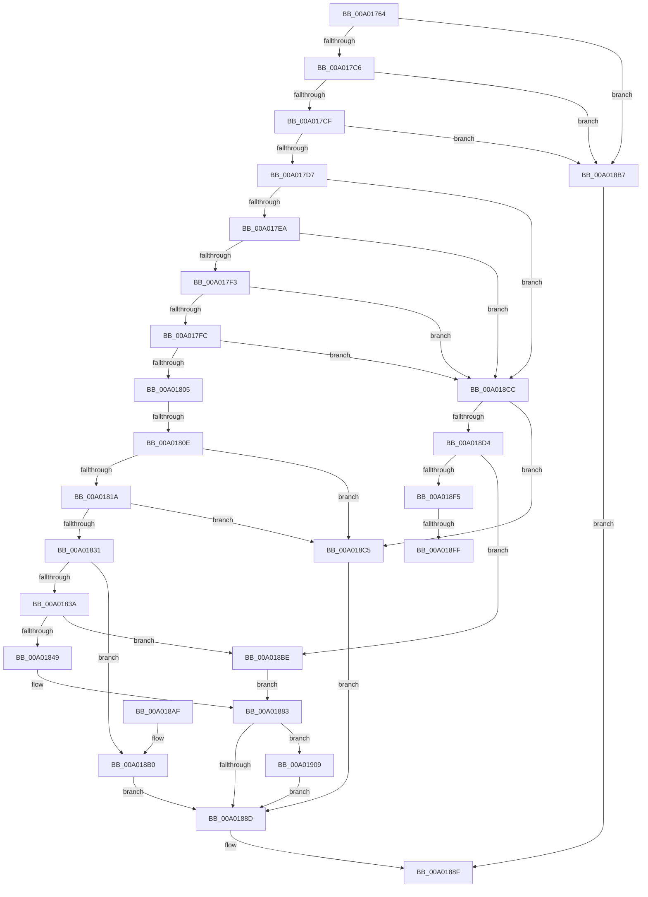

# GetPrintableOperandValue

- RVA: `0x00A01764`–`0x00A01913` (길이 `431` bytes)
- VA: `0x0000000140A01764`
- 실행 섹션: `PAGE`
- PDB 이름 있음: `예`; PDB Function 태그: `예`
- unwind 정보 RVA: `0x000A7E14`
- 디코드: `121`개 명령, `431/431` bytes 표시
- 미해석 바이트: `0` (있으면 어셈블리에 `.byte`로 보존)

> 이 문서는 커널 이미지의 기계어와 PDB 기호를 분석해 생성했습니다. 4번과 5번은 함수 원형과 자료형을 바이너리 사용 방식에서 추정한 C 해석이며 원본 소스 복구 결과는 아닙니다.

## 1. Dependencies

- 직접 호출 지점: **5**; 고유 호출 대상: **4**
- 직접 호출자로 확인된 함수: **2**
- RIP 상대 이미지 참조: **1**

### Outgoing calls
- `0x00A0183C` → [SddlpAlloc](../92/SddlpAlloc_function_00925F88.md) (function, `0x00925F88`)
- `0x00A01865` → [memcpy](../../text/6C/memcpy_function_006C6840.md) (function, `0x006C6840`)
- `0x00A01896` → [_security_check_cookie](../../text/6A/_security_check_cookie_function_006AC640.md) (function, `0x006AC640`)
- `0x00A018E5` → [SddlpAlloc](../92/SddlpAlloc_function_00925F88.md) (function, `0x00925F88`)
- `0x00A01909` → [PdcCloseEvent](../8D/PdcCloseEvent_function_008D2404.md) (function, `0x008D2404`)

### Direct callers
- [LocalpGetStringForCondition](LocalpGetStringForCondition_function_00A0122C.md) at `0x00A0141B`
- [sub_00B32AA2](../B3/Unknown_function_00B32AA2.md) at `0x00B32C57`

### Static image references
- `0x00A0177D` → RVA `0x00E0A740` (`.data`; read)

## 2. Other-region calls and transfers

- 다른 실행 섹션으로 향하는 call: **2**
  - `0x00A01865` → [memcpy](../../text/6C/memcpy_function_006C6840.md) (`PAGE` → `.text`)
  - `0x00A01896` → [_security_check_cookie](../../text/6A/_security_check_cookie_function_006AC640.md) (`PAGE` → `.text`)
- call이 아닌 외부 분기/꼬리 이동: **3**
  - `0x00A01808` → [sub_00B32AA2](../B3/Unknown_function_00B32AA2.md) (`tail-transfer`)
  - `0x00A018F9` → [sub_00B32AA2 + 0x39A](../B3/Unknown_function_00B32AA2.md) (`tail-transfer`)
  - `0x00A01904` → [sub_00B32AA2 + 0x3A5](../B3/Unknown_function_00B32AA2.md) (`tail-transfer`)

## 3. Assembly (complete function range)

```asm
00A01764  40 55                           push rbp
00A01766  53                              push rbx
00A01767  56                              push rsi
00A01768  57                              push rdi
00A01769  41 54                           push r12
00A0176B  41 55                           push r13
00A0176D  41 56                           push r14
00A0176F  41 57                           push r15
00A01771  48 8D 6C 24 F9                  lea rbp, [rsp - 7]
00A01776  48 81 EC F8 00 00 00            sub rsp, 0xf8
00A0177D  48 8B 05 BC 8F 40 00            mov rax, qword ptr [rip + 0x408fbc]
00A01784  48 33 C4                        xor rax, rsp
00A01787  48 89 45 EF                     mov qword ptr [rbp - 0x11], rax
00A0178B  48 8B 45 77                     mov rax, qword ptr [rbp + 0x77]
00A0178F  8B DA                           mov ebx, edx
00A01791  4C 8B 6D 6F                     mov r13, qword ptr [rbp + 0x6f]
00A01795  33 D2                           xor edx, edx
00A01797  48 89 44 24 70                  mov qword ptr [rsp + 0x70], rax
00A0179C  49 8B F1                        mov rsi, r9
00A0179F  48 8B 45 7F                     mov rax, qword ptr [rbp + 0x7f]
00A017A3  4D 8B F0                        mov r14, r8
00A017A6  48 89 44 24 68                  mov qword ptr [rsp + 0x68], rax
00A017AB  4C 8B F9                        mov r15, rcx
00A017AE  4C 89 6D 87                     mov qword ptr [rbp - 0x79], r13
00A017B2  8B FA                           mov edi, edx
00A017B4  48 89 54 24 40                  mov qword ptr [rsp + 0x40], rdx
00A017B9  89 54 24 48                     mov dword ptr [rsp + 0x48], edx
00A017BD  48 85 C9                        test rcx, rcx
00A017C0  0F 84 F1 00 00 00               je 0x140a018b7
00A017C6  4D 85 C0                        test r8, r8
00A017C9  0F 84 E8 00 00 00               je 0x140a018b7
00A017CF  85 DB                           test ebx, ebx
00A017D1  0F 84 E0 00 00 00               je 0x140a018b7
00A017D7  41 C7 01 01 00 00 00            mov dword ptr [r9], 1
00A017DE  0F B6 09                        movzx ecx, byte ptr [rcx]
00A017E1  83 E9 01                        sub ecx, 1
00A017E4  0F 84 E2 00 00 00               je 0x140a018cc
00A017EA  83 E9 01                        sub ecx, 1
00A017ED  0F 84 D9 00 00 00               je 0x140a018cc
00A017F3  83 E9 01                        sub ecx, 1
00A017F6  0F 84 D0 00 00 00               je 0x140a018cc
00A017FC  83 E9 01                        sub ecx, 1
00A017FF  0F 84 C7 00 00 00               je 0x140a018cc
00A01805  83 E9 0C                        sub ecx, 0xc
00A01808  0F 85 94 12 13 00               jne 0x140b32aa2
00A0180E  8D 43 FF                        lea eax, [rbx - 1]
00A01811  83 F8 04                        cmp eax, 4
00A01814  0F 82 AB 00 00 00               jb 0x140a018c5
00A0181A  45 8B 6F 01                     mov r13d, dword ptr [r15 + 1]
00A0181E  8D 43 FB                        lea eax, [rbx - 5]
00A01821  41 C7 01 05 00 00 00            mov dword ptr [r9], 5
00A01828  41 3B C5                        cmp eax, r13d
00A0182B  0F 82 94 00 00 00               jb 0x140a018c5
00A01831  41 8D 45 06                     lea eax, [r13 + 6]
00A01835  41 3B C5                        cmp eax, r13d
00A01838  72 76                           jb 0x140a018b0
00A0183A  8B C8                           mov ecx, eax
00A0183C  E8 47 47 F2 FF                  call 0x140925f88
00A01841  49 89 06                        mov qword ptr [r14], rax
00A01844  48 85 C0                        test rax, rax
00A01847  74 75                           je 0x140a018be
00A01849  41 BC 22 00 00 00               mov r12d, 0x22
00A0184F  45 8B C5                        mov r8d, r13d
00A01852  66 44 89 20                     mov word ptr [rax], r12w
00A01856  41 8B DD                        mov ebx, r13d
00A01859  8B 16                           mov edx, dword ptr [rsi]
00A0185B  49 8B 0E                        mov rcx, qword ptr [r14]
00A0185E  49 03 D7                        add rdx, r15
00A01861  48 83 C1 02                     add rcx, 2
00A01865  E8 D6 4F CC FF                  call 0x1406c6840
00A0186A  49 8B 06                        mov rax, qword ptr [r14]
00A0186D  33 C9                           xor ecx, ecx
00A0186F  48 D1 EB                        shr rbx, 1
00A01872  66 44 89 64 58 02               mov word ptr [rax + rbx*2 + 2], r12w
00A01878  49 8B 06                        mov rax, qword ptr [r14]
00A0187B  66 89 4C 58 04                  mov word ptr [rax + rbx*2 + 4], cx
00A01880  44 01 2E                        add dword ptr [rsi], r13d
00A01883  48 8B 4C 24 40                  mov rcx, qword ptr [rsp + 0x40]
00A01888  48 85 C9                        test rcx, rcx
00A0188B  75 7C                           jne 0x140a01909
00A0188D  8B C7                           mov eax, edi
00A0188F  48 8B 4D EF                     mov rcx, qword ptr [rbp - 0x11]
00A01893  48 33 CC                        xor rcx, rsp
00A01896  E8 A5 AD CA FF                  call 0x1406ac640
00A0189B  48 81 C4 F8 00 00 00            add rsp, 0xf8
00A018A2  41 5F                           pop r15
00A018A4  41 5E                           pop r14
00A018A6  41 5D                           pop r13
00A018A8  41 5C                           pop r12
00A018AA  5F                              pop rdi
00A018AB  5E                              pop rsi
00A018AC  5B                              pop rbx
00A018AD  5D                              pop rbp
00A018AE  C3                              ret
00A018AF  CC                              int3
00A018B0  BF 16 02 00 00                  mov edi, 0x216
00A018B5  EB D6                           jmp 0x140a0188d
00A018B7  B8 57 00 00 00                  mov eax, 0x57
00A018BC  EB D1                           jmp 0x140a0188f
00A018BE  BF 08 00 00 00                  mov edi, 8
00A018C3  EB BE                           jmp 0x140a01883
00A018C5  BF 38 05 00 00                  mov edi, 0x538
00A018CA  EB C1                           jmp 0x140a0188d
00A018CC  8D 43 FF                        lea eax, [rbx - 1]
00A018CF  83 F8 0A                        cmp eax, 0xa
00A018D2  72 F1                           jb 0x140a018c5
00A018D4  4D 8B 6F 01                     mov r13, qword ptr [r15 + 1]
00A018D8  B9 40 00 00 00                  mov ecx, 0x40
00A018DD  45 8A 67 09                     mov r12b, byte ptr [r15 + 9]
00A018E1  41 8A 5F 0A                     mov bl, byte ptr [r15 + 0xa]
00A018E5  E8 9E 46 F2 FF                  call 0x140925f88
00A018EA  49 89 06                        mov qword ptr [r14], rax
00A018ED  4C 8B D8                        mov r11, rax
00A018F0  48 85 C0                        test rax, rax
00A018F3  74 C9                           je 0x140a018be
00A018F5  41 80 FC 01                     cmp r12b, 1
00A018F9  0F 85 3D 15 13 00               jne 0x140b32e3c
00A018FF  66 C7 00 2B 00                  mov word ptr [rax], 0x2b
00A01904  E9 3E 15 13 00                  jmp 0x140b32e47
00A01909  E8 F6 0A ED FF                  call 0x1408d2404
00A0190E  E9 7A FF FF FF                  jmp 0x140a0188d
```

## 4. C-style interpretation (structured pseudocode)

```c
__int64 __fastcall GetPrintableOperandValue(__int64 a1, int a2, __int64 a3, __int64 a4, __int64 a5, __int64 a6, __int64 a7)
{
    __int64 result;
    __int64 v_rbx;
    __int64 v_rsp;
    unsigned __int64 v_stack_m47;
    unsigned __int64 v_stack_m58;
    unsigned __int64 v_stack_mC0;
    unsigned __int64 v_stack_mC8;
    unsigned __int64 v_stack_mD0;
    unsigned int v_stack_mF0;
    unsigned __int64 v_stack_mF8;

    v_rsp = (v_rsp) - (248);
    result = (*(unsigned __int64 *)(v_rip + 4231100)) ^ (v_rsp);
    v_stack_m58 = result;
    a2 = 0;
    v_stack_mC8 = a6;
    v_stack_mD0 = a7;
    v_stack_mC0 = a5;
    v_stack_mF8 = 0;
    v_stack_mF0 = 0;
    if (a1 == 0) goto loc_00A018B7;
    if (a3 == 0) goto loc_00A018B7;
    if ((unsigned int)((unsigned int)(a2)) == 0) goto loc_00A018B7;
    *(unsigned int *)(a4) = 1;
    a1 = (unsigned int)((*(unsigned __int8 *)(a1)) - (1));
    if (condition_is_equal) goto loc_00A018CC;
    a1 = (unsigned int)((a1) - (1));
    if (condition_is_equal) goto loc_00A018CC;
    a1 = (unsigned int)((a1) - (1));
    if (condition_is_equal) goto loc_00A018CC;
    a1 = (unsigned int)((a1) - (1));
    if (condition_is_equal) goto loc_00A018CC;
    a1 = (unsigned int)((a1) - (12));
    if (((unsigned int)((unsigned int)(a2) - 1)) < 4) goto loc_00A018C5;
    *(unsigned int *)(a4) = 5;
    if (((unsigned int)((unsigned int)(a2) - 5)) < ((unsigned int)((unsigned int)(*(unsigned int *)(a1 + 1))))) goto loc_00A018C5;
    if (((unsigned int)((unsigned int)(*(unsigned int *)(a1 + 1)) + 6)) < ((unsigned int)((unsigned int)(*(unsigned int *)(a1 + 1))))) goto loc_00A018B0;
    result = SddlpAlloc((unsigned int)((unsigned int)((unsigned int)(*(unsigned int *)(a1 + 1)) + 6)), a2, a3, a4);
    *(unsigned __int64 *)(a3) = result;
    if (result == 0) goto loc_00A018BE;
    *(unsigned __int16 *)(result) = 34;
    a2 = ((unsigned int)(*(unsigned int *)(a4))) + (a1);
    a1 = (*(unsigned __int64 *)(a3)) + (2);
    result = memcpy(a1, a2, (unsigned int)((unsigned int)((unsigned int)(*(unsigned int *)(a1 + 1)))), a4);
    a1 = 0;
    v_rbx = ((unsigned int)((unsigned int)((unsigned int)(*(unsigned int *)(a1 + 1))))) >> (1);
    *(unsigned __int16 *)(*(unsigned __int64 *)(a3) + v_rbx * 2 + 2) = 34;
    *(unsigned __int16 *)(*(unsigned __int64 *)(a3) + v_rbx * 2 + 4) = 0;
loc_00A01883:
    if (v_stack_mF8 != 0) goto loc_00A01909;
loc_00A0188D:
loc_00A0188F:
    a1 = (v_stack_m58) ^ (v_rsp);
    result = _security_check_cookie(a1, a2, (unsigned int)((unsigned int)((unsigned int)(*(unsigned int *)(a1 + 1)))), a4);
    v_rsp = (v_rsp) + (248);
    return result;
loc_00A018B0:
    goto loc_00A0188D;
loc_00A018B7:
    goto loc_00A0188F;
loc_00A018BE:
    goto loc_00A01883;
loc_00A018C5:
    goto loc_00A0188D;
loc_00A018CC:
    if (((unsigned int)(v_rbx - 1)) < 10) goto loc_00A018C5;
    result = SddlpAlloc(64, a2, (unsigned int)((unsigned int)((unsigned int)(*(unsigned int *)(a1 + 1)))), a4);
    *(unsigned __int64 *)(a3) = result;
    if (result == 0) goto loc_00A018BE;
    *(unsigned __int16 *)(result) = 43;
loc_00A01909:
    result = PdcCloseEvent(64, a2, (unsigned int)((unsigned int)((unsigned int)(*(unsigned int *)(a1 + 1)))), a4);
    goto loc_00A0188D;
}
```

## 5. (Beta) C Style

```c
int64_t GetPrintableOperandValue(void *Arg1, int32_t Arg2, void *Arg3, void *Arg4, int64_t Arg5, int64_t Arg6, int64_t Arg7)
{
    uint8_t *arg1 = (uint8_t *)Arg1;
    uint8_t *arg3 = (uint8_t *)Arg3;
    uint8_t *arg4 = (uint8_t *)Arg4;

    int64_t result;
    int64_t local_rbx;
    int64_t local_rsp;
    uint64_t v_stack_m47;
    uint64_t v_stack_m58;
    uint64_t v_stack_mC0;
    uint64_t v_stack_mC8;
    uint64_t v_stack_mD0;
    uint32_t v_stack_mF0;
    uint64_t v_stack_mF8;

    local_rsp = (local_rsp) - (248);
    result = (*(uint64_t *)(v_rip + 0x408FBC)) ^ (local_rsp);
    v_stack_m58 = result;
    Arg2 = 0;
    v_stack_mC8 = Arg6;
    v_stack_mD0 = Arg7;
    v_stack_mC0 = Arg5;
    v_stack_mF8 = 0;
    v_stack_mF0 = 0;
    if (Arg1 == NULL) goto loc_00A018B7;
    if (Arg3 == NULL) goto loc_00A018B7;
    if ((uint32_t)((uint32_t)(Arg2)) == 0) goto loc_00A018B7;
    *(uint32_t *)(arg4) = 1;
    Arg1 = (uint32_t)((*(uint8_t *)(arg1)) - (1));
    if (condition_is_equal) goto loc_00A018CC;
    Arg1 = (uint32_t)((Arg1) - (1));
    if (condition_is_equal) goto loc_00A018CC;
    Arg1 = (uint32_t)((Arg1) - (1));
    if (condition_is_equal) goto loc_00A018CC;
    Arg1 = (uint32_t)((Arg1) - (1));
    if (condition_is_equal) goto loc_00A018CC;
    Arg1 = (uint32_t)((Arg1) - (12));
    if (((uint32_t)((uint32_t)(Arg2) - 1)) < 4) goto loc_00A018C5;
    *(uint32_t *)(arg4) = 5;
    if (((uint32_t)((uint32_t)(Arg2) - 5)) < ((uint32_t)((uint32_t)(*(uint32_t *)(arg1 + 0x1))))) goto loc_00A018C5;
    if (((uint32_t)((uint32_t)(*(uint32_t *)(arg1 + 0x1)) + 6)) < ((uint32_t)((uint32_t)(*(uint32_t *)(arg1 + 0x1))))) goto loc_00A018B0;
    result = SddlpAlloc((uint32_t)((uint32_t)((uint32_t)(*(uint32_t *)(arg1 + 0x1)) + 6)), Arg2, Arg3, Arg4);
    *(uint64_t *)(arg3) = result;
    if (result == 0) goto loc_00A018BE;
    *(uint16_t *)(result) = 34;
    Arg2 = ((uint32_t)(*(uint32_t *)(arg4))) + (Arg1);
    Arg1 = (*(uint64_t *)(arg3)) + (2);
    result = memcpy(Arg1, Arg2, (uint32_t)((uint32_t)((uint32_t)(*(uint32_t *)(arg1 + 0x1)))), Arg4);
    Arg1 = 0;
    local_rbx = ((uint32_t)((uint32_t)((uint32_t)(*(uint32_t *)(arg1 + 0x1))))) >> (1);
    *(uint16_t *)(*(uint64_t *)(arg3) + local_rbx * 2 + 0x2) = 34;
    *(uint16_t *)(*(uint64_t *)(arg3) + local_rbx * 2 + 0x4) = 0;
loc_00A01883:
    if (v_stack_mF8 != 0) goto loc_00A01909;
loc_00A0188D:
loc_00A0188F:
    Arg1 = (v_stack_m58) ^ (local_rsp);
    result = _security_check_cookie(Arg1, Arg2, (uint32_t)((uint32_t)((uint32_t)(*(uint32_t *)(arg1 + 0x1)))), Arg4);
    local_rsp = (local_rsp) + (248);
    return result;
loc_00A018B0:
    goto loc_00A0188D;
loc_00A018B7:
    goto loc_00A0188F;
loc_00A018BE:
    goto loc_00A01883;
loc_00A018C5:
    goto loc_00A0188D;
loc_00A018CC:
    if (((uint32_t)(local_rbx - 1)) < 10) goto loc_00A018C5;
    result = SddlpAlloc(64, Arg2, (uint32_t)((uint32_t)((uint32_t)(*(uint32_t *)(arg1 + 0x1)))), Arg4);
    *(uint64_t *)(arg3) = result;
    if (result == 0) goto loc_00A018BE;
    *(uint16_t *)(result) = 43;
loc_00A01909:
    result = PdcCloseEvent(64, Arg2, (uint32_t)((uint32_t)((uint32_t)(*(uint32_t *)(arg1 + 0x1)))), Arg4);
    goto loc_00A0188D;
}
```

### 관측된 메모리 오프셋

구조체 형식이 확인되지 않은 접근은 인자 기준의 오프셋으로만 기록했습니다.

| 기준 인자 | 오프셋 표현 | 폭 (bit) | 접근 |
|---|---:|---:|---|
| `Arg1` | `+ 0x1` | `32` | `R` |
| `Arg1` | `+ 0x1` | `64` | `R` |
| `Arg1` | `+ 0x9` | `8` | `R` |
| `Arg1` | `+ 0xA` | `8` | `R` |
| `Arg3` | `+ 0x0` | `64` | `R` |
| `Arg3` | `+ 0x0` | `64` | `W` |
| `Arg4` | `+ 0x0` | `32` | `R` |
| `Arg4` | `+ 0x0` | `32` | `R/W` |
| `Arg4` | `+ 0x0` | `32` | `W` |

## 6. Execution-region graph

[열기: 2D/3D 그래프와 함수 탐색 컨트롤 패널](../../../control-panel.html?section=page&rva=0x00A01764&view=graph)

- 2D 그래프는 위에서 아래로 흐르고, 3D 그래프는 빈 공간을 드래그해 회전합니다. Shift+드래그는 이동, 휠은 확대·축소, 함수 노드 선택은 대상 보고서 이동입니다.

### Static fallback


