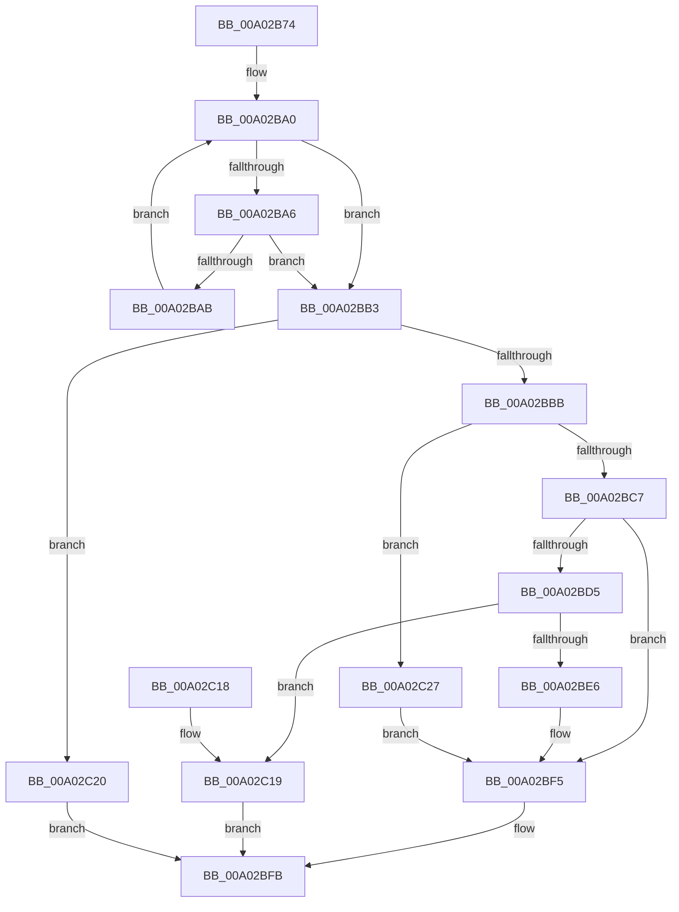

# GetStringOperandValue

- RVA: `0x00A02B74`–`0x00A02C30` (길이 `188` bytes)
- VA: `0x0000000140A02B74`
- 실행 섹션: `PAGE`
- PDB 이름 있음: `예`; PDB Function 태그: `아니요`
- unwind 정보 RVA: `0x000A7F84`
- 디코드: `58`개 명령, `188/188` bytes 표시
- 미해석 바이트: `0` (있으면 어셈블리에 `.byte`로 보존)

> 이 문서는 커널 이미지의 기계어와 PDB 기호를 분석해 생성했습니다. 4번과 5번은 함수 원형과 자료형을 바이너리 사용 방식에서 추정한 C 해석이며 원본 소스 복구 결과는 아닙니다.

## 1. Dependencies

- 직접 호출 지점: **2**; 고유 호출 대상: **2**
- 직접 호출자로 확인된 함수: **1**
- RIP 상대 이미지 참조: **0**

### Outgoing calls
- `0x00A02BD5` → [SddlpAlloc](../92/SddlpAlloc_function_00925F88.md) (function, `0x00925F88`)
- `0x00A02BF0` → [memcpy](../../text/6C/memcpy_function_006C6840.md) (function, `0x006C6840`)

### Direct callers
- [GetOperandValue](GetOperandValue_function_00A024C0.md) at `0x00A025B8`

### Static image references
- 디코드된 RIP-relative 메모리 참조가 없습니다.

## 2. Other-region calls and transfers

- 다른 실행 섹션으로 향하는 call: **1**
  - `0x00A02BF0` → [memcpy](../../text/6C/memcpy_function_006C6840.md) (`PAGE` → `.text`)
- 별도 외부 분기/꼬리 이동을 확인하지 못했습니다.

## 3. Assembly (complete function range)

```asm
00A02B74  48 8B C4                        mov rax, rsp
00A02B77  48 89 58 08                     mov qword ptr [rax + 8], rbx
00A02B7B  48 89 70 10                     mov qword ptr [rax + 0x10], rsi
00A02B7F  48 89 78 18                     mov qword ptr [rax + 0x18], rdi
00A02B83  4C 89 70 20                     mov qword ptr [rax + 0x20], r14
00A02B87  41 57                           push r15
00A02B89  48 83 EC 20                     sub rsp, 0x20
00A02B8D  33 DB                           xor ebx, ebx
00A02B8F  4C 8D 71 02                     lea r14, [rcx + 2]
00A02B93  41 0F B7 06                     movzx eax, word ptr [r14]
00A02B97  4D 8B F8                        mov r15, r8
00A02B9A  48 8B F2                        mov rsi, rdx
00A02B9D  8D 7B 01                        lea edi, [rbx + 1]
00A02BA0  66 83 F8 22                     cmp ax, 0x22
00A02BA4  74 0D                           je 0x140a02bb3
00A02BA6  66 85 C0                        test ax, ax
00A02BA9  74 08                           je 0x140a02bb3
00A02BAB  FF C7                           inc edi
00A02BAD  0F B7 04 79                     movzx eax, word ptr [rcx + rdi*2]
00A02BB1  EB ED                           jmp 0x140a02ba0
00A02BB3  8B C7                           mov eax, edi
00A02BB5  66 39 1C 41                     cmp word ptr [rcx + rax*2], bx
00A02BB9  74 65                           je 0x140a02c20
00A02BBB  48 8B 02                        mov rax, qword ptr [rdx]
00A02BBE  C6 40 01 10                     mov byte ptr [rax + 1], 0x10
00A02BC2  83 FF 01                        cmp edi, 1
00A02BC5  76 60                           jbe 0x140a02c27
00A02BC7  8D 0C 7D FE FF FF FF            lea ecx, [rdi*2 - 2]
00A02BCE  89 48 04                        mov dword ptr [rax + 4], ecx
00A02BD1  85 C9                           test ecx, ecx
00A02BD3  74 20                           je 0x140a02bf5
00A02BD5  E8 AE 33 F2 FF                  call 0x140925f88
00A02BDA  48 8B 0E                        mov rcx, qword ptr [rsi]
00A02BDD  48 89 41 08                     mov qword ptr [rcx + 8], rax
00A02BE1  48 85 C0                        test rax, rax
00A02BE4  74 33                           je 0x140a02c19
00A02BE6  44 8B 41 04                     mov r8d, dword ptr [rcx + 4]
00A02BEA  49 8B D6                        mov rdx, r14
00A02BED  48 8B C8                        mov rcx, rax
00A02BF0  E8 4B 3C CC FF                  call 0x1406c6840
00A02BF5  8D 4F 01                        lea ecx, [rdi + 1]
00A02BF8  41 89 0F                        mov dword ptr [r15], ecx
00A02BFB  48 8B 74 24 38                  mov rsi, qword ptr [rsp + 0x38]
00A02C00  8B C3                           mov eax, ebx
00A02C02  48 8B 5C 24 30                  mov rbx, qword ptr [rsp + 0x30]
00A02C07  48 8B 7C 24 40                  mov rdi, qword ptr [rsp + 0x40]
00A02C0C  4C 8B 74 24 48                  mov r14, qword ptr [rsp + 0x48]
00A02C11  48 83 C4 20                     add rsp, 0x20
00A02C15  41 5F                           pop r15
00A02C17  C3                              ret
00A02C18  CC                              int3
00A02C19  BB 08 00 00 00                  mov ebx, 8
00A02C1E  EB DB                           jmp 0x140a02bfb
00A02C20  BB 38 05 00 00                  mov ebx, 0x538
00A02C25  EB D4                           jmp 0x140a02bfb
00A02C27  89 58 04                        mov dword ptr [rax + 4], ebx
00A02C2A  48 89 58 08                     mov qword ptr [rax + 8], rbx
00A02C2E  EB C5                           jmp 0x140a02bf5
```

## 4. C-style interpretation (structured pseudocode)

```c
__int64 __fastcall GetStringOperandValue(__int64 a1, __int64 a2, __int64 a3)
{
    __int64 result;
    __int64 v_rbx;
    __int64 v_rdi;
    __int64 v_rsp;
    unsigned __int64 v_stack_p10;
    unsigned __int64 v_stack_p18;
    unsigned __int64 v_stack_p20;
    unsigned __int64 v_stack_p8;

    *(unsigned __int64 *)(v_rsp + 8) = v_rbx;
    *(unsigned __int64 *)(v_rsp + 16) = v_rsi;
    *(unsigned __int64 *)(v_rsp + 24) = v_rdi;
    *(unsigned __int64 *)(v_rsp + 32) = v_r14;
    v_rsp = (v_rsp) - (32);
    v_rbx = 0;
loc_00A02BA0:
    if (((unsigned __int16)(*(unsigned __int16 *)(a1 + 2))) == 34) goto loc_00A02BB3;
    if ((unsigned __int16)(*(unsigned __int16 *)(a1 + 2)) == 0) goto loc_00A02BB3;
    v_rdi = (unsigned int)((v_rbx + 1) + 1);
    goto loc_00A02BA0;
loc_00A02BB3:
    if ((*(unsigned __int16 *)(a1 + (unsigned int)((unsigned int)(v_rdi)) * 2)) == 0) goto loc_00A02C20;
    *(unsigned __int8 *)(*(unsigned __int64 *)(a2) + 1) = 16;
    if (((unsigned int)(v_rdi)) <= 1) goto loc_00A02C27;
    *(unsigned int *)(*(unsigned __int64 *)(a2) + 4) = (unsigned int)(v_rdi * 2 - 2);
    if ((unsigned int)(v_rdi * 2 - 2) == 0) goto loc_00A02BF5;
    result = SddlpAlloc(v_rdi * 2 - 2, a2, a3, a4);
    *(unsigned __int64 *)(*(unsigned __int64 *)(a2) + 8) = result;
    if (result == 0) goto loc_00A02C19;
    result = memcpy(result, a1 + 2, (unsigned int)(*(unsigned int *)(*(unsigned __int64 *)(a2) + 4)), a4);
loc_00A02BF5:
    *(unsigned int *)(a3) = (unsigned int)(v_rdi + 1);
loc_00A02BFB:
    v_rsp = (v_rsp) + (32);
    return 0;
loc_00A02C19:
    goto loc_00A02BFB;
loc_00A02C20:
    goto loc_00A02BFB;
loc_00A02C27:
    *(unsigned int *)(0 + 4) = (unsigned int)((unsigned int)(0x538ULL));
    *(unsigned __int64 *)(0 + 8) = (unsigned int)(0x538ULL);
    goto loc_00A02BF5;
}
```

## 5. (Beta) C Style

```c
int64_t GetStringOperandValue(void *Arg1, void *Arg2, void *Arg3)
{
    uint8_t *arg1 = (uint8_t *)Arg1;
    uint8_t *arg2 = (uint8_t *)Arg2;
    uint8_t *arg3 = (uint8_t *)Arg3;

    int64_t result;
    int64_t local_rbx;
    int64_t local_rdi;
    int64_t local_rsp;
    uint64_t v_stack_p10;
    uint64_t v_stack_p18;
    uint64_t v_stack_p20;
    uint64_t v_stack_p8;

    *(uint64_t *)(local_rsp + 0x8) = local_rbx;
    *(uint64_t *)(local_rsp + 0x10) = local_rsi;
    *(uint64_t *)(local_rsp + 0x18) = local_rdi;
    *(uint64_t *)(local_rsp + 0x20) = local_r14;
    local_rsp = (local_rsp) - (32);
    local_rbx = 0;
loc_00A02BA0:
    if (((uint16_t)(*(uint16_t *)(arg1 + 0x2))) == 34) goto loc_00A02BB3;
    if ((uint16_t)(*(uint16_t *)(arg1 + 0x2)) == 0) goto loc_00A02BB3;
    local_rdi = (uint32_t)((local_rbx + 1) + 1);
    goto loc_00A02BA0;
loc_00A02BB3:
    if ((*(uint16_t *)(arg1 + (uint32_t)((uint32_t)(local_rdi)) * 2)) == 0) goto loc_00A02C20;
    *(uint8_t *)(*(uint64_t *)(arg2) + 0x1) = 16;
    if (((uint32_t)(local_rdi)) <= 1) goto loc_00A02C27;
    *(uint32_t *)(*(uint64_t *)(arg2) + 0x4) = (uint32_t)(local_rdi * 2 - 2);
    if ((uint32_t)(local_rdi * 2 - 2) == 0) goto loc_00A02BF5;
    result = SddlpAlloc(local_rdi * 2 - 2, Arg2, Arg3, a4);
    *(uint64_t *)(*(uint64_t *)(arg2) + 0x8) = result;
    if (result == 0) goto loc_00A02C19;
    result = memcpy(result, Arg1 + 2, (uint32_t)(*(uint32_t *)(*(uint64_t *)(arg2) + 0x4)), a4);
loc_00A02BF5:
    *(uint32_t *)(arg3) = (uint32_t)(local_rdi + 1);
loc_00A02BFB:
    local_rsp = (local_rsp) + (32);
    return 0;
loc_00A02C19:
    goto loc_00A02BFB;
loc_00A02C20:
    goto loc_00A02BFB;
loc_00A02C27:
    *(uint32_t *)(0 + 0x4) = (uint32_t)((uint32_t)(0x538ULL));
    *(uint64_t *)(0 + 0x8) = (uint32_t)(0x538ULL);
    goto loc_00A02BF5;
}
```

### 관측된 메모리 오프셋

구조체 형식이 확인되지 않은 접근은 인자 기준의 오프셋으로만 기록했습니다.

| 기준 인자 | 오프셋 표현 | 폭 (bit) | 접근 |
|---|---:|---:|---|
| `Arg1` | `+ 0x0` | `16` | `R` |
| `Arg1` | `+ 0x0 + rax*2` | `16` | `R` |
| `Arg1` | `+ 0x0 + rdi*2` | `16` | `R` |
| `Arg1` | `+ 0x2` | `64` | `R` |
| `Arg2` | `+ 0x0` | `64` | `R` |
| `Arg3` | `+ 0x0` | `32` | `W` |

## 6. Execution-region graph

[열기: 2D/3D 그래프와 함수 탐색 컨트롤 패널](../../../control-panel.html?section=page&rva=0x00A02B74&view=graph)

- 2D 그래프는 위에서 아래로 흐르고, 3D 그래프는 빈 공간을 드래그해 회전합니다. Shift+드래그는 이동, 휠은 확대·축소, 함수 노드 선택은 대상 보고서 이동입니다.

### Static fallback


