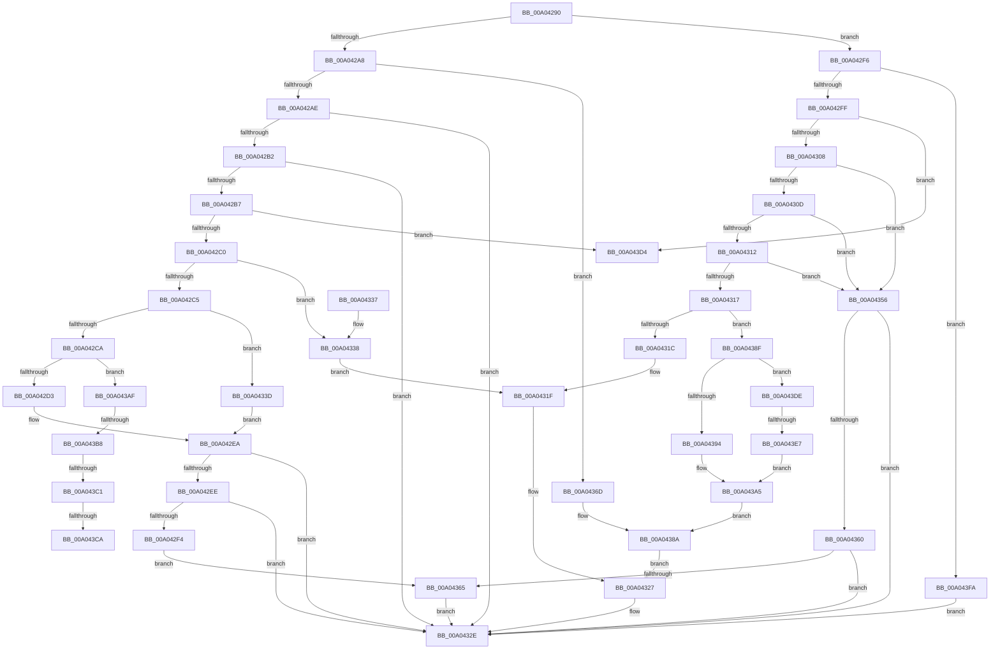

# IoCheckFunctionAccess

- RVA: `0x00A04290`–`0x00A04421` (길이 `401` bytes)
- VA: `0x0000000140A04290`
- 실행 섹션: `PAGE`
- PDB 이름 있음: `예`; PDB Function 태그: `예`
- unwind 정보 RVA: `0x000A8230`
- 디코드: `113`개 명령, `401/401` bytes 표시
- 미해석 바이트: `0` (있으면 어셈블리에 `.byte`로 보존)

> 이 문서는 커널 이미지의 기계어와 PDB 기호를 분석해 생성했습니다. 4번과 5번은 함수 원형과 자료형을 바이너리 사용 방식에서 추정한 C 해석이며 원본 소스 복구 결과는 아닙니다.

## 1. Dependencies

- 직접 호출 지점: **2**; 고유 호출 대상: **2**
- 직접 호출자로 확인된 함수: **0**
- RIP 상대 이미지 참조: **1**

### Outgoing calls
- `0x00A043A0` → [SeQuerySecurityAccessMask](../87/SeQuerySecurityAccessMask_function_008739EC.md) (function, `0x008739EC`)
- `0x00A043F3` → [SeSetSecurityAccessMask](../A2/SeSetSecurityAccessMask_function_00A25E0C.md) (function, `0x00A25E0C`)

### Direct callers
- 이 함수 시작 RVA로 연결되는 직접 call은 확인되지 않았습니다. 간접 호출은 완전히 역산할 수 없습니다.

### Static image references
- `0x00A042D8` → RVA `0x00000000` (`image boundary/outside`; read)

## 2. Other-region calls and transfers

- 다른 실행 섹션으로 향하는 call: **0**
- call이 아닌 외부 분기/꼬리 이동: **6**
  - `0x00A043B2` → [sub_00B33644 + 0x7](../B3/Unknown_function_00B33644.md) (`tail-transfer`)
  - `0x00A043BB` → [sub_00B33644](../B3/Unknown_function_00B33644.md) (`tail-transfer`)
  - `0x00A043C4` → [sub_00B33644 + 0x13](../B3/Unknown_function_00B33644.md) (`tail-transfer`)
  - `0x00A043CF` → [sub_00B33644 + 0xC](../B3/Unknown_function_00B33644.md) (`tail-transfer`)
  - `0x00A043D9` → [sub_00B33644 + 0xC](../B3/Unknown_function_00B33644.md) (`tail-transfer`)
  - `0x00A043E1` → [sub_00B33644 + 0x13](../B3/Unknown_function_00B33644.md) (`tail-transfer`)

## 3. Assembly (complete function range)

```asm
00A04290  40 53                           push rbx
00A04292  48 83 EC 20                     sub rsp, 0x20
00A04296  45 33 C0                        xor r8d, r8d
00A04299  8B D9                           mov ebx, ecx
00A0429B  0F B6 CA                        movzx ecx, dl
00A0429E  44 89 44 24 38                  mov dword ptr [rsp + 0x38], r8d
00A042A3  83 F9 0A                        cmp ecx, 0xa
00A042A6  77 4E                           ja 0x140a042f6
00A042A8  0F 84 BF 00 00 00               je 0x140a0436d
00A042AE  84 D2                           test dl, dl
00A042B0  74 7C                           je 0x140a0432e
00A042B2  83 E9 02                        sub ecx, 2
00A042B5  74 77                           je 0x140a0432e
00A042B7  83 E9 01                        sub ecx, 1
00A042BA  0F 84 14 01 00 00               je 0x140a043d4
00A042C0  83 E9 01                        sub ecx, 1
00A042C3  74 73                           je 0x140a04338
00A042C5  83 E9 01                        sub ecx, 1
00A042C8  74 73                           je 0x140a0433d
00A042CA  83 E9 01                        sub ecx, 1
00A042CD  0F 85 DC 00 00 00               jne 0x140a043af
00A042D3  48 8B 44 24 50                  mov rax, qword ptr [rsp + 0x50]
00A042D8  4C 8D 0D 21 BD 5F FF            lea r9, [rip - 0xa042df]
00A042DF  48 63 08                        movsxd rcx, dword ptr [rax]
00A042E2  41 8B 84 89 20 D9 B4 00         mov eax, dword ptr [r9 + rcx*4 + 0xb4d920]
00A042EA  85 C0                           test eax, eax
00A042EC  74 40                           je 0x140a0432e
00A042EE  F7 D3                           not ebx
00A042F0  85 D8                           test eax, ebx
00A042F2  74 3A                           je 0x140a0432e
00A042F4  EB 6F                           jmp 0x140a04365
00A042F6  83 E9 0B                        sub ecx, 0xb
00A042F9  0F 84 FB 00 00 00               je 0x140a043fa
00A042FF  83 E9 01                        sub ecx, 1
00A04302  0F 84 CC 00 00 00               je 0x140a043d4
00A04308  83 E9 01                        sub ecx, 1
00A0430B  74 49                           je 0x140a04356
00A0430D  83 E9 01                        sub ecx, 1
00A04310  74 44                           je 0x140a04356
00A04312  83 E9 01                        sub ecx, 1
00A04315  74 3F                           je 0x140a04356
00A04317  83 E9 02                        sub ecx, 2
00A0431A  75 73                           jne 0x140a0438f
00A0431C  80 E3 03                        and bl, 3
00A0431F  F6 DB                           neg bl
00A04321  45 1B C0                        sbb r8d, r8d
00A04324  41 F7 D0                        not r8d
00A04327  41 81 E0 22 00 00 C0            and r8d, 0xc0000022
00A0432E  41 8B C0                        mov eax, r8d
00A04331  48 83 C4 20                     add rsp, 0x20
00A04335  5B                              pop rbx
00A04336  C3                              ret
00A04337  CC                              int3
00A04338  80 E3 06                        and bl, 6
00A0433B  EB E2                           jmp 0x140a0431f
00A0433D  48 8B 44 24 50                  mov rax, qword ptr [rsp + 0x50]
00A04342  4C 8D 0D B7 BC 5F FF            lea r9, [rip - 0xa04349]
00A04349  48 63 08                        movsxd rcx, dword ptr [rax]
00A0434C  41 8B 84 89 70 E8 B4 00         mov eax, dword ptr [r9 + rcx*4 + 0xb4e870]
00A04354  EB 94                           jmp 0x140a042ea
00A04356  41 C1 E9 0E                     shr r9d, 0xe
00A0435A  41 83 E1 03                     and r9d, 3
00A0435E  74 CE                           je 0x140a0432e
00A04360  44 85 CB                        test ebx, r9d
00A04363  75 C9                           jne 0x140a0432e
00A04365  41 B8 22 00 00 C0               mov r8d, 0xc0000022
00A0436B  EB C1                           jmp 0x140a0432e
00A0436D  48 8B 44 24 58                  mov rax, qword ptr [rsp + 0x58]
00A04372  4C 8D 0D 87 BC 5F FF            lea r9, [rip - 0xa04379]
00A04379  F7 D3                           not ebx
00A0437B  48 63 00                        movsxd rax, dword ptr [rax]
00A0437E  41 8B 84 81 E0 CA B4 00         mov eax, dword ptr [r9 + rax*4 + 0xb4cae0]
00A04386  23 C3                           and eax, ebx
00A04388  F7 D8                           neg eax
00A0438A  45 1B C0                        sbb r8d, r8d
00A0438D  EB 98                           jmp 0x140a04327
00A0438F  83 E9 03                        sub ecx, 3
00A04392  75 4A                           jne 0x140a043de
00A04394  48 8B 4C 24 50                  mov rcx, qword ptr [rsp + 0x50]
00A04399  48 8D 54 24 38                  lea rdx, [rsp + 0x38]
00A0439E  8B 09                           mov ecx, dword ptr [rcx]
00A043A0  E8 47 F6 E6 FF                  call 0x1408739ec
00A043A5  F7 D3                           not ebx
00A043A7  23 5C 24 38                     and ebx, dword ptr [rsp + 0x38]
00A043AB  F7 DB                           neg ebx
00A043AD  EB DB                           jmp 0x140a0438a
00A043AF  83 E9 01                        sub ecx, 1
00A043B2  0F 84 93 F2 12 00               je 0x140b3364b
00A043B8  83 E9 01                        sub ecx, 1
00A043BB  0F 84 83 F2 12 00               je 0x140b33644
00A043C1  83 F9 01                        cmp ecx, 1
00A043C4  0F 85 8D F2 12 00               jne 0x140b33657
00A043CA  F7 D3                           not ebx
00A043CC  80 E3 02                        and bl, 2
00A043CF  E9 7C F2 12 00                  jmp 0x140b33650
00A043D4  F7 D3                           not ebx
00A043D6  80 E3 01                        and bl, 1
00A043D9  E9 72 F2 12 00                  jmp 0x140b33650
00A043DE  83 F9 01                        cmp ecx, 1
00A043E1  0F 85 70 F2 12 00               jne 0x140b33657
00A043E7  48 8B 4C 24 50                  mov rcx, qword ptr [rsp + 0x50]
00A043EC  48 8D 54 24 38                  lea rdx, [rsp + 0x38]
00A043F1  8B 09                           mov ecx, dword ptr [rcx]
00A043F3  E8 14 1A 02 00                  call 0x140a25e0c
00A043F8  EB AB                           jmp 0x140a043a5
00A043FA  48 8B 4C 24 58                  mov rcx, qword ptr [rsp + 0x58]
00A043FF  4C 8D 0D FA BB 5F FF            lea r9, [rip - 0xa04406]
00A04406  F7 D3                           not ebx
00A04408  B8 22 00 00 C0                  mov eax, 0xc0000022
00A0440D  48 63 11                        movsxd rdx, dword ptr [rcx]
00A04410  41 85 9C 91 30 CB B4 00         test dword ptr [r9 + rdx*4 + 0xb4cb30], ebx
00A04418  44 0F 45 C0                     cmovne r8d, eax
00A0441C  E9 0D FF FF FF                  jmp 0x140a0432e
```

## 4. C-style interpretation (structured pseudocode)

```c
__int64 __fastcall IoCheckFunctionAccess(int a1, unsigned __int8 a2, int a3, __int64 a4, __int64 a5, __int64 a6)
{
    __int64 result;
    __int64 v_rbx;
    __int64 v_rsp;
    unsigned int v_stack_p10;
    unsigned __int64 v_stack_p38;

    v_rsp = (v_rsp) - (32);
    a3 = 0;
    v_stack_p10 = 0;
    if (a2 > 10) goto loc_00A042F6;
    if (a2 == 10) goto loc_00A0436D;
    if (a2 == 0) goto loc_00A0432E;
    a1 = (unsigned int)((a2) - (2));
    if (condition_is_equal) goto loc_00A0432E;
    a1 = (unsigned int)((a1) - (1));
    if (condition_is_equal) goto loc_00A043D4;
    a1 = (unsigned int)((a1) - (1));
    if (condition_is_equal) goto loc_00A04338;
    a1 = (unsigned int)((a1) - (1));
    if (condition_is_equal) goto loc_00A0433D;
    a1 = (unsigned int)((a1) - (1));
    if (condition_is_not_equal) goto loc_00A043AF;
loc_00A042EA:
    if ((unsigned int)((unsigned int)(*(unsigned int *)(v_rip - 10502879 + (int)(*(unsigned int *)(a5)) * 4 + 11852064))) == 0) goto loc_00A0432E;
    v_rbx = (unsigned int)(~((unsigned int)(a1)));
    if ((((unsigned int)((unsigned int)(*(unsigned int *)(v_rip - 10502879 + (int)(*(unsigned int *)(a5)) * 4 + 11852064)))) & ((unsigned int)(v_rbx))) == 0) goto loc_00A0432E;
    goto loc_00A04365;
loc_00A042F6:
    a1 = (unsigned int)(((int)(*(unsigned int *)(a5))) - (11));
    if (condition_is_equal) goto loc_00A043FA;
    a1 = (unsigned int)((a1) - (1));
    if (condition_is_equal) goto loc_00A043D4;
    a1 = (unsigned int)((a1) - (1));
    if (condition_is_equal) goto loc_00A04356;
    a1 = (unsigned int)((a1) - (1));
    if (condition_is_equal) goto loc_00A04356;
    a1 = (unsigned int)((a1) - (1));
    if (condition_is_equal) goto loc_00A04356;
    a1 = (unsigned int)((a1) - (2));
    if (condition_is_not_equal) goto loc_00A0438F;
    v_rbx = (unsigned __int8)((v_rbx) & (3));
loc_00A0431F:
    v_rbx = (unsigned __int8)(-(v_rbx));
    a3 = (unsigned int)(~(a3));
loc_00A04327:
    a3 = (unsigned int)((a3) & (0xC0000022ULL));
loc_00A0432E:
    v_rsp = (v_rsp) + (32);
    return (unsigned int)(a3);
loc_00A04338:
    v_rbx = (unsigned __int8)((v_rbx) & (6));
    goto loc_00A0431F;
loc_00A0433D:
    goto loc_00A042EA;
loc_00A04356:
    a4 = (unsigned int)((v_rip - 10502985) >> (14));
    a4 = (unsigned int)((a4) & (3));
    if (condition_is_equal) goto loc_00A0432E;
    if ((((unsigned int)(v_rbx)) & ((unsigned int)(a4))) != 0) goto loc_00A0432E;
loc_00A04365:
    goto loc_00A0432E;
loc_00A0436D:
    v_rbx = (unsigned int)(~(v_rbx));
    result = (unsigned int)(((unsigned int)(*(unsigned int *)(v_rip - 10503033 + (int)(*(unsigned int *)(a6)) * 4 + 11848416))) & ((unsigned int)(v_rbx)));
    result = (unsigned int)(-(result));
loc_00A0438A:
    goto loc_00A04327;
loc_00A0438F:
    a1 = (unsigned int)(((int)(*(unsigned int *)(a5))) - (3));
    if (condition_is_not_equal) goto loc_00A043DE;
    result = SeQuerySecurityAccessMask((unsigned int)(*(unsigned int *)(a5)), v_stack_p38, (unsigned int)(0xC0000022ULL), v_rip - 10503033);
loc_00A043A5:
    v_rbx = (unsigned int)(~(v_rbx));
    v_rbx = (unsigned int)((v_rbx) & (v_stack_p38));
    v_rbx = (unsigned int)(-(v_rbx));
    goto loc_00A0438A;
loc_00A043AF:
    a1 = (unsigned int)(((unsigned int)(*(unsigned int *)(a5))) - (1));
    a1 = (unsigned int)((a1) - (1));
    v_rbx = (unsigned int)(~(v_rbx));
    v_rbx = (unsigned __int8)((v_rbx) & (2));
loc_00A043D4:
    v_rbx = (unsigned int)(~(v_rbx));
    v_rbx = (unsigned __int8)((v_rbx) & (1));
loc_00A043DE:
    result = SeSetSecurityAccessMask((unsigned int)(*(unsigned int *)(a5)), v_stack_p38, (unsigned int)(0xC0000022ULL), v_rip - 10503033);
    goto loc_00A043A5;
loc_00A043FA:
    v_rbx = (unsigned int)(~(v_rbx));
    a3 = (unsigned int)(0xC0000022ULL);
    if (((*(unsigned int *)(v_rip - 10503174 + (int)(*(unsigned int *)(a6)) * 4 + 11848496)) & ((unsigned int)(v_rbx))) != 0) { a3 = (unsigned int)((unsigned int)(0xC0000022ULL)); }
    goto loc_00A0432E;
}
```

## 5. (Beta) C Style

```c
int64_t IoCheckFunctionAccess(int32_t Arg1, uint8_t Arg2, int32_t Arg3, int64_t Arg4, void *Arg5, void *Arg6)
{
    uint8_t *arg5 = (uint8_t *)Arg5;
    uint8_t *arg6 = (uint8_t *)Arg6;

    int64_t result;
    int64_t local_rbx;
    int64_t local_rsp;
    uint32_t v_stack_p10;
    uint64_t v_stack_p38;

    local_rsp = (local_rsp) - (32);
    Arg3 = 0;
    v_stack_p10 = 0;
    if (Arg2 > 10) goto loc_00A042F6;
    if (Arg2 == 10) goto loc_00A0436D;
    if (Arg2 == 0) goto loc_00A0432E;
    Arg1 = (uint32_t)((Arg2) - (2));
    if (condition_is_equal) goto loc_00A0432E;
    Arg1 = (uint32_t)((Arg1) - (1));
    if (condition_is_equal) goto loc_00A043D4;
    Arg1 = (uint32_t)((Arg1) - (1));
    if (condition_is_equal) goto loc_00A04338;
    Arg1 = (uint32_t)((Arg1) - (1));
    if (condition_is_equal) goto loc_00A0433D;
    Arg1 = (uint32_t)((Arg1) - (1));
    if (condition_is_not_equal) goto loc_00A043AF;
loc_00A042EA:
    if ((uint32_t)((uint32_t)(*(uint32_t *)(v_rip - 0xA042DF + (int32_t)(*(uint32_t *)(arg5)) * 4 + 0xB4D920))) == 0) goto loc_00A0432E;
    local_rbx = (uint32_t)(~((uint32_t)(Arg1)));
    if ((((uint32_t)((uint32_t)(*(uint32_t *)(v_rip - 0xA042DF + (int32_t)(*(uint32_t *)(arg5)) * 4 + 0xB4D920)))) & ((uint32_t)(local_rbx))) == 0) goto loc_00A0432E;
    goto loc_00A04365;
loc_00A042F6:
    Arg1 = (uint32_t)(((int32_t)(*(uint32_t *)(arg5))) - (11));
    if (condition_is_equal) goto loc_00A043FA;
    Arg1 = (uint32_t)((Arg1) - (1));
    if (condition_is_equal) goto loc_00A043D4;
    Arg1 = (uint32_t)((Arg1) - (1));
    if (condition_is_equal) goto loc_00A04356;
    Arg1 = (uint32_t)((Arg1) - (1));
    if (condition_is_equal) goto loc_00A04356;
    Arg1 = (uint32_t)((Arg1) - (1));
    if (condition_is_equal) goto loc_00A04356;
    Arg1 = (uint32_t)((Arg1) - (2));
    if (condition_is_not_equal) goto loc_00A0438F;
    local_rbx = (uint8_t)((local_rbx) & (3));
loc_00A0431F:
    local_rbx = (uint8_t)(-(local_rbx));
    Arg3 = (uint32_t)(~(Arg3));
loc_00A04327:
    Arg3 = (uint32_t)((Arg3) & (0xC0000022ULL));
loc_00A0432E:
    local_rsp = (local_rsp) + (32);
    return (uint32_t)(Arg3);
loc_00A04338:
    local_rbx = (uint8_t)((local_rbx) & (6));
    goto loc_00A0431F;
loc_00A0433D:
    goto loc_00A042EA;
loc_00A04356:
    Arg4 = (uint32_t)((v_rip - 10502985) >> (14));
    Arg4 = (uint32_t)((Arg4) & (3));
    if (condition_is_equal) goto loc_00A0432E;
    if ((((uint32_t)(local_rbx)) & ((uint32_t)(Arg4))) != 0) goto loc_00A0432E;
loc_00A04365:
    goto loc_00A0432E;
loc_00A0436D:
    local_rbx = (uint32_t)(~(local_rbx));
    result = (uint32_t)(((uint32_t)(*(uint32_t *)(v_rip - 0xA04379 + (int32_t)(*(uint32_t *)(arg6)) * 4 + 0xB4CAE0))) & ((uint32_t)(local_rbx)));
    result = (uint32_t)(-(result));
loc_00A0438A:
    goto loc_00A04327;
loc_00A0438F:
    Arg1 = (uint32_t)(((int32_t)(*(uint32_t *)(arg5))) - (3));
    if (condition_is_not_equal) goto loc_00A043DE;
    result = SeQuerySecurityAccessMask((uint32_t)(*(uint32_t *)(arg5)), v_stack_p38, (uint32_t)(0xC0000022ULL), v_rip - 10503033);
loc_00A043A5:
    local_rbx = (uint32_t)(~(local_rbx));
    local_rbx = (uint32_t)((local_rbx) & (v_stack_p38));
    local_rbx = (uint32_t)(-(local_rbx));
    goto loc_00A0438A;
loc_00A043AF:
    Arg1 = (uint32_t)(((uint32_t)(*(uint32_t *)(arg5))) - (1));
    Arg1 = (uint32_t)((Arg1) - (1));
    local_rbx = (uint32_t)(~(local_rbx));
    local_rbx = (uint8_t)((local_rbx) & (2));
loc_00A043D4:
    local_rbx = (uint32_t)(~(local_rbx));
    local_rbx = (uint8_t)((local_rbx) & (1));
loc_00A043DE:
    result = SeSetSecurityAccessMask((uint32_t)(*(uint32_t *)(arg5)), v_stack_p38, (uint32_t)(0xC0000022ULL), v_rip - 10503033);
    goto loc_00A043A5;
loc_00A043FA:
    local_rbx = (uint32_t)(~(local_rbx));
    Arg3 = (uint32_t)(0xC0000022ULL);
    if (((*(uint32_t *)(v_rip - 0xA04406 + (int32_t)(*(uint32_t *)(arg6)) * 4 + 0xB4CB30)) & ((uint32_t)(local_rbx))) != 0) { Arg3 = (uint32_t)((uint32_t)(0xC0000022ULL)); }
    goto loc_00A0432E;
}
```

### 관측된 메모리 오프셋

구조체 형식이 확인되지 않은 접근은 인자 기준의 오프셋으로만 기록했습니다.

| 기준 인자 | 오프셋 표현 | 폭 (bit) | 접근 |
|---|---:|---:|---|
| `Arg5` | `+ 0x0` | `32` | `R` |
| `Arg6` | `+ 0x0` | `32` | `R` |

## 6. Execution-region graph

[열기: 2D/3D 그래프와 함수 탐색 컨트롤 패널](../../../control-panel.html?section=page&rva=0x00A04290&view=graph)

- 2D 그래프는 위에서 아래로 흐르고, 3D 그래프는 빈 공간을 드래그해 회전합니다. Shift+드래그는 이동, 휠은 확대·축소, 함수 노드 선택은 대상 보고서 이동입니다.

### Static fallback


