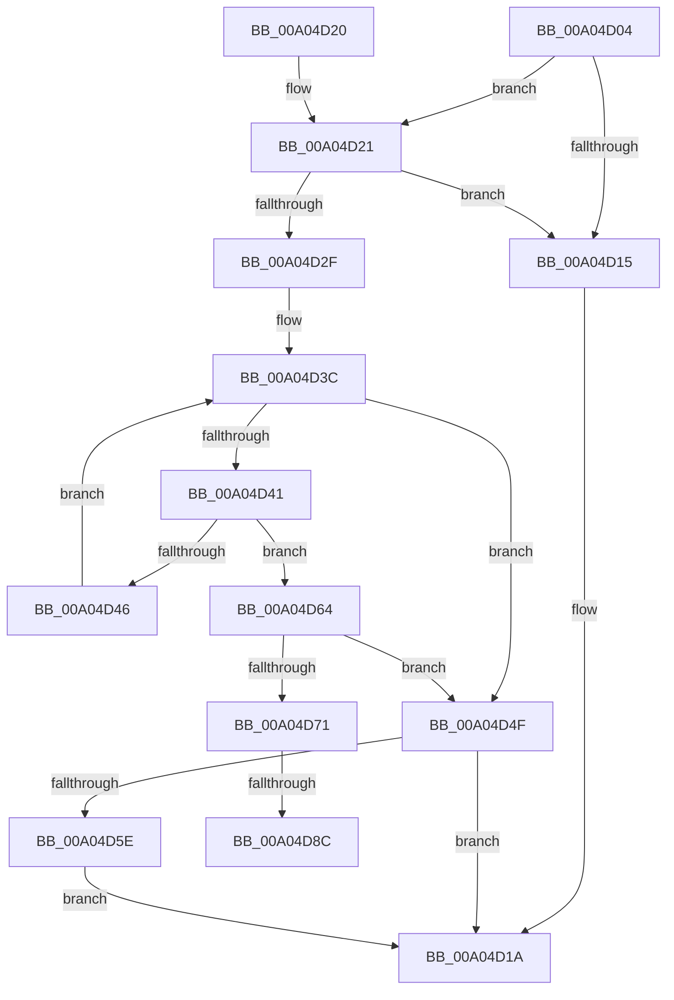

# IopAddRelationToList

- RVA: `0x00A04D04`–`0x00A04D9C` (길이 `152` bytes)
- VA: `0x0000000140A04D04`
- 실행 섹션: `PAGE`
- PDB 이름 있음: `예`; PDB Function 태그: `예`
- unwind 정보 RVA: `0x000734D8`
- 디코드: `46`개 명령, `152/152` bytes 표시
- 미해석 바이트: `0` (있으면 어셈블리에 `.byte`로 보존)

> 이 문서는 커널 이미지의 기계어와 PDB 기호를 분석해 생성했습니다. 4번과 5번은 함수 원형과 자료형을 바이너리 사용 방식에서 추정한 C 해석이며 원본 소스 복구 결과는 아닙니다.

## 1. Dependencies

- 직접 호출 지점: **1**; 고유 호출 대상: **1**
- 직접 호출자로 확인된 함수: **4**
- RIP 상대 이미지 참조: **0**

### Outgoing calls
- `0x00A04D55` → [PipDeviceObjectListAdd](PipDeviceObjectListAdd_function_00A04E18.md) (function, `0x00A04E18`)

### Direct callers
- [IopMergeRelationLists](../73/IopMergeRelationLists_function_0073DA50.md) at `0x0073DADF`
- [PnpProcessRelation](PnpProcessRelation_function_00A04A4C.md) at `0x00A04AAF`
- [PnpInvalidateRelationsInList](PnpInvalidateRelationsInList_function_00A05DF8.md) at `0x00A05F42`
- [sub_00B336B0](../B3/Unknown_function_00B336B0.md) at `0x00B339D3`

### Static image references
- 디코드된 RIP-relative 메모리 참조가 없습니다.

## 2. Other-region calls and transfers

- 다른 실행 섹션으로 향하는 call: **0**
- call이 아닌 외부 분기/꼬리 이동: **2**
  - `0x00A04D86` → [sub_00B33DCE](../B3/Unknown_function_00B33DCE.md) (`tail-transfer`)
  - `0x00A04D97` → [sub_00B33DCE](../B3/Unknown_function_00B33DCE.md) (`tail-transfer`)

## 3. Assembly (complete function range)

```asm
00A04D04  40 53                           push rbx
00A04D06  48 83 EC 20                     sub rsp, 0x20
00A04D0A  45 8B D8                        mov r11d, r8d
00A04D0D  48 8B D9                        mov rbx, rcx
00A04D10  48 85 D2                        test rdx, rdx
00A04D13  75 0C                           jne 0x140a04d21
00A04D15  B8 0E 00 00 C0                  mov eax, 0xc000000e
00A04D1A  48 83 C4 20                     add rsp, 0x20
00A04D1E  5B                              pop rbx
00A04D1F  C3                              ret
00A04D20  CC                              int3
00A04D21  48 8B 82 38 01 00 00            mov rax, qword ptr [rdx + 0x138]
00A04D28  48 83 78 28 00                  cmp qword ptr [rax + 0x28], 0
00A04D2D  74 E6                           je 0x140a04d15
00A04D2F  4C 8B 11                        mov r10, qword ptr [rcx]
00A04D32  45 33 C0                        xor r8d, r8d
00A04D35  41 8B 0A                        mov ecx, dword ptr [r10]
00A04D38  49 8D 42 10                     lea rax, [r10 + 0x10]
00A04D3C  44 3B C1                        cmp r8d, ecx
00A04D3F  7D 0E                           jge 0x140a04d4f
00A04D41  48 3B 10                        cmp rdx, qword ptr [rax]
00A04D44  74 1E                           je 0x140a04d64
00A04D46  41 FF C0                        inc r8d
00A04D49  48 83 C0 18                     add rax, 0x18
00A04D4D  EB ED                           jmp 0x140a04d3c
00A04D4F  45 8B C3                        mov r8d, r11d
00A04D52  48 8B CB                        mov rcx, rbx
00A04D55  E8 BE 00 00 00                  call 0x140a04e18
00A04D5A  85 C0                           test eax, eax
00A04D5C  78 BC                           js 0x140a04d1a
00A04D5E  C6 43 08 00                     mov byte ptr [rbx + 8], 0
00A04D62  EB B6                           jmp 0x140a04d1a
00A04D64  49 63 C0                        movsxd rax, r8d
00A04D67  48 8D 0C 40                     lea rcx, [rax + rax*2]
00A04D6B  41 83 F8 FF                     cmp r8d, -1
00A04D6F  74 DE                           je 0x140a04d4f
00A04D71  41 8B 44 CA 18                  mov eax, dword ptr [r10 + rcx*8 + 0x18]
00A04D76  44 3B D8                        cmp r11d, eax
00A04D79  41 0F 4F C3                     cmovg eax, r11d
00A04D7D  41 89 44 CA 18                  mov dword ptr [r10 + rcx*8 + 0x18], eax
00A04D82  41 83 F9 01                     cmp r9d, 1
00A04D86  0F 85 42 F0 12 00               jne 0x140b33dce
00A04D8C  48 8B 03                        mov rax, qword ptr [rbx]
00A04D8F  FF 40 08                        inc dword ptr [rax + 8]
00A04D92  45 09 4C CA 20                  or dword ptr [r10 + rcx*8 + 0x20], r9d
00A04D97  E9 32 F0 12 00                  jmp 0x140b33dce
```

## 4. C-style interpretation (structured pseudocode)

```c
__int64 __fastcall IopAddRelationToList(__int64 a1, __int64 a2, int a3, int a4)
{
    __int64 result;
    __int64 v_rsp;

    v_rsp = (v_rsp) - (32);
    if (a2 != 0) goto loc_00A04D21;
loc_00A04D15:
loc_00A04D1A:
    v_rsp = (v_rsp) + (32);
    return (unsigned int)(0xC000000EULL);
loc_00A04D21:
    if ((*(unsigned __int64 *)(*(unsigned __int64 *)(a2 + 312) + 40)) == 0) goto loc_00A04D15;
    a3 = 0;
loc_00A04D3C:
    if (0 >= ((unsigned int)((unsigned int)(*(unsigned int *)(*(unsigned __int64 *)(a1)))))) goto loc_00A04D4F;
    if (a2 == (*(unsigned __int64 *)(*(unsigned __int64 *)(a1) + 16))) goto loc_00A04D64;
    a3 = (unsigned int)((a3) + 1);
    result = (*(unsigned __int64 *)(a1) + 16) + (24);
    goto loc_00A04D3C;
loc_00A04D4F:
    result = PipDeviceObjectListAdd(a1, a2, (unsigned int)((unsigned int)((unsigned int)(a3))), a4);
    if (sign_flag) goto loc_00A04D1A;
    *(unsigned __int8 *)(a1 + 8) = 0;
    goto loc_00A04D1A;
loc_00A04D64:
    if (((unsigned int)((unsigned int)((unsigned int)((unsigned int)(a3))))) == -1) goto loc_00A04D4F;
    result = (unsigned int)(*(unsigned int *)(*(unsigned __int64 *)(a1) + (int)((unsigned int)((unsigned int)((unsigned int)((unsigned int)(a3))))) + (int)((unsigned int)((unsigned int)((unsigned int)((unsigned int)(a3))))) * 2 * 8 + 24));
    if (((unsigned int)((unsigned int)(a3))) > ((unsigned int)((unsigned int)(*(unsigned int *)(*(unsigned __int64 *)(a1) + (int)((unsigned int)((unsigned int)((unsigned int)((unsigned int)(a3))))) + (int)((unsigned int)((unsigned int)((unsigned int)((unsigned int)(a3))))) * 2 * 8 + 24))))) { result = (unsigned int)((unsigned int)(a3)); }
    *(unsigned int *)(*(unsigned __int64 *)(a1) + (int)((unsigned int)((unsigned int)((unsigned int)((unsigned int)(a3))))) + (int)((unsigned int)((unsigned int)((unsigned int)((unsigned int)(a3))))) * 2 * 8 + 24) = (unsigned int)(result);
}
```

## 5. (Beta) C Style

```c
int64_t IopAddRelationToList(void *Arg1, int64_t Arg2, int32_t Arg3, int32_t Arg4)
{
    uint8_t *arg1 = (uint8_t *)Arg1;

    int64_t result;
    int64_t local_rsp;

    local_rsp = (local_rsp) - (32);
    if (Arg2 != 0) goto loc_00A04D21;
loc_00A04D15:
loc_00A04D1A:
    local_rsp = (local_rsp) + (32);
    return (uint32_t)(0xC000000EULL);
loc_00A04D21:
    if ((*(uint64_t *)(*(uint64_t *)(Arg2 + 0x138) + 0x28)) == 0) goto loc_00A04D15;
    Arg3 = 0;
loc_00A04D3C:
    if (0 >= ((uint32_t)((uint32_t)(*(uint32_t *)(*(uint64_t *)(arg1)))))) goto loc_00A04D4F;
    if (Arg2 == (*(uint64_t *)(*(uint64_t *)(arg1) + 0x10))) goto loc_00A04D64;
    Arg3 = (uint32_t)((Arg3) + 1);
    result = (*(uint64_t *)(arg1) + 16) + (24);
    goto loc_00A04D3C;
loc_00A04D4F:
    result = PipDeviceObjectListAdd(Arg1, Arg2, (uint32_t)((uint32_t)((uint32_t)(Arg3))), Arg4);
    if (sign_flag) goto loc_00A04D1A;
    *(uint8_t *)(arg1 + 0x8) = 0;
    goto loc_00A04D1A;
loc_00A04D64:
    if (((uint32_t)((uint32_t)((uint32_t)((uint32_t)(Arg3))))) == -1) goto loc_00A04D4F;
    result = (uint32_t)(*(uint32_t *)(*(uint64_t *)(arg1) + (int32_t)((uint32_t)((uint32_t)((uint32_t)((uint32_t)(Arg3))))) + (int32_t)((uint32_t)((uint32_t)((uint32_t)((uint32_t)(Arg3))))) * 2 * 8 + 0x18));
    if (((uint32_t)((uint32_t)(Arg3))) > ((uint32_t)((uint32_t)(*(uint32_t *)(*(uint64_t *)(arg1) + (int32_t)((uint32_t)((uint32_t)((uint32_t)((uint32_t)(Arg3))))) + (int32_t)((uint32_t)((uint32_t)((uint32_t)((uint32_t)(Arg3))))) * 2 * 8 + 0x18))))) { result = (uint32_t)((uint32_t)(Arg3)); }
    *(uint32_t *)(*(uint64_t *)(arg1) + (int32_t)((uint32_t)((uint32_t)((uint32_t)((uint32_t)(Arg3))))) + (int32_t)((uint32_t)((uint32_t)((uint32_t)((uint32_t)(Arg3))))) * 2 * 8 + 0x18) = (uint32_t)(result);
}
```

### 관측된 메모리 오프셋

구조체 형식이 확인되지 않은 접근은 인자 기준의 오프셋으로만 기록했습니다.

| 기준 인자 | 오프셋 표현 | 폭 (bit) | 접근 |
|---|---:|---:|---|
| `Arg1` | `+ 0x0` | `64` | `R` |
| `Arg1` | `+ 0x8` | `8` | `W` |

## 6. Execution-region graph

[열기: 2D/3D 그래프와 함수 탐색 컨트롤 패널](../../../control-panel.html?section=page&rva=0x00A04D04&view=graph)

- 2D 그래프는 위에서 아래로 흐르고, 3D 그래프는 빈 공간을 드래그해 회전합니다. Shift+드래그는 이동, 휠은 확대·축소, 함수 노드 선택은 대상 보고서 이동입니다.

### Static fallback


