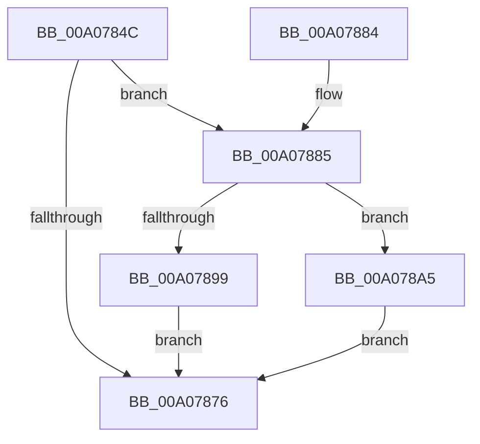

# IopAllocateRelationList

- RVA: `0x00A0784C`–`0x00A078AB` (길이 `95` bytes)
- VA: `0x0000000140A0784C`
- 실행 섹션: `PAGE`
- PDB 이름 있음: `예`; PDB Function 태그: `아니요`
- unwind 정보 RVA: `0x00063C24`
- 디코드: `29`개 명령, `95/95` bytes 표시
- 미해석 바이트: `0` (있으면 어셈블리에 `.byte`로 보존)

> 이 문서는 커널 이미지의 기계어와 PDB 기호를 분석해 생성했습니다. 4번과 5번은 함수 원형과 자료형을 바이너리 사용 방식에서 추정한 C 해석이며 원본 소스 복구 결과는 아닙니다.

## 1. Dependencies

- 직접 호출 지점: **3**; 고유 호출 대상: **3**
- 직접 호출자로 확인된 함수: **3**
- RIP 상대 이미지 참조: **0**

### Outgoing calls
- `0x00A07869` → [PnpAllocateCriticalMemory](PnpAllocateCriticalMemory_function_00A07924.md) (function, `0x00A07924`)
- `0x00A0788C` → [PiAllocateDeviceObjectList](PiAllocateDeviceObjectList_function_00A078B4.md) (function, `0x00A078B4`)
- `0x00A0789C` → [IopFreeRelationList](IopFreeRelationList_function_00A08310.md) (function, `0x00A08310`)

### Direct callers
- [PnpBuildRemovalRelationList](PnpBuildRemovalRelationList_function_00A058D0.md) at `0x00A05902`
- [PnpInvalidateRelationsInList](PnpInvalidateRelationsInList_function_00A05DF8.md) at `0x00A05E22`
- [PnpQueuePendingSurpriseRemoval](PnpQueuePendingSurpriseRemoval_function_00A05FAC.md) at `0x00A060AA`

### Static image references
- 디코드된 RIP-relative 메모리 참조가 없습니다.

## 2. Other-region calls and transfers

- 다른 실행 섹션으로 향하는 call: **0**
- 별도 외부 분기/꼬리 이동을 확인하지 못했습니다.

## 3. Assembly (complete function range)

```asm
00A0784C  48 89 5C 24 08                  mov qword ptr [rsp + 8], rbx
00A07851  57                              push rdi
00A07852  48 83 EC 20                     sub rsp, 0x20
00A07856  BA 00 01 00 00                  mov edx, 0x100
00A0785B  41 B9 50 6E 70 54               mov r9d, 0x54706e50
00A07861  41 B8 10 00 00 00               mov r8d, 0x10
00A07867  8B F9                           mov edi, ecx
00A07869  E8 B6 00 00 00                  call 0x140a07924
00A0786E  48 8B D8                        mov rbx, rax
00A07871  48 85 C0                        test rax, rax
00A07874  75 0F                           jne 0x140a07885
00A07876  48 8B C3                        mov rax, rbx
00A07879  48 8B 5C 24 30                  mov rbx, qword ptr [rsp + 0x30]
00A0787E  48 83 C4 20                     add rsp, 0x20
00A07882  5F                              pop rdi
00A07883  C3                              ret
00A07884  CC                              int3
00A07885  BA 08 00 00 00                  mov edx, 8
00A0788A  8B CF                           mov ecx, edi
00A0788C  E8 23 00 00 00                  call 0x140a078b4
00A07891  48 89 03                        mov qword ptr [rbx], rax
00A07894  48 85 C0                        test rax, rax
00A07897  75 0C                           jne 0x140a078a5
00A07899  48 8B CB                        mov rcx, rbx
00A0789C  E8 6F 0A 00 00                  call 0x140a08310
00A078A1  33 DB                           xor ebx, ebx
00A078A3  EB D1                           jmp 0x140a07876
00A078A5  C6 43 08 00                     mov byte ptr [rbx + 8], 0
00A078A9  EB CB                           jmp 0x140a07876
```

## 4. C-style interpretation (structured pseudocode)

```c
__int64 __fastcall IopAllocateRelationList(int a1)
{
    __int64 result;
    __int64 v_rbx;
    __int64 v_rsp;
    unsigned __int64 v_stack_p8;

    v_stack_p8 = v_rbx;
    v_rsp = (v_rsp) - (32);
    result = PnpAllocateCriticalMemory(a1, 256, 16, (unsigned int)(0x54706E50ULL));
    if (result != 0) goto loc_00A07885;
loc_00A07876:
    v_rsp = (v_rsp) + (32);
    return result;
loc_00A07885:
    result = PiAllocateDeviceObjectList((unsigned int)((unsigned int)((unsigned int)(a1))), 8, 16, (unsigned int)(0x54706E50ULL));
    *(unsigned __int64 *)(v_stack_p8) = result;
    if (result != 0) goto loc_00A078A5;
    result = IopFreeRelationList(v_stack_p8, 8, 16, (unsigned int)(0x54706E50ULL));
    v_rbx = 0;
    goto loc_00A07876;
loc_00A078A5:
    *(unsigned __int8 *)(v_rbx + 8) = 0;
    goto loc_00A07876;
}
```

## 5. (Beta) C Style

```c
int64_t IopAllocateRelationList(int32_t Arg1)
{
    int64_t result;
    int64_t local_rbx;
    int64_t local_rsp;
    uint64_t v_stack_p8;

    v_stack_p8 = local_rbx;
    local_rsp = (local_rsp) - (32);
    result = PnpAllocateCriticalMemory(Arg1, 256, 16, (uint32_t)(0x54706E50ULL));
    if (result != 0) goto loc_00A07885;
loc_00A07876:
    local_rsp = (local_rsp) + (32);
    return result;
loc_00A07885:
    result = PiAllocateDeviceObjectList((uint32_t)((uint32_t)((uint32_t)(Arg1))), 8, 16, (uint32_t)(0x54706E50ULL));
    *(uint64_t *)(v_stack_p8) = result;
    if (result != 0) goto loc_00A078A5;
    result = IopFreeRelationList(v_stack_p8, 8, 16, (uint32_t)(0x54706E50ULL));
    local_rbx = 0;
    goto loc_00A07876;
loc_00A078A5:
    *(uint8_t *)(local_rbx + 0x8) = 0;
    goto loc_00A07876;
}
```

## 6. Execution-region graph

[열기: 2D/3D 그래프와 함수 탐색 컨트롤 패널](../../../control-panel.html?section=page&rva=0x00A0784C&view=graph)

- 2D 그래프는 위에서 아래로 흐르고, 3D 그래프는 빈 공간을 드래그해 회전합니다. Shift+드래그는 이동, 휠은 확대·축소, 함수 노드 선택은 대상 보고서 이동입니다.

### Static fallback


