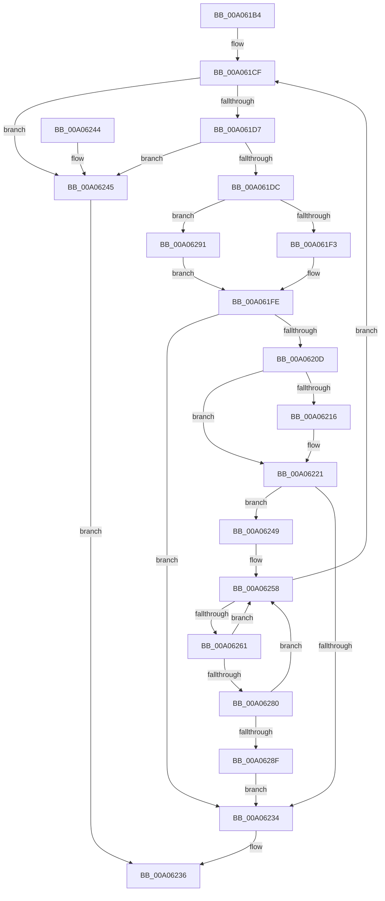

# IopCheckIfMergeRequired

- RVA: `0x00A061B4`–`0x00A06299` (길이 `229` bytes)
- VA: `0x0000000140A061B4`
- 실행 섹션: `PAGE`
- PDB 이름 있음: `예`; PDB Function 태그: `아니요`
- unwind 정보 RVA: `0x000A84C4`
- 디코드: `70`개 명령, `229/229` bytes 표시
- 미해석 바이트: `0` (있으면 어셈블리에 `.byte`로 보존)

> 이 문서는 커널 이미지의 기계어와 PDB 기호를 분석해 생성했습니다. 4번과 5번은 함수 원형과 자료형을 바이너리 사용 방식에서 추정한 C 해석이며 원본 소스 복구 결과는 아닙니다.

## 1. Dependencies

- 직접 호출 지점: **5**; 고유 호출 대상: **3**
- 직접 호출자로 확인된 함수: **1**
- RIP 상대 이미지 참조: **0**

### Outgoing calls
- `0x00A06204` → [PipIsDeviceInDeviceObjectList](PipIsDeviceInDeviceObjectList_function_00A070D0.md) (function, `0x00A070D0`)
- `0x00A0622B` → [PipIsDeviceInDeviceObjectList](PipIsDeviceInDeviceObjectList_function_00A070D0.md) (function, `0x00A070D0`)
- `0x00A0624D` → [PiGetProviderList](PiGetProviderList_function_00A07140.md) (function, `0x00A07140`)
- `0x00A0626E` → [PiEnumerateProviderListEntry](../72/PiEnumerateProviderListEntry_function_007277E4.md) (function, `0x007277E4`)
- `0x00A06286` → [PipIsDeviceInDeviceObjectList](PipIsDeviceInDeviceObjectList_function_00A070D0.md) (function, `0x00A070D0`)

### Direct callers
- [PnpQueuePendingSurpriseRemoval](PnpQueuePendingSurpriseRemoval_function_00A05FAC.md) at `0x00A06085`

### Static image references
- 디코드된 RIP-relative 메모리 참조가 없습니다.

## 2. Other-region calls and transfers

- 다른 실행 섹션으로 향하는 call: **0**
- 별도 외부 분기/꼬리 이동을 확인하지 못했습니다.

## 3. Assembly (complete function range)

```asm
00A061B4  48 89 5C 24 08                  mov qword ptr [rsp + 8], rbx
00A061B9  56                              push rsi
00A061BA  57                              push rdi
00A061BB  41 56                           push r14
00A061BD  48 83 EC 20                     sub rsp, 0x20
00A061C1  48 83 64 24 58 00               and qword ptr [rsp + 0x58], 0
00A061C7  48 8B F2                        mov rsi, rdx
00A061CA  33 FF                           xor edi, edi
00A061CC  4C 8B F1                        mov r14, rcx
00A061CF  4D 8B 06                        mov r8, qword ptr [r14]
00A061D2  41 3B 38                        cmp edi, dword ptr [r8]
00A061D5  73 6E                           jae 0x140a06245
00A061D7  4D 85 C0                        test r8, r8
00A061DA  74 69                           je 0x140a06245
00A061DC  0F AE E8                        lfence
00A061DF  48 8D 0C 7F                     lea rcx, [rdi + rdi*2]
00A061E3  FF C7                           inc edi
00A061E5  49 8B 54 C8 10                  mov rdx, qword ptr [r8 + rcx*8 + 0x10]
00A061EA  48 85 D2                        test rdx, rdx
00A061ED  0F 84 9E 00 00 00               je 0x140a06291
00A061F3  48 8B 82 38 01 00 00            mov rax, qword ptr [rdx + 0x138]
00A061FA  4C 8B 58 28                     mov r11, qword ptr [rax + 0x28]
00A061FE  48 8B 0E                        mov rcx, qword ptr [rsi]
00A06201  45 33 C0                        xor r8d, r8d
00A06204  E8 C7 0E 00 00                  call 0x140a070d0
00A06209  84 C0                           test al, al
00A0620B  75 27                           jne 0x140a06234
00A0620D  49 8B 53 10                     mov rdx, qword ptr [r11 + 0x10]
00A06211  48 85 D2                        test rdx, rdx
00A06214  75 0B                           jne 0x140a06221
00A06216  49 8B 93 88 02 00 00            mov rdx, qword ptr [r11 + 0x288]
00A0621D  48 83 E2 FE                     and rdx, 0xfffffffffffffffe
00A06221  48 8B 52 20                     mov rdx, qword ptr [rdx + 0x20]
00A06225  45 33 C0                        xor r8d, r8d
00A06228  48 8B 0E                        mov rcx, qword ptr [rsi]
00A0622B  E8 A0 0E 00 00                  call 0x140a070d0
00A06230  84 C0                           test al, al
00A06232  74 15                           je 0x140a06249
00A06234  B0 01                           mov al, 1
00A06236  48 8B 5C 24 40                  mov rbx, qword ptr [rsp + 0x40]
00A0623B  48 83 C4 20                     add rsp, 0x20
00A0623F  41 5E                           pop r14
00A06241  5F                              pop rdi
00A06242  5E                              pop rsi
00A06243  C3                              ret
00A06244  CC                              int3
00A06245  32 C0                           xor al, al
00A06247  EB ED                           jmp 0x140a06236
00A06249  49 8B 4B 20                     mov rcx, qword ptr [r11 + 0x20]
00A0624D  E8 EE 0E 00 00                  call 0x140a07140
00A06252  48 8B D8                        mov rbx, rax
00A06255  4C 8B 18                        mov r11, qword ptr [rax]
00A06258  4C 3B DB                        cmp r11, rbx
00A0625B  0F 84 6E FF FF FF               je 0x140a061cf
00A06261  4C 8D 44 24 50                  lea r8, [rsp + 0x50]
00A06266  49 8B CB                        mov rcx, r11
00A06269  48 8D 54 24 58                  lea rdx, [rsp + 0x58]
00A0626E  E8 71 15 D2 FF                  call 0x1407277e4
00A06273  48 8B 54 24 58                  mov rdx, qword ptr [rsp + 0x58]
00A06278  4D 8B 1B                        mov r11, qword ptr [r11]
00A0627B  48 85 D2                        test rdx, rdx
00A0627E  74 D8                           je 0x140a06258
00A06280  48 8B 0E                        mov rcx, qword ptr [rsi]
00A06283  45 33 C0                        xor r8d, r8d
00A06286  E8 45 0E 00 00                  call 0x140a070d0
00A0628B  84 C0                           test al, al
00A0628D  74 C9                           je 0x140a06258
00A0628F  EB A3                           jmp 0x140a06234
00A06291  45 33 DB                        xor r11d, r11d
00A06294  E9 65 FF FF FF                  jmp 0x140a061fe
```

## 4. C-style interpretation (structured pseudocode)

```c
__int64 __fastcall IopCheckIfMergeRequired(__int64 a1, __int64 a2)
{
    __int64 result;
    __int64 v_r11;
    __int64 v_rdi;
    __int64 v_rsp;
    unsigned __int64 v_stack_p20;
    unsigned __int64 v_stack_p50;
    unsigned __int64 v_stack_p58;
    unsigned __int64 v_stack_p8;

    v_stack_p8 = v_rbx;
    v_rsp = (v_rsp) - (32);
    v_rdi = 0;
loc_00A061CF:
    if (0 >= (*(unsigned int *)(*(unsigned __int64 *)(a1)))) goto loc_00A06245;
    if (*(unsigned __int64 *)(a1) == 0) goto loc_00A06245;
    v_rdi = (unsigned int)((v_rdi) + 1);
    if (*(unsigned __int64 *)(*(unsigned __int64 *)(a1) + v_rdi + v_rdi * 2 * 8 + 16) == 0) goto loc_00A06291;
loc_00A061FE:
    a3 = 0;
    result = PipIsDeviceInDeviceObjectList(*(unsigned __int64 *)(a2), *(unsigned __int64 *)(*(unsigned __int64 *)(a1) + v_rdi + v_rdi * 2 * 8 + 16), a3, a4);
    if ((unsigned __int8)(result) != 0) goto loc_00A06234;
    if (*(unsigned __int64 *)(*(unsigned __int64 *)(*(unsigned __int64 *)(*(unsigned __int64 *)(*(unsigned __int64 *)(a1) + v_rdi + v_rdi * 2 * 8 + 16) + 312) + 40) + 16) == 0) {
        a2 = *(unsigned __int64 *)(*(unsigned __int64 *)(*(unsigned __int64 *)(*(unsigned __int64 *)(*(unsigned __int64 *)(a1) + v_rdi + v_rdi * 2 * 8 + 16) + 312) + 40) + 648);
        a2 = (a2) & (-2);
    }
    a3 = 0;
    result = PipIsDeviceInDeviceObjectList(*(unsigned __int64 *)(a2), *(unsigned __int64 *)(a2 + 32), a3, a4);
    if ((unsigned __int8)(result) == 0) goto loc_00A06249;
loc_00A06234:
loc_00A06236:
    v_rsp = (v_rsp) + (32);
    return 1;
loc_00A06245:
    result = 0;
    goto loc_00A06236;
loc_00A06249:
    result = PiGetProviderList(*(unsigned __int64 *)(*(unsigned __int64 *)(*(unsigned __int64 *)(*(unsigned __int64 *)(*(unsigned __int64 *)(a1) + v_rdi + v_rdi * 2 * 8 + 16) + 312) + 40) + 32), *(unsigned __int64 *)(a2 + 32), a3, a4);
loc_00A06258:
    if ((*(unsigned __int64 *)(result)) == result) goto loc_00A061CF;
    result = PiEnumerateProviderListEntry(*(unsigned __int64 *)(result), v_stack_p58, v_stack_p50, a4);
    if (v_stack_p58 == 0) goto loc_00A06258;
    a3 = 0;
    result = PipIsDeviceInDeviceObjectList(*(unsigned __int64 *)(a2), v_stack_p58, a3, a4);
    if ((unsigned __int8)(result) == 0) goto loc_00A06258;
    goto loc_00A06234;
loc_00A06291:
    v_r11 = 0;
    goto loc_00A061FE;
}
```

## 5. (Beta) C Style

```c
int64_t IopCheckIfMergeRequired(void *Arg1, void *Arg2)
{
    uint8_t *arg1 = (uint8_t *)Arg1;
    uint8_t *arg2 = (uint8_t *)Arg2;

    int64_t result;
    int64_t local_r11;
    int64_t local_rdi;
    int64_t local_rsp;
    uint64_t v_stack_p20;
    uint64_t v_stack_p50;
    uint64_t v_stack_p58;
    uint64_t v_stack_p8;

    v_stack_p8 = local_rbx;
    local_rsp = (local_rsp) - (32);
    local_rdi = 0;
loc_00A061CF:
    if (0 >= (*(uint32_t *)(*(uint64_t *)(arg1)))) goto loc_00A06245;
    if (*(uint64_t *)(arg1) == 0) goto loc_00A06245;
    local_rdi = (uint32_t)((local_rdi) + 1);
    if (*(uint64_t *)(*(uint64_t *)(arg1) + local_rdi + local_rdi * 2 * 8 + 0x10) == 0) goto loc_00A06291;
loc_00A061FE:
    a3 = 0;
    result = PipIsDeviceInDeviceObjectList(*(uint64_t *)(arg2), *(uint64_t *)(*(uint64_t *)(arg1) + local_rdi + local_rdi * 2 * 8 + 0x10), a3, a4);
    if ((uint8_t)(result) != 0) goto loc_00A06234;
    if (*(uint64_t *)(*(uint64_t *)(*(uint64_t *)(*(uint64_t *)(*(uint64_t *)(arg1) + local_rdi + local_rdi * 2 * 8 + 0x10) + 0x138) + 0x28) + 0x10) == 0) {
        Arg2 = *(uint64_t *)(*(uint64_t *)(*(uint64_t *)(*(uint64_t *)(*(uint64_t *)(arg1) + local_rdi + local_rdi * 2 * 8 + 0x10) + 0x138) + 0x28) + 0x288);
        Arg2 = (Arg2) & (-2);
    }
    a3 = 0;
    result = PipIsDeviceInDeviceObjectList(*(uint64_t *)(arg2), *(uint64_t *)(arg2 + 0x20), a3, a4);
    if ((uint8_t)(result) == 0) goto loc_00A06249;
loc_00A06234:
loc_00A06236:
    local_rsp = (local_rsp) + (32);
    return 1;
loc_00A06245:
    result = 0;
    goto loc_00A06236;
loc_00A06249:
    result = PiGetProviderList(*(uint64_t *)(*(uint64_t *)(*(uint64_t *)(*(uint64_t *)(*(uint64_t *)(arg1) + local_rdi + local_rdi * 2 * 8 + 0x10) + 0x138) + 0x28) + 0x20), *(uint64_t *)(arg2 + 0x20), a3, a4);
loc_00A06258:
    if ((*(uint64_t *)(result)) == result) goto loc_00A061CF;
    result = PiEnumerateProviderListEntry(*(uint64_t *)(result), v_stack_p58, v_stack_p50, a4);
    if (v_stack_p58 == 0) goto loc_00A06258;
    a3 = 0;
    result = PipIsDeviceInDeviceObjectList(*(uint64_t *)(arg2), v_stack_p58, a3, a4);
    if ((uint8_t)(result) == 0) goto loc_00A06258;
    goto loc_00A06234;
loc_00A06291:
    local_r11 = 0;
    goto loc_00A061FE;
}
```

### 관측된 메모리 오프셋

구조체 형식이 확인되지 않은 접근은 인자 기준의 오프셋으로만 기록했습니다.

| 기준 인자 | 오프셋 표현 | 폭 (bit) | 접근 |
|---|---:|---:|---|
| `Arg1` | `+ 0x0` | `64` | `R` |
| `Arg2` | `+ 0x0` | `64` | `R` |

## 6. Execution-region graph

[열기: 2D/3D 그래프와 함수 탐색 컨트롤 패널](../../../control-panel.html?section=page&rva=0x00A061B4&view=graph)

- 2D 그래프는 위에서 아래로 흐르고, 3D 그래프는 빈 공간을 드래그해 회전합니다. Shift+드래그는 이동, 휠은 확대·축소, 함수 노드 선택은 대상 보고서 이동입니다.

### Static fallback


