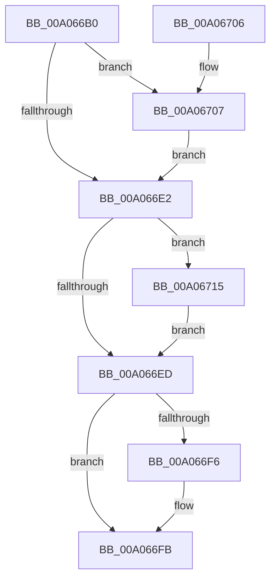

# IopDeleteDevice

- RVA: `0x00A066B0`–`0x00A0671E` (길이 `110` bytes)
- VA: `0x0000000140A066B0`
- 실행 섹션: `PAGE`
- PDB 이름 있음: `예`; PDB Function 태그: `아니요`
- unwind 정보 RVA: `0x0007918C`
- 디코드: `31`개 명령, `110/110` bytes 표시
- 미해석 바이트: `0` (있으면 어셈블리에 `.byte`로 보존)

> 이 문서는 커널 이미지의 기계어와 PDB 기호를 분석해 생성했습니다. 4번과 5번은 함수 원형과 자료형을 바이너리 사용 방식에서 추정한 C 해석이며 원본 소스 복구 결과는 아닙니다.

## 1. Dependencies

- 직접 호출 지점: **5**; 고유 호출 대상: **5**
- 직접 호출자로 확인된 함수: **0**
- RIP 상대 이미지 참조: **0**

### Outgoing calls
- `0x00A066BD` → [PnpDeleteAllDependencyRelations](PnpDeleteAllDependencyRelations_function_00A06724.md) (function, `0x00A06724`)
- `0x00A066CD` → [IopDestroyDeviceNode](IopDestroyDeviceNode_function_00A06A3C.md) (function, `0x00A06A3C`)
- `0x00A066F6` → [ObfDereferenceObject](../../text/2F/ObfDereferenceObject_function_002F9350.md) (function, `0x002F9350`)
- `0x00A0670E` → [IopCleanupNotifications](../../text/4B/IopCleanupNotifications_function_004B044C.md) (function, `0x004B044C`)
- `0x00A06717` → [ExFreePoolWithTag](../../poolcode/B8/ExFreePoolWithTag_function_00B82870.md) (function, `0x00B82870`)

### Direct callers
- 이 함수 시작 RVA로 연결되는 직접 call은 확인되지 않았습니다. 간접 호출은 완전히 역산할 수 없습니다.

### Static image references
- 디코드된 RIP-relative 메모리 참조가 없습니다.

## 2. Other-region calls and transfers

- 다른 실행 섹션으로 향하는 call: **3**
  - `0x00A066F6` → [ObfDereferenceObject](../../text/2F/ObfDereferenceObject_function_002F9350.md) (`PAGE` → `.text`)
  - `0x00A0670E` → [IopCleanupNotifications](../../text/4B/IopCleanupNotifications_function_004B044C.md) (`PAGE` → `.text`)
  - `0x00A06717` → [ExFreePoolWithTag](../../poolcode/B8/ExFreePoolWithTag_function_00B82870.md) (`PAGE` → `POOLCODE`)
- 별도 외부 분기/꼬리 이동을 확인하지 못했습니다.

## 3. Assembly (complete function range)

```asm
00A066B0  48 89 5C 24 08                  mov qword ptr [rsp + 8], rbx
00A066B5  57                              push rdi
00A066B6  48 83 EC 20                     sub rsp, 0x20
00A066BA  48 8B F9                        mov rdi, rcx
00A066BD  E8 62 00 00 00                  call 0x140a06724
00A066C2  48 8B 8F 38 01 00 00            mov rcx, qword ptr [rdi + 0x138]
00A066C9  48 8B 49 28                     mov rcx, qword ptr [rcx + 0x28]
00A066CD  E8 6A 03 00 00                  call 0x140a06a3c
00A066D2  48 8B 87 38 01 00 00            mov rax, qword ptr [rdi + 0x138]
00A066D9  F7 40 20 00 10 00 00            test dword ptr [rax + 0x20], 0x1000
00A066E0  75 25                           jne 0x140a06707
00A066E2  33 C9                           xor ecx, ecx
00A066E4  48 87 4F 38                     xchg qword ptr [rdi + 0x38], rcx
00A066E8  48 85 C9                        test rcx, rcx
00A066EB  75 28                           jne 0x140a06715
00A066ED  48 8B 4F 08                     mov rcx, qword ptr [rdi + 8]
00A066F1  48 85 C9                        test rcx, rcx
00A066F4  74 05                           je 0x140a066fb
00A066F6  E8 55 2C 8F FF                  call 0x1402f9350
00A066FB  48 8B 5C 24 30                  mov rbx, qword ptr [rsp + 0x30]
00A06700  48 83 C4 20                     add rsp, 0x20
00A06704  5F                              pop rdi
00A06705  C3                              ret
00A06706  CC                              int3
00A06707  48 8B 4F 08                     mov rcx, qword ptr [rdi + 8]
00A0670B  48 8B D7                        mov rdx, rdi
00A0670E  E8 39 9D AA FF                  call 0x1404b044c
00A06713  EB CD                           jmp 0x140a066e2
00A06715  33 D2                           xor edx, edx
00A06717  E8 54 C1 17 00                  call 0x140b82870
00A0671C  EB CF                           jmp 0x140a066ed
```

## 4. C-style interpretation (structured pseudocode)

```c
__int64 __fastcall IopDeleteDevice(__int64 a1)
{
    __int64 result;
    __int64 v_rsp;
    unsigned __int64 v_stack_p8;

    v_stack_p8 = v_rbx;
    v_rsp = (v_rsp) - (32);
    result = PnpDeleteAllDependencyRelations(a1, a2, a3, a4);
    result = IopDestroyDeviceNode(*(unsigned __int64 *)(*(unsigned __int64 *)(a1 + 312) + 40), a2, a3, a4);
    if (((*(unsigned int *)(*(unsigned __int64 *)(a1 + 312) + 32)) & (0x1000ULL)) != 0) goto loc_00A06707;
loc_00A066E2:
    a1 = 0;
    if (0 != 0) goto loc_00A06715;
loc_00A066ED:
    result = *(unsigned __int64 *)(a1 + 312);
    if (*(unsigned __int64 *)(a1 + 8) != 0) {
        result = ObfDereferenceObject(*(unsigned __int64 *)(a1 + 8), a2, a3, a4);
    }
    v_rsp = (v_rsp) + (32);
    return result;
loc_00A06707:
    result = IopCleanupNotifications(*(unsigned __int64 *)(a1 + 8), 0, a3, a4);
    goto loc_00A066E2;
loc_00A06715:
    a2 = 0;
    result = ExFreePoolWithTag(*(unsigned __int64 *)(a1 + 8), a2, a3, a4);
    goto loc_00A066ED;
}
```

## 5. (Beta) C Style

```c
int64_t IopDeleteDevice(void *Arg1)
{
    uint8_t *arg1 = (uint8_t *)Arg1;

    int64_t result;
    int64_t local_rsp;
    uint64_t v_stack_p8;

    v_stack_p8 = local_rbx;
    local_rsp = (local_rsp) - (32);
    result = PnpDeleteAllDependencyRelations(Arg1, a2, a3, a4);
    result = IopDestroyDeviceNode(*(uint64_t *)(*(uint64_t *)(arg1 + 0x138) + 0x28), a2, a3, a4);
    if (((*(uint32_t *)(*(uint64_t *)(arg1 + 0x138) + 0x20)) & (0x1000ULL)) != 0) goto loc_00A06707;
loc_00A066E2:
    Arg1 = 0;
    if (0 != 0) goto loc_00A06715;
loc_00A066ED:
    result = *(uint64_t *)(arg1 + 0x138);
    if (*(uint64_t *)(arg1 + 0x8) != 0) {
        result = ObfDereferenceObject(*(uint64_t *)(arg1 + 0x8), a2, a3, a4);
    }
    local_rsp = (local_rsp) + (32);
    return result;
loc_00A06707:
    result = IopCleanupNotifications(*(uint64_t *)(arg1 + 0x8), 0, a3, a4);
    goto loc_00A066E2;
loc_00A06715:
    a2 = 0;
    result = ExFreePoolWithTag(*(uint64_t *)(arg1 + 0x8), a2, a3, a4);
    goto loc_00A066ED;
}
```

### 관측된 메모리 오프셋

구조체 형식이 확인되지 않은 접근은 인자 기준의 오프셋으로만 기록했습니다.

| 기준 인자 | 오프셋 표현 | 폭 (bit) | 접근 |
|---|---:|---:|---|
| `Arg1` | `+ 0x8` | `64` | `R` |
| `Arg1` | `+ 0x38` | `64` | `R/W` |
| `Arg1` | `+ 0x138` | `64` | `R` |

## 6. Execution-region graph

[열기: 2D/3D 그래프와 함수 탐색 컨트롤 패널](../../../control-panel.html?section=page&rva=0x00A066B0&view=graph)

- 2D 그래프는 위에서 아래로 흐르고, 3D 그래프는 빈 공간을 드래그해 회전합니다. Shift+드래그는 이동, 휠은 확대·축소, 함수 노드 선택은 대상 보고서 이동입니다.

### Static fallback


