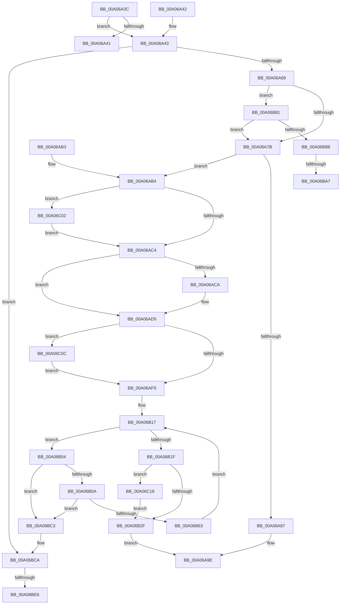

# IopDestroyDeviceNode

- RVA: `0x00A06A3C`–`0x00A06C27` (길이 `491` bytes)
- VA: `0x0000000140A06A3C`
- 실행 섹션: `PAGE`
- PDB 이름 있음: `예`; PDB Function 태그: `예`
- unwind 정보 RVA: `0x000A8538`
- 디코드: `119`개 명령, `491/491` bytes 표시
- 미해석 바이트: `0` (있으면 어셈블리에 `.byte`로 보존)

> 이 문서는 커널 이미지의 기계어와 PDB 기호를 분석해 생성했습니다. 4번과 5번은 함수 원형과 자료형을 바이너리 사용 방식에서 추정한 C 해석이며 원본 소스 복구 결과는 아닙니다.

## 1. Dependencies

- 직접 호출 지점: **18**; 고유 호출 대상: **8**
- 직접 호출자로 확인된 함수: **3**
- RIP 상대 이미지 참조: **3**

### Outgoing calls
- `0x00A06A99` → [IopLegacyResourceAllocation](IopLegacyResourceAllocation_function_00A07224.md) (function, `0x00A07224`)
- `0x00A06AD0` → [ExFreePoolWithTag](../../poolcode/B8/ExFreePoolWithTag_function_00B82870.md) (function, `0x00B82870`)
- `0x00A06AD8` → [PnpFreeDeviceInstancePath](PnpFreeDeviceInstancePath_function_00A074F0.md) (function, `0x00A074F0`)
- `0x00A06AE4` → [ExAcquireFastMutex](../../text/20/ExAcquireFastMutex_function_0020E5A0.md) (function, `0x0020E5A0`)
- `0x00A06B00` → [ExReleaseFastMutex](../../text/25/ExReleaseFastMutex_function_002519C0.md) (function, `0x002519C0`)
- `0x00A06B0B` → [IopUncacheInterfaceInformation](../8F/IopUncacheInterfaceInformation_function_008FCC28.md) (function, `0x008FCC28`)
- `0x00A06B43` → [ExFreePoolWithTag](../../poolcode/B8/ExFreePoolWithTag_function_00B82870.md) (function, `0x00B82870`)
- `0x00A06B70` → [ExFreePoolWithTag](../../poolcode/B8/ExFreePoolWithTag_function_00B82870.md) (function, `0x00B82870`)
- `0x00A06B7A` → [ExFreePoolWithTag](../../poolcode/B8/ExFreePoolWithTag_function_00B82870.md) (function, `0x00B82870`)
- `0x00A06B94` → [IoAddTriageDumpDataBlock](../../text/42/IoAddTriageDumpDataBlock_function_00428374.md) (function, `0x00428374`)
- `0x00A06BAC` → [IoAddTriageDumpDataBlock](../../text/42/IoAddTriageDumpDataBlock_function_00428374.md) (function, `0x00428374`)
- `0x00A06BB8` → [IoAddTriageDumpDataBlock](../../text/42/IoAddTriageDumpDataBlock_function_00428374.md) (function, `0x00428374`)
- `0x00A06BD3` → [IoAddTriageDumpDataBlock](../../text/42/IoAddTriageDumpDataBlock_function_00428374.md) (function, `0x00428374`)
- `0x00A06BEB` → [IoAddTriageDumpDataBlock](../../text/42/IoAddTriageDumpDataBlock_function_00428374.md) (function, `0x00428374`)
- `0x00A06BF7` → [IoAddTriageDumpDataBlock](../../text/42/IoAddTriageDumpDataBlock_function_00428374.md) (function, `0x00428374`)
- `0x00A06C02` → [ObfDereferenceObject](../../text/2F/ObfDereferenceObject_function_002F9350.md) (function, `0x002F9350`)
- `0x00A06C0E` → [ExFreePoolWithTag](../../poolcode/B8/ExFreePoolWithTag_function_00B82870.md) (function, `0x00B82870`)
- `0x00A06C1D` → [ExFreePoolWithTag](../../poolcode/B8/ExFreePoolWithTag_function_00B82870.md) (function, `0x00B82870`)

### Direct callers
- [IopRemoveLegacyDeviceNode](../72/IopRemoveLegacyDeviceNode_function_0072E590.md) at `0x0072E647`
- [IopDeleteDevice](IopDeleteDevice_function_00A066B0.md) at `0x00A066CD`
- [IopFindLegacyDeviceNode](../AC/IopFindLegacyDeviceNode_function_00AC7338.md) at `0x00AC73B9`

### Static image references
- `0x00A06A87` → RVA `0x00F8C440` (`.data`; read)
- `0x00A06ADD` → RVA `0x00F8C3E0` (`.data`; read)
- `0x00A06B48` → RVA `0x00F8C668` (`.data`; read/write)

## 2. Other-region calls and transfers

- 다른 실행 섹션으로 향하는 call: **15**
  - `0x00A06AD0` → [ExFreePoolWithTag](../../poolcode/B8/ExFreePoolWithTag_function_00B82870.md) (`PAGE` → `POOLCODE`)
  - `0x00A06AE4` → [ExAcquireFastMutex](../../text/20/ExAcquireFastMutex_function_0020E5A0.md) (`PAGE` → `.text`)
  - `0x00A06B00` → [ExReleaseFastMutex](../../text/25/ExReleaseFastMutex_function_002519C0.md) (`PAGE` → `.text`)
  - `0x00A06B43` → [ExFreePoolWithTag](../../poolcode/B8/ExFreePoolWithTag_function_00B82870.md) (`PAGE` → `POOLCODE`)
  - `0x00A06B70` → [ExFreePoolWithTag](../../poolcode/B8/ExFreePoolWithTag_function_00B82870.md) (`PAGE` → `POOLCODE`)
  - `0x00A06B7A` → [ExFreePoolWithTag](../../poolcode/B8/ExFreePoolWithTag_function_00B82870.md) (`PAGE` → `POOLCODE`)
  - `0x00A06B94` → [IoAddTriageDumpDataBlock](../../text/42/IoAddTriageDumpDataBlock_function_00428374.md) (`PAGE` → `.text`)
  - `0x00A06BAC` → [IoAddTriageDumpDataBlock](../../text/42/IoAddTriageDumpDataBlock_function_00428374.md) (`PAGE` → `.text`)
  - `0x00A06BB8` → [IoAddTriageDumpDataBlock](../../text/42/IoAddTriageDumpDataBlock_function_00428374.md) (`PAGE` → `.text`)
  - `0x00A06BD3` → [IoAddTriageDumpDataBlock](../../text/42/IoAddTriageDumpDataBlock_function_00428374.md) (`PAGE` → `.text`)
  - `0x00A06BEB` → [IoAddTriageDumpDataBlock](../../text/42/IoAddTriageDumpDataBlock_function_00428374.md) (`PAGE` → `.text`)
  - `0x00A06BF7` → [IoAddTriageDumpDataBlock](../../text/42/IoAddTriageDumpDataBlock_function_00428374.md) (`PAGE` → `.text`)
  - `0x00A06C02` → [ObfDereferenceObject](../../text/2F/ObfDereferenceObject_function_002F9350.md) (`PAGE` → `.text`)
  - `0x00A06C0E` → [ExFreePoolWithTag](../../poolcode/B8/ExFreePoolWithTag_function_00B82870.md) (`PAGE` → `POOLCODE`)
  - `0x00A06C1D` → [ExFreePoolWithTag](../../poolcode/B8/ExFreePoolWithTag_function_00B82870.md) (`PAGE` → `POOLCODE`)
- call이 아닌 외부 분기/꼬리 이동: **4**
  - `0x00A06BA1` → [sub_00B34536 + 0x6D](../B3/Unknown_function_00B34536.md) (`tail-transfer`)
  - `0x00A06BBE` → [sub_00B34536 + 0x6D](../B3/Unknown_function_00B34536.md) (`tail-transfer`)
  - `0x00A06BE0` → [sub_00B34536](../B3/Unknown_function_00B34536.md) (`tail-transfer`)
  - `0x00A06BFD` → [sub_00B34536](../B3/Unknown_function_00B34536.md) (`tail-transfer`)

## 3. Assembly (complete function range)

```asm
00A06A3C  48 85 C9                        test rcx, rcx
00A06A3F  75 02                           jne 0x140a06a43
00A06A41  C3                              ret
00A06A42  CC                              int3
00A06A43  48 89 5C 24 08                  mov qword ptr [rsp + 8], rbx
00A06A48  48 89 6C 24 10                  mov qword ptr [rsp + 0x10], rbp
00A06A4D  48 89 74 24 18                  mov qword ptr [rsp + 0x18], rsi
00A06A52  57                              push rdi
00A06A53  48 83 EC 30                     sub rsp, 0x30
00A06A57  33 ED                           xor ebp, ebp
00A06A59  48 8B D9                        mov rbx, rcx
00A06A5C  48 39 A9 D0 02 00 00            cmp qword ptr [rcx + 0x2d0], rbp
00A06A63  0F 85 61 01 00 00               jne 0x140a06bca
00A06A69  4C 8B 41 20                     mov r8, qword ptr [rcx + 0x20]
00A06A6D  41 F7 40 30 00 10 00 00         test dword ptr [r8 + 0x30], 0x1000
00A06A75  0F 85 06 01 00 00               jne 0x140a06b81
00A06A7B  F7 81 8C 01 00 00 00 00 02 00   test dword ptr [rcx + 0x18c], 0x20000
00A06A85  74 2D                           je 0x140a06ab4
00A06A87  48 8B 15 B2 59 58 00            mov rdx, qword ptr [rip + 0x5859b2]
00A06A8E  45 33 C9                        xor r9d, r9d
00A06A91  83 C9 FF                        or ecx, 0xffffffff
00A06A94  48 89 6C 24 20                  mov qword ptr [rsp + 0x20], rbp
00A06A99  E8 86 07 00 00                  call 0x140a07224
00A06A9E  48 8B 5C 24 40                  mov rbx, qword ptr [rsp + 0x40]
00A06AA3  48 8B 6C 24 48                  mov rbp, qword ptr [rsp + 0x48]
00A06AA8  48 8B 74 24 50                  mov rsi, qword ptr [rsp + 0x50]
00A06AAD  48 83 C4 30                     add rsp, 0x30
00A06AB1  5F                              pop rdi
00A06AB2  C3                              ret
00A06AB3  CC                              int3
00A06AB4  48 8B 89 B0 01 00 00            mov rcx, qword ptr [rcx + 0x1b0]
00A06ABB  48 85 C9                        test rcx, rcx
00A06ABE  0F 85 3E 01 00 00               jne 0x140a06c02
00A06AC4  66 39 6B 38                     cmp word ptr [rbx + 0x38], bp
00A06AC8  74 0B                           je 0x140a06ad5
00A06ACA  48 8B 4B 40                     mov rcx, qword ptr [rbx + 0x40]
00A06ACE  33 D2                           xor edx, edx
00A06AD0  E8 9B BD 17 00                  call 0x140b82870
00A06AD5  48 8B CB                        mov rcx, rbx
00A06AD8  E8 13 0A 00 00                  call 0x140a074f0
00A06ADD  48 8D 0D FC 58 58 00            lea rcx, [rip + 0x5858fc]
00A06AE4  E8 B7 7A 80 FF                  call 0x14020e5a0
00A06AE9  48 8B 8B B8 01 00 00            mov rcx, qword ptr [rbx + 0x1b8]
00A06AF0  48 85 C9                        test rcx, rcx
00A06AF3  0F 85 13 01 00 00               jne 0x140a06c0c
00A06AF9  48 8D 0D E0 58 58 00            lea rcx, [rip + 0x5858e0]
00A06B00  E8 BB AE 84 FF                  call 0x1402519c0
00A06B05  48 8B 4B 20                     mov rcx, qword ptr [rbx + 0x20]
00A06B09  33 D2                           xor edx, edx
00A06B0B  E8 18 61 EF FF                  call 0x1408fcc28
00A06B10  48 8D B3 60 02 00 00            lea rsi, [rbx + 0x260]
00A06B17  48 8B 3E                        mov rdi, qword ptr [rsi]
00A06B1A  48 3B FE                        cmp rdi, rsi
00A06B1D  75 35                           jne 0x140a06b54
00A06B1F  48 8B 8B C8 02 00 00            mov rcx, qword ptr [rbx + 0x2c8]
00A06B26  48 85 C9                        test rcx, rcx
00A06B29  0F 85 E9 00 00 00               jne 0x140a06c18
00A06B2F  48 8B 43 20                     mov rax, qword ptr [rbx + 0x20]
00A06B33  33 D2                           xor edx, edx
00A06B35  48 8B 88 38 01 00 00            mov rcx, qword ptr [rax + 0x138]
00A06B3C  48 89 69 28                     mov qword ptr [rcx + 0x28], rbp
00A06B40  48 8B CB                        mov rcx, rbx
00A06B43  E8 28 BD 17 00                  call 0x140b82870
00A06B48  F0 FF 0D 19 5B 58 00            lock dec dword ptr [rip + 0x585b19]
00A06B4F  E9 4A FF FF FF                  jmp 0x140a06a9e
00A06B54  48 39 77 08                     cmp qword ptr [rdi + 8], rsi
00A06B58  75 69                           jne 0x140a06bc3
00A06B5A  48 8B 07                        mov rax, qword ptr [rdi]
00A06B5D  48 39 78 08                     cmp qword ptr [rax + 8], rdi
00A06B61  75 60                           jne 0x140a06bc3
00A06B63  48 89 06                        mov qword ptr [rsi], rax
00A06B66  33 D2                           xor edx, edx
00A06B68  48 89 70 08                     mov qword ptr [rax + 8], rsi
00A06B6C  48 8B 4F 18                     mov rcx, qword ptr [rdi + 0x18]
00A06B70  E8 FB BC 17 00                  call 0x140b82870
00A06B75  33 D2                           xor edx, edx
00A06B77  48 8B CF                        mov rcx, rdi
00A06B7A  E8 F1 BC 17 00                  call 0x140b82870
00A06B7F  EB 96                           jmp 0x140a06b17
00A06B81  48 39 69 10                     cmp qword ptr [rcx + 0x10], rbp
00A06B85  0F 84 F0 FE FF FF               je 0x140a06a7b
00A06B8B  BA 88 03 00 00                  mov edx, 0x388
00A06B90  48 8D 71 28                     lea rsi, [rcx + 0x28]
00A06B94  E8 DB 17 A2 FF                  call 0x140428374
00A06B99  BF 02 00 00 00                  mov edi, 2
00A06B9E  66 39 2E                        cmp word ptr [rsi], bp
00A06BA1  0F 84 FC D9 12 00               je 0x140b345a3
00A06BA7  8B D7                           mov edx, edi
00A06BA9  48 8B CE                        mov rcx, rsi
00A06BAC  E8 C3 17 A2 FF                  call 0x140428374
00A06BB1  0F B7 16                        movzx edx, word ptr [rsi]
00A06BB4  48 8B 4E 08                     mov rcx, qword ptr [rsi + 8]
00A06BB8  E8 B7 17 A2 FF                  call 0x140428374
00A06BBD  90                              nop
00A06BBE  E9 E0 D9 12 00                  jmp 0x140b345a3
00A06BC3  B9 03 00 00 00                  mov ecx, 3
00A06BC8  CD 29                           int 0x29
00A06BCA  BA 88 03 00 00                  mov edx, 0x388
00A06BCF  48 8D 71 28                     lea rsi, [rcx + 0x28]
00A06BD3  E8 9C 17 A2 FF                  call 0x140428374
00A06BD8  BF 02 00 00 00                  mov edi, 2
00A06BDD  66 39 2E                        cmp word ptr [rsi], bp
00A06BE0  0F 84 50 D9 12 00               je 0x140b34536
00A06BE6  8B D7                           mov edx, edi
00A06BE8  48 8B CE                        mov rcx, rsi
00A06BEB  E8 84 17 A2 FF                  call 0x140428374
00A06BF0  0F B7 16                        movzx edx, word ptr [rsi]
00A06BF3  48 8B 4E 08                     mov rcx, qword ptr [rsi + 8]
00A06BF7  E8 78 17 A2 FF                  call 0x140428374
00A06BFC  90                              nop
00A06BFD  E9 34 D9 12 00                  jmp 0x140b34536
00A06C02  E8 49 27 8F FF                  call 0x1402f9350
00A06C07  E9 B8 FE FF FF                  jmp 0x140a06ac4
00A06C0C  33 D2                           xor edx, edx
00A06C0E  E8 5D BC 17 00                  call 0x140b82870
00A06C13  E9 E1 FE FF FF                  jmp 0x140a06af9
00A06C18  BA 50 52 65 62                  mov edx, 0x62655250
00A06C1D  E8 4E BC 17 00                  call 0x140b82870
00A06C22  E9 08 FF FF FF                  jmp 0x140a06b2f
```

## 4. C-style interpretation (structured pseudocode)

```c
__int64 __fastcall IopDestroyDeviceNode(__int64 a1, __int64 a2, __int64 a3, int a4)
{
    __int64 result;
    __int64 v_rbp;
    __int64 v_rsp;
    unsigned __int64 v_stack_m18;
    unsigned __int64 v_stack_p10;
    unsigned __int64 v_stack_p18;
    unsigned __int64 v_stack_p8;

    if (a1 != 0) goto loc_00A06A43;
    return result;
loc_00A06A43:
    v_stack_p8 = v_rbx;
    v_stack_p10 = v_rbp;
    v_stack_p18 = v_rsi;
    v_rsp = (v_rsp) - (48);
    v_rbp = 0;
    if ((*(unsigned __int64 *)(a1 + 720)) != 0) goto loc_00A06BCA;
    if (((*(unsigned int *)(*(unsigned __int64 *)(a1 + 32) + 48)) & (0x1000ULL)) != 0) goto loc_00A06B81;
loc_00A06A7B:
    if (((*(unsigned int *)(a1 + 396)) & (0x20000ULL)) == 0) goto loc_00A06AB4;
    a4 = 0;
    a1 = (unsigned int)((a1) | (0xFFFFFFFFULL));
    v_stack_m18 = 0;
    result = IopLegacyResourceAllocation(a1, *(unsigned __int64 *)(v_rip + 5790130), *(unsigned __int64 *)(a1 + 32), a4);
loc_00A06A9E:
    v_rsp = (v_rsp) + (48);
    return result;
loc_00A06AB4:
    if (*(unsigned __int64 *)(a1 + 432) != 0) goto loc_00A06C02;
loc_00A06AC4:
    if ((*(unsigned __int16 *)(v_stack_p8 + 56)) != ((unsigned __int16)(v_stack_p10))) {
        a1 = *(unsigned __int64 *)(v_stack_p8 + 64);
        a2 = 0;
        result = ExFreePoolWithTag(a1, a2, *(unsigned __int64 *)(a1 + 32), a4);
    }
    result = PnpFreeDeviceInstancePath(v_stack_p8, a2, *(unsigned __int64 *)(a1 + 32), a4);
    result = ExAcquireFastMutex(v_rip + 5789948, a2, *(unsigned __int64 *)(a1 + 32), a4);
    if (*(unsigned __int64 *)(v_stack_p8 + 440) != 0) goto loc_00A06C0C;
loc_00A06AF9:
    result = ExReleaseFastMutex(v_rip + 5789920, a2, *(unsigned __int64 *)(a1 + 32), a4);
    a2 = 0;
    result = IopUncacheInterfaceInformation(*(unsigned __int64 *)(v_stack_p8 + 32), a2, *(unsigned __int64 *)(a1 + 32), a4);
loc_00A06B17:
    if ((*(unsigned __int64 *)(v_stack_p8 + 608)) != (v_stack_p8 + 608)) goto loc_00A06B54;
    if (*(unsigned __int64 *)(v_stack_p8 + 712) != 0) goto loc_00A06C18;
loc_00A06B2F:
    a2 = 0;
    *(unsigned __int64 *)(*(unsigned __int64 *)(*(unsigned __int64 *)(v_stack_p8 + 32) + 312) + 40) = v_stack_p10;
    result = ExFreePoolWithTag(v_stack_p8, a2, *(unsigned __int64 *)(a1 + 32), a4);
    goto loc_00A06A9E;
loc_00A06B54:
    if ((*(unsigned __int64 *)(*(unsigned __int64 *)(v_stack_p8 + 608) + 8)) != (v_stack_p8 + 608)) goto loc_00A06BC3;
    if ((*(unsigned __int64 *)(*(unsigned __int64 *)(*(unsigned __int64 *)(v_stack_p8 + 608)) + 8)) != (*(unsigned __int64 *)(v_stack_p8 + 608))) goto loc_00A06BC3;
    *(unsigned __int64 *)(v_stack_p8 + 608) = *(unsigned __int64 *)(*(unsigned __int64 *)(v_stack_p8 + 608));
    a2 = 0;
    *(unsigned __int64 *)(*(unsigned __int64 *)(*(unsigned __int64 *)(v_stack_p8 + 608)) + 8) = v_stack_p8 + 608;
    result = ExFreePoolWithTag(*(unsigned __int64 *)(*(unsigned __int64 *)(v_stack_p8 + 608) + 24), a2, *(unsigned __int64 *)(a1 + 32), a4);
    a2 = 0;
    result = ExFreePoolWithTag(*(unsigned __int64 *)(v_stack_p8 + 608), a2, *(unsigned __int64 *)(a1 + 32), a4);
    goto loc_00A06B17;
loc_00A06B81:
    if ((*(unsigned __int64 *)(*(unsigned __int64 *)(v_stack_p8 + 608) + 16)) == v_stack_p10) goto loc_00A06A7B;
    result = IoAddTriageDumpDataBlock(*(unsigned __int64 *)(v_stack_p8 + 608), 904, *(unsigned __int64 *)(a1 + 32), a4);
    result = IoAddTriageDumpDataBlock(*(unsigned __int64 *)(v_stack_p8 + 608) + 40, 2, *(unsigned __int64 *)(a1 + 32), a4);
    result = IoAddTriageDumpDataBlock(*(unsigned __int64 *)(*(unsigned __int64 *)(v_stack_p8 + 608) + 40 + 8), *(unsigned __int16 *)(*(unsigned __int64 *)(v_stack_p8 + 608) + 40), *(unsigned __int64 *)(a1 + 32), a4);
loc_00A06BC3:
loc_00A06BCA:
    result = IoAddTriageDumpDataBlock(3, 904, *(unsigned __int64 *)(a1 + 32), a4);
    result = IoAddTriageDumpDataBlock(3 + 40, 2, *(unsigned __int64 *)(a1 + 32), a4);
    result = IoAddTriageDumpDataBlock(*(unsigned __int64 *)(3 + 40 + 8), *(unsigned __int16 *)(3 + 40), *(unsigned __int64 *)(a1 + 32), a4);
loc_00A06C02:
    result = ObfDereferenceObject(*(unsigned __int64 *)(3 + 40 + 8), *(unsigned __int16 *)(3 + 40), *(unsigned __int64 *)(a1 + 32), a4);
    goto loc_00A06AC4;
loc_00A06C0C:
    a2 = 0;
    result = ExFreePoolWithTag(*(unsigned __int64 *)(3 + 40 + 8), a2, *(unsigned __int64 *)(a1 + 32), a4);
    goto loc_00A06AF9;
loc_00A06C18:
    result = ExFreePoolWithTag(*(unsigned __int64 *)(3 + 40 + 8), (unsigned int)(0x62655250ULL), *(unsigned __int64 *)(a1 + 32), a4);
    goto loc_00A06B2F;
}
```

## 5. (Beta) C Style

```c
int64_t IopDestroyDeviceNode(int64_t Arg1, int64_t Arg2, int64_t Arg3, int32_t Arg4)
{
    int64_t result;
    int64_t local_rbp;
    int64_t local_rsp;
    uint64_t v_stack_m18;
    uint64_t v_stack_p10;
    uint64_t v_stack_p18;
    uint64_t v_stack_p8;

    if (Arg1 != 0) goto loc_00A06A43;
    return result;
loc_00A06A43:
    v_stack_p8 = local_rbx;
    v_stack_p10 = local_rbp;
    v_stack_p18 = local_rsi;
    local_rsp = (local_rsp) - (48);
    local_rbp = 0;
    if ((*(uint64_t *)(Arg1 + 0x2D0)) != 0) goto loc_00A06BCA;
    if (((*(uint32_t *)(*(uint64_t *)(Arg1 + 0x20) + 0x30)) & (0x1000ULL)) != 0) goto loc_00A06B81;
loc_00A06A7B:
    if (((*(uint32_t *)(Arg1 + 0x18C)) & (0x20000ULL)) == 0) goto loc_00A06AB4;
    Arg4 = 0;
    Arg1 = (uint32_t)((Arg1) | (0xFFFFFFFFULL));
    v_stack_m18 = 0;
    result = IopLegacyResourceAllocation(Arg1, *(uint64_t *)(v_rip + 0x5859B2), *(uint64_t *)(Arg1 + 0x20), Arg4);
loc_00A06A9E:
    local_rsp = (local_rsp) + (48);
    return result;
loc_00A06AB4:
    if (*(uint64_t *)(Arg1 + 0x1B0) != 0) goto loc_00A06C02;
loc_00A06AC4:
    if ((*(uint16_t *)(v_stack_p8 + 0x38)) != ((uint16_t)(v_stack_p10))) {
        Arg1 = *(uint64_t *)(v_stack_p8 + 0x40);
        Arg2 = 0;
        result = ExFreePoolWithTag(Arg1, Arg2, *(uint64_t *)(Arg1 + 0x20), Arg4);
    }
    result = PnpFreeDeviceInstancePath(v_stack_p8, Arg2, *(uint64_t *)(Arg1 + 0x20), Arg4);
    result = ExAcquireFastMutex(v_rip + 5789948, Arg2, *(uint64_t *)(Arg1 + 0x20), Arg4);
    if (*(uint64_t *)(v_stack_p8 + 0x1B8) != 0) goto loc_00A06C0C;
loc_00A06AF9:
    result = ExReleaseFastMutex(v_rip + 5789920, Arg2, *(uint64_t *)(Arg1 + 0x20), Arg4);
    Arg2 = 0;
    result = IopUncacheInterfaceInformation(*(uint64_t *)(v_stack_p8 + 0x20), Arg2, *(uint64_t *)(Arg1 + 0x20), Arg4);
loc_00A06B17:
    if ((*(uint64_t *)(v_stack_p8 + 0x260)) != (v_stack_p8 + 608)) goto loc_00A06B54;
    if (*(uint64_t *)(v_stack_p8 + 0x2C8) != 0) goto loc_00A06C18;
loc_00A06B2F:
    Arg2 = 0;
    *(uint64_t *)(*(uint64_t *)(*(uint64_t *)(v_stack_p8 + 0x20) + 0x138) + 0x28) = v_stack_p10;
    result = ExFreePoolWithTag(v_stack_p8, Arg2, *(uint64_t *)(Arg1 + 0x20), Arg4);
    goto loc_00A06A9E;
loc_00A06B54:
    if ((*(uint64_t *)(*(uint64_t *)(v_stack_p8 + 0x260) + 0x8)) != (v_stack_p8 + 608)) goto loc_00A06BC3;
    if ((*(uint64_t *)(*(uint64_t *)(*(uint64_t *)(v_stack_p8 + 0x260)) + 0x8)) != (*(uint64_t *)(v_stack_p8 + 0x260))) goto loc_00A06BC3;
    *(uint64_t *)(v_stack_p8 + 0x260) = *(uint64_t *)(*(uint64_t *)(v_stack_p8 + 0x260));
    Arg2 = 0;
    *(uint64_t *)(*(uint64_t *)(*(uint64_t *)(v_stack_p8 + 0x260)) + 0x8) = v_stack_p8 + 608;
    result = ExFreePoolWithTag(*(uint64_t *)(*(uint64_t *)(v_stack_p8 + 0x260) + 0x18), Arg2, *(uint64_t *)(Arg1 + 0x20), Arg4);
    Arg2 = 0;
    result = ExFreePoolWithTag(*(uint64_t *)(v_stack_p8 + 0x260), Arg2, *(uint64_t *)(Arg1 + 0x20), Arg4);
    goto loc_00A06B17;
loc_00A06B81:
    if ((*(uint64_t *)(*(uint64_t *)(v_stack_p8 + 0x260) + 0x10)) == v_stack_p10) goto loc_00A06A7B;
    result = IoAddTriageDumpDataBlock(*(uint64_t *)(v_stack_p8 + 0x260), 904, *(uint64_t *)(Arg1 + 0x20), Arg4);
    result = IoAddTriageDumpDataBlock(*(uint64_t *)(v_stack_p8 + 0x260) + 40, 2, *(uint64_t *)(Arg1 + 0x20), Arg4);
    result = IoAddTriageDumpDataBlock(*(uint64_t *)(*(uint64_t *)(v_stack_p8 + 0x260) + 0x28 + 0x8), *(uint16_t *)(*(uint64_t *)(v_stack_p8 + 0x260) + 0x28), *(uint64_t *)(Arg1 + 0x20), Arg4);
loc_00A06BC3:
loc_00A06BCA:
    result = IoAddTriageDumpDataBlock(3, 904, *(uint64_t *)(Arg1 + 0x20), Arg4);
    result = IoAddTriageDumpDataBlock(3 + 40, 2, *(uint64_t *)(Arg1 + 0x20), Arg4);
    result = IoAddTriageDumpDataBlock(*(uint64_t *)(3 + 0x28 + 0x8), *(uint16_t *)(3 + 0x28), *(uint64_t *)(Arg1 + 0x20), Arg4);
loc_00A06C02:
    result = ObfDereferenceObject(*(uint64_t *)(3 + 0x28 + 0x8), *(uint16_t *)(3 + 0x28), *(uint64_t *)(Arg1 + 0x20), Arg4);
    goto loc_00A06AC4;
loc_00A06C0C:
    Arg2 = 0;
    result = ExFreePoolWithTag(*(uint64_t *)(3 + 0x28 + 0x8), Arg2, *(uint64_t *)(Arg1 + 0x20), Arg4);
    goto loc_00A06AF9;
loc_00A06C18:
    result = ExFreePoolWithTag(*(uint64_t *)(3 + 0x28 + 0x8), (uint32_t)(0x62655250ULL), *(uint64_t *)(Arg1 + 0x20), Arg4);
    goto loc_00A06B2F;
}
```

## 6. Execution-region graph

[열기: 2D/3D 그래프와 함수 탐색 컨트롤 패널](../../../control-panel.html?section=page&rva=0x00A06A3C&view=graph)

- 2D 그래프는 위에서 아래로 흐르고, 3D 그래프는 빈 공간을 드래그해 회전합니다. Shift+드래그는 이동, 휠은 확대·축소, 함수 노드 선택은 대상 보고서 이동입니다.

### Static fallback


