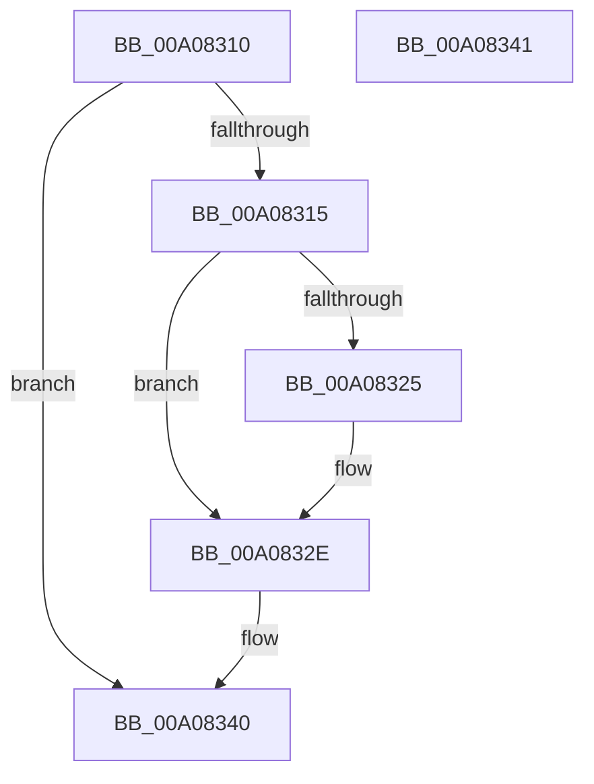

# IopFreeRelationList

- RVA: `0x00A08310`–`0x00A08342` (길이 `50` bytes)
- VA: `0x0000000140A08310`
- 실행 섹션: `PAGE`
- PDB 이름 있음: `예`; PDB Function 태그: `아니요`
- unwind 정보 RVA: `0x000805BC`
- 디코드: `17`개 명령, `50/50` bytes 표시
- 미해석 바이트: `0` (있으면 어셈블리에 `.byte`로 보존)

> 이 문서는 커널 이미지의 기계어와 PDB 기호를 분석해 생성했습니다. 4번과 5번은 함수 원형과 자료형을 바이너리 사용 방식에서 추정한 C 해석이며 원본 소스 복구 결과는 아닙니다.

## 1. Dependencies

- 직접 호출 지점: **2**; 고유 호출 대상: **2**
- 직접 호출자로 확인된 함수: **9**
- RIP 상대 이미지 참조: **0**

### Outgoing calls
- `0x00A08325` → [PipFreeDeviceObjectList](PipFreeDeviceObjectList_function_00A08348.md) (function, `0x00A08348`)
- `0x00A08336` → [ExFreePoolWithTag](../../poolcode/B8/ExFreePoolWithTag_function_00B82870.md) (function, `0x00B82870`)

### Direct callers
- [PnpProcessCompletedEject](../72/PnpProcessCompletedEject_function_0072D090.md) at `0x0072D196`
- [PnpProcessQueryRemoveAndEject](PnpProcessQueryRemoveAndEject_function_00A05170.md) at `0x00A055B2`
- [PnpBuildRemovalRelationList](PnpBuildRemovalRelationList_function_00A058D0.md) at `0x00A0595D`
- [PnpInvalidateRelationsInList](PnpInvalidateRelationsInList_function_00A05DF8.md) at `0x00A05F20`
- [PnpQueuePendingSurpriseRemoval](PnpQueuePendingSurpriseRemoval_function_00A05FAC.md) at `0x00A060D2`
- [IopAllocateRelationList](IopAllocateRelationList_function_00A0784C.md) at `0x00A0789C`
- [PipRemoveDevicesInRelationList](PipRemoveDevicesInRelationList_function_00A08CF0.md) at `0x00A08DB5`
- [sub_00B33FE8](../B3/Unknown_function_00B33FE8.md) at `0x00B340A1`
- [sub_00B33FE8](../B3/Unknown_function_00B33FE8.md) at `0x00B34140`
- [sub_00B33FE8](../B3/Unknown_function_00B33FE8.md) at `0x00B34172`
- [sub_00B33FE8](../B3/Unknown_function_00B33FE8.md) at `0x00B341B0`
- [sub_00B33FE8](../B3/Unknown_function_00B33FE8.md) at `0x00B3424D`
- [sub_00B33FE8](../B3/Unknown_function_00B33FE8.md) at `0x00B3430A`
- [sub_00B33FE8](../B3/Unknown_function_00B33FE8.md) at `0x00B34385`
- [sub_00B344A6](../B3/Unknown_function_00B344A6.md) at `0x00B344B9`

### Static image references
- 디코드된 RIP-relative 메모리 참조가 없습니다.

## 2. Other-region calls and transfers

- 다른 실행 섹션으로 향하는 call: **1**
  - `0x00A08336` → [ExFreePoolWithTag](../../poolcode/B8/ExFreePoolWithTag_function_00B82870.md) (`PAGE` → `POOLCODE`)
- 별도 외부 분기/꼬리 이동을 확인하지 못했습니다.

## 3. Assembly (complete function range)

```asm
00A08310  48 85 C9                        test rcx, rcx
00A08313  74 2B                           je 0x140a08340
00A08315  53                              push rbx
00A08316  48 83 EC 20                     sub rsp, 0x20
00A0831A  48 8B D9                        mov rbx, rcx
00A0831D  48 8B 09                        mov rcx, qword ptr [rcx]
00A08320  48 85 C9                        test rcx, rcx
00A08323  74 09                           je 0x140a0832e
00A08325  E8 1E 00 00 00                  call 0x140a08348
00A0832A  48 83 23 00                     and qword ptr [rbx], 0
00A0832E  BA 50 6E 70 54                  mov edx, 0x54706e50
00A08333  48 8B CB                        mov rcx, rbx
00A08336  E8 35 A5 17 00                  call 0x140b82870
00A0833B  48 83 C4 20                     add rsp, 0x20
00A0833F  5B                              pop rbx
00A08340  C3                              ret
00A08341  CC                              int3
```

## 4. C-style interpretation (structured pseudocode)

```c
__int64 __fastcall IopFreeRelationList(__int64 a1)
{
    __int64 result;
    __int64 v_rsp;

    if (a1 == 0) goto loc_00A08340;
    v_rsp = (v_rsp) - (32);
    if (*(unsigned __int64 *)(a1) != 0) {
        result = PipFreeDeviceObjectList(*(unsigned __int64 *)(a1), a2, a3, a4);
    }
    result = ExFreePoolWithTag(a1, (unsigned int)(0x54706E50ULL), a3, a4);
    v_rsp = (v_rsp) + (32);
loc_00A08340:
    return result;
}
```

## 5. (Beta) C Style

```c
int64_t IopFreeRelationList(int64_t Arg1)
{
    int64_t result;
    int64_t local_rsp;

    if (Arg1 == 0) goto loc_00A08340;
    local_rsp = (local_rsp) - (32);
    if (*(uint64_t *)(Arg1) != 0) {
        result = PipFreeDeviceObjectList(*(uint64_t *)(Arg1), a2, a3, a4);
    }
    result = ExFreePoolWithTag(Arg1, (uint32_t)(0x54706E50ULL), a3, a4);
    local_rsp = (local_rsp) + (32);
loc_00A08340:
    return result;
}
```

## 6. Execution-region graph

[열기: 2D/3D 그래프와 함수 탐색 컨트롤 패널](../../../control-panel.html?section=page&rva=0x00A08310&view=graph)

- 2D 그래프는 위에서 아래로 흐르고, 3D 그래프는 빈 공간을 드래그해 회전합니다. Shift+드래그는 이동, 휠은 확대·축소, 함수 노드 선택은 대상 보고서 이동입니다.

### Static fallback


