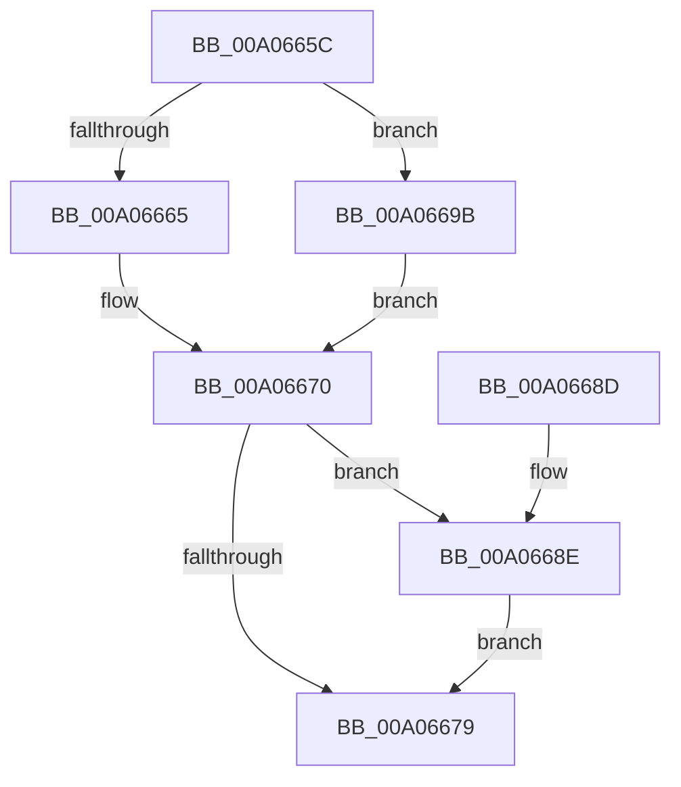

# IopIsDescendantNode

- RVA: `0x00A0665C`–`0x00A066A0` (길이 `68` bytes)
- VA: `0x0000000140A0665C`
- 실행 섹션: `PAGE`
- PDB 이름 있음: `예`; PDB Function 태그: `아니요`
- unwind 정보 RVA: `0x0007A1AC`
- 디코드: `20`개 명령, `68/68` bytes 표시
- 미해석 바이트: `0` (있으면 어셈블리에 `.byte`로 보존)

> 이 문서는 커널 이미지의 기계어와 PDB 기호를 분석해 생성했습니다. 4번과 5번은 함수 원형과 자료형을 바이너리 사용 방식에서 추정한 C 해석이며 원본 소스 복구 결과는 아닙니다.

## 1. Dependencies

- 직접 호출 지점: **1**; 고유 호출 대상: **1**
- 직접 호출자로 확인된 함수: **2**
- RIP 상대 이미지 참조: **0**

### Outgoing calls
- `0x00A06683` → [PipIsDeviceInDeviceObjectList](PipIsDeviceInDeviceObjectList_function_00A070D0.md) (function, `0x00A070D0`)

### Direct callers
- [PnpQueuePendingSurpriseRemoval](PnpQueuePendingSurpriseRemoval_function_00A05FAC.md) at `0x00A06110`
- [PnpUnlinkDeviceRemovalRelations](PnpUnlinkDeviceRemovalRelations_function_00A063D8.md) at `0x00A064CB`

### Static image references
- 디코드된 RIP-relative 메모리 참조가 없습니다.

## 2. Other-region calls and transfers

- 다른 실행 섹션으로 향하는 call: **0**
- 별도 외부 분기/꼬리 이동을 확인하지 못했습니다.

## 3. Assembly (complete function range)

```asm
00A0665C  48 83 EC 28                     sub rsp, 0x28
00A06660  48 85 D2                        test rdx, rdx
00A06663  74 36                           je 0x140a0669b
00A06665  48 8B 82 38 01 00 00            mov rax, qword ptr [rdx + 0x138]
00A0666C  4C 8B 40 28                     mov r8, qword ptr [rax + 0x28]
00A06670  49 8B 50 10                     mov rdx, qword ptr [r8 + 0x10]
00A06674  48 85 D2                        test rdx, rdx
00A06677  74 15                           je 0x140a0668e
00A06679  48 8B 52 20                     mov rdx, qword ptr [rdx + 0x20]
00A0667D  45 33 C0                        xor r8d, r8d
00A06680  48 8B 09                        mov rcx, qword ptr [rcx]
00A06683  E8 48 0A 00 00                  call 0x140a070d0
00A06688  48 83 C4 28                     add rsp, 0x28
00A0668C  C3                              ret
00A0668D  CC                              int3
00A0668E  49 8B 90 88 02 00 00            mov rdx, qword ptr [r8 + 0x288]
00A06695  48 83 E2 FE                     and rdx, 0xfffffffffffffffe
00A06699  EB DE                           jmp 0x140a06679
00A0669B  45 33 C0                        xor r8d, r8d
00A0669E  EB D0                           jmp 0x140a06670
```

## 4. C-style interpretation (structured pseudocode)

```c
__int64 __fastcall IopIsDescendantNode(__int64 a1, __int64 a2)
{
    __int64 result;
    __int64 v_rsp;

    v_rsp = (v_rsp) - (40);
    if (a2 == 0) goto loc_00A0669B;
loc_00A06670:
    if (*(unsigned __int64 *)(*(unsigned __int64 *)(*(unsigned __int64 *)(a2 + 312) + 40) + 16) == 0) goto loc_00A0668E;
loc_00A06679:
    a3 = 0;
    result = PipIsDeviceInDeviceObjectList(*(unsigned __int64 *)(a1), *(unsigned __int64 *)(*(unsigned __int64 *)(*(unsigned __int64 *)(*(unsigned __int64 *)(a2 + 312) + 40) + 16) + 32), a3, a4);
    v_rsp = (v_rsp) + (40);
    return result;
loc_00A0668E:
    a2 = (*(unsigned __int64 *)(a3 + 648)) & (-2);
    goto loc_00A06679;
loc_00A0669B:
    a3 = 0;
    goto loc_00A06670;
}
```

## 5. (Beta) C Style

```c
int64_t IopIsDescendantNode(void *Arg1, int64_t Arg2)
{
    uint8_t *arg1 = (uint8_t *)Arg1;

    int64_t result;
    int64_t local_rsp;

    local_rsp = (local_rsp) - (40);
    if (Arg2 == 0) goto loc_00A0669B;
loc_00A06670:
    if (*(uint64_t *)(*(uint64_t *)(*(uint64_t *)(Arg2 + 0x138) + 0x28) + 0x10) == 0) goto loc_00A0668E;
loc_00A06679:
    a3 = 0;
    result = PipIsDeviceInDeviceObjectList(*(uint64_t *)(arg1), *(uint64_t *)(*(uint64_t *)(*(uint64_t *)(*(uint64_t *)(Arg2 + 0x138) + 0x28) + 0x10) + 0x20), a3, a4);
    local_rsp = (local_rsp) + (40);
    return result;
loc_00A0668E:
    Arg2 = (*(uint64_t *)(a3 + 0x288)) & (-2);
    goto loc_00A06679;
loc_00A0669B:
    a3 = 0;
    goto loc_00A06670;
}
```

### 관측된 메모리 오프셋

구조체 형식이 확인되지 않은 접근은 인자 기준의 오프셋으로만 기록했습니다.

| 기준 인자 | 오프셋 표현 | 폭 (bit) | 접근 |
|---|---:|---:|---|
| `Arg1` | `+ 0x0` | `64` | `R` |

## 6. Execution-region graph

[열기: 2D/3D 그래프와 함수 탐색 컨트롤 패널](../../../control-panel.html?section=page&rva=0x00A0665C&view=graph)

- 2D 그래프는 위에서 아래로 흐르고, 3D 그래프는 빈 공간을 드래그해 회전합니다. Shift+드래그는 이동, 휠은 확대·축소, 함수 노드 선택은 대상 보고서 이동입니다.

### Static fallback


