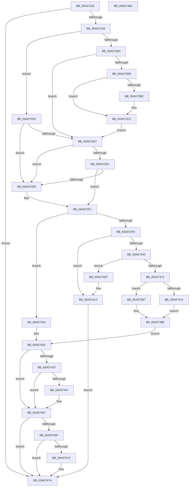

# IopLegacyResourceAllocation

- RVA: `0x00A07224`–`0x00A074B3` (길이 `655` bytes)
- VA: `0x0000000140A07224`
- 실행 섹션: `PAGE`
- PDB 이름 있음: `예`; PDB Function 태그: `아니요`
- unwind 정보 RVA: `0x000A85F0`
- 디코드: `171`개 명령, `655/655` bytes 표시
- 미해석 바이트: `0` (있으면 어셈블리에 `.byte`로 보존)

> 이 문서는 커널 이미지의 기계어와 PDB 기호를 분석해 생성했습니다. 4번과 5번은 함수 원형과 자료형을 바이너리 사용 방식에서 추정한 C 해석이며 원본 소스 복구 결과는 아닙니다.

## 1. Dependencies

- 직접 호출 지점: **23**; 고유 호출 대상: **17**
- 직접 호출자로 확인된 함수: **4**
- RIP 상대 이미지 참조: **3**

### Outgoing calls
- `0x00A07286` → [KeWaitForSingleObject](../../text/20/KeWaitForSingleObject_function_0020E6B0.md) (function, `0x0020E6B0`)
- `0x00A07299` → [IopFindLegacyDeviceNode](../AC/IopFindLegacyDeviceNode_function_00AC7338.md) (function, `0x00AC7338`)
- `0x00A072EC` → [IopReleaseResources](../72/IopReleaseResources_function_0072D964.md) (function, `0x0072D964`)
- `0x00A07304` → [memset](../../text/6C/memset_function_006C6C40.md) (function, `0x006C6C40`)
- `0x00A0732E` → [PnpAllocateResources](../A2/PnpAllocateResources_function_00A2ACC4.md) (function, `0x00A2ACC4`)
- `0x00A07352` → [PnpDetermineResourceListSize](../8F/PnpDetermineResourceListSize_function_008FC6F8.md) (function, `0x008FC6F8`)
- `0x00A07367` → [ExAllocatePool2](../../poolcode/B8/ExAllocatePool2_function_00B820F0.md) (function, `0x00B820F0`)
- `0x00A07380` → [ExFreePoolWithTag](../../poolcode/B8/ExFreePoolWithTag_function_00B82870.md) (function, `0x00B82870`)
- `0x00A07395` → [ExAcquireFastMutex](../../text/20/ExAcquireFastMutex_function_0020E5A0.md) (function, `0x0020E5A0`)
- `0x00A073AA` → [memcpy](../../text/6C/memcpy_function_006C6840.md) (function, `0x006C6840`)
- `0x00A073C1` → [ExReleaseFastMutex](../../text/25/ExReleaseFastMutex_function_002519C0.md) (function, `0x002519C0`)
- `0x00A073DE` → [ExAcquireFastMutex](../../text/20/ExAcquireFastMutex_function_0020E5A0.md) (function, `0x0020E5A0`)
- `0x00A07400` → [ExReleaseFastMutex](../../text/25/ExReleaseFastMutex_function_002519C0.md) (function, `0x002519C0`)
- `0x00A07408` → [IopReleaseResources](../72/IopReleaseResources_function_0072D964.md) (function, `0x0072D964`)
- `0x00A07419` → [IopRemoveLegacyDeviceNode](../72/IopRemoveLegacyDeviceNode_function_0072E590.md) (function, `0x0072E590`)
- `0x00A0742D` → [IopRemoveLegacyDeviceNode](../72/IopRemoveLegacyDeviceNode_function_0072E590.md) (function, `0x0072E590`)
- `0x00A0743A` → [IopCombineLegacyResources](../72/IopCombineLegacyResources_function_0072E3D0.md) (function, `0x0072E3D0`)
- `0x00A0744A` → [PnpDetermineResourceListSize](../8F/PnpDetermineResourceListSize_function_008FC6F8.md) (function, `0x008FC6F8`)
- `0x00A07458` → [IopWriteAllocatedResourcesToRegistry](../AA/IopWriteAllocatedResourcesToRegistry_function_00AA54E4.md) (function, `0x00AA54E4`)
- `0x00A07462` → [ExFreePoolWithTag](../../poolcode/B8/ExFreePoolWithTag_function_00B82870.md) (function, `0x00B82870`)
- `0x00A07475` → [IopSetLegacyResourcesFlag](../../text/5A/IopSetLegacyResourcesFlag_function_005A79A4.md) (function, `0x005A79A4`)
- `0x00A0748A` → [KeReleaseSemaphore](../../text/39/KeReleaseSemaphore_function_00397080.md) (function, `0x00397080`)
- `0x00A0748F` → [KeLeaveCriticalRegion](../../text/25/KeLeaveCriticalRegion_function_0025D8B0.md) (function, `0x0025D8B0`)

### Direct callers
- [IoAssignResources](../72/IoAssignResources_function_00725AD0.md) at `0x00725CA7`
- [IoReportResourceUsageInternal](../72/IoReportResourceUsageInternal_function_0072A398.md) at `0x0072A438`
- [IopDestroyDeviceNode](IopDestroyDeviceNode_function_00A06A3C.md) at `0x00A06A99`
- [IopReleaseDeviceResources](IopReleaseDeviceResources_function_00A0867C.md) at `0x00A0870D`

### Static image references
- `0x00A07275` → RVA `0x00F8C360` (`.data`; read)
- `0x00A072C5` → RVA `0x00F8C438` (`.data`; read)
- `0x00A0738E` → RVA `0x00F8C3E0` (`.data`; read)

## 2. Other-region calls and transfers

- 다른 실행 섹션으로 향하는 call: **13**
  - `0x00A07286` → [KeWaitForSingleObject](../../text/20/KeWaitForSingleObject_function_0020E6B0.md) (`PAGE` → `.text`)
  - `0x00A07304` → [memset](../../text/6C/memset_function_006C6C40.md) (`PAGE` → `.text`)
  - `0x00A07367` → [ExAllocatePool2](../../poolcode/B8/ExAllocatePool2_function_00B820F0.md) (`PAGE` → `POOLCODE`)
  - `0x00A07380` → [ExFreePoolWithTag](../../poolcode/B8/ExFreePoolWithTag_function_00B82870.md) (`PAGE` → `POOLCODE`)
  - `0x00A07395` → [ExAcquireFastMutex](../../text/20/ExAcquireFastMutex_function_0020E5A0.md) (`PAGE` → `.text`)
  - `0x00A073AA` → [memcpy](../../text/6C/memcpy_function_006C6840.md) (`PAGE` → `.text`)
  - `0x00A073C1` → [ExReleaseFastMutex](../../text/25/ExReleaseFastMutex_function_002519C0.md) (`PAGE` → `.text`)
  - `0x00A073DE` → [ExAcquireFastMutex](../../text/20/ExAcquireFastMutex_function_0020E5A0.md) (`PAGE` → `.text`)
  - `0x00A07400` → [ExReleaseFastMutex](../../text/25/ExReleaseFastMutex_function_002519C0.md) (`PAGE` → `.text`)
  - `0x00A07462` → [ExFreePoolWithTag](../../poolcode/B8/ExFreePoolWithTag_function_00B82870.md) (`PAGE` → `POOLCODE`)
  - `0x00A07475` → [IopSetLegacyResourcesFlag](../../text/5A/IopSetLegacyResourcesFlag_function_005A79A4.md) (`PAGE` → `.text`)
  - `0x00A0748A` → [KeReleaseSemaphore](../../text/39/KeReleaseSemaphore_function_00397080.md) (`PAGE` → `.text`)
  - `0x00A0748F` → [KeLeaveCriticalRegion](../../text/25/KeLeaveCriticalRegion_function_0025D8B0.md) (`PAGE` → `.text`)
- 별도 외부 분기/꼬리 이동을 확인하지 못했습니다.

## 3. Assembly (complete function range)

```asm
00A07224  48 89 5C 24 18                  mov qword ptr [rsp + 0x18], rbx
00A07229  48 89 54 24 10                  mov qword ptr [rsp + 0x10], rdx
00A0722E  89 4C 24 08                     mov dword ptr [rsp + 8], ecx
00A07232  55                              push rbp
00A07233  56                              push rsi
00A07234  57                              push rdi
00A07235  41 54                           push r12
00A07237  41 55                           push r13
00A07239  41 56                           push r14
00A0723B  41 57                           push r15
00A0723D  48 8B EC                        mov rbp, rsp
00A07240  48 81 EC 80 00 00 00            sub rsp, 0x80
00A07247  65 48 8B 04 25 88 01 00 00      mov rax, qword ptr gs:[0x188]
00A07250  33 F6                           xor esi, esi
00A07252  44 8B E1                        mov r12d, ecx
00A07255  48 89 75 B8                     mov qword ptr [rbp - 0x48], rsi
00A07259  83 C9 FF                        or ecx, 0xffffffff
00A0725C  48 89 75 B0                     mov qword ptr [rbp - 0x50], rsi
00A07260  49 8B F9                        mov rdi, r9
00A07263  48 89 74 24 20                  mov qword ptr [rsp + 0x20], rsi
00A07268  66 01 88 E4 01 00 00            add word ptr [rax + 0x1e4], cx
00A0726F  4D 8B F8                        mov r15, r8
00A07272  4C 8B EA                        mov r13, rdx
00A07275  48 8D 0D E4 50 58 00            lea rcx, [rip + 0x5850e4]
00A0727C  45 33 C9                        xor r9d, r9d
00A0727F  8D 56 04                        lea edx, [rsi + 4]
00A07282  45 33 C0                        xor r8d, r8d
00A07285  90                              nop
00A07286  E8 25 74 80 FF                  call 0x14020e6b0
00A0728B  4C 8D 4D B8                     lea r9, [rbp - 0x48]
00A0728F  49 8B D7                        mov rdx, r15
00A07292  4C 8D 45 B0                     lea r8, [rbp - 0x50]
00A07296  49 8B CD                        mov rcx, r13
00A07299  E8 9A 00 0C 00                  call 0x140ac7338
00A0729E  44 8B F0                        mov r14d, eax
00A072A1  85 C0                           test eax, eax
00A072A3  0F 88 D1 01 00 00               js 0x140a0747a
00A072A9  48 8B 5D B0                     mov rbx, qword ptr [rbp - 0x50]
00A072AD  48 39 73 10                     cmp qword ptr [rbx + 0x10], rsi
00A072B1  75 1F                           jne 0x140a072d2
00A072B3  48 85 FF                        test rdi, rdi
00A072B6  74 1F                           je 0x140a072d7
00A072B8  83 7F 04 FF                     cmp dword ptr [rdi + 4], -1
00A072BC  75 07                           jne 0x140a072c5
00A072BE  C7 47 04 01 00 00 00            mov dword ptr [rdi + 4], 1
00A072C5  48 8B 05 6C 51 58 00            mov rax, qword ptr [rip + 0x58516c]
00A072CC  48 89 43 10                     mov qword ptr [rbx + 0x10], rax
00A072D0  EB 05                           jmp 0x140a072d7
00A072D2  48 85 FF                        test rdi, rdi
00A072D5  74 12                           je 0x140a072e9
00A072D7  48 39 B3 A0 01 00 00            cmp qword ptr [rbx + 0x1a0], rsi
00A072DE  75 09                           jne 0x140a072e9
00A072E0  48 39 B3 20 02 00 00            cmp qword ptr [rbx + 0x220], rsi
00A072E7  74 08                           je 0x140a072f1
00A072E9  48 8B CB                        mov rcx, rbx
00A072EC  E8 73 66 D2 FF                  call 0x14072d964
00A072F1  48 85 FF                        test rdi, rdi
00A072F4  0F 84 26 01 00 00               je 0x140a07420
00A072FA  33 D2                           xor edx, edx
00A072FC  48 8D 4D C0                     lea rcx, [rbp - 0x40]
00A07300  44 8D 42 40                     lea r8d, [rdx + 0x40]
00A07304  E8 37 F9 CB FF                  call 0x1406c6c40
00A07309  48 8B 45 B8                     mov rax, qword ptr [rbp - 0x48]
00A0730D  48 8D 55 C0                     lea rdx, [rbp - 0x40]
00A07311  45 33 C9                        xor r9d, r9d
00A07314  48 89 45 C0                     mov qword ptr [rbp - 0x40], rax
00A07318  41 B0 01                        mov r8b, 1
00A0731B  48 89 7D D8                     mov qword ptr [rbp - 0x28], rdi
00A0731F  44 89 65 CC                     mov dword ptr [rbp - 0x34], r12d
00A07323  C7 45 C8 80 00 00 00            mov dword ptr [rbp - 0x38], 0x80
00A0732A  41 8D 49 01                     lea ecx, [r9 + 1]
00A0732E  E8 91 39 02 00                  call 0x140a2acc4
00A07333  44 8B 75 F8                     mov r14d, dword ptr [rbp - 8]
00A07337  45 85 F6                        test r14d, r14d
00A0733A  0F 88 D3 00 00 00               js 0x140a07413
00A07340  48 8B 75 60                     mov rsi, qword ptr [rbp + 0x60]
00A07344  48 8B 4D E8                     mov rcx, qword ptr [rbp - 0x18]
00A07348  48 8B 06                        mov rax, qword ptr [rsi]
00A0734B  48 85 C0                        test rax, rax
00A0734E  48 0F 45 C8                     cmovne rcx, rax
00A07352  E8 A1 53 EF FF                  call 0x1408fc6f8
00A07357  41 B8 50 70 20 20               mov r8d, 0x20207050
00A0735D  8B D0                           mov edx, eax
00A0735F  B9 00 01 00 00                  mov ecx, 0x100
00A07364  44 8B E8                        mov r13d, eax
00A07367  E8 84 AD 17 00                  call 0x140b820f0
00A0736C  4C 8B E0                        mov r12, rax
00A0736F  48 85 C0                        test rax, rax
00A07372  74 63                           je 0x140a073d7
00A07374  48 83 3E 00                     cmp qword ptr [rsi], 0
00A07378  74 0D                           je 0x140a07387
00A0737A  48 8B 4D E8                     mov rcx, qword ptr [rbp - 0x18]
00A0737E  33 D2                           xor edx, edx
00A07380  E8 EB B4 17 00                  call 0x140b82870
00A07385  EB 07                           jmp 0x140a0738e
00A07387  48 8B 45 E8                     mov rax, qword ptr [rbp - 0x18]
00A0738B  48 89 06                        mov qword ptr [rsi], rax
00A0738E  48 8D 0D 4B 50 58 00            lea rcx, [rip + 0x58504b]
00A07395  E8 06 72 80 FF                  call 0x14020e5a0
00A0739A  4C 89 A3 A0 01 00 00            mov qword ptr [rbx + 0x1a0], r12
00A073A1  4D 8B C5                        mov r8, r13
00A073A4  48 8B 16                        mov rdx, qword ptr [rsi]
00A073A7  49 8B CC                        mov rcx, r12
00A073AA  E8 91 F4 CB FF                  call 0x1406c6840
00A073AF  48 8B 45 F0                     mov rax, qword ptr [rbp - 0x10]
00A073B3  48 8D 0D 26 50 58 00            lea rcx, [rip + 0x585026]
00A073BA  48 89 83 A8 01 00 00            mov qword ptr [rbx + 0x1a8], rax
00A073C1  E8 FA A5 84 FF                  call 0x1402519c0
00A073C6  48 8B B3 10 02 00 00            mov rsi, qword ptr [rbx + 0x210]
00A073CD  44 8B 65 40                     mov r12d, dword ptr [rbp + 0x40]
00A073D1  4C 8B 6D 48                     mov r13, qword ptr [rbp + 0x48]
00A073D5  EB 5B                           jmp 0x140a07432
00A073D7  48 8D 0D 02 50 58 00            lea rcx, [rip + 0x585002]
00A073DE  E8 BD 71 80 FF                  call 0x14020e5a0
00A073E3  48 8B 45 E8                     mov rax, qword ptr [rbp - 0x18]
00A073E7  48 8D 0D F2 4F 58 00            lea rcx, [rip + 0x584ff2]
00A073EE  48 89 83 A0 01 00 00            mov qword ptr [rbx + 0x1a0], rax
00A073F5  48 8B 45 F0                     mov rax, qword ptr [rbp - 0x10]
00A073F9  48 89 83 A8 01 00 00            mov qword ptr [rbx + 0x1a8], rax
00A07400  E8 BB A5 84 FF                  call 0x1402519c0
00A07405  48 8B CB                        mov rcx, rbx
00A07408  E8 57 65 D2 FF                  call 0x14072d964
00A0740D  41 BE 9A 00 00 C0               mov r14d, 0xc000009a
00A07413  48 8B D3                        mov rdx, rbx
00A07416  49 8B CF                        mov rcx, r15
00A07419  E8 72 71 D2 FF                  call 0x14072e590
00A0741E  EB 5A                           jmp 0x140a0747a
00A07420  48 8B B3 10 02 00 00            mov rsi, qword ptr [rbx + 0x210]
00A07427  48 8B D3                        mov rdx, rbx
00A0742A  49 8B CF                        mov rcx, r15
00A0742D  E8 5E 71 D2 FF                  call 0x14072e590
00A07432  48 85 F6                        test rsi, rsi
00A07435  74 30                           je 0x140a07467
00A07437  48 8B CE                        mov rcx, rsi
00A0743A  E8 91 6F D2 FF                  call 0x14072e3d0
00A0743F  48 8B D8                        mov rbx, rax
00A07442  48 85 C0                        test rax, rax
00A07445  74 20                           je 0x140a07467
00A07447  48 8B C8                        mov rcx, rax
00A0744A  E8 A9 52 EF FF                  call 0x1408fc6f8
00A0744F  44 8B C0                        mov r8d, eax
00A07452  48 8B D3                        mov rdx, rbx
00A07455  48 8B CE                        mov rcx, rsi
00A07458  E8 87 E0 09 00                  call 0x140aa54e4
00A0745D  33 D2                           xor edx, edx
00A0745F  48 8B CB                        mov rcx, rbx
00A07462  E8 09 B4 17 00                  call 0x140b82870
00A07467  41 83 FC 03                     cmp r12d, 3
00A0746B  74 0D                           je 0x140a0747a
00A0746D  48 85 FF                        test rdi, rdi
00A07470  74 08                           je 0x140a0747a
00A07472  49 8B CD                        mov rcx, r13
00A07475  E8 2A 05 BA FF                  call 0x1405a79a4
00A0747A  45 33 C9                        xor r9d, r9d
00A0747D  48 8D 0D DC 4E 58 00            lea rcx, [rip + 0x584edc]
00A07484  33 D2                           xor edx, edx
00A07486  45 8D 41 01                     lea r8d, [r9 + 1]
00A0748A  E8 F1 FB 98 FF                  call 0x140397080
00A0748F  E8 1C 64 85 FF                  call 0x14025d8b0
00A07494  48 8B 9C 24 D0 00 00 00         mov rbx, qword ptr [rsp + 0xd0]
00A0749C  41 8B C6                        mov eax, r14d
00A0749F  48 81 C4 80 00 00 00            add rsp, 0x80
00A074A6  41 5F                           pop r15
00A074A8  41 5E                           pop r14
00A074AA  41 5D                           pop r13
00A074AC  41 5C                           pop r12
00A074AE  5F                              pop rdi
00A074AF  5E                              pop rsi
00A074B0  5D                              pop rbp
00A074B1  C3                              ret
00A074B2  CC                              int3
```

## 4. C-style interpretation (structured pseudocode)

```c
__int64 __fastcall IopLegacyResourceAllocation(int a1, __int64 a2, __int64 a3, __int64 a4, __int64 a5)
{
    __int64 result;
    __int64 v_rsi;
    __int64 v_rsp;
    unsigned int v_stack_m40;
    unsigned __int64 v_stack_m48;
    unsigned __int64 v_stack_m50;
    unsigned __int64 v_stack_m60;
    unsigned int v_stack_m6C;
    unsigned int v_stack_m70;
    unsigned __int64 v_stack_m78;
    unsigned __int64 v_stack_m80;
    unsigned __int64 v_stack_m88;
    unsigned __int64 v_stack_m98;
    unsigned __int64 v_stack_p10;
    unsigned __int64 v_stack_p18;
    unsigned int v_stack_p8;

    v_stack_p18 = v_rbx;
    v_stack_p10 = a2;
    v_stack_p8 = a1;
    v_rsp = (v_rsp) - (128);
    v_rsi = 0;
    v_stack_m80 = 0;
    a1 = (unsigned int)((a1) | (0xFFFFFFFFULL));
    v_stack_m88 = 0;
    v_stack_m98 = 0;
    a4 = 0;
    a3 = 0;
    result = KeWaitForSingleObject(v_rip + 5787876, v_rsi + 4, a3, a4);
    result = IopFindLegacyDeviceNode(a2, 0, v_stack_m88, v_stack_m80);
    if (sign_flag) goto loc_00A0747A;
    if ((*(unsigned __int64 *)(v_stack_m88 + 16)) != 0) goto loc_00A072D2;
    if (0 == 0) goto loc_00A072D7;
    if ((*(unsigned int *)(a4 + 4)) == -1) {
        *(unsigned int *)(a4 + 4) = 1;
    }
    *(unsigned __int64 *)(v_stack_m88 + 16) = *(unsigned __int64 *)(v_rip + 5788012);
    goto loc_00A072D7;
loc_00A072D2:
    if (0 == 0) goto loc_00A072E9;
loc_00A072D7:
    if ((*(unsigned __int64 *)(v_stack_m88 + 416)) != 0) goto loc_00A072E9;
    result = *(unsigned __int64 *)(v_rip + 5788012);
    if ((*(unsigned __int64 *)(v_stack_m88 + 544)) != 0) {
        a1 = v_stack_m88;
        result = IopReleaseResources(a1, 0, v_stack_m88, v_stack_m80);
    }
    if (0 == 0) goto loc_00A07420;
    a2 = 0;
    result = memset(v_stack_m78, a2, a2 + 64, v_stack_m80);
    a4 = 0;
    v_stack_m78 = v_stack_m80;
    v_stack_m60 = 0;
    v_stack_m6C = (unsigned int)((unsigned int)(a1));
    v_stack_m70 = 128;
    result = PnpAllocateResources(a4 + 1, v_stack_m78, 1, a4);
    if (sign_flag) goto loc_00A07413;
    a1 = v_stack_m50;
    if (*(unsigned __int64 *)(a5) != 0) { a1 = *(unsigned __int64 *)(a5); }
    result = PnpDetermineResourceListSize(a1, v_stack_m78, 1, a4);
    result = ExAllocatePool2(256, (unsigned int)((unsigned int)(result)), (unsigned int)(0x20207050ULL), a4);
    if (result == 0) goto loc_00A073D7;
    if ((*(unsigned __int64 *)(a5)) == 0) goto loc_00A07387;
    a2 = 0;
    result = ExFreePoolWithTag(v_stack_m50, a2, (unsigned int)(0x20207050ULL), a4);
    goto loc_00A0738E;
loc_00A07387:
    *(unsigned __int64 *)(a5) = v_stack_m50;
loc_00A0738E:
    result = ExAcquireFastMutex(v_rip + 5787723, a2, (unsigned int)(0x20207050ULL), a4);
    *(unsigned __int64 *)(v_stack_m88 + 416) = result;
    result = memcpy(result, *(unsigned __int64 *)(a5), (unsigned int)((unsigned int)(result)), a4);
    *(unsigned __int64 *)(v_stack_m88 + 424) = v_stack_m48;
    result = ExReleaseFastMutex(v_rip + 5787686, *(unsigned __int64 *)(a5), (unsigned int)((unsigned int)(result)), a4);
    goto loc_00A07432;
loc_00A073D7:
    result = ExAcquireFastMutex(v_rip + 5787650, *(unsigned __int64 *)(a5), (unsigned int)((unsigned int)(result)), a4);
    *(unsigned __int64 *)(v_stack_m88 + 416) = v_stack_m50;
    *(unsigned __int64 *)(v_stack_m88 + 424) = v_stack_m48;
    result = ExReleaseFastMutex(v_rip + 5787634, *(unsigned __int64 *)(a5), (unsigned int)((unsigned int)(result)), a4);
    result = IopReleaseResources(v_stack_m88, *(unsigned __int64 *)(a5), (unsigned int)((unsigned int)(result)), a4);
loc_00A07413:
    result = IopRemoveLegacyDeviceNode(0, v_stack_m88, (unsigned int)((unsigned int)(result)), a4);
    goto loc_00A0747A;
loc_00A07420:
    result = IopRemoveLegacyDeviceNode(0, v_stack_m88, (unsigned int)((unsigned int)(result)), a4);
loc_00A07432:
    if (*(unsigned __int64 *)(v_stack_m88 + 528) == 0) goto loc_00A07467;
    result = IopCombineLegacyResources(*(unsigned __int64 *)(v_stack_m88 + 528), v_stack_m88, (unsigned int)((unsigned int)(result)), a4);
    if (result != 0) {
        a1 = result;
        result = PnpDetermineResourceListSize(a1, v_stack_m88, (unsigned int)((unsigned int)(result)), a4);
        a3 = (unsigned int)(result);
        a2 = result;
        a1 = *(unsigned __int64 *)(v_stack_m88 + 528);
        result = IopWriteAllocatedResourcesToRegistry(a1, a2, a3, a4);
        a2 = 0;
        a1 = result;
        result = ExFreePoolWithTag(a1, a2, a3, a4);
    }
    if (((unsigned int)((unsigned int)(v_stack_p8))) == 3) goto loc_00A0747A;
    if (0 != 0) {
        a1 = v_stack_p10;
        result = IopSetLegacyResourcesFlag(a1, a2, a3, a4);
    }
    a4 = 0;
    a2 = 0;
    result = KeReleaseSemaphore(v_rip + 5787356, a2, a4 + 1, a4);
    result = KeLeaveCriticalRegion(v_rip + 5787356, a2, a4 + 1, a4);
    v_rsp = (v_rsp) + (128);
    return (unsigned int)((unsigned int)((unsigned int)(0xC000009AULL)));
}
```

## 5. (Beta) C Style

```c
int64_t IopLegacyResourceAllocation(int32_t Arg1, int64_t Arg2, int64_t Arg3, int64_t Arg4, void *Arg5)
{
    uint8_t *arg5 = (uint8_t *)Arg5;

    int64_t result;
    int64_t local_rsi;
    int64_t local_rsp;
    uint32_t v_stack_m40;
    uint64_t v_stack_m48;
    uint64_t v_stack_m50;
    uint64_t v_stack_m60;
    uint32_t v_stack_m6C;
    uint32_t v_stack_m70;
    uint64_t v_stack_m78;
    uint64_t v_stack_m80;
    uint64_t v_stack_m88;
    uint64_t v_stack_m98;
    uint64_t v_stack_p10;
    uint64_t v_stack_p18;
    uint32_t v_stack_p8;

    v_stack_p18 = local_rbx;
    v_stack_p10 = Arg2;
    v_stack_p8 = Arg1;
    local_rsp = (local_rsp) - (128);
    local_rsi = 0;
    v_stack_m80 = 0;
    Arg1 = (uint32_t)((Arg1) | (0xFFFFFFFFULL));
    v_stack_m88 = 0;
    v_stack_m98 = 0;
    Arg4 = 0;
    Arg3 = 0;
    result = KeWaitForSingleObject(v_rip + 5787876, local_rsi + 4, Arg3, Arg4);
    result = IopFindLegacyDeviceNode(Arg2, 0, v_stack_m88, v_stack_m80);
    if (sign_flag) goto loc_00A0747A;
    if ((*(uint64_t *)(v_stack_m88 + 0x10)) != 0) goto loc_00A072D2;
    if (0 == 0) goto loc_00A072D7;
    if ((*(uint32_t *)(Arg4 + 0x4)) == -1) {
        *(uint32_t *)(Arg4 + 0x4) = 1;
    }
    *(uint64_t *)(v_stack_m88 + 0x10) = *(uint64_t *)(v_rip + 0x58516C);
    goto loc_00A072D7;
loc_00A072D2:
    if (0 == 0) goto loc_00A072E9;
loc_00A072D7:
    if ((*(uint64_t *)(v_stack_m88 + 0x1A0)) != 0) goto loc_00A072E9;
    result = *(uint64_t *)(v_rip + 0x58516C);
    if ((*(uint64_t *)(v_stack_m88 + 0x220)) != 0) {
        Arg1 = v_stack_m88;
        result = IopReleaseResources(Arg1, 0, v_stack_m88, v_stack_m80);
    }
    if (0 == 0) goto loc_00A07420;
    Arg2 = 0;
    result = memset(v_stack_m78, Arg2, Arg2 + 64, v_stack_m80);
    Arg4 = 0;
    v_stack_m78 = v_stack_m80;
    v_stack_m60 = 0;
    v_stack_m6C = (uint32_t)((uint32_t)(Arg1));
    v_stack_m70 = 128;
    result = PnpAllocateResources(Arg4 + 1, v_stack_m78, 1, Arg4);
    if (sign_flag) goto loc_00A07413;
    Arg1 = v_stack_m50;
    if (*(uint64_t *)(arg5) != 0) { Arg1 = *(uint64_t *)(arg5); }
    result = PnpDetermineResourceListSize(Arg1, v_stack_m78, 1, Arg4);
    result = ExAllocatePool2(256, (uint32_t)((uint32_t)(result)), (uint32_t)(0x20207050ULL), Arg4);
    if (result == 0) goto loc_00A073D7;
    if ((*(uint64_t *)(arg5)) == 0) goto loc_00A07387;
    Arg2 = 0;
    result = ExFreePoolWithTag(v_stack_m50, Arg2, (uint32_t)(0x20207050ULL), Arg4);
    goto loc_00A0738E;
loc_00A07387:
    *(uint64_t *)(arg5) = v_stack_m50;
loc_00A0738E:
    result = ExAcquireFastMutex(v_rip + 5787723, Arg2, (uint32_t)(0x20207050ULL), Arg4);
    *(uint64_t *)(v_stack_m88 + 0x1A0) = result;
    result = memcpy(result, *(uint64_t *)(arg5), (uint32_t)((uint32_t)(result)), Arg4);
    *(uint64_t *)(v_stack_m88 + 0x1A8) = v_stack_m48;
    result = ExReleaseFastMutex(v_rip + 5787686, *(uint64_t *)(arg5), (uint32_t)((uint32_t)(result)), Arg4);
    goto loc_00A07432;
loc_00A073D7:
    result = ExAcquireFastMutex(v_rip + 5787650, *(uint64_t *)(arg5), (uint32_t)((uint32_t)(result)), Arg4);
    *(uint64_t *)(v_stack_m88 + 0x1A0) = v_stack_m50;
    *(uint64_t *)(v_stack_m88 + 0x1A8) = v_stack_m48;
    result = ExReleaseFastMutex(v_rip + 5787634, *(uint64_t *)(arg5), (uint32_t)((uint32_t)(result)), Arg4);
    result = IopReleaseResources(v_stack_m88, *(uint64_t *)(arg5), (uint32_t)((uint32_t)(result)), Arg4);
loc_00A07413:
    result = IopRemoveLegacyDeviceNode(0, v_stack_m88, (uint32_t)((uint32_t)(result)), Arg4);
    goto loc_00A0747A;
loc_00A07420:
    result = IopRemoveLegacyDeviceNode(0, v_stack_m88, (uint32_t)((uint32_t)(result)), Arg4);
loc_00A07432:
    if (*(uint64_t *)(v_stack_m88 + 0x210) == 0) goto loc_00A07467;
    result = IopCombineLegacyResources(*(uint64_t *)(v_stack_m88 + 0x210), v_stack_m88, (uint32_t)((uint32_t)(result)), Arg4);
    if (result != 0) {
        Arg1 = result;
        result = PnpDetermineResourceListSize(Arg1, v_stack_m88, (uint32_t)((uint32_t)(result)), Arg4);
        Arg3 = (uint32_t)(result);
        Arg2 = result;
        Arg1 = *(uint64_t *)(v_stack_m88 + 0x210);
        result = IopWriteAllocatedResourcesToRegistry(Arg1, Arg2, Arg3, Arg4);
        Arg2 = 0;
        Arg1 = result;
        result = ExFreePoolWithTag(Arg1, Arg2, Arg3, Arg4);
    }
    if (((uint32_t)((uint32_t)(v_stack_p8))) == 3) goto loc_00A0747A;
    if (0 != 0) {
        Arg1 = v_stack_p10;
        result = IopSetLegacyResourcesFlag(Arg1, Arg2, Arg3, Arg4);
    }
    Arg4 = 0;
    Arg2 = 0;
    result = KeReleaseSemaphore(v_rip + 5787356, Arg2, Arg4 + 1, Arg4);
    result = KeLeaveCriticalRegion(v_rip + 5787356, Arg2, Arg4 + 1, Arg4);
    local_rsp = (local_rsp) + (128);
    return (uint32_t)((uint32_t)((uint32_t)(0xC000009AULL)));
}
```

### 관측된 메모리 오프셋

구조체 형식이 확인되지 않은 접근은 인자 기준의 오프셋으로만 기록했습니다.

| 기준 인자 | 오프셋 표현 | 폭 (bit) | 접근 |
|---|---:|---:|---|
| `Arg5` | `+ 0x0` | `64` | `R` |
| `Arg5` | `+ 0x0` | `64` | `W` |

## 6. Execution-region graph

[열기: 2D/3D 그래프와 함수 탐색 컨트롤 패널](../../../control-panel.html?section=page&rva=0x00A07224&view=graph)

- 2D 그래프는 위에서 아래로 흐르고, 3D 그래프는 빈 공간을 드래그해 회전합니다. Shift+드래그는 이동, 휠은 확대·축소, 함수 노드 선택은 대상 보고서 이동입니다.

### Static fallback


