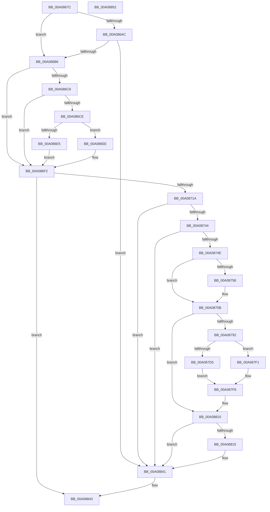

# IopReleaseDeviceResources

- RVA: `0x00A0867C`–`0x00A08853` (길이 `471` bytes)
- VA: `0x0000000140A0867C`
- 실행 섹션: `PAGE`
- PDB 이름 있음: `예`; PDB Function 태그: `아니요`
- unwind 정보 RVA: `0x0009CA58`
- 디코드: `126`개 명령, `471/471` bytes 표시
- 미해석 바이트: `0` (있으면 어셈블리에 `.byte`로 보존)

> 이 문서는 커널 이미지의 기계어와 PDB 기호를 분석해 생성했습니다. 4번과 5번은 함수 원형과 자료형을 바이너리 사용 방식에서 추정한 C 해석이며 원본 소스 복구 결과는 아닙니다.

## 1. Dependencies

- 직접 호출 지점: **12**; 고유 호출 대상: **12**
- 직접 호출자로 확인된 함수: **5**
- RIP 상대 이미지 참조: **5**

### Outgoing calls
- `0x00A086DC` → [IopQueryDeviceResources](../8F/IopQueryDeviceResources_function_008FC344.md) (function, `0x008FC344`)
- `0x00A0870D` → [IopLegacyResourceAllocation](IopLegacyResourceAllocation_function_00A07224.md) (function, `0x00A07224`)
- `0x00A08736` → [PnpRequestDeviceAction](../../text/47/PnpRequestDeviceAction_function_00477FF8.md) (function, `0x00477FF8`)
- `0x00A08789` → [_CmOpenDeviceRegKey](../8E/_CmOpenDeviceRegKey_function_008EE540.md) (function, `0x008EE540`)
- `0x00A087BF` → [ExAcquireResourceSharedLite](../../text/21/ExAcquireResourceSharedLite_function_00211BC0.md) (function, `0x00211BC0`)
- `0x00A087EA` → [ZwSetValueKey](../../text/6A/ZwSetValueKey_function_006ADCD0.md) (function, `0x006ADCD0`)
- `0x00A087F1` → [ZwDeleteValueKey](../../text/6A/ZwDeleteValueKey_function_006AECB0.md) (function, `0x006AECB0`)
- `0x00A087FD` → [ExReleaseResourceLite](../../text/25/ExReleaseResourceLite_function_0025FA10.md) (function, `0x0025FA10`)
- `0x00A08802` → [KeLeaveCriticalRegion](../../text/25/KeLeaveCriticalRegion_function_0025D8B0.md) (function, `0x0025D8B0`)
- `0x00A0880B` → [ZwClose](../../text/6A/ZwClose_function_006AD2B0.md) (function, `0x006AD2B0`)
- `0x00A0881D` → [PipSetDevNodeFlags](../8F/PipSetDevNodeFlags_function_008FC048.md) (function, `0x008FC048`)
- `0x00A0883C` → [guard_dispatch_icall](../../text/6B/guard_dispatch_icall_function_006BAAD0.md) (function, `0x006BAAD0`)

### Direct callers
- [PnpRemoveLockedDeviceNode](../../text/47/PnpRemoveLockedDeviceNode_function_004702AC.md) at `0x0047050C`
- [sub_006F3B38](../../text/6F/Unknown_function_006F3B38.md) at `0x006F3B75`
- [PnpDisableDevice](../72/PnpDisableDevice_function_0072C6FC.md) at `0x0072C772`
- [PnpSurpriseRemoveLockedDeviceNode](PnpSurpriseRemoveLockedDeviceNode_function_00A08370.md) at `0x00A08404`
- [PnpSurpriseRemoveLockedDeviceNode](PnpSurpriseRemoveLockedDeviceNode_function_00A08370.md) at `0x00A085A3`
- [PnpDriverLoadingFailed](../AB/PnpDriverLoadingFailed_function_00AB8928.md) at `0x00AB8AE5`

### Static image references
- `0x00A086FA` → RVA `0x00F8C440` (`.data`; read)
- `0x00A0876C` → RVA `0x00E66398` (`.data`; read)
- `0x00A08799` → RVA `0x00AFD500` (` ?? ::NNGAKEGL::`string'`; read)
- `0x00A087A4` → RVA `0x00F8C600` (`.data`; read)
- `0x00A08822` → RVA `0x00F8C138` (`.data`; read)

## 2. Other-region calls and transfers

- 다른 실행 섹션으로 향하는 call: **8**
  - `0x00A08736` → [PnpRequestDeviceAction](../../text/47/PnpRequestDeviceAction_function_00477FF8.md) (`PAGE` → `.text`)
  - `0x00A087BF` → [ExAcquireResourceSharedLite](../../text/21/ExAcquireResourceSharedLite_function_00211BC0.md) (`PAGE` → `.text`)
  - `0x00A087EA` → [ZwSetValueKey](../../text/6A/ZwSetValueKey_function_006ADCD0.md) (`PAGE` → `.text`)
  - `0x00A087F1` → [ZwDeleteValueKey](../../text/6A/ZwDeleteValueKey_function_006AECB0.md) (`PAGE` → `.text`)
  - `0x00A087FD` → [ExReleaseResourceLite](../../text/25/ExReleaseResourceLite_function_0025FA10.md) (`PAGE` → `.text`)
  - `0x00A08802` → [KeLeaveCriticalRegion](../../text/25/KeLeaveCriticalRegion_function_0025D8B0.md) (`PAGE` → `.text`)
  - `0x00A0880B` → [ZwClose](../../text/6A/ZwClose_function_006AD2B0.md) (`PAGE` → `.text`)
  - `0x00A0883C` → [guard_dispatch_icall](../../text/6B/guard_dispatch_icall_function_006BAAD0.md) (`PAGE` → `.text`)
- 별도 외부 분기/꼬리 이동을 확인하지 못했습니다.

## 3. Assembly (complete function range)

```asm
00A0867C  40 55                           push rbp
00A0867E  53                              push rbx
00A0867F  56                              push rsi
00A08680  57                              push rdi
00A08681  41 55                           push r13
00A08683  41 56                           push r14
00A08685  41 57                           push r15
00A08687  48 8B EC                        mov rbp, rsp
00A0868A  48 83 EC 50                     sub rsp, 0x50
00A0868E  48 83 B9 A0 01 00 00 00         cmp qword ptr [rcx + 0x1a0], 0
00A08696  48 8D B9 8C 01 00 00            lea rdi, [rcx + 0x18c]
00A0869D  0F 57 C0                        xorps xmm0, xmm0
00A086A0  44 8B F2                        mov r14d, edx
00A086A3  0F 11 45 F0                     movups xmmword ptr [rbp - 0x10], xmm0
00A086A7  48 8B F1                        mov rsi, rcx
00A086AA  75 0A                           jne 0x140a086b6
00A086AC  8B 07                           mov eax, dword ptr [rdi]
00A086AE  84 C0                           test al, al
00A086B0  0F 89 8B 01 00 00               jns 0x140a08841
00A086B6  83 65 40 00                     and dword ptr [rbp + 0x40], 0
00A086BA  33 DB                           xor ebx, ebx
00A086BC  45 32 FF                        xor r15b, r15b
00A086BF  48 89 5D 50                     mov qword ptr [rbp + 0x50], rbx
00A086C3  45 85 F6                        test r14d, r14d
00A086C6  74 2A                           je 0x140a086f2
00A086C8  8B 07                           mov eax, dword ptr [rdi]
00A086CA  A8 01                           test al, 1
00A086CC  75 24                           jne 0x140a086f2
00A086CE  48 8B 49 20                     mov rcx, qword ptr [rcx + 0x20]
00A086D2  4C 8D 4D 40                     lea r9, [rbp + 0x40]
00A086D6  4C 8D 45 50                     lea r8, [rbp + 0x50]
00A086DA  33 D2                           xor edx, edx
00A086DC  E8 63 3C EF FF                  call 0x1408fc344
00A086E1  85 C0                           test eax, eax
00A086E3  79 09                           jns 0x140a086ee
00A086E5  21 5D 40                        and dword ptr [rbp + 0x40], ebx
00A086E8  48 89 5D 50                     mov qword ptr [rbp + 0x50], rbx
00A086EC  EB 04                           jmp 0x140a086f2
00A086EE  48 8B 5D 50                     mov rbx, qword ptr [rbp + 0x50]
00A086F2  4C 8B 46 20                     mov r8, qword ptr [rsi + 0x20]
00A086F6  41 83 CD FF                     or r13d, 0xffffffff
00A086FA  48 8B 15 3F 3D 58 00            mov rdx, qword ptr [rip + 0x583d3f]
00A08701  41 8B CD                        mov ecx, r13d
00A08704  48 83 64 24 20 00               and qword ptr [rsp + 0x20], 0
00A0870A  45 33 C9                        xor r9d, r9d
00A0870D  E8 12 EB FF FF                  call 0x140a07224
00A08712  85 C0                           test eax, eax
00A08714  0F 88 29 01 00 00               js 0x140a08843
00A0871A  48 83 64 24 30 00               and qword ptr [rsp + 0x30], 0
00A08720  45 33 C9                        xor r9d, r9d
00A08723  48 83 64 24 28 00               and qword ptr [rsp + 0x28], 0
00A08729  45 33 C0                        xor r8d, r8d
00A0872C  48 83 64 24 20 00               and qword ptr [rsp + 0x20], 0
00A08732  33 D2                           xor edx, edx
00A08734  33 C9                           xor ecx, ecx
00A08736  E8 BD F8 A6 FF                  call 0x140477ff8
00A0873B  45 85 F6                        test r14d, r14d
00A0873E  0F 84 FD 00 00 00               je 0x140a08841
00A08744  8B 07                           mov eax, dword ptr [rdi]
00A08746  A8 01                           test al, 1
00A08748  0F 85 F3 00 00 00               jne 0x140a08841
00A0874E  48 83 65 58 00                  and qword ptr [rbp + 0x58], 0
00A08753  48 85 DB                        test rbx, rbx
00A08756  74 03                           je 0x140a0875b
00A08758  41 B7 01                        mov r15b, 1
00A0875B  48 83 64 24 38 00               and qword ptr [rsp + 0x38], 0
00A08761  48 8D 45 58                     lea rax, [rbp + 0x58]
00A08765  48 8B 56 30                     mov rdx, qword ptr [rsi + 0x30]
00A08769  45 33 C9                        xor r9d, r9d
00A0876C  48 8B 0D 25 DC 45 00            mov rcx, qword ptr [rip + 0x45dc25]
00A08773  48 89 44 24 30                  mov qword ptr [rsp + 0x30], rax
00A08778  44 88 7C 24 28                  mov byte ptr [rsp + 0x28], r15b
00A0877D  45 8D 41 14                     lea r8d, [r9 + 0x14]
00A08781  C7 44 24 20 3F 00 0F 00         mov dword ptr [rsp + 0x20], 0xf003f
00A08789  E8 B2 5D EE FF                  call 0x1408ee540
00A0878E  85 C0                           test eax, eax
00A08790  78 7E                           js 0x140a08810
00A08792  C7 45 F0 14 00 16 00            mov dword ptr [rbp - 0x10], 0x160014
00A08799  48 8D 05 60 4D 0F 00            lea rax, [rip + 0xf4d60]
00A087A0  48 89 45 F8                     mov qword ptr [rbp - 8], rax
00A087A4  48 8D 0D 55 3E 58 00            lea rcx, [rip + 0x583e55]
00A087AB  65 48 8B 04 25 88 01 00 00      mov rax, qword ptr gs:[0x188]
00A087B4  B2 01                           mov dl, 1
00A087B6  66 44 01 A8 E4 01 00 00         add word ptr [rax + 0x1e4], r13w
00A087BE  90                              nop
00A087BF  E8 FC 93 80 FF                  call 0x140211bc0
00A087C4  48 8B 5D 50                     mov rbx, qword ptr [rbp + 0x50]
00A087C8  48 8D 55 F0                     lea rdx, [rbp - 0x10]
00A087CC  48 8B 4D 58                     mov rcx, qword ptr [rbp + 0x58]
00A087D0  48 85 DB                        test rbx, rbx
00A087D3  74 1C                           je 0x140a087f1
00A087D5  8B 45 40                        mov eax, dword ptr [rbp + 0x40]
00A087D8  41 B9 08 00 00 00               mov r9d, 8
00A087DE  89 44 24 28                     mov dword ptr [rsp + 0x28], eax
00A087E2  45 33 C0                        xor r8d, r8d
00A087E5  48 89 5C 24 20                  mov qword ptr [rsp + 0x20], rbx
00A087EA  E8 E1 54 CA FF                  call 0x1406adcd0
00A087EF  EB 05                           jmp 0x140a087f6
00A087F1  E8 BA 64 CA FF                  call 0x1406aecb0
00A087F6  48 8D 0D 03 3E 58 00            lea rcx, [rip + 0x583e03]
00A087FD  E8 0E 72 85 FF                  call 0x14025fa10
00A08802  E8 A9 50 85 FF                  call 0x14025d8b0
00A08807  48 8B 4D 58                     mov rcx, qword ptr [rbp + 0x58]
00A0880B  E8 A0 4A CA FF                  call 0x1406ad2b0
00A08810  48 85 DB                        test rbx, rbx
00A08813  74 2C                           je 0x140a08841
00A08815  BA 40 00 00 00                  mov edx, 0x40
00A0881A  48 8B CE                        mov rcx, rsi
00A0881D  E8 26 38 EF FF                  call 0x1408fc048
00A08822  48 8B 05 0F 39 58 00            mov rax, qword ptr [rip + 0x58390f]
00A08829  4C 8B C3                        mov r8, rbx
00A0882C  48 8B 56 20                     mov rdx, qword ptr [rsi + 0x20]
00A08830  B9 04 00 00 00                  mov ecx, 4
00A08835  48 89 9E 20 02 00 00            mov qword ptr [rsi + 0x220], rbx
00A0883C  E8 8F 22 CB FF                  call 0x1406baad0
00A08841  33 C0                           xor eax, eax
00A08843  48 83 C4 50                     add rsp, 0x50
00A08847  41 5F                           pop r15
00A08849  41 5E                           pop r14
00A0884B  41 5D                           pop r13
00A0884D  5F                              pop rdi
00A0884E  5E                              pop rsi
00A0884F  5B                              pop rbx
00A08850  5D                              pop rbp
00A08851  C3                              ret
00A08852  CC                              int3
```

## 4. C-style interpretation (structured pseudocode)

```c
__int64 __fastcall IopReleaseDeviceResources(__int64 a1, int a2)
{
    __int64 result;
    __int64 v_r13;
    __int64 v_r15;
    __int64 v_rbx;
    __int64 v_rsp;
    unsigned __int64 v_stack_m40;
    unsigned __int64 v_stack_m48;
    unsigned __int64 v_stack_m50;
    unsigned __int64 v_stack_m58;
    unsigned __int64 v_stack_m60;
    unsigned __int64 v_stack_m68;
    unsigned __int64 v_stack_p18;
    unsigned __int64 v_stack_p20;
    unsigned int v_stack_p8;

    v_rsp = (v_rsp) - (80);
    v_stack_m48 = v_xmm0;
    if ((*(unsigned __int64 *)(a1 + 416)) != 0) goto loc_00A086B6;
    if (!sign_flag) goto loc_00A08841;
loc_00A086B6:
    v_rbx = 0;
    v_r15 = 0;
    v_stack_p18 = 0;
    if ((unsigned int)((unsigned int)(a2)) == 0) goto loc_00A086F2;
    if ((((unsigned __int8)((unsigned int)(*(unsigned int *)(a1 + 396)))) & (1)) != 0) goto loc_00A086F2;
    a2 = 0;
    result = IopQueryDeviceResources(*(unsigned __int64 *)(a1 + 32), a2, v_stack_p18, v_stack_p8);
    if (!sign_flag) goto loc_00A086EE;
    v_stack_p18 = 0;
    goto loc_00A086F2;
loc_00A086EE:
loc_00A086F2:
    v_r13 = (unsigned int)((v_r13) | (0xFFFFFFFFULL));
    a4 = 0;
    result = IopLegacyResourceAllocation((unsigned int)((unsigned int)(v_r13)), *(unsigned __int64 *)(v_rip + 5782847), *(unsigned __int64 *)(a1 + 32), a4);
    if (sign_flag) goto loc_00A08843;
    a4 = 0;
    a3 = 0;
    a2 = 0;
    a1 = 0;
    result = PnpRequestDeviceAction(a1, a2, a3, a4);
    if ((unsigned int)((unsigned int)(a2)) == 0) goto loc_00A08841;
    if ((((unsigned __int8)((unsigned int)(*(unsigned int *)(a1 + 396)))) & (1)) != 0) goto loc_00A08841;
    if (v_stack_p18 != 0) {
        v_r15 = 1;
    }
    a4 = 0;
    v_stack_m58 = v_stack_p20;
    v_stack_m60 = (unsigned __int8)(v_r15);
    v_stack_m68 = 0xF003FULL;
    result = _CmOpenDeviceRegKey(*(unsigned __int64 *)(v_rip + 4578341), *(unsigned __int64 *)(a1 + 48), a4 + 20, a4);
    if (sign_flag) goto loc_00A08810;
    v_stack_m48 = 0x160014ULL;
    v_stack_m40 = v_rip + 1002848;
    result = ExAcquireResourceSharedLite(v_rip + 5783125, 1, a4 + 20, a4);
    if (v_stack_p18 == 0) goto loc_00A087F1;
    v_stack_m60 = (unsigned int)((unsigned int)(v_stack_p8));
    a3 = 0;
    v_stack_m68 = v_stack_p18;
    result = ZwSetValueKey(v_stack_p20, v_stack_m48, a3, 8);
    goto loc_00A087F6;
loc_00A087F1:
    result = ZwDeleteValueKey(v_stack_p20, v_stack_m48, a3, 8);
loc_00A087F6:
    result = ExReleaseResourceLite(v_rip + 5783043, v_stack_m48, a3, 8);
    result = KeLeaveCriticalRegion(v_rip + 5783043, v_stack_m48, a3, 8);
    result = ZwClose(v_stack_p20, v_stack_m48, a3, 8);
loc_00A08810:
    if (v_stack_p18 != 0) {
        a2 = 64;
        a1 = 0;
        result = PipSetDevNodeFlags(a1, a2, a3, 8);
        result = *(unsigned __int64 *)(v_rip + 5781775);
        a3 = v_stack_p18;
        a2 = *(unsigned __int64 *)(a1 + 32);
        a1 = 4;
        *(unsigned __int64 *)(a1 + 544) = v_stack_p18;
        result = guard_dispatch_icall(a1, a2, a3, 8);
    }
    result = 0;
loc_00A08843:
    v_rsp = (v_rsp) + (80);
    return result;
}
```

## 5. (Beta) C Style

```c
int64_t IopReleaseDeviceResources(void *Arg1, int32_t Arg2)
{
    uint8_t *arg1 = (uint8_t *)Arg1;

    int64_t result;
    int64_t local_r13;
    int64_t local_r15;
    int64_t local_rbx;
    int64_t local_rsp;
    uint64_t v_stack_m40;
    uint64_t v_stack_m48;
    uint64_t v_stack_m50;
    uint64_t v_stack_m58;
    uint64_t v_stack_m60;
    uint64_t v_stack_m68;
    uint64_t v_stack_p18;
    uint64_t v_stack_p20;
    uint32_t v_stack_p8;

    local_rsp = (local_rsp) - (80);
    v_stack_m48 = v_xmm0;
    if ((*(uint64_t *)(arg1 + 0x1A0)) != 0) goto loc_00A086B6;
    if (!sign_flag) goto loc_00A08841;
loc_00A086B6:
    local_rbx = 0;
    local_r15 = 0;
    v_stack_p18 = 0;
    if ((uint32_t)((uint32_t)(Arg2)) == 0) goto loc_00A086F2;
    if ((((uint8_t)((uint32_t)(*(uint32_t *)(arg1 + 0x18C)))) & (1)) != 0) goto loc_00A086F2;
    Arg2 = 0;
    result = IopQueryDeviceResources(*(uint64_t *)(arg1 + 0x20), Arg2, v_stack_p18, v_stack_p8);
    if (!sign_flag) goto loc_00A086EE;
    v_stack_p18 = 0;
    goto loc_00A086F2;
loc_00A086EE:
loc_00A086F2:
    local_r13 = (uint32_t)((local_r13) | (0xFFFFFFFFULL));
    a4 = 0;
    result = IopLegacyResourceAllocation((uint32_t)((uint32_t)(local_r13)), *(uint64_t *)(v_rip + 0x583D3F), *(uint64_t *)(arg1 + 0x20), a4);
    if (sign_flag) goto loc_00A08843;
    a4 = 0;
    a3 = 0;
    Arg2 = 0;
    Arg1 = 0;
    result = PnpRequestDeviceAction(Arg1, Arg2, a3, a4);
    if ((uint32_t)((uint32_t)(Arg2)) == 0) goto loc_00A08841;
    if ((((uint8_t)((uint32_t)(*(uint32_t *)(arg1 + 0x18C)))) & (1)) != 0) goto loc_00A08841;
    if (v_stack_p18 != 0) {
        local_r15 = 1;
    }
    a4 = 0;
    v_stack_m58 = v_stack_p20;
    v_stack_m60 = (uint8_t)(local_r15);
    v_stack_m68 = 0xF003FULL;
    result = _CmOpenDeviceRegKey(*(uint64_t *)(v_rip + 0x45DC25), *(uint64_t *)(arg1 + 0x30), a4 + 20, a4);
    if (sign_flag) goto loc_00A08810;
    v_stack_m48 = 0x160014ULL;
    v_stack_m40 = v_rip + 1002848;
    result = ExAcquireResourceSharedLite(v_rip + 5783125, 1, a4 + 20, a4);
    if (v_stack_p18 == 0) goto loc_00A087F1;
    v_stack_m60 = (uint32_t)((uint32_t)(v_stack_p8));
    a3 = 0;
    v_stack_m68 = v_stack_p18;
    result = ZwSetValueKey(v_stack_p20, v_stack_m48, a3, 8);
    goto loc_00A087F6;
loc_00A087F1:
    result = ZwDeleteValueKey(v_stack_p20, v_stack_m48, a3, 8);
loc_00A087F6:
    result = ExReleaseResourceLite(v_rip + 5783043, v_stack_m48, a3, 8);
    result = KeLeaveCriticalRegion(v_rip + 5783043, v_stack_m48, a3, 8);
    result = ZwClose(v_stack_p20, v_stack_m48, a3, 8);
loc_00A08810:
    if (v_stack_p18 != 0) {
        Arg2 = 64;
        Arg1 = 0;
        result = PipSetDevNodeFlags(Arg1, Arg2, a3, 8);
        result = *(uint64_t *)(v_rip + 0x58390F);
        a3 = v_stack_p18;
        Arg2 = *(uint64_t *)(arg1 + 0x20);
        Arg1 = 4;
        *(uint64_t *)(arg1 + 0x220) = v_stack_p18;
        result = guard_dispatch_icall(Arg1, Arg2, a3, 8);
    }
    result = 0;
loc_00A08843:
    local_rsp = (local_rsp) + (80);
    return result;
}
```

### 관측된 메모리 오프셋

구조체 형식이 확인되지 않은 접근은 인자 기준의 오프셋으로만 기록했습니다.

| 기준 인자 | 오프셋 표현 | 폭 (bit) | 접근 |
|---|---:|---:|---|
| `Arg1` | `+ 0x0` | `32` | `R` |
| `Arg1` | `+ 0x20` | `64` | `R` |
| `Arg1` | `+ 0x30` | `64` | `R` |
| `Arg1` | `+ 0x18C` | `64` | `R` |
| `Arg1` | `+ 0x1A0` | `64` | `R` |
| `Arg1` | `+ 0x220` | `64` | `W` |

## 6. Execution-region graph

[열기: 2D/3D 그래프와 함수 탐색 컨트롤 패널](../../../control-panel.html?section=page&rva=0x00A0867C&view=graph)

- 2D 그래프는 위에서 아래로 흐르고, 3D 그래프는 빈 공간을 드래그해 회전합니다. Shift+드래그는 이동, 휠은 확대·축소, 함수 노드 선택은 대상 보고서 이동입니다.

### Static fallback


