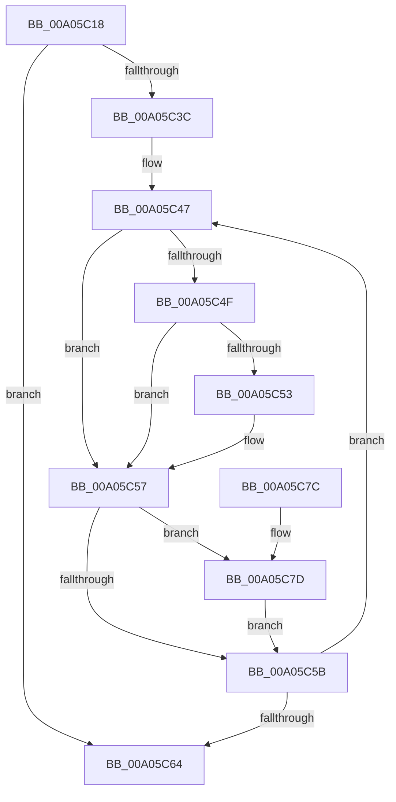

# IopRemoveDeviceRelationsFromList

- RVA: `0x00A05C18`–`0x00A05C86` (길이 `110` bytes)
- VA: `0x0000000140A05C18`
- 실행 섹션: `PAGE`
- PDB 이름 있음: `예`; PDB Function 태그: `아니요`
- unwind 정보 RVA: `0x000A7C70`
- 디코드: `36`개 명령, `110/110` bytes 표시
- 미해석 바이트: `0` (있으면 어셈블리에 `.byte`로 보존)

> 이 문서는 커널 이미지의 기계어와 PDB 기호를 분석해 생성했습니다. 4번과 5번은 함수 원형과 자료형을 바이너리 사용 방식에서 추정한 C 해석이며 원본 소스 복구 결과는 아닙니다.

## 1. Dependencies

- 직접 호출 지점: **1**; 고유 호출 대상: **1**
- 직접 호출자로 확인된 함수: **1**
- RIP 상대 이미지 참조: **0**

### Outgoing calls
- `0x00A05C7F` → [PipDeviceObjectListRemove](../AC/PipDeviceObjectListRemove_function_00ACA6D8.md) (function, `0x00ACA6D8`)

### Direct callers
- [PnpProcessQueryRemoveAndEject](PnpProcessQueryRemoveAndEject_function_00A05170.md) at `0x00A05344`

### Static image references
- 디코드된 RIP-relative 메모리 참조가 없습니다.

## 2. Other-region calls and transfers

- 다른 실행 섹션으로 향하는 call: **0**
- 별도 외부 분기/꼬리 이동을 확인하지 못했습니다.

## 3. Assembly (complete function range)

```asm
00A05C18  48 89 5C 24 08                  mov qword ptr [rsp + 8], rbx
00A05C1D  48 89 74 24 10                  mov qword ptr [rsp + 0x10], rsi
00A05C22  48 89 7C 24 18                  mov qword ptr [rsp + 0x18], rdi
00A05C27  41 56                           push r14
00A05C29  48 83 EC 20                     sub rsp, 0x20
00A05C2D  48 8B 01                        mov rax, qword ptr [rcx]
00A05C30  33 F6                           xor esi, esi
00A05C32  4C 8B F1                        mov r14, rcx
00A05C35  8B 18                           mov ebx, dword ptr [rax]
00A05C37  83 EB 01                        sub ebx, 1
00A05C3A  78 28                           js 0x140a05c64
00A05C3C  48 63 C3                        movsxd rax, ebx
00A05C3F  48 8D 3C 40                     lea rdi, [rax + rax*2]
00A05C43  48 C1 E7 03                     shl rdi, 3
00A05C47  49 8B 0E                        mov rcx, qword ptr [r14]
00A05C4A  48 85 C9                        test rcx, rcx
00A05C4D  74 08                           je 0x140a05c57
00A05C4F  3B 19                           cmp ebx, dword ptr [rcx]
00A05C51  73 04                           jae 0x140a05c57
00A05C53  8B 74 0F 18                     mov esi, dword ptr [rdi + rcx + 0x18]
00A05C57  85 F6                           test esi, esi
00A05C59  74 22                           je 0x140a05c7d
00A05C5B  48 83 EF 18                     sub rdi, 0x18
00A05C5F  83 EB 01                        sub ebx, 1
00A05C62  79 E3                           jns 0x140a05c47
00A05C64  48 8B 5C 24 30                  mov rbx, qword ptr [rsp + 0x30]
00A05C69  33 C0                           xor eax, eax
00A05C6B  48 8B 74 24 38                  mov rsi, qword ptr [rsp + 0x38]
00A05C70  48 8B 7C 24 40                  mov rdi, qword ptr [rsp + 0x40]
00A05C75  48 83 C4 20                     add rsp, 0x20
00A05C79  41 5E                           pop r14
00A05C7B  C3                              ret
00A05C7C  CC                              int3
00A05C7D  8B D3                           mov edx, ebx
00A05C7F  E8 54 4A 0C 00                  call 0x140aca6d8
00A05C84  EB D5                           jmp 0x140a05c5b
```

## 4. C-style interpretation (structured pseudocode)

```c
__int64 __fastcall IopRemoveDeviceRelationsFromList(__int64 a1)
{
    __int64 result;
    __int64 v_rbx;
    __int64 v_rdi;
    __int64 v_rsi;
    __int64 v_rsp;
    unsigned __int64 v_stack_p10;
    unsigned __int64 v_stack_p18;
    unsigned __int64 v_stack_p8;

    v_stack_p8 = v_rbx;
    v_stack_p10 = v_rsi;
    v_stack_p18 = v_rdi;
    v_rsp = (v_rsp) - (32);
    v_rsi = 0;
    v_rbx = (unsigned int)(((unsigned int)(*(unsigned int *)(*(unsigned __int64 *)(a1)))) - (1));
    if (sign_flag) goto loc_00A05C64;
    v_rdi = ((int)((unsigned int)(v_rbx)) + (int)((unsigned int)(v_rbx)) * 2) << (3);
loc_00A05C47:
    if (*(unsigned __int64 *)(a1) == 0) goto loc_00A05C57;
    if (((unsigned int)(v_rbx)) < (*(unsigned int *)(*(unsigned __int64 *)(a1)))) {
        v_rsi = *(unsigned int *)(v_rdi + *(unsigned __int64 *)(a1) * 1 + 24);
    }
    if ((unsigned int)(v_rsi) == 0) goto loc_00A05C7D;
loc_00A05C5B:
    v_rdi = (v_rdi) - (24);
    v_rbx = (unsigned int)((v_rbx) - (1));
    if (!sign_flag) goto loc_00A05C47;
loc_00A05C64:
    result = 0;
    v_rsp = (v_rsp) + (32);
    return result;
loc_00A05C7D:
    result = PipDeviceObjectListRemove(*(unsigned __int64 *)(a1), (unsigned int)((unsigned int)(v_stack_p8)), a3, a4);
    goto loc_00A05C5B;
}
```

## 5. (Beta) C Style

```c
int64_t IopRemoveDeviceRelationsFromList(void *Arg1)
{
    uint8_t *arg1 = (uint8_t *)Arg1;

    int64_t result;
    int64_t local_rbx;
    int64_t local_rdi;
    int64_t local_rsi;
    int64_t local_rsp;
    uint64_t v_stack_p10;
    uint64_t v_stack_p18;
    uint64_t v_stack_p8;

    v_stack_p8 = local_rbx;
    v_stack_p10 = local_rsi;
    v_stack_p18 = local_rdi;
    local_rsp = (local_rsp) - (32);
    local_rsi = 0;
    local_rbx = (uint32_t)(((uint32_t)(*(uint32_t *)(*(uint64_t *)(arg1)))) - (1));
    if (sign_flag) goto loc_00A05C64;
    local_rdi = ((int32_t)((uint32_t)(local_rbx)) + (int32_t)((uint32_t)(local_rbx)) * 2) << (3);
loc_00A05C47:
    if (*(uint64_t *)(arg1) == 0) goto loc_00A05C57;
    if (((uint32_t)(local_rbx)) < (*(uint32_t *)(*(uint64_t *)(arg1)))) {
        local_rsi = *(uint32_t *)(local_rdi + *(uint64_t *)(arg1) * 1 + 0x18);
    }
    if ((uint32_t)(local_rsi) == 0) goto loc_00A05C7D;
loc_00A05C5B:
    local_rdi = (local_rdi) - (24);
    local_rbx = (uint32_t)((local_rbx) - (1));
    if (!sign_flag) goto loc_00A05C47;
loc_00A05C64:
    result = 0;
    local_rsp = (local_rsp) + (32);
    return result;
loc_00A05C7D:
    result = PipDeviceObjectListRemove(*(uint64_t *)(arg1), (uint32_t)((uint32_t)(v_stack_p8)), a3, a4);
    goto loc_00A05C5B;
}
```

### 관측된 메모리 오프셋

구조체 형식이 확인되지 않은 접근은 인자 기준의 오프셋으로만 기록했습니다.

| 기준 인자 | 오프셋 표현 | 폭 (bit) | 접근 |
|---|---:|---:|---|
| `Arg1` | `+ 0x0` | `64` | `R` |

## 6. Execution-region graph

[열기: 2D/3D 그래프와 함수 탐색 컨트롤 패널](../../../control-panel.html?section=page&rva=0x00A05C18&view=graph)

- 2D 그래프는 위에서 아래로 흐르고, 3D 그래프는 빈 공간을 드래그해 회전합니다. Shift+드래그는 이동, 휠은 확대·축소, 함수 노드 선택은 대상 보고서 이동입니다.

### Static fallback


