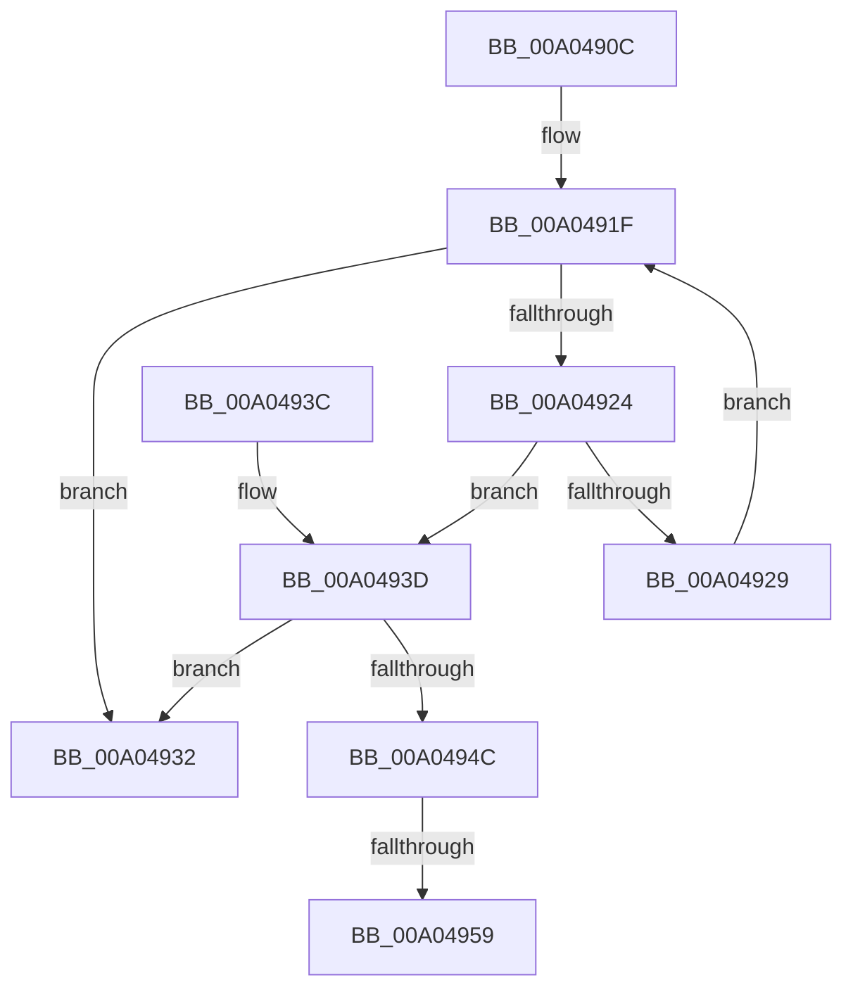

# IopSetRelationsTag

- RVA: `0x00A0490C`–`0x00A04962` (길이 `86` bytes)
- VA: `0x0000000140A0490C`
- 실행 섹션: `PAGE`
- PDB 이름 있음: `예`; PDB Function 태그: `예`
- unwind 정보 RVA: `0x000DB714`
- 디코드: `27`개 명령, `86/86` bytes 표시
- 미해석 바이트: `0` (있으면 어셈블리에 `.byte`로 보존)

> 이 문서는 커널 이미지의 기계어와 PDB 기호를 분석해 생성했습니다. 4번과 5번은 함수 원형과 자료형을 바이너리 사용 방식에서 추정한 C 해석이며 원본 소스 복구 결과는 아닙니다.

## 1. Dependencies

- 직접 호출 지점: **0**; 고유 호출 대상: **0**
- 직접 호출자로 확인된 함수: **2**
- RIP 상대 이미지 참조: **0**

### Outgoing calls
- 직접 디코드된 call 명령이 없습니다.

### Direct callers
- [PnpChainDereferenceComplete](PnpChainDereferenceComplete_function_00A047F4.md) at `0x00A04880`
- [PnpInvalidateRelationsInList](PnpInvalidateRelationsInList_function_00A05DF8.md) at `0x00A05EAF`

### Static image references
- 디코드된 RIP-relative 메모리 참조가 없습니다.

## 2. Other-region calls and transfers

- 다른 실행 섹션으로 향하는 call: **0**
- call이 아닌 외부 분기/꼬리 이동: **2**
  - `0x00A04953` → `0x00B3369E` (`tail-transfer`)
  - `0x00A0495D` → `0x00B3369E` (`tail-transfer`)

## 3. Assembly (complete function range)

```asm
00A0490C  4C 8B 01                        mov r8, qword ptr [rcx]
00A0490F  45 33 D2                        xor r10d, r10d
00A04912  4C 8B D9                        mov r11, rcx
00A04915  45 8B CA                        mov r9d, r10d
00A04918  41 8B 08                        mov ecx, dword ptr [r8]
00A0491B  49 8D 40 10                     lea rax, [r8 + 0x10]
00A0491F  44 3B C9                        cmp r9d, ecx
00A04922  7D 0E                           jge 0x140a04932
00A04924  48 3B 10                        cmp rdx, qword ptr [rax]
00A04927  74 14                           je 0x140a0493d
00A04929  41 FF C1                        inc r9d
00A0492C  48 83 C0 18                     add rax, 0x18
00A04930  EB ED                           jmp 0x140a0491f
00A04932  41 BA 0E 00 00 C0               mov r10d, 0xc000000e
00A04938  41 8B C2                        mov eax, r10d
00A0493B  C3                              ret
00A0493C  CC                              int3
00A0493D  49 63 C1                        movsxd rax, r9d
00A04940  83 CA FF                        or edx, 0xffffffff
00A04943  48 8D 0C 40                     lea rcx, [rax + rax*2]
00A04947  44 3B CA                        cmp r9d, edx
00A0494A  74 E6                           je 0x140a04932
00A0494C  41 8B 44 C8 20                  mov eax, dword ptr [r8 + rcx*8 + 0x20]
00A04951  A8 01                           test al, 1
00A04953  0F 84 45 ED 12 00               je 0x140b3369e
00A04959  41 01 50 08                     add dword ptr [r8 + 8], edx
00A0495D  E9 3C ED 12 00                  jmp 0x140b3369e
```

## 4. C-style interpretation (structured pseudocode)

```c
__int64 __fastcall IopSetRelationsTag(__int64 a1, __int64 a2)
{
    __int64 result;
    __int64 v_r10;

    v_r10 = 0;
loc_00A0491F:
    if (0 >= ((unsigned int)((unsigned int)(*(unsigned int *)(*(unsigned __int64 *)(a1)))))) goto loc_00A04932;
    if (a2 == (*(unsigned __int64 *)(*(unsigned __int64 *)(a1) + 16))) goto loc_00A0493D;
    a4 = (unsigned int)((0) + 1);
    result = (*(unsigned __int64 *)(a1) + 16) + (24);
    goto loc_00A0491F;
loc_00A04932:
    return (unsigned int)((unsigned int)((unsigned int)(0xC000000EULL)));
loc_00A0493D:
    a2 = (unsigned int)((a2) | (0xFFFFFFFFULL));
    if (((unsigned int)(a4)) == ((unsigned int)(a2))) goto loc_00A04932;
}
```

## 5. (Beta) C Style

```c
int64_t IopSetRelationsTag(void *Arg1, int64_t Arg2)
{
    uint8_t *arg1 = (uint8_t *)Arg1;

    int64_t result;
    int64_t local_r10;

    local_r10 = 0;
loc_00A0491F:
    if (0 >= ((uint32_t)((uint32_t)(*(uint32_t *)(*(uint64_t *)(arg1)))))) goto loc_00A04932;
    if (Arg2 == (*(uint64_t *)(*(uint64_t *)(arg1) + 0x10))) goto loc_00A0493D;
    a4 = (uint32_t)((0) + 1);
    result = (*(uint64_t *)(arg1) + 16) + (24);
    goto loc_00A0491F;
loc_00A04932:
    return (uint32_t)((uint32_t)((uint32_t)(0xC000000EULL)));
loc_00A0493D:
    Arg2 = (uint32_t)((Arg2) | (0xFFFFFFFFULL));
    if (((uint32_t)(a4)) == ((uint32_t)(Arg2))) goto loc_00A04932;
}
```

### 관측된 메모리 오프셋

구조체 형식이 확인되지 않은 접근은 인자 기준의 오프셋으로만 기록했습니다.

| 기준 인자 | 오프셋 표현 | 폭 (bit) | 접근 |
|---|---:|---:|---|
| `Arg1` | `+ 0x0` | `64` | `R` |

## 6. Execution-region graph

[열기: 2D/3D 그래프와 함수 탐색 컨트롤 패널](../../../control-panel.html?section=page&rva=0x00A0490C&view=graph)

- 2D 그래프는 위에서 아래로 흐르고, 3D 그래프는 빈 공간을 드래그해 회전합니다. Shift+드래그는 이동, 휠은 확대·축소, 함수 노드 선택은 대상 보고서 이동입니다.

### Static fallback


