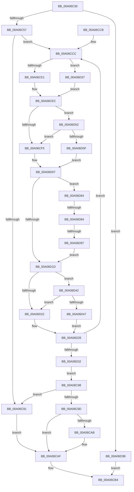

# IopSortRelationListForRemove

- RVA: `0x00A06C30`–`0x00A06D9C` (길이 `364` bytes)
- VA: `0x0000000140A06C30`
- 실행 섹션: `PAGE`
- PDB 이름 있음: `예`; PDB Function 태그: `예`
- unwind 정보 RVA: `0x000A8560`
- 디코드: `108`개 명령, `364/364` bytes 표시
- 미해석 바이트: `0` (있으면 어셈블리에 `.byte`로 보존)

> 이 문서는 커널 이미지의 기계어와 PDB 기호를 분석해 생성했습니다. 4번과 5번은 함수 원형과 자료형을 바이너리 사용 방식에서 추정한 C 해석이며 원본 소스 복구 결과는 아닙니다.

## 1. Dependencies

- 직접 호출 지점: **8**; 고유 호출 대상: **6**
- 직접 호출자로 확인된 함수: **2**
- RIP 상대 이미지 참조: **2**

### Outgoing calls
- `0x00A06C71` → [ExAcquireResourceSharedLite](../../text/21/ExAcquireResourceSharedLite_function_00211BC0.md) (function, `0x00211BC0`)
- `0x00A06C7F` → [ExAcquireResourceSharedLite](../../text/21/ExAcquireResourceSharedLite_function_00211BC0.md) (function, `0x00211BC0`)
- `0x00A06CA0` → [PipSortDeviceObjectList](PipSortDeviceObjectList_function_00A06EDC.md) (function, `0x00A06EDC`)
- `0x00A06CAF` → [PnpReleaseDependencyRelationsLock](PnpReleaseDependencyRelationsLock_function_00A06E14.md) (function, `0x00A06E14`)
- `0x00A06CFF` → [PipIsDeviceInDeviceObjectList](PipIsDeviceInDeviceObjectList_function_00A070D0.md) (function, `0x00A070D0`)
- `0x00A06D0D` → [PiGetProviderList](PiGetProviderList_function_00A07140.md) (function, `0x00A07140`)
- `0x00A06D71` → [PiEnumerateProviderListEntry](../72/PiEnumerateProviderListEntry_function_007277E4.md) (function, `0x007277E4`)
- `0x00A06D8A` → [PipIsDeviceInDeviceObjectList](PipIsDeviceInDeviceObjectList_function_00A070D0.md) (function, `0x00A070D0`)

### Direct callers
- [PnpBuildRemovalRelationList](PnpBuildRemovalRelationList_function_00A058D0.md) at `0x00A05954`
- [PipRemoveDevicesInRelationList](PipRemoveDevicesInRelationList_function_00A08CF0.md) at `0x00A08D4E`

### Static image references
- `0x00A06C60` → RVA `0x00F8C560` (`.data`; read)
- `0x00A06C78` → RVA `0x00F8CEA0` (`.data`; read)

## 2. Other-region calls and transfers

- 다른 실행 섹션으로 향하는 call: **2**
  - `0x00A06C71` → [ExAcquireResourceSharedLite](../../text/21/ExAcquireResourceSharedLite_function_00211BC0.md) (`PAGE` → `.text`)
  - `0x00A06C7F` → [ExAcquireResourceSharedLite](../../text/21/ExAcquireResourceSharedLite_function_00211BC0.md) (`PAGE` → `.text`)
- call이 아닌 외부 분기/꼬리 이동: **2**
  - `0x00A06D7E` → [sub_00B34608](../B3/Unknown_function_00B34608.md) (`tail-transfer`)
  - `0x00A06D91` → [sub_00B34608](../B3/Unknown_function_00B34608.md) (`tail-transfer`)

## 3. Assembly (complete function range)

```asm
00A06C30  48 89 5C 24 18                  mov qword ptr [rsp + 0x18], rbx
00A06C35  55                              push rbp
00A06C36  56                              push rsi
00A06C37  57                              push rdi
00A06C38  41 54                           push r12
00A06C3A  41 55                           push r13
00A06C3C  41 56                           push r14
00A06C3E  41 57                           push r15
00A06C40  48 83 EC 20                     sub rsp, 0x20
00A06C44  48 83 64 24 68 00               and qword ptr [rsp + 0x68], 0
00A06C4A  48 8B F9                        mov rdi, rcx
00A06C4D  80 79 08 00                     cmp byte ptr [rcx + 8], 0
00A06C51  0F 85 E4 00 00 00               jne 0x140a06d3b
00A06C57  65 48 8B 04 25 88 01 00 00      mov rax, qword ptr gs:[0x188]
00A06C60  48 8D 0D F9 58 58 00            lea rcx, [rip + 0x5858f9]
00A06C67  B2 01                           mov dl, 1
00A06C69  66 FF 88 E4 01 00 00            dec word ptr [rax + 0x1e4]
00A06C70  90                              nop
00A06C71  E8 4A AF 80 FF                  call 0x140211bc0
00A06C76  B2 01                           mov dl, 1
00A06C78  48 8D 0D 21 62 58 00            lea rcx, [rip + 0x586221]
00A06C7F  E8 3C AF 80 FF                  call 0x140211bc0
00A06C84  4C 8B 1F                        mov r11, qword ptr [rdi]
00A06C87  45 33 E4                        xor r12d, r12d
00A06C8A  33 ED                           xor ebp, ebp
00A06C8C  41 39 2B                        cmp dword ptr [r11], ebp
00A06C8F  77 3B                           ja 0x140a06ccc
00A06C91  BB 01 00 00 C0                  mov ebx, 0xc0000001
00A06C96  EB 17                           jmp 0x140a06caf
00A06C98  45 85 E4                        test r12d, r12d
00A06C9B  74 F4                           je 0x140a06c91
00A06C9D  48 8B CF                        mov rcx, rdi
00A06CA0  E8 37 02 00 00                  call 0x140a06edc
00A06CA5  8B D8                           mov ebx, eax
00A06CA7  85 C0                           test eax, eax
00A06CA9  78 04                           js 0x140a06caf
00A06CAB  C6 47 08 01                     mov byte ptr [rdi + 8], 1
00A06CAF  E8 60 01 00 00                  call 0x140a06e14
00A06CB4  8B C3                           mov eax, ebx
00A06CB6  48 8B 5C 24 70                  mov rbx, qword ptr [rsp + 0x70]
00A06CBB  48 83 C4 20                     add rsp, 0x20
00A06CBF  41 5F                           pop r15
00A06CC1  41 5E                           pop r14
00A06CC3  41 5D                           pop r13
00A06CC5  41 5C                           pop r12
00A06CC7  5F                              pop rdi
00A06CC8  5E                              pop rsi
00A06CC9  5D                              pop rbp
00A06CCA  C3                              ret
00A06CCB  CC                              int3
00A06CCC  48 8D 1C 6D 00 00 00 00         lea rbx, [rbp*2]
00A06CD4  48 03 DD                        add rbx, rbp
00A06CD7  49 8B 74 DB 10                  mov rsi, qword ptr [r11 + rbx*8 + 0x10]
00A06CDC  48 85 F6                        test rsi, rsi
00A06CDF  74 56                           je 0x140a06d37
00A06CE1  48 8B 86 38 01 00 00            mov rax, qword ptr [rsi + 0x138]
00A06CE8  48 8B 48 28                     mov rcx, qword ptr [rax + 0x28]
00A06CEC  48 8B 51 10                     mov rdx, qword ptr [rcx + 0x10]
00A06CF0  48 85 D2                        test rdx, rdx
00A06CF3  74 5D                           je 0x140a06d52
00A06CF5  48 8B 52 20                     mov rdx, qword ptr [rdx + 0x20]
00A06CF9  45 33 C0                        xor r8d, r8d
00A06CFC  49 8B CB                        mov rcx, r11
00A06CFF  E8 CC 03 00 00                  call 0x140a070d0
00A06D04  44 8A F0                        mov r14b, al
00A06D07  45 32 FF                        xor r15b, r15b
00A06D0A  48 8B CE                        mov rcx, rsi
00A06D0D  E8 2E 04 00 00                  call 0x140a07140
00A06D12  4C 8B E8                        mov r13, rax
00A06D15  48 8B 30                        mov rsi, qword ptr [rax]
00A06D18  49 3B F5                        cmp rsi, r13
00A06D1B  75 47                           jne 0x140a06d64
00A06D1D  45 84 F6                        test r14b, r14b
00A06D20  74 20                           je 0x140a06d42
00A06D22  41 83 64 DB 20 FB               and dword ptr [r11 + rbx*8 + 0x20], 0xfffffffb
00A06D28  4C 8B 1F                        mov r11, qword ptr [rdi]
00A06D2B  FF C5                           inc ebp
00A06D2D  41 3B 2B                        cmp ebp, dword ptr [r11]
00A06D30  72 9A                           jb 0x140a06ccc
00A06D32  E9 61 FF FF FF                  jmp 0x140a06c98
00A06D37  33 C9                           xor ecx, ecx
00A06D39  EB B1                           jmp 0x140a06cec
00A06D3B  33 DB                           xor ebx, ebx
00A06D3D  E9 72 FF FF FF                  jmp 0x140a06cb4
00A06D42  45 84 FF                        test r15b, r15b
00A06D45  75 DB                           jne 0x140a06d22
00A06D47  41 83 4C DB 20 04               or dword ptr [r11 + rbx*8 + 0x20], 4
00A06D4D  41 FF C4                        inc r12d
00A06D50  EB D6                           jmp 0x140a06d28
00A06D52  48 8B 91 88 02 00 00            mov rdx, qword ptr [rcx + 0x288]
00A06D59  48 83 E2 FE                     and rdx, 0xfffffffffffffffe
00A06D5D  75 96                           jne 0x140a06cf5
00A06D5F  45 32 F6                        xor r14b, r14b
00A06D62  EB A3                           jmp 0x140a06d07
00A06D64  4C 8D 44 24 60                  lea r8, [rsp + 0x60]
00A06D69  48 8B CE                        mov rcx, rsi
00A06D6C  48 8D 54 24 68                  lea rdx, [rsp + 0x68]
00A06D71  E8 6E 0A D2 FF                  call 0x1407277e4
00A06D76  48 8B 54 24 68                  mov rdx, qword ptr [rsp + 0x68]
00A06D7B  48 85 D2                        test rdx, rdx
00A06D7E  0F 84 84 D8 12 00               je 0x140b34608
00A06D84  48 8B 0F                        mov rcx, qword ptr [rdi]
00A06D87  45 33 C0                        xor r8d, r8d
00A06D8A  E8 41 03 00 00                  call 0x140a070d0
00A06D8F  84 C0                           test al, al
00A06D91  0F 84 71 D8 12 00               je 0x140b34608
00A06D97  41 B7 01                        mov r15b, 1
00A06D9A  EB 81                           jmp 0x140a06d1d
```

## 4. C-style interpretation (structured pseudocode)

```c
__int64 __fastcall IopSortRelationListForRemove(__int64 a1, __int64 a2, int a3)
{
    __int64 result;
    __int64 v_r12;
    __int64 v_r14;
    __int64 v_r15;
    __int64 v_rbp;
    __int64 v_rbx;
    __int64 v_rsp;
    unsigned __int64 v_stack_p10;
    unsigned __int64 v_stack_p18;
    unsigned __int64 v_stack_p60;
    unsigned __int64 v_stack_p68;

    v_stack_p18 = v_rbx;
    v_rsp = (v_rsp) - (32);
    if ((*(unsigned __int8 *)(a1 + 8)) != 0) goto loc_00A06D3B;
    result = ExAcquireResourceSharedLite(v_rip + 5789945, 1, a3, a4);
    result = ExAcquireResourceSharedLite(v_rip + 5792289, 1, a3, a4);
    v_r12 = 0;
    v_rbp = 0;
    if ((*(unsigned int *)(*(unsigned __int64 *)(a1))) > 0) goto loc_00A06CCC;
loc_00A06C91:
    goto loc_00A06CAF;
loc_00A06C98:
    if (0 == 0) goto loc_00A06C91;
    result = PipSortDeviceObjectList(a1, 1, a3, a4);
    if (!(sign_flag)) {
        *(unsigned __int8 *)(a1 + 8) = 1;
    }
    result = PnpReleaseDependencyRelationsLock(a1, 1, a3, a4);
loc_00A06CB4:
    v_rsp = (v_rsp) + (32);
    return (unsigned int)((unsigned int)((unsigned int)((unsigned int)(result))));
loc_00A06CCC:
    v_rbx = (v_rbp * 2) + (0);
    if (*(unsigned __int64 *)(*(unsigned __int64 *)(a1) + v_rbx * 8 + 16) == 0) goto loc_00A06D37;
loc_00A06CEC:
    if (*(unsigned __int64 *)(*(unsigned __int64 *)(*(unsigned __int64 *)(*(unsigned __int64 *)(*(unsigned __int64 *)(a1) + v_rbx * 8 + 16) + 312) + 40) + 16) == 0) goto loc_00A06D52;
loc_00A06CF5:
    a3 = 0;
    result = PipIsDeviceInDeviceObjectList(*(unsigned __int64 *)(a1), *(unsigned __int64 *)(*(unsigned __int64 *)(*(unsigned __int64 *)(*(unsigned __int64 *)(*(unsigned __int64 *)(*(unsigned __int64 *)(a1) + v_rbx * 8 + 16) + 312) + 40) + 16) + 32), a3, a4);
loc_00A06D07:
    v_r15 = 0;
    result = PiGetProviderList(*(unsigned __int64 *)(*(unsigned __int64 *)(a1) + v_rbx * 8 + 16), *(unsigned __int64 *)(*(unsigned __int64 *)(*(unsigned __int64 *)(*(unsigned __int64 *)(*(unsigned __int64 *)(*(unsigned __int64 *)(a1) + v_rbx * 8 + 16) + 312) + 40) + 16) + 32), a3, a4);
    if ((*(unsigned __int64 *)(result)) != result) goto loc_00A06D64;
loc_00A06D1D:
    if ((unsigned __int8)((unsigned __int8)(result)) == 0) goto loc_00A06D42;
loc_00A06D22:
loc_00A06D28:
    v_rbp = (unsigned int)((v_rbp) + 1);
    if (((unsigned int)(v_rbp)) < (*(unsigned int *)(*(unsigned __int64 *)(a1)))) goto loc_00A06CCC;
    goto loc_00A06C98;
loc_00A06D37:
    a1 = 0;
    goto loc_00A06CEC;
loc_00A06D3B:
    v_rbx = 0;
    goto loc_00A06CB4;
loc_00A06D42:
    if (0 != 0) goto loc_00A06D22;
    v_r12 = (unsigned int)((v_r12) + 1);
    goto loc_00A06D28;
loc_00A06D52:
    a2 = (*(unsigned __int64 *)(a1 + 648)) & (-2);
    if (condition_is_not_equal) goto loc_00A06CF5;
    v_r14 = 0;
    goto loc_00A06D07;
loc_00A06D64:
    result = PiEnumerateProviderListEntry(*(unsigned __int64 *)(result), v_stack_p68, v_stack_p60, a4);
    a3 = 0;
    result = PipIsDeviceInDeviceObjectList(*(unsigned __int64 *)(a1), v_stack_p68, a3, a4);
    goto loc_00A06D1D;
}
```

## 5. (Beta) C Style

```c
int64_t IopSortRelationListForRemove(void *Arg1, int64_t Arg2, int32_t Arg3)
{
    uint8_t *arg1 = (uint8_t *)Arg1;

    int64_t result;
    int64_t local_r12;
    int64_t local_r14;
    int64_t local_r15;
    int64_t local_rbp;
    int64_t local_rbx;
    int64_t local_rsp;
    uint64_t v_stack_p10;
    uint64_t v_stack_p18;
    uint64_t v_stack_p60;
    uint64_t v_stack_p68;

    v_stack_p18 = local_rbx;
    local_rsp = (local_rsp) - (32);
    if ((*(uint8_t *)(arg1 + 0x8)) != 0) goto loc_00A06D3B;
    result = ExAcquireResourceSharedLite(v_rip + 5789945, 1, Arg3, a4);
    result = ExAcquireResourceSharedLite(v_rip + 5792289, 1, Arg3, a4);
    local_r12 = 0;
    local_rbp = 0;
    if ((*(uint32_t *)(*(uint64_t *)(arg1))) > 0) goto loc_00A06CCC;
loc_00A06C91:
    goto loc_00A06CAF;
loc_00A06C98:
    if (0 == 0) goto loc_00A06C91;
    result = PipSortDeviceObjectList(Arg1, 1, Arg3, a4);
    if (!(sign_flag)) {
        *(uint8_t *)(arg1 + 0x8) = 1;
    }
    result = PnpReleaseDependencyRelationsLock(Arg1, 1, Arg3, a4);
loc_00A06CB4:
    local_rsp = (local_rsp) + (32);
    return (uint32_t)((uint32_t)((uint32_t)((uint32_t)(result))));
loc_00A06CCC:
    local_rbx = (local_rbp * 2) + (0);
    if (*(uint64_t *)(*(uint64_t *)(arg1) + local_rbx * 8 + 0x10) == 0) goto loc_00A06D37;
loc_00A06CEC:
    if (*(uint64_t *)(*(uint64_t *)(*(uint64_t *)(*(uint64_t *)(*(uint64_t *)(arg1) + local_rbx * 8 + 0x10) + 0x138) + 0x28) + 0x10) == 0) goto loc_00A06D52;
loc_00A06CF5:
    Arg3 = 0;
    result = PipIsDeviceInDeviceObjectList(*(uint64_t *)(arg1), *(uint64_t *)(*(uint64_t *)(*(uint64_t *)(*(uint64_t *)(*(uint64_t *)(*(uint64_t *)(arg1) + local_rbx * 8 + 0x10) + 0x138) + 0x28) + 0x10) + 0x20), Arg3, a4);
loc_00A06D07:
    local_r15 = 0;
    result = PiGetProviderList(*(uint64_t *)(*(uint64_t *)(arg1) + local_rbx * 8 + 0x10), *(uint64_t *)(*(uint64_t *)(*(uint64_t *)(*(uint64_t *)(*(uint64_t *)(*(uint64_t *)(arg1) + local_rbx * 8 + 0x10) + 0x138) + 0x28) + 0x10) + 0x20), Arg3, a4);
    if ((*(uint64_t *)(result)) != result) goto loc_00A06D64;
loc_00A06D1D:
    if ((uint8_t)((uint8_t)(result)) == 0) goto loc_00A06D42;
loc_00A06D22:
loc_00A06D28:
    local_rbp = (uint32_t)((local_rbp) + 1);
    if (((uint32_t)(local_rbp)) < (*(uint32_t *)(*(uint64_t *)(arg1)))) goto loc_00A06CCC;
    goto loc_00A06C98;
loc_00A06D37:
    Arg1 = 0;
    goto loc_00A06CEC;
loc_00A06D3B:
    local_rbx = 0;
    goto loc_00A06CB4;
loc_00A06D42:
    if (0 != 0) goto loc_00A06D22;
    local_r12 = (uint32_t)((local_r12) + 1);
    goto loc_00A06D28;
loc_00A06D52:
    Arg2 = (*(uint64_t *)(arg1 + 0x288)) & (-2);
    if (condition_is_not_equal) goto loc_00A06CF5;
    local_r14 = 0;
    goto loc_00A06D07;
loc_00A06D64:
    result = PiEnumerateProviderListEntry(*(uint64_t *)(result), v_stack_p68, v_stack_p60, a4);
    Arg3 = 0;
    result = PipIsDeviceInDeviceObjectList(*(uint64_t *)(arg1), v_stack_p68, Arg3, a4);
    goto loc_00A06D1D;
}
```

### 관측된 메모리 오프셋

구조체 형식이 확인되지 않은 접근은 인자 기준의 오프셋으로만 기록했습니다.

| 기준 인자 | 오프셋 표현 | 폭 (bit) | 접근 |
|---|---:|---:|---|
| `Arg1` | `+ 0x0` | `64` | `R` |
| `Arg1` | `+ 0x8` | `8` | `R` |
| `Arg1` | `+ 0x8` | `8` | `W` |

## 6. Execution-region graph

[열기: 2D/3D 그래프와 함수 탐색 컨트롤 패널](../../../control-panel.html?section=page&rva=0x00A06C30&view=graph)

- 2D 그래프는 위에서 아래로 흐르고, 3D 그래프는 빈 공간을 드래그해 회전합니다. Shift+드래그는 이동, 휠은 확대·축소, 함수 노드 선택은 대상 보고서 이동입니다.

### Static fallback


