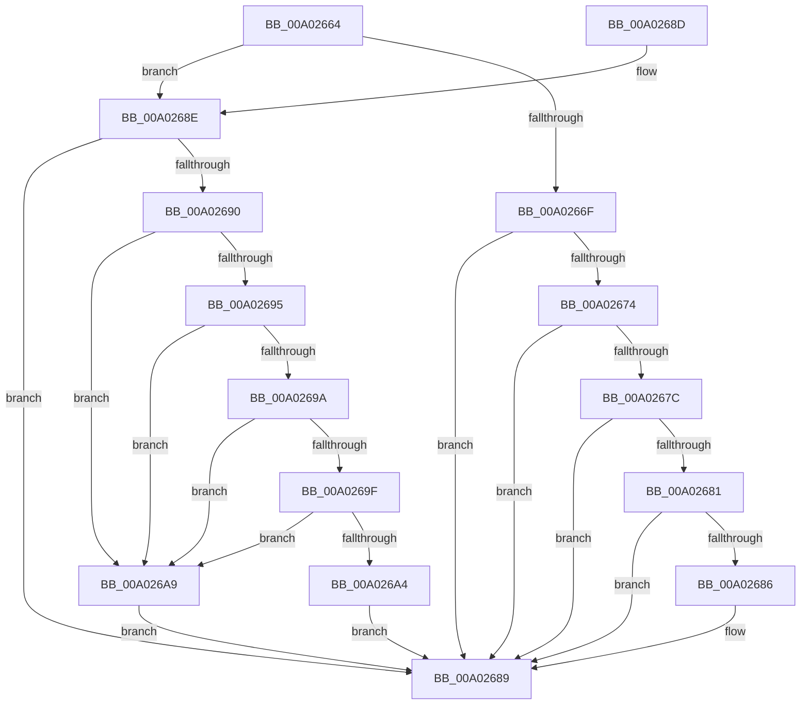

# IsValueSizeFixed

- RVA: `0x00A02664`–`0x00A026AE` (길이 `74` bytes)
- VA: `0x0000000140A02664`
- 실행 섹션: `PAGE`
- PDB 이름 있음: `예`; PDB Function 태그: `아니요`
- unwind 정보 RVA: `0x000DB714`
- 디코드: `29`개 명령, `74/74` bytes 표시
- 미해석 바이트: `0` (있으면 어셈블리에 `.byte`로 보존)

> 이 문서는 커널 이미지의 기계어와 PDB 기호를 분석해 생성했습니다. 4번과 5번은 함수 원형과 자료형을 바이너리 사용 방식에서 추정한 C 해석이며 원본 소스 복구 결과는 아닙니다.

## 1. Dependencies

- 직접 호출 지점: **0**; 고유 호출 대상: **0**
- 직접 호출자로 확인된 함수: **2**
- RIP 상대 이미지 참조: **0**

### Outgoing calls
- 직접 디코드된 call 명령이 없습니다.

### Direct callers
- [LocalGetConditionForString](LocalGetConditionForString_function_00A01C20.md) at `0x00A01EF3`
- [sub_00B32FE4](../B3/Unknown_function_00B32FE4.md) at `0x00B3306C`

### Static image references
- 디코드된 RIP-relative 메모리 참조가 없습니다.

## 2. Other-region calls and transfers

- 다른 실행 섹션으로 향하는 call: **0**
- 별도 외부 분기/꼬리 이동을 확인하지 못했습니다.

## 3. Assembly (complete function range)

```asm
00A02664  45 32 C0                        xor r8b, r8b
00A02667  0F B6 D1                        movzx edx, cl
00A0266A  83 FA 50                        cmp edx, 0x50
00A0266D  76 1F                           jbe 0x140a0268e
00A0266F  83 EA 51                        sub edx, 0x51
00A02672  74 15                           je 0x140a02689
00A02674  81 EA A7 00 00 00               sub edx, 0xa7
00A0267A  74 0D                           je 0x140a02689
00A0267C  83 EA 01                        sub edx, 1
00A0267F  74 08                           je 0x140a02689
00A02681  83 EA 01                        sub edx, 1
00A02684  74 03                           je 0x140a02689
00A02686  83 EA 01                        sub edx, 1
00A02689  41 8A C0                        mov al, r8b
00A0268C  C3                              ret
00A0268D  CC                              int3
00A0268E  74 F9                           je 0x140a02689
00A02690  83 EA 01                        sub edx, 1
00A02693  74 14                           je 0x140a026a9
00A02695  83 EA 01                        sub edx, 1
00A02698  74 0F                           je 0x140a026a9
00A0269A  83 EA 01                        sub edx, 1
00A0269D  74 0A                           je 0x140a026a9
00A0269F  83 EA 01                        sub edx, 1
00A026A2  74 05                           je 0x140a026a9
00A026A4  83 EA 0C                        sub edx, 0xc
00A026A7  EB E0                           jmp 0x140a02689
00A026A9  41 B0 01                        mov r8b, 1
00A026AC  EB DB                           jmp 0x140a02689
```

## 4. C-style interpretation (structured pseudocode)

```c
__int64 __fastcall IsValueSizeFixed(unsigned __int8 a1, __int64 a2, unsigned __int8 a3)
{
    a3 = 0;
    if (a1 <= 80) goto loc_00A0268E;
    a2 = (unsigned int)((a1) - (81));
    if (condition_is_equal) goto loc_00A02689;
    a2 = (unsigned int)((a2) - (167));
    if (condition_is_equal) goto loc_00A02689;
    a2 = (unsigned int)((a2) - (1));
    if (condition_is_equal) goto loc_00A02689;
    a2 = (unsigned int)((a2) - (1));
    if (!(condition_is_equal)) {
        a2 = (unsigned int)((a2) - (1));
    }
    return 0;
loc_00A0268E:
    if (condition_is_equal) goto loc_00A02689;
    a2 = (unsigned int)((a2) - (1));
    if (condition_is_equal) goto loc_00A026A9;
    a2 = (unsigned int)((a2) - (1));
    if (condition_is_equal) goto loc_00A026A9;
    a2 = (unsigned int)((a2) - (1));
    if (condition_is_equal) goto loc_00A026A9;
    a2 = (unsigned int)((a2) - (1));
    if (condition_is_equal) goto loc_00A026A9;
    a2 = (unsigned int)((a2) - (12));
    goto loc_00A02689;
loc_00A026A9:
    goto loc_00A02689;
}
```

## 5. (Beta) C Style

```c
int64_t IsValueSizeFixed(uint8_t Arg1, int64_t Arg2, uint8_t Arg3)
{
    Arg3 = 0;
    if (Arg1 <= 80) goto loc_00A0268E;
    Arg2 = (uint32_t)((Arg1) - (81));
    if (condition_is_equal) goto loc_00A02689;
    Arg2 = (uint32_t)((Arg2) - (167));
    if (condition_is_equal) goto loc_00A02689;
    Arg2 = (uint32_t)((Arg2) - (1));
    if (condition_is_equal) goto loc_00A02689;
    Arg2 = (uint32_t)((Arg2) - (1));
    if (!(condition_is_equal)) {
        Arg2 = (uint32_t)((Arg2) - (1));
    }
    return 0;
loc_00A0268E:
    if (condition_is_equal) goto loc_00A02689;
    Arg2 = (uint32_t)((Arg2) - (1));
    if (condition_is_equal) goto loc_00A026A9;
    Arg2 = (uint32_t)((Arg2) - (1));
    if (condition_is_equal) goto loc_00A026A9;
    Arg2 = (uint32_t)((Arg2) - (1));
    if (condition_is_equal) goto loc_00A026A9;
    Arg2 = (uint32_t)((Arg2) - (1));
    if (condition_is_equal) goto loc_00A026A9;
    Arg2 = (uint32_t)((Arg2) - (12));
    goto loc_00A02689;
loc_00A026A9:
    goto loc_00A02689;
}
```

## 6. Execution-region graph

[열기: 2D/3D 그래프와 함수 탐색 컨트롤 패널](../../../control-panel.html?section=page&rva=0x00A02664&view=graph)

- 2D 그래프는 위에서 아래로 흐르고, 3D 그래프는 빈 공간을 드래그해 회전합니다. Shift+드래그는 이동, 휠은 확대·축소, 함수 노드 선택은 대상 보고서 이동입니다.

### Static fallback


