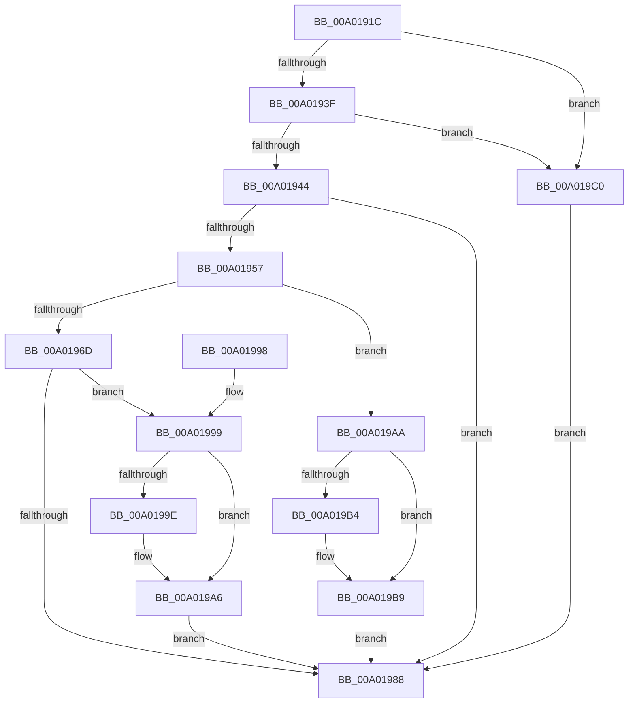

# LocalConvertSidToStringSidW

- RVA: `0x00A0191C`–`0x00A019C7` (길이 `171` bytes)
- VA: `0x0000000140A0191C`
- 실행 섹션: `PAGE`
- PDB 이름 있음: `예`; PDB Function 태그: `아니요`
- unwind 정보 RVA: `0x000A7E48`
- 디코드: `52`개 명령, `171/171` bytes 표시
- 미해석 바이트: `0` (있으면 어셈블리에 `.byte`로 보존)

> 이 문서는 커널 이미지의 기계어와 PDB 기호를 분석해 생성했습니다. 4번과 5번은 함수 원형과 자료형을 바이너리 사용 방식에서 추정한 C 해석이며 원본 소스 복구 결과는 아닙니다.

## 1. Dependencies

- 직접 호출 지점: **5**; 고유 호출 대상: **4**
- 직접 호출자로 확인된 함수: **3**
- RIP 상대 이미지 참조: **0**

### Outgoing calls
- `0x00A0194E` → [RtlConvertSidToUnicodeString](../92/RtlConvertSidToUnicodeString_function_00927B30.md) (function, `0x00927B30`)
- `0x00A01960` → [SddlpAlloc](../92/SddlpAlloc_function_00925F88.md) (function, `0x00925F88`)
- `0x00A0197F` → [RtlStringCbCopyNW](../../text/39/RtlStringCbCopyNW_function_003905E8.md) (function, `0x003905E8`)
- `0x00A019A1` → [ExFreePool](../../poolcode/B8/ExFreePool_function_00B82850.md) (function, `0x00B82850`)
- `0x00A019B4` → [ExFreePool](../../poolcode/B8/ExFreePool_function_00B82850.md) (function, `0x00B82850`)

### Direct callers
- [SeConvertSidToStringSid](../../text/4B/SeConvertSidToStringSid_function_004BD490.md) at `0x004BD494`
- [LocalGetStringForSid](LocalGetStringForSid_function_00A00328.md) at `0x00A003BD`
- [LocalConvertAclToString](LocalConvertAclToString_function_00A00408.md) at `0x00A00ED3`

### Static image references
- 디코드된 RIP-relative 메모리 참조가 없습니다.

## 2. Other-region calls and transfers

- 다른 실행 섹션으로 향하는 call: **3**
  - `0x00A0197F` → [RtlStringCbCopyNW](../../text/39/RtlStringCbCopyNW_function_003905E8.md) (`PAGE` → `.text`)
  - `0x00A019A1` → [ExFreePool](../../poolcode/B8/ExFreePool_function_00B82850.md) (`PAGE` → `POOLCODE`)
  - `0x00A019B4` → [ExFreePool](../../poolcode/B8/ExFreePool_function_00B82850.md) (`PAGE` → `POOLCODE`)
- 별도 외부 분기/꼬리 이동을 확인하지 못했습니다.

## 3. Assembly (complete function range)

```asm
00A0191C  48 8B C4                        mov rax, rsp
00A0191F  48 89 58 08                     mov qword ptr [rax + 8], rbx
00A01923  48 89 70 10                     mov qword ptr [rax + 0x10], rsi
00A01927  57                              push rdi
00A01928  48 83 EC 30                     sub rsp, 0x30
00A0192C  0F 57 C0                        xorps xmm0, xmm0
00A0192F  48 8B DA                        mov rbx, rdx
00A01932  0F 11 40 E8                     movups xmmword ptr [rax - 0x18], xmm0
00A01936  48 85 C9                        test rcx, rcx
00A01939  0F 84 81 00 00 00               je 0x140a019c0
00A0193F  48 85 D2                        test rdx, rdx
00A01942  74 7C                           je 0x140a019c0
00A01944  48 8B D1                        mov rdx, rcx
00A01947  41 B0 01                        mov r8b, 1
00A0194A  48 8D 48 E8                     lea rcx, [rax - 0x18]
00A0194E  E8 DD 61 F2 FF                  call 0x140927b30
00A01953  85 C0                           test eax, eax
00A01955  78 31                           js 0x140a01988
00A01957  0F B7 7C 24 20                  movzx edi, word ptr [rsp + 0x20]
00A0195C  48 8D 4F 02                     lea rcx, [rdi + 2]
00A01960  E8 23 46 F2 FF                  call 0x140925f88
00A01965  48 89 03                        mov qword ptr [rbx], rax
00A01968  48 85 C0                        test rax, rax
00A0196B  74 3D                           je 0x140a019aa
00A0196D  4C 8B 5C 24 28                  mov r11, qword ptr [rsp + 0x28]
00A01972  48 8D 57 02                     lea rdx, [rdi + 2]
00A01976  4D 8B C3                        mov r8, r11
00A01979  44 8B CF                        mov r9d, edi
00A0197C  48 8B C8                        mov rcx, rax
00A0197F  E8 64 EC 98 FF                  call 0x1403905e8
00A01984  85 C0                           test eax, eax
00A01986  79 11                           jns 0x140a01999
00A01988  48 8B 5C 24 40                  mov rbx, qword ptr [rsp + 0x40]
00A0198D  48 8B 74 24 48                  mov rsi, qword ptr [rsp + 0x48]
00A01992  48 83 C4 30                     add rsp, 0x30
00A01996  5F                              pop rdi
00A01997  C3                              ret
00A01998  CC                              int3
00A01999  4D 85 DB                        test r11, r11
00A0199C  74 08                           je 0x140a019a6
00A0199E  49 8B CB                        mov rcx, r11
00A019A1  E8 AA 0E 18 00                  call 0x140b82850
00A019A6  33 C0                           xor eax, eax
00A019A8  EB DE                           jmp 0x140a01988
00A019AA  48 8B 4C 24 28                  mov rcx, qword ptr [rsp + 0x28]
00A019AF  48 85 C9                        test rcx, rcx
00A019B2  74 05                           je 0x140a019b9
00A019B4  E8 97 0E 18 00                  call 0x140b82850
00A019B9  B8 17 00 00 C0                  mov eax, 0xc0000017
00A019BE  EB C8                           jmp 0x140a01988
00A019C0  B8 0D 00 00 C0                  mov eax, 0xc000000d
00A019C5  EB C1                           jmp 0x140a01988
```

## 4. C-style interpretation (structured pseudocode)

```c
__int64 __fastcall LocalConvertSidToStringSidW(__int64 a1, __int64 a2)
{
    __int64 result;
    __int64 v_rsp;
    unsigned __int64 v_stack_m10;
    unsigned __int16 v_stack_m18;
    unsigned __int64 v_stack_p10;
    unsigned __int64 v_stack_p28;
    unsigned __int64 v_stack_p8;

    *(unsigned __int64 *)(v_rsp + 8) = v_rbx;
    *(unsigned __int64 *)(v_rsp + 16) = v_rsi;
    v_rsp = (v_rsp) - (48);
    *(unsigned __int64 *)(v_rsp - 24) = v_xmm0;
    if (a1 == 0) goto loc_00A019C0;
    if (a2 == 0) goto loc_00A019C0;
    result = RtlConvertSidToUnicodeString(v_rsp - 24, a1, 1, a4);
    if (sign_flag) goto loc_00A01988;
    result = SddlpAlloc(v_stack_m18 + 2, a1, 1, a4);
    *(unsigned __int64 *)(a2) = result;
    if (result == 0) goto loc_00A019AA;
    result = RtlStringCbCopyNW(result, v_stack_m18 + 2, v_stack_m10, (unsigned int)((unsigned int)(v_stack_m18)));
    if (!sign_flag) goto loc_00A01999;
loc_00A01988:
    v_rsp = (v_rsp) + (48);
    return result;
loc_00A01999:
    if (v_stack_m10 != 0) {
        a1 = v_stack_m10;
        result = ExFreePool(a1, v_stack_m18 + 2, v_stack_m10, (unsigned int)((unsigned int)(v_stack_m18)));
    }
    result = 0;
    goto loc_00A01988;
loc_00A019AA:
    if (v_stack_p28 != 0) {
        result = ExFreePool(v_stack_p28, v_stack_m18 + 2, v_stack_m10, (unsigned int)((unsigned int)(v_stack_m18)));
    }
    goto loc_00A01988;
loc_00A019C0:
    goto loc_00A01988;
}
```

## 5. (Beta) C Style

```c
int64_t LocalConvertSidToStringSidW(int64_t Arg1, void *Arg2)
{
    uint8_t *arg2 = (uint8_t *)Arg2;

    int64_t result;
    int64_t local_rsp;
    uint64_t v_stack_m10;
    uint16_t v_stack_m18;
    uint64_t v_stack_p10;
    uint64_t v_stack_p28;
    uint64_t v_stack_p8;

    *(uint64_t *)(local_rsp + 0x8) = local_rbx;
    *(uint64_t *)(local_rsp + 0x10) = local_rsi;
    local_rsp = (local_rsp) - (48);
    *(uint64_t *)(local_rsp - 0x18) = v_xmm0;
    if (Arg1 == 0) goto loc_00A019C0;
    if (Arg2 == NULL) goto loc_00A019C0;
    result = RtlConvertSidToUnicodeString(local_rsp - 24, Arg1, 1, a4);
    if (sign_flag) goto loc_00A01988;
    result = SddlpAlloc(v_stack_m18 + 2, Arg1, 1, a4);
    *(uint64_t *)(arg2) = result;
    if (result == 0) goto loc_00A019AA;
    result = RtlStringCbCopyNW(result, v_stack_m18 + 2, v_stack_m10, (uint32_t)((uint32_t)(v_stack_m18)));
    if (!sign_flag) goto loc_00A01999;
loc_00A01988:
    local_rsp = (local_rsp) + (48);
    return result;
loc_00A01999:
    if (v_stack_m10 != 0) {
        Arg1 = v_stack_m10;
        result = ExFreePool(Arg1, v_stack_m18 + 2, v_stack_m10, (uint32_t)((uint32_t)(v_stack_m18)));
    }
    result = 0;
    goto loc_00A01988;
loc_00A019AA:
    if (v_stack_p28 != 0) {
        result = ExFreePool(v_stack_p28, v_stack_m18 + 2, v_stack_m10, (uint32_t)((uint32_t)(v_stack_m18)));
    }
    goto loc_00A01988;
loc_00A019C0:
    goto loc_00A01988;
}
```

### 관측된 메모리 오프셋

구조체 형식이 확인되지 않은 접근은 인자 기준의 오프셋으로만 기록했습니다.

| 기준 인자 | 오프셋 표현 | 폭 (bit) | 접근 |
|---|---:|---:|---|
| `Arg2` | `+ 0x0` | `64` | `W` |

## 6. Execution-region graph

[열기: 2D/3D 그래프와 함수 탐색 컨트롤 패널](../../../control-panel.html?section=page&rva=0x00A0191C&view=graph)

- 2D 그래프는 위에서 아래로 흐르고, 3D 그래프는 빈 공간을 드래그해 회전합니다. Shift+드래그는 이동, 휠은 확대·축소, 함수 노드 선택은 대상 보고서 이동입니다.

### Static fallback


