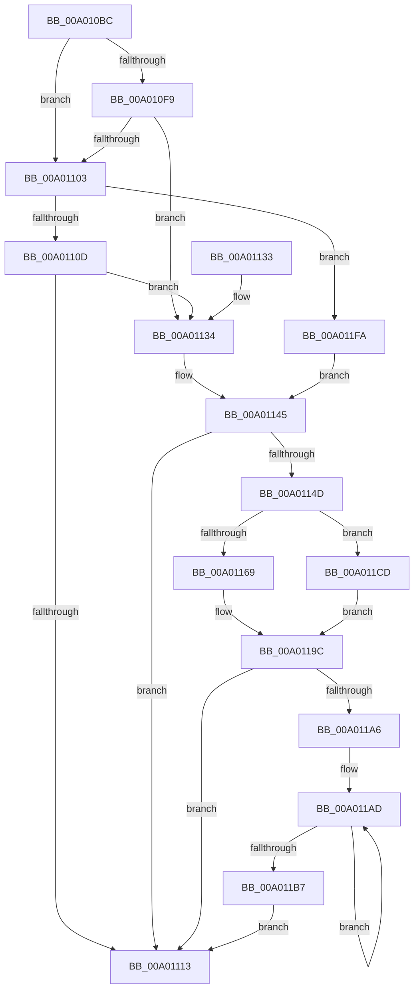

# LocalGetAceCondition

- RVA: `0x00A010BC`–`0x00A01225` (길이 `361` bytes)
- VA: `0x0000000140A010BC`
- 실행 섹션: `PAGE`
- PDB 이름 있음: `예`; PDB Function 태그: `아니요`
- unwind 정보 RVA: `0x000A7DBC`
- 디코드: `99`개 명령, `361/361` bytes 표시
- 미해석 바이트: `0` (있으면 어셈블리에 `.byte`로 보존)

> 이 문서는 커널 이미지의 기계어와 PDB 기호를 분석해 생성했습니다. 4번과 5번은 함수 원형과 자료형을 바이너리 사용 방식에서 추정한 C 해석이며 원본 소스 복구 결과는 아닙니다.

## 1. Dependencies

- 직접 호출 지점: **5**; 고유 호출 대상: **3**
- 직접 호출자로 확인된 함수: **1**
- RIP 상대 이미지 참조: **0**

### Outgoing calls
- `0x00A01137` → [RtlLengthSid](../../text/45/RtlLengthSid_function_0045D270.md) (function, `0x0045D270`)
- `0x00A01150` → [RtlLengthSid](../../text/45/RtlLengthSid_function_0045D270.md) (function, `0x0045D270`)
- `0x00A01197` → [LocalpGetStringForCondition](LocalpGetStringForCondition_function_00A0122C.md) (function, `0x00A0122C`)
- `0x00A011F3` → [LocalGetStringForRelativeAttribute](LocalGetStringForRelativeAttribute_function_00A02C38.md) (function, `0x00A02C38`)
- `0x00A01200` → [RtlLengthSid](../../text/45/RtlLengthSid_function_0045D270.md) (function, `0x0045D270`)

### Direct callers
- [LocalConvertAclToString](LocalConvertAclToString_function_00A00408.md) at `0x00A00723`
- [LocalConvertAclToString](LocalConvertAclToString_function_00A00408.md) at `0x00A009DF`

### Static image references
- 디코드된 RIP-relative 메모리 참조가 없습니다.

## 2. Other-region calls and transfers

- 다른 실행 섹션으로 향하는 call: **3**
  - `0x00A01137` → [RtlLengthSid](../../text/45/RtlLengthSid_function_0045D270.md) (`PAGE` → `.text`)
  - `0x00A01150` → [RtlLengthSid](../../text/45/RtlLengthSid_function_0045D270.md) (`PAGE` → `.text`)
  - `0x00A01200` → [RtlLengthSid](../../text/45/RtlLengthSid_function_0045D270.md) (`PAGE` → `.text`)
- 별도 외부 분기/꼬리 이동을 확인하지 못했습니다.

## 3. Assembly (complete function range)

```asm
00A010BC  48 89 5C 24 08                  mov qword ptr [rsp + 8], rbx
00A010C1  48 89 6C 24 10                  mov qword ptr [rsp + 0x10], rbp
00A010C6  48 89 74 24 18                  mov qword ptr [rsp + 0x18], rsi
00A010CB  57                              push rdi
00A010CC  41 54                           push r12
00A010CE  41 55                           push r13
00A010D0  41 56                           push r14
00A010D2  41 57                           push r15
00A010D4  48 83 EC 40                     sub rsp, 0x40
00A010D8  0F B6 31                        movzx esi, byte ptr [rcx]
00A010DB  45 33 ED                        xor r13d, r13d
00A010DE  4D 89 28                        mov qword ptr [r8], r13
00A010E1  4D 8B E1                        mov r12, r9
00A010E4  45 89 29                        mov dword ptr [r9], r13d
00A010E7  4D 8B F8                        mov r15, r8
00A010EA  4C 8B F2                        mov r14, rdx
00A010ED  48 8B F9                        mov rdi, rcx
00A010F0  41 8B ED                        mov ebp, r13d
00A010F3  40 80 FE 12                     cmp sil, 0x12
00A010F7  77 0A                           ja 0x140a01103
00A010F9  B9 00 26 04 00                  mov ecx, 0x42600
00A010FE  0F A3 F1                        bt ecx, esi
00A01101  72 31                           jb 0x140a01134
00A01103  40 80 FE 0B                     cmp sil, 0xb
00A01107  0F 84 ED 00 00 00               je 0x140a011fa
00A0110D  40 80 FE 15                     cmp sil, 0x15
00A01111  74 21                           je 0x140a01134
00A01113  4C 8D 5C 24 40                  lea r11, [rsp + 0x40]
00A01118  8B C5                           mov eax, ebp
00A0111A  49 8B 5B 30                     mov rbx, qword ptr [r11 + 0x30]
00A0111E  49 8B 6B 38                     mov rbp, qword ptr [r11 + 0x38]
00A01122  49 8B 73 40                     mov rsi, qword ptr [r11 + 0x40]
00A01126  49 8B E3                        mov rsp, r11
00A01129  41 5F                           pop r15
00A0112B  41 5E                           pop r14
00A0112D  41 5D                           pop r13
00A0112F  41 5C                           pop r12
00A01131  5F                              pop rdi
00A01132  C3                              ret
00A01133  CC                              int3
00A01134  49 8B CE                        mov rcx, r14
00A01137  E8 34 C1 A5 FF                  call 0x14045d270
00A0113C  0F B7 7F 02                     movzx edi, word ptr [rdi + 2]
00A01140  2B F8                           sub edi, eax
00A01142  83 EF 08                        sub edi, 8
00A01145  41 89 3C 24                     mov dword ptr [r12], edi
00A01149  85 FF                           test edi, edi
00A0114B  74 C6                           je 0x140a01113
00A0114D  49 8B CE                        mov rcx, r14
00A01150  E8 1B C1 A5 FF                  call 0x14045d270
00A01155  8B C8                           mov ecx, eax
00A01157  8B D7                           mov edx, edi
00A01159  8A 84 24 B0 00 00 00            mov al, byte ptr [rsp + 0xb0]
00A01160  49 03 CE                        add rcx, r14
00A01163  40 80 FE 12                     cmp sil, 0x12
00A01167  74 64                           je 0x140a011cd
00A01169  88 44 24 38                     mov byte ptr [rsp + 0x38], al
00A0116D  4D 8B C7                        mov r8, r15
00A01170  48 8B 84 24 A8 00 00 00         mov rax, qword ptr [rsp + 0xa8]
00A01178  48 89 44 24 30                  mov qword ptr [rsp + 0x30], rax
00A0117D  48 8B 84 24 A0 00 00 00         mov rax, qword ptr [rsp + 0xa0]
00A01185  48 89 44 24 28                  mov qword ptr [rsp + 0x28], rax
00A0118A  48 8B 84 24 98 00 00 00         mov rax, qword ptr [rsp + 0x98]
00A01192  48 89 44 24 20                  mov qword ptr [rsp + 0x20], rax
00A01197  E8 90 00 00 00                  call 0x140a0122c
00A0119C  8B E8                           mov ebp, eax
00A0119E  85 C0                           test eax, eax
00A011A0  0F 85 6D FF FF FF               jne 0x140a01113
00A011A6  49 8B 07                        mov rax, qword ptr [r15]
00A011A9  48 83 C9 FF                     or rcx, 0xffffffffffffffff
00A011AD  48 FF C1                        inc rcx
00A011B0  66 44 39 2C 48                  cmp word ptr [rax + rcx*2], r13w
00A011B5  75 F6                           jne 0x140a011ad
00A011B7  48 8B 84 24 90 00 00 00         mov rax, qword ptr [rsp + 0x90]
00A011BF  8D 0C 4D 02 00 00 00            lea ecx, [rcx*2 + 2]
00A011C6  01 08                           add dword ptr [rax], ecx
00A011C8  E9 46 FF FF FF                  jmp 0x140a01113
00A011CD  4C 8B 8C 24 A0 00 00 00         mov r9, qword ptr [rsp + 0xa0]
00A011D5  4C 8B 84 24 98 00 00 00         mov r8, qword ptr [rsp + 0x98]
00A011DD  4C 89 7C 24 30                  mov qword ptr [rsp + 0x30], r15
00A011E2  88 44 24 28                     mov byte ptr [rsp + 0x28], al
00A011E6  48 8B 84 24 A8 00 00 00         mov rax, qword ptr [rsp + 0xa8]
00A011EE  48 89 44 24 20                  mov qword ptr [rsp + 0x20], rax
00A011F3  E8 40 1A 00 00                  call 0x140a02c38
00A011F8  EB A2                           jmp 0x140a0119c
00A011FA  8B 5F 08                        mov ebx, dword ptr [rdi + 8]
00A011FD  49 8B CE                        mov rcx, r14
00A01200  E8 6B C0 A5 FF                  call 0x14045d270
00A01205  0F B7 7F 02                     movzx edi, word ptr [rdi + 2]
00A01209  8B CB                           mov ecx, ebx
00A0120B  83 E1 01                        and ecx, 1
00A0120E  83 E3 02                        and ebx, 2
00A01211  C1 E1 04                        shl ecx, 4
00A01214  2B F9                           sub edi, ecx
00A01216  C1 E3 03                        shl ebx, 3
00A01219  2B FB                           sub edi, ebx
00A0121B  2B F8                           sub edi, eax
00A0121D  83 EF 0C                        sub edi, 0xc
00A01220  E9 20 FF FF FF                  jmp 0x140a01145
```

## 4. C-style interpretation (structured pseudocode)

```c
__int64 __fastcall LocalGetAceCondition(__int64 a1, __int64 a2, __int64 a3, __int64 a4, __int64 a5, __int64 a6, __int64 a7, __int64 a8, unsigned __int8 a9)
{
    __int64 result;
    __int64 v_r13;
    __int64 v_rbx;
    __int64 v_rdi;
    __int64 v_rsp;
    unsigned __int64 v_stack_m10;
    unsigned __int64 v_stack_m18;
    unsigned __int64 v_stack_m20;
    unsigned __int64 v_stack_m28;
    unsigned __int8 v_stack_m8;
    unsigned __int64 v_stack_p10;
    unsigned __int64 v_stack_p18;
    unsigned __int64 v_stack_p8;

    v_stack_p8 = v_rbx;
    v_stack_p10 = v_rbp;
    v_stack_p18 = v_rsi;
    v_rsp = (v_rsp) - (64);
    v_r13 = 0;
    *(unsigned __int64 *)(a3) = 0;
    *(unsigned int *)(a4) = 0;
    if (((unsigned __int8)(*(unsigned __int8 *)(a1))) > 18) goto loc_00A01103;
    if (((unsigned __int8)(*(unsigned __int8 *)(a1))) < 18) goto loc_00A01134;
loc_00A01103:
    if (((unsigned __int8)(*(unsigned __int8 *)(a1))) == 11) goto loc_00A011FA;
    if (((unsigned __int8)(*(unsigned __int8 *)(a1))) == 21) goto loc_00A01134;
loc_00A01113:
    return 0;
loc_00A01134:
    result = RtlLengthSid(a2, a2, a3, a4);
    v_rdi = (unsigned int)((*(unsigned __int16 *)(a1 + 2)) - ((unsigned int)(result)));
    v_rdi = (unsigned int)((v_rdi) - (8));
loc_00A01145:
    *(unsigned int *)(a4) = (unsigned int)(v_rdi);
    if ((unsigned int)(v_rdi) == 0) goto loc_00A01113;
    result = RtlLengthSid(a2, a2, a3, a4);
    a1 = ((unsigned int)((unsigned int)(result))) + (a2);
    if (((unsigned __int8)(*(unsigned __int64 *)(v_stack_m28 + 64))) == 18) goto loc_00A011CD;
    v_stack_m8 = a9;
    v_stack_m10 = a8;
    v_stack_m18 = a7;
    v_stack_m20 = a6;
    result = LocalpGetStringForCondition(a1, (unsigned int)((unsigned int)(v_rdi)), a3, a4);
loc_00A0119C:
    if ((unsigned int)(result) != 0) goto loc_00A01113;
    a1 = (a1) | (-1);
loc_00A011AD:
    a1 = (a1) + 1;
    if ((*(unsigned __int16 *)(*(unsigned __int64 *)(a3) + a1 * 2)) != 0) goto loc_00A011AD;
    goto loc_00A01113;
loc_00A011CD:
    v_stack_m10 = a3;
    v_stack_m18 = (unsigned __int8)(a5);
    v_stack_m20 = a8;
    result = LocalGetStringForRelativeAttribute(a1 * 2 + 2, (unsigned int)((unsigned int)(v_rdi)), a6, a7);
    goto loc_00A0119C;
loc_00A011FA:
    result = RtlLengthSid(a2, (unsigned int)((unsigned int)(v_rdi)), a6, a7);
    a1 = (unsigned int)(((unsigned int)((unsigned int)((unsigned int)(*(unsigned int *)(v_rdi + 8))))) & (1));
    v_rbx = (unsigned int)(((unsigned int)(*(unsigned int *)(v_rdi + 8))) & (2));
    a1 = (unsigned int)((a1) << (4));
    v_rdi = (unsigned int)((*(unsigned __int16 *)(v_rdi + 2)) - ((unsigned int)(a1)));
    v_rbx = (unsigned int)((v_rbx) << (3));
    v_rdi = (unsigned int)((v_rdi) - ((unsigned int)(v_rbx)));
    v_rdi = (unsigned int)((v_rdi) - ((unsigned int)(result)));
    v_rdi = (unsigned int)((v_rdi) - (12));
    goto loc_00A01145;
}
```

## 5. (Beta) C Style

```c
int64_t LocalGetAceCondition(void *Arg1, int64_t Arg2, void *Arg3, void *Arg4, void *Arg5, int64_t Arg6, int64_t Arg7, int64_t Arg8, uint8_t Arg9)
{
    uint8_t *arg1 = (uint8_t *)Arg1;
    uint8_t *arg3 = (uint8_t *)Arg3;
    uint8_t *arg4 = (uint8_t *)Arg4;
    uint8_t *arg5 = (uint8_t *)Arg5;

    int64_t result;
    int64_t local_r13;
    int64_t local_rbx;
    int64_t local_rdi;
    int64_t local_rsp;
    uint64_t v_stack_m10;
    uint64_t v_stack_m18;
    uint64_t v_stack_m20;
    uint64_t v_stack_m28;
    uint8_t v_stack_m8;
    uint64_t v_stack_p10;
    uint64_t v_stack_p18;
    uint64_t v_stack_p8;

    v_stack_p8 = local_rbx;
    v_stack_p10 = local_rbp;
    v_stack_p18 = local_rsi;
    local_rsp = (local_rsp) - (64);
    local_r13 = 0;
    *(uint64_t *)(arg3) = 0;
    *(uint32_t *)(arg4) = 0;
    if (((uint8_t)(*(uint8_t *)(arg1))) > 18) goto loc_00A01103;
    if (((uint8_t)(*(uint8_t *)(arg1))) < 18) goto loc_00A01134;
loc_00A01103:
    if (((uint8_t)(*(uint8_t *)(arg1))) == 11) goto loc_00A011FA;
    if (((uint8_t)(*(uint8_t *)(arg1))) == 21) goto loc_00A01134;
loc_00A01113:
    return 0;
loc_00A01134:
    result = RtlLengthSid(Arg2, Arg2, Arg3, Arg4);
    local_rdi = (uint32_t)((*(uint16_t *)(arg1 + 0x2)) - ((uint32_t)(result)));
    local_rdi = (uint32_t)((local_rdi) - (8));
loc_00A01145:
    *(uint32_t *)(arg4) = (uint32_t)(local_rdi);
    if ((uint32_t)(local_rdi) == 0) goto loc_00A01113;
    result = RtlLengthSid(Arg2, Arg2, Arg3, Arg4);
    Arg1 = ((uint32_t)((uint32_t)(result))) + (Arg2);
    if (((uint8_t)(*(uint64_t *)(v_stack_m28 + 0x40))) == 18) goto loc_00A011CD;
    v_stack_m8 = Arg9;
    v_stack_m10 = Arg8;
    v_stack_m18 = Arg7;
    v_stack_m20 = Arg6;
    result = LocalpGetStringForCondition(Arg1, (uint32_t)((uint32_t)(local_rdi)), Arg3, Arg4);
loc_00A0119C:
    if ((uint32_t)(result) != 0) goto loc_00A01113;
    Arg1 = (Arg1) | (-1);
loc_00A011AD:
    Arg1 = (Arg1) + 1;
    if ((*(uint16_t *)(*(uint64_t *)(arg3) + arg1 * 2)) != 0) goto loc_00A011AD;
    goto loc_00A01113;
loc_00A011CD:
    v_stack_m10 = Arg3;
    v_stack_m18 = (uint8_t)(Arg5);
    v_stack_m20 = Arg8;
    result = LocalGetStringForRelativeAttribute(Arg1 * 2 + 2, (uint32_t)((uint32_t)(local_rdi)), Arg6, Arg7);
    goto loc_00A0119C;
loc_00A011FA:
    result = RtlLengthSid(Arg2, (uint32_t)((uint32_t)(local_rdi)), Arg6, Arg7);
    Arg1 = (uint32_t)(((uint32_t)((uint32_t)((uint32_t)(*(uint32_t *)(local_rdi + 0x8))))) & (1));
    local_rbx = (uint32_t)(((uint32_t)(*(uint32_t *)(local_rdi + 0x8))) & (2));
    Arg1 = (uint32_t)((Arg1) << (4));
    local_rdi = (uint32_t)((*(uint16_t *)(local_rdi + 0x2)) - ((uint32_t)(Arg1)));
    local_rbx = (uint32_t)((local_rbx) << (3));
    local_rdi = (uint32_t)((local_rdi) - ((uint32_t)(local_rbx)));
    local_rdi = (uint32_t)((local_rdi) - ((uint32_t)(result)));
    local_rdi = (uint32_t)((local_rdi) - (12));
    goto loc_00A01145;
}
```

### 관측된 메모리 오프셋

구조체 형식이 확인되지 않은 접근은 인자 기준의 오프셋으로만 기록했습니다.

| 기준 인자 | 오프셋 표현 | 폭 (bit) | 접근 |
|---|---:|---:|---|
| `Arg1` | `+ 0x0` | `8` | `R` |
| `Arg1` | `+ 0x2` | `16` | `R` |
| `Arg1` | `+ 0x8` | `32` | `R` |
| `Arg3` | `+ 0x0` | `64` | `R` |
| `Arg3` | `+ 0x0` | `64` | `W` |
| `Arg4` | `+ 0x0` | `32` | `W` |
| `Arg5` | `+ 0x0` | `32` | `R/W` |

## 6. Execution-region graph

[열기: 2D/3D 그래프와 함수 탐색 컨트롤 패널](../../../control-panel.html?section=page&rva=0x00A010BC&view=graph)

- 2D 그래프는 위에서 아래로 흐르고, 3D 그래프는 빈 공간을 드래그해 회전합니다. Shift+드래그는 이동, 휠은 확대·축소, 함수 노드 선택은 대상 보고서 이동입니다.

### Static fallback


