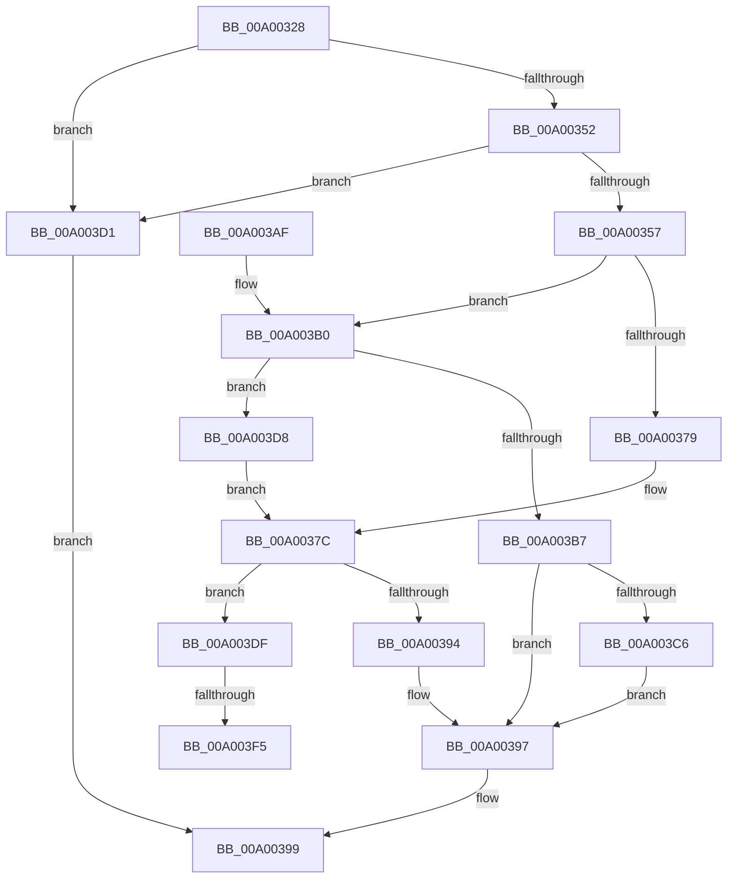

# LocalGetStringForSid

- RVA: `0x00A00328`–`0x00A00401` (길이 `217` bytes)
- VA: `0x0000000140A00328`
- 실행 섹션: `PAGE`
- PDB 이름 있음: `예`; PDB Function 태그: `예`
- unwind 정보 RVA: `0x000A7D64`
- 디코드: `64`개 명령, `217/217` bytes 표시
- 미해석 바이트: `0` (있으면 어셈블리에 `.byte`로 보존)

> 이 문서는 커널 이미지의 기계어와 PDB 기호를 분석해 생성했습니다. 4번과 5번은 함수 원형과 자료형을 바이너리 사용 방식에서 추정한 C 해석이며 원본 소스 복구 결과는 아닙니다.

## 1. Dependencies

- 직접 호출 지점: **4**; 고유 호출 대상: **4**
- 직접 호출자로 확인된 함수: **3**
- RIP 상대 이미지 참조: **1**

### Outgoing calls
- `0x00A0036C` → [LookupSidInTable](../92/LookupSidInTable_function_009293C0.md) (function, `0x009293C0`)
- `0x00A00387` → [SddlpAlloc](../92/SddlpAlloc_function_00925F88.md) (function, `0x00925F88`)
- `0x00A003BD` → [LocalConvertSidToStringSidW](LocalConvertSidToStringSidW_function_00A0191C.md) (function, `0x00A0191C`)
- `0x00A003C8` → [RtlNtStatusToDosError](../92/RtlNtStatusToDosError_function_00926C40.md) (function, `0x00926C40`)

### Direct callers
- [LocalConvertSDToStringSD_Rev1](../92/LocalConvertSDToStringSD_Rev1_function_00924428.md) at `0x0092483F`
- [LocalConvertSDToStringSD_Rev1](../92/LocalConvertSDToStringSD_Rev1_function_00924428.md) at `0x0092498E`
- [LocalGetStringForRelativeAttribute](LocalGetStringForRelativeAttribute_function_00A02C38.md) at `0x00A02EDE`
- [LocalGetStringForRelativeAttribute](LocalGetStringForRelativeAttribute_function_00A02C38.md) at `0x00A03257`
- [sub_00B32AA2](../B3/Unknown_function_00B32AA2.md) at `0x00B32B10`

### Static image references
- `0x00A003F5` → RVA `0x00011CF4` (`.rdata`; read)

## 2. Other-region calls and transfers

- 다른 실행 섹션으로 향하는 call: **0**
- call이 아닌 외부 분기/꼬리 이동: **2**
  - `0x00A003EF` → [sub_00B327AA](../B3/Unknown_function_00B327AA.md) (`tail-transfer`)
  - `0x00A003FC` → [sub_00B327AA](../B3/Unknown_function_00B327AA.md) (`tail-transfer`)

## 3. Assembly (complete function range)

```asm
00A00328  4C 8B DC                        mov r11, rsp
00A0032B  49 89 5B 08                     mov qword ptr [r11 + 8], rbx
00A0032F  49 89 73 10                     mov qword ptr [r11 + 0x10], rsi
00A00333  49 89 7B 18                     mov qword ptr [r11 + 0x18], rdi
00A00337  4D 89 4B 20                     mov qword ptr [r11 + 0x20], r9
00A0033B  41 56                           push r14
00A0033D  48 83 EC 40                     sub rsp, 0x40
00A00341  33 DB                           xor ebx, ebx
00A00343  4C 8B F2                        mov r14, rdx
00A00346  49 89 5B 20                     mov qword ptr [r11 + 0x20], rbx
00A0034A  48 8B F9                        mov rdi, rcx
00A0034D  48 85 C9                        test rcx, rcx
00A00350  74 7F                           je 0x140a003d1
00A00352  48 85 D2                        test rdx, rdx
00A00355  74 7A                           je 0x140a003d1
00A00357  49 8D 43 20                     lea rax, [r11 + 0x20]
00A0035B  48 8B D1                        mov rdx, rcx
00A0035E  49 89 43 E8                     mov qword ptr [r11 - 0x18], rax
00A00362  33 C9                           xor ecx, ecx
00A00364  8A 44 24 78                     mov al, byte ptr [rsp + 0x78]
00A00368  88 44 24 28                     mov byte ptr [rsp + 0x28], al
00A0036C  E8 4F 90 F2 FF                  call 0x1409293c0
00A00371  48 8B F0                        mov rsi, rax
00A00374  48 85 C0                        test rax, rax
00A00377  74 37                           je 0x140a003b0
00A00379  8B 40 0C                        mov eax, dword ptr [rax + 0xc]
00A0037C  48 8D 3C 45 02 00 00 00         lea rdi, [rax*2 + 2]
00A00384  48 8B CF                        mov rcx, rdi
00A00387  E8 FC 5B F2 FF                  call 0x140925f88
00A0038C  49 89 06                        mov qword ptr [r14], rax
00A0038F  48 85 C0                        test rax, rax
00A00392  75 4B                           jne 0x140a003df
00A00394  8D 58 08                        lea ebx, [rax + 8]
00A00397  8B C3                           mov eax, ebx
00A00399  48 8B 5C 24 50                  mov rbx, qword ptr [rsp + 0x50]
00A0039E  48 8B 74 24 58                  mov rsi, qword ptr [rsp + 0x58]
00A003A3  48 8B 7C 24 60                  mov rdi, qword ptr [rsp + 0x60]
00A003A8  48 83 C4 40                     add rsp, 0x40
00A003AC  41 5E                           pop r14
00A003AE  C3                              ret
00A003AF  CC                              int3
00A003B0  48 39 5C 24 68                  cmp qword ptr [rsp + 0x68], rbx
00A003B5  75 21                           jne 0x140a003d8
00A003B7  49 8B D6                        mov rdx, r14
00A003BA  48 8B CF                        mov rcx, rdi
00A003BD  E8 5A 15 00 00                  call 0x140a0191c
00A003C2  85 C0                           test eax, eax
00A003C4  79 D1                           jns 0x140a00397
00A003C6  8B C8                           mov ecx, eax
00A003C8  E8 73 68 F2 FF                  call 0x140926c40
00A003CD  8B D8                           mov ebx, eax
00A003CF  EB C6                           jmp 0x140a00397
00A003D1  B8 57 00 00 00                  mov eax, 0x57
00A003D6  EB C1                           jmp 0x140a00399
00A003D8  B8 02 00 00 00                  mov eax, 2
00A003DD  EB 9D                           jmp 0x140a0037c
00A003DF  48 D1 EF                        shr rdi, 1
00A003E2  4C 8D 46 02                     lea r8, [rsi + 2]
00A003E6  48 8B D7                        mov rdx, rdi
00A003E9  48 8B C8                        mov rcx, rax
00A003EC  48 85 F6                        test rsi, rsi
00A003EF  0F 85 B5 23 13 00               jne 0x140b327aa
00A003F5  4C 8D 05 F8 18 61 FF            lea r8, [rip - 0x9ee708]
00A003FC  E9 A9 23 13 00                  jmp 0x140b327aa
```

## 4. C-style interpretation (structured pseudocode)

```c
__int64 __fastcall LocalGetStringForSid(__int64 a1, __int64 a2, __int64 a3, __int64 a4, __int64 a5, unsigned __int8 a6)
{
    __int64 result;
    __int64 v_rbx;
    __int64 v_rdi;
    __int64 v_rsp;
    unsigned __int8 v_stack_m20;
    unsigned __int64 v_stack_p10;
    unsigned __int64 v_stack_p18;
    unsigned __int64 v_stack_p68;
    unsigned __int64 v_stack_p8;

    *(unsigned __int64 *)(v_rsp + 8) = v_rbx;
    *(unsigned __int64 *)(v_rsp + 16) = v_rsi;
    *(unsigned __int64 *)(v_rsp + 24) = v_rdi;
    *(unsigned __int64 *)(v_rsp + 32) = a4;
    v_rsp = (v_rsp) - (64);
    v_rbx = 0;
    *(unsigned __int64 *)(v_rsp + 32) = 0;
    if (a1 == 0) goto loc_00A003D1;
    if (a2 == 0) goto loc_00A003D1;
    *(unsigned __int64 *)(v_rsp - 24) = v_rsp + 32;
    a1 = 0;
    v_stack_m20 = a6;
    result = LookupSidInTable(a1, a1, a3, a4);
    if (result == 0) goto loc_00A003B0;
loc_00A0037C:
    result = SddlpAlloc((unsigned int)(*(unsigned int *)(result + 12)) * 2 + 2, a1, a3, a4);
    *(unsigned __int64 *)(a2) = result;
    if (result != 0) goto loc_00A003DF;
loc_00A00397:
loc_00A00399:
    v_rsp = (v_rsp) + (64);
    return (unsigned int)((unsigned int)(result + 8));
loc_00A003B0:
    if (v_stack_p68 != v_stack_p8) goto loc_00A003D8;
    result = LocalConvertSidToStringSidW(v_stack_p18, a2, a3, a4);
    if (!sign_flag) goto loc_00A00397;
    result = RtlNtStatusToDosError((unsigned int)((unsigned int)(result)), a2, a3, a4);
    goto loc_00A00397;
loc_00A003D1:
    goto loc_00A00399;
loc_00A003D8:
    goto loc_00A0037C;
loc_00A003DF:
    v_rdi = (v_stack_p18) >> (1);
}
```

## 5. (Beta) C Style

```c
int64_t LocalGetStringForSid(int64_t Arg1, void *Arg2, int64_t Arg3, int64_t Arg4, uint64_t Arg5, uint8_t Arg6)
{
    uint8_t *arg2 = (uint8_t *)Arg2;

    int64_t result;
    int64_t local_rbx;
    int64_t local_rdi;
    int64_t local_rsp;
    uint8_t v_stack_m20;
    uint64_t v_stack_p10;
    uint64_t v_stack_p18;
    uint64_t v_stack_p68;
    uint64_t v_stack_p8;

    *(uint64_t *)(local_rsp + 0x8) = local_rbx;
    *(uint64_t *)(local_rsp + 0x10) = local_rsi;
    *(uint64_t *)(local_rsp + 0x18) = local_rdi;
    *(uint64_t *)(local_rsp + 0x20) = Arg4;
    local_rsp = (local_rsp) - (64);
    local_rbx = 0;
    *(uint64_t *)(local_rsp + 0x20) = 0;
    if (Arg1 == 0) goto loc_00A003D1;
    if (Arg2 == NULL) goto loc_00A003D1;
    *(uint64_t *)(local_rsp - 0x18) = local_rsp + 32;
    Arg1 = 0;
    v_stack_m20 = Arg6;
    result = LookupSidInTable(Arg1, Arg1, Arg3, Arg4);
    if (result == 0) goto loc_00A003B0;
loc_00A0037C:
    result = SddlpAlloc((uint32_t)(*(uint32_t *)(result + 0xC)) * 2 + 2, Arg1, Arg3, Arg4);
    *(uint64_t *)(arg2) = result;
    if (result != 0) goto loc_00A003DF;
loc_00A00397:
loc_00A00399:
    local_rsp = (local_rsp) + (64);
    return (uint32_t)((uint32_t)(result + 8));
loc_00A003B0:
    if (v_stack_p68 != v_stack_p8) goto loc_00A003D8;
    result = LocalConvertSidToStringSidW(v_stack_p18, Arg2, Arg3, Arg4);
    if (!sign_flag) goto loc_00A00397;
    result = RtlNtStatusToDosError((uint32_t)((uint32_t)(result)), Arg2, Arg3, Arg4);
    goto loc_00A00397;
loc_00A003D1:
    goto loc_00A00399;
loc_00A003D8:
    goto loc_00A0037C;
loc_00A003DF:
    local_rdi = (v_stack_p18) >> (1);
}
```

### 관측된 메모리 오프셋

구조체 형식이 확인되지 않은 접근은 인자 기준의 오프셋으로만 기록했습니다.

| 기준 인자 | 오프셋 표현 | 폭 (bit) | 접근 |
|---|---:|---:|---|
| `Arg2` | `+ 0x0` | `64` | `W` |

## 6. Execution-region graph

[열기: 2D/3D 그래프와 함수 탐색 컨트롤 패널](../../../control-panel.html?section=page&rva=0x00A00328&view=graph)

- 2D 그래프는 위에서 아래로 흐르고, 3D 그래프는 빈 공간을 드래그해 회전합니다. Shift+드래그는 이동, 휠은 확대·축소, 함수 노드 선택은 대상 보고서 이동입니다.

### Static fallback


