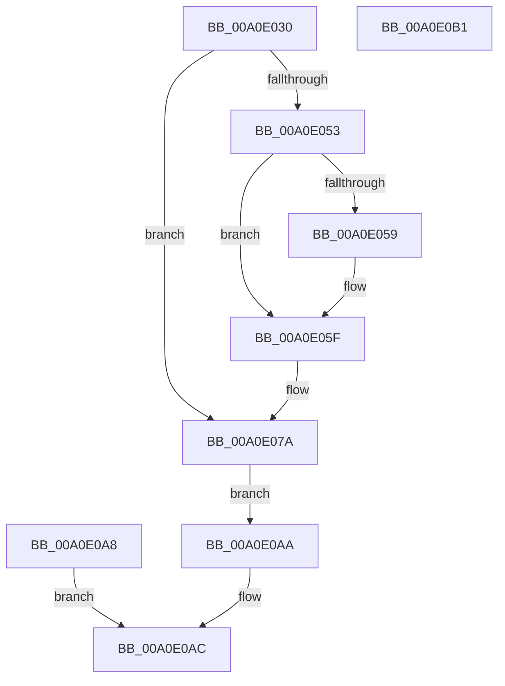

# NtAllocateLocallyUniqueId

- RVA: `0x00A0E030`–`0x00A0E0B2` (길이 `130` bytes)
- VA: `0x0000000140A0E030`
- 실행 섹션: `PAGE`
- PDB 이름 있음: `예`; PDB Function 태그: `아니요`
- unwind 정보 RVA: `0x000A8D10`
- 디코드: `34`개 명령, `130/130` bytes 표시
- 미해석 바이트: `0` (있으면 어셈블리에 `.byte`로 보존)

> 이 문서는 커널 이미지의 기계어와 PDB 기호를 분석해 생성했습니다. 4번과 5번은 함수 원형과 자료형을 바이너리 사용 방식에서 추정한 C 해석이며 원본 소스 복구 결과는 아닙니다.

## 1. Dependencies

- 직접 호출 지점: **1**; 고유 호출 대상: **1**
- 직접 호출자로 확인된 함수: **0**
- RIP 상대 이미지 참조: **2**

### Outgoing calls
- `0x00A0E059` → [ExRaiseDatatypeMisalignment](../89/ExRaiseDatatypeMisalignment_function_00899FD0.md) (function, `0x00899FD0`)

### Direct callers
- 이 함수 시작 RVA로 연결되는 직접 call은 확인되지 않았습니다. 간접 호출은 완전히 역산할 수 없습니다.

### Static image references
- `0x00A0E080` → RVA `0x00012D08` (`.rdata`; read)
- `0x00A0E08A` → RVA `0x00E0EBF0` (`.data`; read/write)

## 2. Other-region calls and transfers

- 다른 실행 섹션으로 향하는 call: **0**
- 별도 외부 분기/꼬리 이동을 확인하지 못했습니다.

## 3. Assembly (complete function range)

```asm
00A0E030  48 83 EC 38                     sub rsp, 0x38
00A0E034  4C 8B C1                        mov r8, rcx
00A0E037  65 48 8B 04 25 88 01 00 00      mov rax, qword ptr gs:[0x188]
00A0E040  48 89 44 24 58                  mov qword ptr [rsp + 0x58], rax
00A0E045  8A 90 32 02 00 00               mov dl, byte ptr [rax + 0x232]
00A0E04B  88 54 24 48                     mov byte ptr [rsp + 0x48], dl
00A0E04F  84 D2                           test dl, dl
00A0E051  74 27                           je 0x140a0e07a
00A0E053  41 F6 C0 03                     test r8b, 3
00A0E057  74 06                           je 0x140a0e05f
00A0E059  E8 72 BF E8 FF                  call 0x140899fd0
00A0E05E  CC                              int3
00A0E05F  48 B9 00 00 FF FF FF 7F 00 00   movabs rcx, 0x7fffffff0000
00A0E069  4C 3B C1                        cmp r8, rcx
00A0E06C  49 0F 42 C8                     cmovb rcx, r8
00A0E070  8A 01                           mov al, byte ptr [rcx]
00A0E072  88 01                           mov byte ptr [rcx], al
00A0E074  8A 41 07                        mov al, byte ptr [rcx + 7]
00A0E077  88 41 07                        mov byte ptr [rcx + 7], al
00A0E07A  48 83 64 24 50 00               and qword ptr [rsp + 0x50], 0
00A0E080  48 8B 0D 81 4C 60 FF            mov rcx, qword ptr [rip - 0x9fb37f]
00A0E087  48 8B C1                        mov rax, rcx
00A0E08A  F0 48 0F C1 05 5D 0B 40 00      lock xadd qword ptr [rip + 0x400b5d], rax
00A0E093  48 03 C1                        add rax, rcx
00A0E096  48 89 44 24 50                  mov qword ptr [rsp + 0x50], rax
00A0E09B  41 89 00                        mov dword ptr [r8], eax
00A0E09E  48 C1 E8 20                     shr rax, 0x20
00A0E0A2  41 89 40 04                     mov dword ptr [r8 + 4], eax
00A0E0A6  EB 02                           jmp 0x140a0e0aa
00A0E0A8  EB 02                           jmp 0x140a0e0ac
00A0E0AA  33 C0                           xor eax, eax
00A0E0AC  48 83 C4 38                     add rsp, 0x38
00A0E0B0  C3                              ret
00A0E0B1  CC                              int3
```

## 4. C-style interpretation (structured pseudocode)

```c
__int64 __fastcall NtAllocateLocallyUniqueId(__int64 a1)
{
    __int64 result;
    __int64 v_rsp;
    unsigned __int8 v_stack_p10;
    unsigned __int64 v_stack_p18;
    unsigned __int64 v_stack_p20;

    v_rsp = (v_rsp) - (56);
    v_stack_p20 = *(unsigned __int64 *)(gs_base + (0 + 392));
    v_stack_p10 = (unsigned __int8)(*(unsigned __int8 *)(*(unsigned __int64 *)(gs_base + (0 + 392)) + 562));
    if ((unsigned __int8)(*(unsigned __int8 *)(*(unsigned __int64 *)(gs_base + (0 + 392)) + 562)) == 0) goto loc_00A0E07A;
    result = *(unsigned __int64 *)(gs_base + (0 + 392));
    if ((((unsigned __int8)(a1)) & (3)) != 0) {
        result = ExRaiseDatatypeMisalignment(a1, *(unsigned __int8 *)(*(unsigned __int64 *)(gs_base + (0 + 392)) + 562), a1, a4);
    }
    if (a1 < a1) { a1 = a1; }
    *(unsigned __int8 *)(a1) = (unsigned __int8)(*(unsigned __int8 *)(a1));
    *(unsigned __int8 *)(a1 + 7) = (unsigned __int8)(*(unsigned __int8 *)(a1 + 7));
loc_00A0E07A:
    result = (*(unsigned __int64 *)(v_rip - 10466175)) + (*(unsigned __int64 *)(v_rip - 10466175));
    v_stack_p18 = result;
    *(unsigned int *)(a1) = (unsigned int)(result);
    result = (result) >> (32);
    *(unsigned int *)(a1 + 4) = (unsigned int)(result);
    goto loc_00A0E0AA;
loc_00A0E0AA:
    result = 0;
loc_00A0E0AC:
    v_rsp = (v_rsp) + (56);
    return result;
}
```

## 5. (Beta) C Style

```c
int64_t NtAllocateLocallyUniqueId(int64_t Arg1)
{
    int64_t result;
    int64_t local_rsp;
    uint8_t v_stack_p10;
    uint64_t v_stack_p18;
    uint64_t v_stack_p20;

    local_rsp = (local_rsp) - (56);
    v_stack_p20 = *(uint64_t *)(gs_base + (0 + 0x188));
    v_stack_p10 = (uint8_t)(*(uint8_t *)(*(uint64_t *)(gs_base + (0 + 0x188)) + 0x232));
    if ((uint8_t)(*(uint8_t *)(*(uint64_t *)(gs_base + (0 + 0x188)) + 0x232)) == 0) goto loc_00A0E07A;
    result = *(uint64_t *)(gs_base + (0 + 0x188));
    if ((((uint8_t)(Arg1)) & (3)) != 0) {
        result = ExRaiseDatatypeMisalignment(Arg1, *(uint8_t *)(*(uint64_t *)(gs_base + (0 + 0x188)) + 0x232), Arg1, a4);
    }
    if (Arg1 < Arg1) { Arg1 = Arg1; }
    *(uint8_t *)(Arg1) = (uint8_t)(*(uint8_t *)(Arg1));
    *(uint8_t *)(Arg1 + 0x7) = (uint8_t)(*(uint8_t *)(Arg1 + 0x7));
loc_00A0E07A:
    result = (*(uint64_t *)(v_rip - 0x9FB37F)) + (*(uint64_t *)(v_rip - 0x9FB37F));
    v_stack_p18 = result;
    *(uint32_t *)(Arg1) = (uint32_t)(result);
    result = (result) >> (32);
    *(uint32_t *)(Arg1 + 0x4) = (uint32_t)(result);
    goto loc_00A0E0AA;
loc_00A0E0AA:
    result = 0;
loc_00A0E0AC:
    local_rsp = (local_rsp) + (56);
    return result;
}
```

## 6. Execution-region graph

[열기: 2D/3D 그래프와 함수 탐색 컨트롤 패널](../../../control-panel.html?section=page&rva=0x00A0E030&view=graph)

- 2D 그래프는 위에서 아래로 흐르고, 3D 그래프는 빈 공간을 드래그해 회전합니다. Shift+드래그는 이동, 휠은 확대·축소, 함수 노드 선택은 대상 보고서 이동입니다.

### Static fallback


